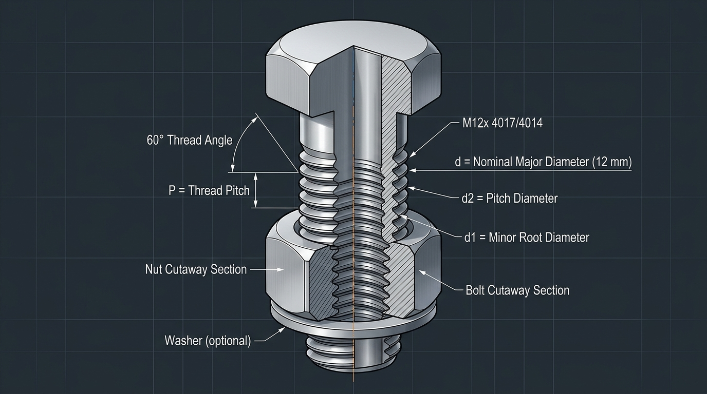
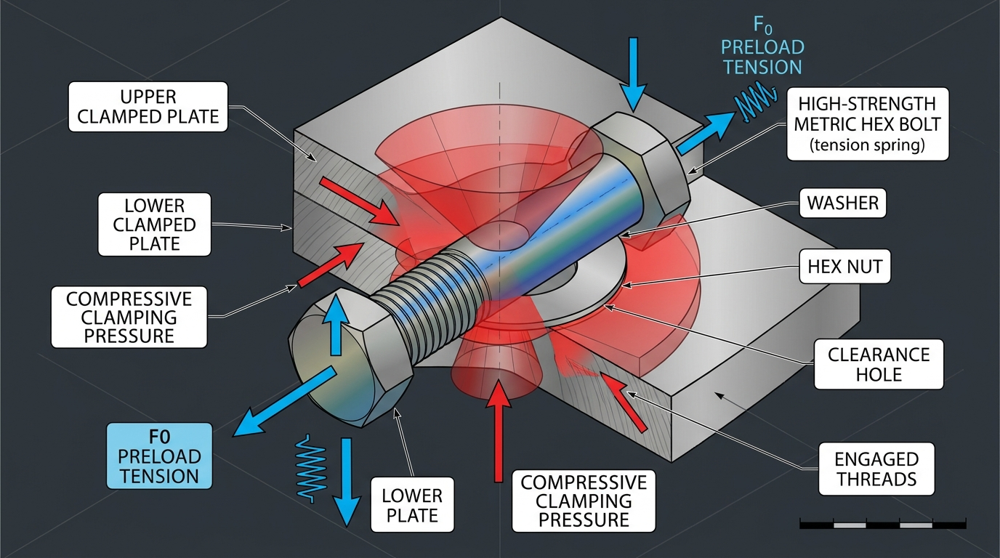
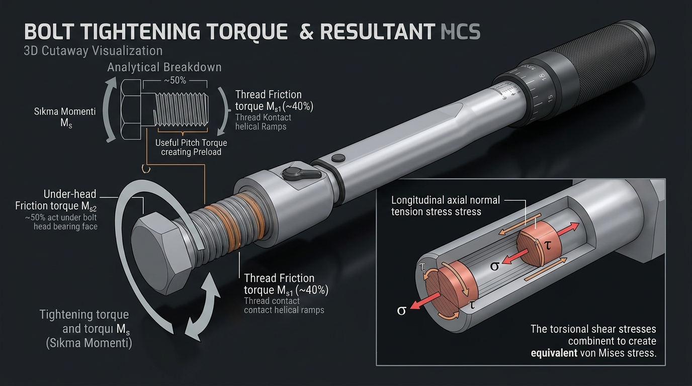
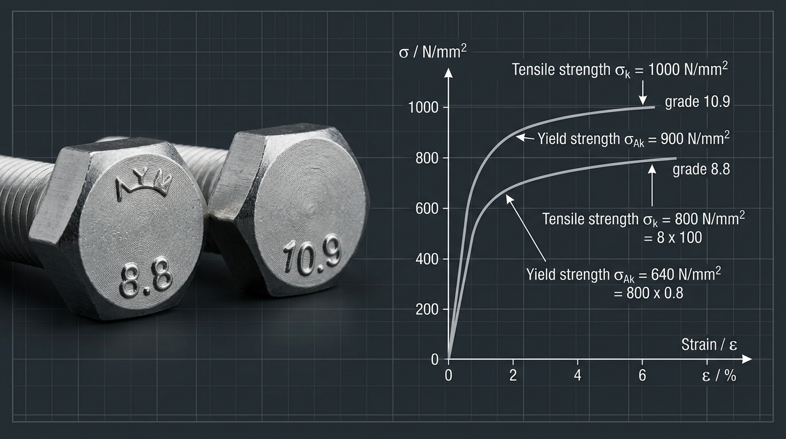

# MAK 3119 MAKİNE ELEMANLARI I: CIVATA BAĞLANTILARI GÖRSEL REHBERİ VE SINAV ÇÖZÜMLERİ

**Bölüm:** Manisa Celal Bayar Üniversitesi - Makine Mühendisliği Bölümü  
**Ders:** MAK 3119 Makine Elemanları I  
**Öğretim Üyeleri:** Prof. Dr. Enver ATİK / Doç. Dr. Can ÇİVİ  
**Hedef:** Vize ve Final Sınavlarında Cıvata Konusunda Tam Puan Almak

---

## 1. BÖLÜM: CIVATA GEOMETRİSİ VE ÇAPLAR

### Temel Tanımlar ve Formüller
* **$d$ (Anma / Dış Çap):** Cıvatanın adıdır (Örn: M12 için $d = 12\text{ mm}$, M16 için $d = 16\text{ mm}$).
* **$d_1$ (Diş Dibi Çapı):** Cıvatanın en zayıf ve en ince yeridir. Eksenel çekme yükünü taşıyan net kesit alanı bu çaptan hesaplanır:
  $$A_1 = \frac{\pi \cdot d_1^2}{4}$$
  *(Cıvata aşırı yükte koparsa daima bu kesitten kopar!)*
* **$d_2$ (Ortalama Çap):** Diş tepesi ile diş dibinin ortalamasıdır:
  $$d_2 \approx \frac{d + d_1}{2}$$
  *(Kuvvet aktarımı ve diş sürtünmesi bu ortalama silindir üzerinde gerçekleşir).*
* **$P$ (Hatve):** İki ardışık diş tepesi arasındaki eksenel mesafedir. Somun 1 tam tur döndüğünde ($360^\circ$) cıvata ekseni boyunca $P$ kadar ilerler.
* **$\alpha$ (Helis Rampası Açısı):**
  $$\tan\alpha = \frac{P}{\pi \cdot d_2}$$
* **$\beta$ (Profil Açısı):** Metrik vidalarda $\beta = 60^\circ$'dir. Diş sürtünme katsayısı:
  $$\mu' = \frac{\mu}{\cos(\beta/2)} = \frac{\mu}{\cos(30^\circ)} \approx 1.155 \cdot \mu$$

---

## 2. BÖLÜM: ÖN GERİLME KUVVETİ ($F_0$) VE BAĞLANTI YAY MODELİ

### Fiziksel Çalışma Prensibi
* **Cıvata bir gergi yayıdır:** Anahtarla somun sıkıldığında cıvatanın gövdesi elastik olarak uzar.
* **Bağlanan parçalar bir baskı yayıdır:** Aradaki levhalar, kapak ve conta ezilerek sıkışır.
* Cıvatanın eski boyuna dönme isteği, aradaki flanşları birbirine **Ön Gerilme Kuvveti ($F_0$)** ile yapıştırır.

### İşletme Yükü Geldiğinde Ne Olur? ($F_0$ ve $F_{iş}$)
Kaba iç basınç veya harici bir çekme yükü ($F_{iş}$) geldiğinde:
* Cıvatanın hissettiği toplam kuvvet:
  $$F_{top} = F_0 + \chi \cdot F_{iş}$$
  *(Burada $\chi \approx 0.15 - 0.25$ cıvata-flanş esneklik faktörüdür).*
* **Sızdırmazlık Şartı (Flanşların Açılmama Kuralı):**
  $$F_{kalan} = F_0 - (1 - \chi) \cdot F_{iş} > 0$$
* **Pratik Sınav Kuralı:** Eğer $F_0$ doğrudan verilmemişse, sızdırmazlığı garanti etmek için:
  $$F_0 = (1.2 \text{ ila } 1.5) \cdot F_{iş}$$
  seçilir.

---

## 3. BÖLÜM: SIKMA MOMENTİ ($M_s$) VE BİLEŞİK GERİLME

### Sıkma Momentinin Dağılımı
Anahtarla uyguladığımız tork ($M_s$) iki direnci yenmek için harcanır:
$$M_s = M_{s1} + M_{s2}$$

1. **$M_{s1}$ (Diş Sürtünme ve Yükselme Momenti):**
   $$M_{s1} = F_0 \cdot \frac{d_2}{2} \cdot \tan(\alpha + \rho')$$
2. **$M_{s2}$ (Kafa / Pul Altı Sürtünme Momenti):**
   $$M_{s2} = F_0 \cdot \mu_0 \cdot \frac{d_o}{2}$$

### Tam Formül:
$$M_s = F_0 \cdot \left[ \frac{d_2}{2} \cdot \tan(\alpha + \rho') + \mu_0 \cdot \frac{d_o}{2} \right]$$

### Yaklaşık Formül (Sınavda Hayat Kurtaran Formül!):
Standart çelik cıvatalarda ($\mu \approx 0.14$):
$$M_s \approx 0.2 \cdot d \cdot F_0$$

*(Örneğin M12 için: $M_s \approx 0.2 \cdot 12 \cdot F_0 = 2.4 \cdot F_0\text{ N.mm}$)*

---

### Sıkma Anında Bileşik Gerilme (Von Mises)
Cıvata sıkılırken aynı anda iki gerilmeye maruz kalır:
1. **Çekme Gerilmesi:** $\sigma = \frac{F_0}{A_1} = \frac{F_0}{\frac{\pi d_1^2}{4}}$
2. **Burulma Gerilmesi:** $\tau = \frac{M_{s1}}{W_p} = \frac{M_{s1}}{\frac{\pi d_1^3}{16}}$

Von Mises Eşdeğer Gerilmesi:
$$\sigma_{eş} = \sqrt{\sigma^2 + 3\tau^2}$$

Pratik hesapta burulma yükü gerilmeyi yaklaşık %30 artırır:
$$\sigma_{eş} \approx 1.3 \cdot \sigma = 1.3 \cdot \frac{F_0}{A_1}$$

**Emniyet Şartı:**
$$\sigma_{eş} \le \sigma_{em} = \frac{\sigma_{Ak}}{S_{em}}$$

---

## 4. BÖLÜM: CIVATA MALZEME KALİTE SINIFLARI

Cıvata kafasındaki numaraların (4.6, 6.8, 8.8, 10.9, 12.9) çözümü:
* **Kopma Mukavemeti ($\sigma_k$):** $\text{1. Sayı} \times 100\text{ N/mm}^2$
* **Akma Mukavemeti ($\sigma_{Ak}$):** $\text{1. Sayı} \times \text{2. Sayı} \times 10\text{ N/mm}^2$

| Kalite Sınıfı | Çekme Mukavemeti ($\sigma_k$) | Akma Mukavemeti ($\sigma_{Ak}$) | Kullanım Alanı |
| :---: | :---: | :---: | :--- |
| **4.6** | $400\text{ N/mm}^2$ | $240\text{ N/mm}^2$ | Hafif konstrüksiyon |
| **6.8** | $600\text{ N/mm}^2$ | $480\text{ N/mm}^2$ | Genel makine imalatı |
| **8.8** | $800\text{ N/mm}^2$ | $640\text{ N/mm}^2$ | **En yaygın standart cıvata (Sınav Klasiği)** |
| **10.9** | $1000\text{ N/mm}^2$ | $900\text{ N/mm}^2$ | Yüksek mukavemetli ağır sanayi / silindir kapağı |
| **12.9** | $1200\text{ N/mm}^2$ | $1080\text{ N/mm}^2$ | Ekstrem yüksek mukavemet |

---

## 5. BÖLÜM: MCBÜ ÇIKMIŞ SINAV SORUSU VE TAM ÇÖZÜMÜ

> **Sınav:** Manisa Celal Bayar Üniversitesi Makine Elemanları I Vize Sınavı  
> **Öğretim Üyesi:** Doç. Dr. Can ÇİVİ  
> **Puan Değeri:** 30 Puan

### Soru Metni:
Şekildeki basınçlı kap kapak bağlantısında cıvata **M12**, Malzeme **8.8** (Diş dibi çapı $d_1 = 9.853\text{ mm}$, hatve $P = 1.75\text{ mm}$, sürtünme katsayısı $\mu = \tan\rho' = 0.14 = \mu_0$). Her bir cıvatanın üzerine $F_{iş} = 25\,000\text{ N}$ ($25\text{ kN}$) işletme kuvveti etki etmektedir. Buna göre:
* **a)** Cıvatadaki gerekli minimum sıkma momentini tam ve yaklaşık olarak bulunuz. (10 Puan)
* **b)** Cıvatanın sıkma esnasında kopmaması için maksimum sıkma momentini yaklaşık olarak belirleyiniz. (10 Puan)
* **c)** Bu işletme kuvveti altında veya gerekli sıkma momenti etkisinde cıvata kopar mı? (10 Puan)

---

### ADIM ADIM TAM SAYISAL ÇÖZÜM

#### 1. Adım: Ön Bilgiler ve Malzeme Değerleri
* M12 Cıvata $\implies d = 12\text{ mm}$, $d_1 = 9.853\text{ mm}$.
* Diş dibi çekme alanı:
  $$A_1 = \frac{\pi \cdot d_1^2}{4} = \frac{\pi \cdot (9.853)^2}{4} = 76.25\text{ mm}^2$$
* Ortalama çap:
  $$d_2 \approx d - 0.6495 \cdot P = 12 - 0.6495(1.75) = 10.86\text{ mm}$$
* 8.8 Kalite Malzeme:
  $$\sigma_k = 8 \times 100 = 800\text{ N/mm}^2$$
  $$\sigma_{Ak} = 8 \times 8 \times 10 = 640\text{ N/mm}^2$$

#### 2. Adım: Gerekli Ön Gerilme Kuvveti ($F_0$)
Basınçlı kapta kapağın açılmaması ve sızdırmazlık için $F_0 = 1.25 \cdot F_{iş}$ kabul edilir:
$$F_0 = 1.25 \times 25\,000 = \mathbf{31\,250\text{ N}}$$

---

#### a) Gerekli Minimum Sıkma Momenti (10 Puan)

* **Yaklaşık Formülle ($M_{s,yaklaşık}$):**
  $$M_{s,yaklaşık} \approx 0.2 \cdot d \cdot F_0$$
  $$M_{s,yaklaşık} = 0.2 \times 12\text{ mm} \times 31\,250\text{ N} = \mathbf{75\,000\text{ N.mm} = 75\text{ N.m}}$$

* **Tam Formülle ($M_{s,tam}$):**
  $$\tan\alpha = \frac{P}{\pi \cdot d_2} = \frac{1.75}{\pi \times 10.86} = 0.0513$$
  $$\tan\rho' = 0.14$$
  $$d_o \approx 1.25 \cdot d = 1.25 \times 12 = 15\text{ mm}$$
  $$M_{s,tam} = F_0 \cdot \left[ \frac{d_2}{2} (\tan\alpha + \tan\rho') + \mu_0 \frac{d_o}{2} \right]$$
  $$M_{s,tam} = 31\,250 \cdot \left[ \frac{10.86}{2} (0.0513 + 0.14) + 0.14 \times \frac{15}{2} \right]$$
  $$M_{s,tam} = 31\,250 \cdot [ 5.43(0.1913) + 1.05 ] = 31\,250 \cdot [1.039 + 1.05] = 31\,250 \times 2.089$$
  $$M_{s,tam} = \mathbf{65\,280\text{ N.mm} = 65.28\text{ N.m}}$$

---

#### b) Cıvatanın Kopmaması İçin İzin Verilen Maksimum Sıkma Momenti (10 Puan)

Cıvatanın sıkılırken kalıcı şekil değiştirmemesi ve kopmaması için akma sınırına kadar izin verilir:
$$\sigma_{eş} \approx 1.3 \cdot \frac{F_{0,max}}{A_1} \le \sigma_{Ak} = 640\text{ N/mm}^2$$

Buradan cıvatanın taşıyabileceği tavan ön gerilme kuvveti ($F_{0,max}$):
$$F_{0,max} = \frac{\sigma_{Ak} \cdot A_1}{1.3} = \frac{640 \times 76.25}{1.3} = \frac{48\,800}{1.3} = \mathbf{37\,538\text{ N}}$$

Yaklaşık formülle izin verilen maksimum sıkma momenti:
$$M_{s,max} = 0.2 \cdot d \cdot F_{0,max} = 0.2 \times 12 \times 37\,538 = \mathbf{90\,091\text{ N.mm} \approx 90.1\text{ N.m}}$$

---

#### c) Cıvata Kopar mı? (10 Puan)

Karşılaştırma:
* Gerekli ön gerilme kuvvetimiz: $F_0 = 31\,250\text{ N}$
* İzin verilen maksimum emniyetli ön gerilme: $F_{0,max} = 37\,538\text{ N}$
* $F_0 = 31\,250\text{ N} < F_{0,max} = 37\,538\text{ N}$ $\checkmark$

Oluşan bileşik gerilme:
$$\sigma_{eş} \approx 1.3 \cdot \frac{31\,250}{76.25} = 1.3 \times 409.8 = \mathbf{532.7\text{ N/mm}^2}$$
Akma sınırı:
$$\sigma_{eş} = 532.7\text{ N/mm}^2 < \sigma_{Ak} = 640\text{ N/mm}^2$$

**SONUÇ VE YORUM:**  
Oluşan eşdeğer gerilme akma dayanımının altında kaldığı için **CIVATA KOPMAZ**, cıvata bağlantısı **EMNİYETLİDİR**.
