# Mekanizma Tekniğine Giriş

*Prof. Dr. Eres Söylemez - Mekanizma Tekniği*

---

<!-- Kısım 1 -->
# I. MEKANİZMA TEKNİĞİNE GİRİŞ

    1.1

---

<!-- Kısım 2 -->
# BU KISIMDA AMAÇ:

   

## – Mekanizma tekniği alanında kullanılan temel kavramları anlamak,– Uzay, mafsal ve mekanizma serbestlik derecelerini anlamak ve  uygulamak,– Verilen bir mekanizmanın serbestlik derecesini bulmakdır.

 

# 1.1 Çalışma Alanı

**Mekanizma tekniği eğitiminde amaç:** makinalarda bulunan cisimlerin hareketlerinin incelenmesinde kullanılabilecek gerekli temel kuralları göstermek ve bu kurallardan faydalanarak makinaların gerek hareket analizi ve gerek hareket sentezinin yapılabilmesi için gereken bilgileri ortaya koymaktır.

   

**Makina**, *Reuleaux*‘ya göre, tabiatta mevcut mekanik kuvvetlerin belirli bir hareket ile birlikte iş yapmasını sağlayabilen, kuvvete karşı direnç gösterebilen cisimlerin birleştirilmesi ile oluşturulan bir sistemdir. Makinanın bu tanımı sadece mekanik makinaları içerir. Bu tanımlama ısı makinalarını veya bir bilgi işlem makinasını makina olarak kabul etmeyen bir tanımdır. 

   

Diğer yandan; 

   

**Mekanizma**, kuvvet ve hareket iletimi için kullanılabilen rijit cisimlerin rijit mafsallarla birleştirildiği sistem olarak tanımlanabilir. 

   

**  **

**   Bu tanımları da göz önüne alırsak, şu önemli ve özet sonuçlar çıkarılabilir:**

   

Mekanizma ve makina arasında en önemli fark bir makinanın belirli bir amaç için üretilmiş olmasıdır. Buna karşın mekanizma daha geneldir ve çok farklı makinalarda kullanılıyor olabilir. Makinalar temel olarak yaptıkları iş için incelenirken, mekanizmalar kullanım alanına bakılmadan incelenerek farklı uygulamalarda benzer mekanizmalar için de geçerli olabilecek sonuçlar çıkarılmaya çalışılır. 

   

Mekanizma, kendisini inceleyerek makina yapısını analiz ve sentez edebileceğimiz bir idealleştirilmiş sistemdir. Oysa makina gerçek (reel) bir sistemi ifade eder. 

   

Makinalarda ayrıca hidrolik kuvvet iletim kısımları, yay gibi rijit olmayan elemanlar ve bilhassa son yıllarda çok görülen elektronik kontrol elemanları bulunabilir. Bu tip rijit olmayan kısımlar, mekanizma için verilmiş olan tanıma göre mekanizma tekniği çalışmalarında ihmal edilecektir.

   

Pratikte kullanılan bazı mekanizma örnekleri bir sonraki bölümde incelenecektir.

---

<!-- Kısım 3 -->
# 1.2 Mekanizma Uygulamalarına Örnekler-I:

   

### Ön yükleyici ve Kazıcı (HİDROMEK)

   

Şekilde görülen makina, çoğu inşaat alanında, yol yapımında gördüğümüz ön yükleyici ve kazıcı makinasıdır. D ön Kepçesi kullanılarak yerden kaldırılan toprak veya taş bir kamyona yüklenebilir. A da görülen kepçe ise kanal açmak, çukur kazmak için kullanılabilir.

   

 
 

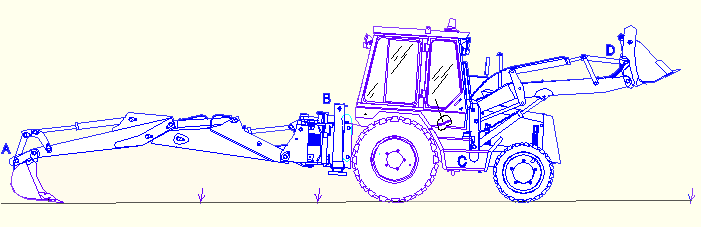

 
 
 

   

### İçten yanmalı Motorlar

---

<!-- Kısım 4 -->
# 1.2 Mekanizma Uygulamalarına Örnekler-II:

   

### Otomobil Dişli Kutusu

 

 
        

 
		

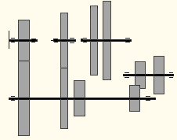

	 

      
 
	

Takım tezgahlarında, arabalarda, ve daha birçok uygulamada, sabit bir giriş hızından değişik değerlerde çıkış hızının elde edilmesi gerekli olmaktadır. Bu durumlarda dişlilerin birbirleri ile temas etmeleri veya ayrılmaları ile, veya dişli bir kavrama yardımıyla ana taşıyıcı mile bağlanması ile, değişik hızların elde edilmesi mümkün olacaktır. Şekilde, bir araç dişli kutusu örnek olarak gösterilmektedir.

 
        
 
	 

### Oyuncak Hayvan Yürüme Mekanizması

---

<!-- Kısım 5 -->
# 1.2 Mekanizma Uygulamalarına Örnekler-III:

   

### Boya Kutusu Karıştırma Aparatı

---

<!-- Kısım 6 -->
# 1.2 Mekanizma Uygulamalarına Örnekler-IV:

   

### Ot Havalandırma Mekanizması

---

<!-- Kısım 7 -->
# 1.2 Mekanizma Uygulamalarına Örnekler-V:

   

### Hamur karıştırıcı

---

<!-- Kısım 8 -->
# 1.3 Temel Kavramlar-1

## Kinematik Eleman, Kinematik Çift

Mekanizmaların en önemli özelliğinin sistemde bulunan rijit cisimler olmayıp, bu cisimleri birleştiren mafsal veya kinematik çift olarak tanımlanan bağlantılar olduğu anlaşılmıştır. Mafsallarda oluşan hareket serbestlikleri ve bu hareket serbestliklerinden kaynaklanan cisimlerin birbirlerine göre bağıl hareketleri, bir mekanizmayı diğerinden ayıran özelliklerdir.

 **Kinematik eleman** , bir rijit cismi diğer bir rijit cisme, birbirlerine göre bağıl hareket yapabilecek şekilde bağlamak için kullanılan rijit cisim kısmına denir. Bağlanan cisimler arasında mutlaka bağıl hareket olması şarttır; ve iki cisim arasında olası bağıl hareket, belirli yönlerde sınırlanacaktır.

 **Kinematik çift**  veya  **mafsal** , iki rijit cisim üzerinde bulunan kinematik elemanların yan yana getirilmesinden oluşan bağlantıdır. Bir mekanizmada kullanılan kinematik çift çeşitleri ve bu kinematik çiftlerin mekanizma içinde dağılımı, mekanizmanın temel özelliklerini tanımlar. Kinematik çiftler değişik şekillerde sınıflandırılabilirler. Bu sınıflandırmaların bir kaç çeşidini göreceğiz.

 **Kinematik çiftlerin sınıflandırılması:** 

Kinematik çiftler çok çeşitli şekilde sınıflandırılabilir. Burada temel ve en çok kullanılan sınıflandırmalar kullanılacaktır.

 
        
 
	

 **Kapalı kinematik çift** lerde, iki kinematik eleman arasında temas, mekanizmanın tüm hareketi süresince mevcuttur. Yandaki şekilde bir kapalı kinematik çift görülmektedir.

 ** Açık kinematik çift** lerde, kinematik elemanlar hareketin tümü boyunca temas etmeyebilirler ve bu temas kontrol edilebilir. Yanda Genova Mekanizması olarak adlandırılan bir kesikli hareket mekanizması görülmektedir.

 
      

 
		

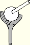

	 

    
 
	   

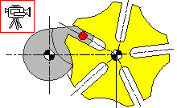

    

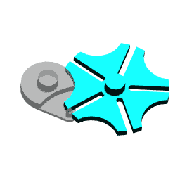

   
 
        
 
	

 **Kapalı kinematik çift** lerde eğer temas bir kuvvetten dolayı ise, bu tür kinematik çiftler  **kuvvet kapalı**  (Sağda üstteki şekil) olarak adlandırılacaktır. Kinematik çiftlerin geometrik şekillerinden dolayı aralarında devamlı temas sağlanıyor ise, bu tür kinematik çiftler  **Şekil kapalı ** (Sağda alttaki şekil). Şekil kapalı kinematik çiftlerde bir kinematik eleman diğerini sarar.

 
      

 
		

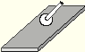

	 

    

 
		

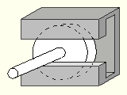

	 

        
 
	 

Kapalı kinematik çiftler ayrıca temas şekline göre  **basit**  veya  **yüksek kinematik çift**  olarak sınıflandırılabilir.

 **

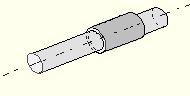

Basit kinematik çift** lerde kinematik elemanlar bir yüzey boyunca temas ederler. Bu durumda temas gerilimleri daha düşük olacaktır.Şekilde bir basit kinematik çift görülmektedir.

 **Yüksek kinematik çift** lerde ise temas, geometrik olarak bir nokta veya bir çizgi üzerindedir. Yukarıda kuvvet ve şekil kapalı kinematik çiftlere verilen iki örnek de birer yüksek kinematik çifttir. Üstte bulunan çift (şekil kapalı) bir çizgisel bir temas, altta bulunan (kuvvet kapalı) çift ise noktasal bir temas sağlamaktadır. Gerçek durumda bu nokta veya çizgi teması belirli bir alan ise de, bu alan yük altında deformasyondan dolayı oluştuğundan, temas gerilimleri oldukça yüksek olacaktır. Bu nedenle büyük yükler altında çalışan mekanizmalar için yüksek kinematik çiftler tavsiye edilmez. Ancak, yüksek kinematik çift kullanan mekanizmalar daha küçük hacim kaplayabilir ve aynı iş için kullanılan parça sayısı daha az olabilir. Yüksek kinematik çiftler kullanılırken yüzey sertliği ve kalitesine özel dikkat edilmesi gereklidir.

---

<!-- Kısım 9 -->
# 1.3 Temel Kavramlar-2

## Serbestlik Dereceleri

Bir önceki sayfada değinilen sınıflandırmalar bazı açılardan (örneğin kuvvet iletimi) önemli ise de, kinematik çiftlerin en önemli özelliği olan hareket ile ilgilenmemektedir. Bir kinematik çift ile bağlanmış olan iki rijit cismin birbirlerine göre, kinematik çiftin özelliklerine bağlı olarak,  farklı bağıl hareketleri olacaktır. Oluşan bu bağıl hareket bir kinematik çiftin en önemli özelliklerini verir. Bu bağıl hareket kıstasına göre sınıflandırmak için, **serbestlik derecesi** kavramına ihtiyaç vardır.

**Uzay serbestlik derecesi**, o uzayda bulunan bir cismin konumunu belirlemek için gerekli olan bağımsız parametre sayısıdır.

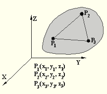

Üç boyutlu bir uzayda -ki bu yaşadığımız genel uzay konumudur- bir cismin konumunu belirleyelim (Alttaki şekilde üç boyutlu koordinat ekseni ve cismin konumu gösterilmiştir).Cismin konumunu bu genel uzayda belirlemenin bir yolu, cismin üzerinde aynı doğru üzerinde bulunmayan her hangi üç noktanın (P 1 , P 2 , P 3  ) konumunu belirlemektir. Bu üç noktanın konumu bilindikten sonra, rijidite kavramından dolayı bir başka noktanın bu noktalardan uzaklığı değişmeyeceğinden, diğer noktaların konumu belirlenmiş olacaktır. Bu üç noktanın her birinin konumu üç parametre ile belirlenir (P 1 (x 1 , y 1 , z 1 ), P 2  (x 2 , y 2 , z 2 ) ve P 3  (x 3 , y 3 , z 3 )). Bu durumda üç noktanın ve dolayısı ile cismin konumunu belirlemek için dokuz parametre gerekli görülür ise de, cismi rijit kabul ettiğimizden bu üç nokta arasında uzaklıklar sabit olacaktır. Bu sabit uzaklık şartı dokuz parametre arasındaki şu üç ilişkiyi tanımlayacaktır:

(x 2  − x 1 ) 2  + (y 2  − y 1 ) 2  + (z 2  − z 1 ) 2  = a 1  2 

(x 3  − x 1 ) 2  + (y 3  − y 1 ) 2  + (z 3  − z 1 ) 2  = a 2  2 

(x 3  − x 2 ) 2  + (y 3  − y 2 ) 2  + (z 3  − z 2 ) 2  = a 3  2 

Dokuz parametre (x i , y i , z i  : i = 1, 2, 3) ve bu parametreler arasında üç denklem bulunmaktadır. Bu durumda bu parametreler arasından sadece altısını tanımladığımızda üç noktanın ve dolayısı ile cismin konumu belirlenmiş olacaktır. Bağımsız parametre sayısı altı olduğundan  **genel uzayda serbestlik derecesi altıdır**. 

 **Soru:**** Gerekli olan bu altı parametreyi tanımlamakta herhangi bir kısıtlama var mıdır?** 

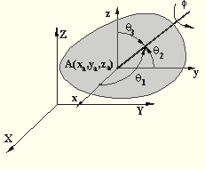

Cismin konumunu belirlemek için mutlaka üç nokta gerekmez. Farklı bir tanım için alttaki şekilde görüldüğü gibi cisim üzerinde bir nokta ve bir doğru ele alalım. Cismin konumunu belirlemek için ilk olarak A noktasının konumunu üç parametre ile tanımlayabiliriz. Cisim üzerinde bulunan doğrunun yönünü belirlemek için, doğru ile X,Y ve Z eksenleri arasında kalan açıları kullanalım (θ 1 , θ 2  ve θ 3 ). Nokta ve doğru belirlendikten sonra cisim sadece doğru etrafında serbestçe dönebilir. Bu dönmeyi de bir açı ile belirlersek cismin konumu belirlenmiş olacaktır ve bu durumda yedi parametre kullanılmıştır (x a , y a , z a , θ 1 , θ 2 , θ 3  ve ϕ). Ancak doğru ile eksenler arasında kalan üç açı arasında:

cos 2 (θ 1 ) + cos 2 (θ 2 ) + cos 2 (θ 3 ) = 1

bağlantısı vardır. Bu durumda cismin konumunu belirlemek için yine altı bağımsız parametre gereklidir (x a , y a , z a , ϕ ve θ 1 , θ 2 , θ 3  açılarından her hangi ikisi). Görüldüğü gibi, cismin konumunu belirlemek için farklı yaklaşımlar kullanılabilir ise de, gerekli olan bağımsız parametre sayısı daima sabittir.

### Düzlemsel Uzayda Serbestlik Derecesi:

Düzlemsel bir uzay düşündüğümüzde, bir cismin bir düzlem içinde hareketi söz konusu olacaktır. Bu durumda cisim sadece iki yönde öteleyecek ve öteleme düzlemine dik bir eksen etrafında dönebilecektir. Öyle ise düzlemsel uzayda gerekli olan bağımsız parametre sayısı üçtür ve  **düzlemsel uzay serbestlik derecesi üç olacaktır**.  Bu serbestlik derecelerinin tanımı için aşağıdaki şekilde gösterildiği gibi, değişik parametreler kullanılabilir.

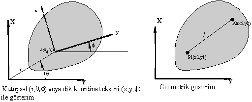

Yukarıda gösterilmiş olan genel ve düzlemsel uzaydan başka küresel ve iki boyutlu uzaylarda bulunmaktadır. Bu uzaylara ileride değinilecektir. Pratikte kullanılan mekanizmaların çalıştığı ortamlar çoğunlukla düzlemseldir.

 

 **Bir kinematik çiftin (mafsalın) serbestlik derecesi**,  o mafsalla birleştirilen cisimlerin birbirlerine göre bağıl konumlarını belirlemek için kullanılması gerekli bağımsız parametre sayısıdır. Kinematik çiftlerin serbestlik dereceleri ve bu serbestliklerin müsaade ettiği hareketin yönü ve tipi (dönme veya öteleme), kinematik çiftleri birbirinden ayıran en önemli özelliktir ve bu özellikler kinematik çiftlerin tiplerini belirlemekte kullanılır.

---

<!-- Kısım 10 -->
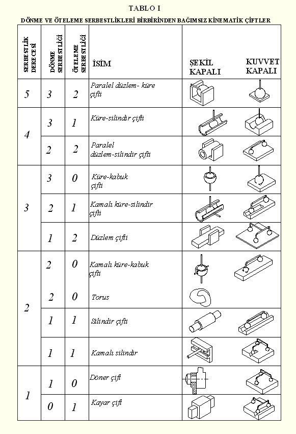

---

<!-- Kısım 11 -->
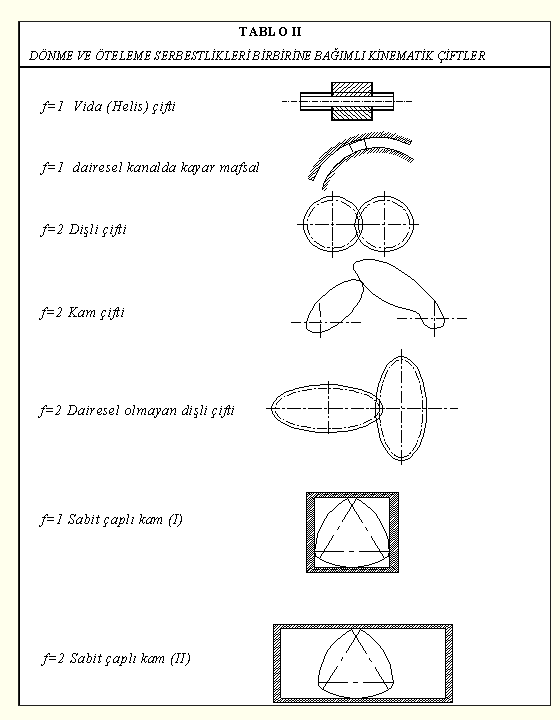

---

<!-- Kısım 12 -->
# 1.3 Temel Kavramlar-3

   

## Uzuv-Kinematik Zincir

 

Bir rijit cisim üzerinde kinematik çift oluşturan en az iki kinematik eleman var ise, bu cisme  **uzuv**  denir. Uzuv ikiden fazla kinematik eleman ihtiva edebilir (fakat iki kinematik elemandan az olamaz). Uzuvlar iki, üç, dört kinematik elemanlı olarak kinematik eleman sayısına göre sınıflandırılabilir.

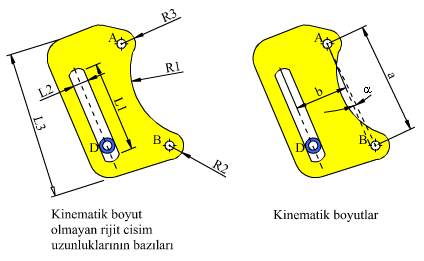

Bir mekanizmada bulunan uzuvların kinematik boyutu o uzvun üzerinde bulunan kinematik elemanların birbirlerine göre konumlarını belirleyen boyutlardır ve bu boyutlar verildiğinde kinematik açıdan uzuv boyutları tanımlanmıştır. Bu boyutlar genellikle uzunluk ise de iki doğru arasında kalan bir açı da olabilir. Farklı konularda, örneğin imalat için, montaj için veya dinamik analiz için uzva ait farklı boyutlar (kalınlık parça eni boyu, ağırlık merkezi gibi) verilmesi gerekecektir ve bu boyutlar kinematik boyutlardan farklı olabilir. Hareketin incelenmesi sırasında sadece kinematik boyutlar gereklidir. Yukarıda görüldüğü gibi, düzlemsel hareket eden bir uzvun A ve B noktalarında döner mafsal, D noktasında ise bir kamalı silindir ile diğer uzuvlara bağlandığı bir sistem olsun. Kinematik boyut olmayan ancak bu parçanın imalatı veya montajında gerekli olabilecek yarı çaplar( R 1 , R 2 , R 3 ), kanal genişliği ve uzunluğu (L 1 , L 2 ), parça boyu gibi (L 3 ) birçok uzunluk verilebilir.  A ve B mafsalları arasında uzaklık (a), kanalın AB doğrusuna göre yaptığı açı (α) ve A noktasından kanal eksenine olan dik uzaklık (b) bu uzvun kinematik boyutlarıdır. Bu parametreler ile mafsalların birbirlerine göre bağıl konumları belirlenebilir.

**   **

Birbirlerine kinematik çiftlerle bağlanmış uzuvlar bir zincir oluşturacaktır. Bu zincire  **Kinematik Zincir**  denir. Eğer kullanılan kinematik çiftlerin hepsi kapalı kinematik çift ise, bu zincir “Kapalı kinematik zincir” dir, kinematik çiftlerden birisi açık ise “Açık kinematik zincir” söz konusudur.

**   **

Kinematik zincir gerçek mekanizma yapısının bir modelidir. Bu modelde uzuv boyutları, yapısı ve şekli, mafsal yapısı ve şekli önemli değildir (tabiki mafsalın serbestlik derecesi önemlidir). Genellikle bu zincir modelinde uzuvlar bir doğru, bir üçgen veya dörtgen gibi basit şekillerle gösterilirler. Bu üçgen veya dörtgenin her bir köşesinde bir kinematik eleman bir başka uzuvda bulunan bir kinematik elemana bağlıdır.

**   **

Bazı mafsal noktalarında ikiden fazla uzuv birbirine bağlı olabilir. Bu durumda o mafsal ile birleştirilen uzuv sayısından bir eksik sayı, mafsal derecesi olarak alınır ve o noktada mafsal derecesi kadar mafsal olduğu kabul edilir (alttaki şekli inceleyiniz).

**Mafsal derecesi ile mafsal serbestlik derecesi iki farklı kavramdır.**

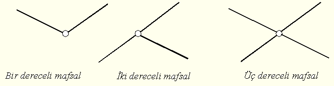

Kinematik zinciri oluşturan tüm uzuvların hareketi aynı düzlemde veya birbirlerine paralel düzlemlerde ise, bu kinematik zincirler  **“Düzlemsel kinematik zincir”**  dir. Uzuvların üzerinde bulunan noktaların tümü aynı merkezli küreler üzerinde hareket ediyor ise,  **“Küresel kinematik zincir”**  dir. En genel zincir ise  **“Uzaysal kinematik zincir”**  dir.
 **Kinematik zincirde bulunan bir uzvun sabitleştirilmesi ile elde edilen sistem mekanizmadır** . Bu tanım mekanizma için önceden vermiş olduğumuz (mekanizma, kuvvet ve hareket için kullanılabilen rijit cisimlerin rijit mafsallarla birleştirildiği sistem) tanımından farklı gibi görünür ise de, iki tanım da aynıdır.

---