# Mekanizma Serbestlik Derecesi ve Mekanizmaların Sınıflandırılması

*Prof. Dr. Eres Söylemez - Mekanizma Tekniği*

---

<!-- Kısım 1 -->
# II. MEKANİZMA SERBESTLİK DERECESİ VE MEKANİZMALARIN SINIFLANDIRILMASI

   

    2.1

---

<!-- Kısım 2 -->
# 2.1 Mekanizma Serbestlik Derecesi-1

 **Bir mekanizmanın serbestlik derecesi** , bir mekamizmada bulunan tüm uzuvların konumunu belirlemek için gerekli olan parametre sayısıdır.

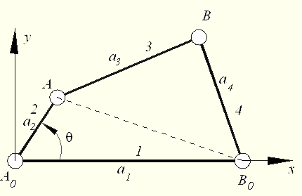

Örnek olarak dört döner mafsalla bağlı dört uzuvdan oluşan ve genellikle dört-çubuk mekanizması olarak adlandırılan mekanizmayı ele alalım.

 

 

θ açısı değeri verildiğinde her bir uzuv üzerinde iki noktanın konumu (A 0 B 0  (1 uzvu), A 0 A (2 uzvu), AB (3 uzvu) ve BB 0  (4 uzvu)) bulunabildiğine göre, bu mekanizmada bulunan tüm uzuvların konumunu belirlemek için sadece bir parametre gerekmektedir. Öyle ise,  **dört-çubuk mekanizmasının serbestlik derecesi 1 dir.** 

 

 

İkinci bir örnek olarak yanda gösterilen beş döner mafsallı beş uzuvlu mekanizmayı ele alalım. θ tanımladığımızda A 0 AC 0  üçgeni ile ilgili gerekli bilgi elde edilmiş olur ise de, kalan kısım ABCC 0  bir

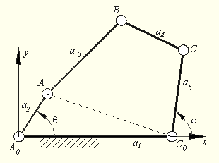

 dörtgen olup bu kısmın belirlenebilmesi için bir yeni parametre (ϕ açısı) gerekecektir. Bu durumda beş çubuk mekanizmasının tüm uzuvlarının konumunu belirlemek için gereken parametre sayısı 2 olduğundan, serbestlik derecesi 2 dir.

 

 

Yukarıda gösterilmiş olan örneklerde belirtilen θ ve ϕ parametrelerinden farklı parametreler de mekanizma uzuvlarının konumlarını belirlemek için kullanılabilir. Buna karşın kullanılması gereken parametre sayısı belirlidir. Bir başka husus ise, genel olarak gerekli olan parametre sayısının uzuvların boyutlarına bağlı olmamasıdır. Örneğin a 2  boyutu 5 birim yerine 4 birim olsa, dört çubuk mekanizmasının serbestlik derecesi yine 1, beş çubuk mekanizmasının serbestlik derecesi ise yine 2 olur.

 **

  **  **Sonuç: Mekanizmaların serbestlik derecesi uzuv sayısına, mafsal sayısına ve mafsal serbestlik derecesine bağlıdır, uzuv boyutuna bağlı değildir.**

---

<!-- Kısım 3 -->
# 2.1 Mekanizma Serbestlik Derecesi-2

Bir önceki kısımda serbestlik derecesinin mekanizma uzuv boyutlarına bağlı olmadığını görmüştük. Öyle ise, mekanizma serbestlik derecesi ile mekanizmada bulunan mafsalların serbestlik derecesi, mafsal sayısı, uzuv sayısı arasında bir bağıntı bulmayı hedefleyebiliriz. Matematiksel olarak olaya bakmak için aşağıda verilmiş olan parametreleri tanımlayalım:

λ : Uzay Serbestlik Derecesi

(Düzlemsel uzaylar için λ = 3 ; genel uzay için λ = 6)

*l* : Mekanizmada uzuv sayısı (sabit uzuv dahil)

j : Mekanizmada mafsal sayısı

f i  : i mafsalının serbestlik derecesi

F : Mekanizma serbestlik derecesi

*l* sayıda uzvun λ serbestlik dereceli uzayda herhangi bir kinematik çift ile birbirlerine bağlanmadan durduklarını düşünelim. Bu durumda sabit uzuv hariç, diğer *l* − 1 uzvun her biri için λ sayıda parametre tanımlamamız gerekir (sabit uzva referans koordinat sistemi bağlı olduğundan sabit uzvun konumu sabittir). Öyle ise hiç bir mafsal olmadığında uzuvların konumu:

 
 
 
 λ(*l* − 1) 
 (1) 
 
 
 

parametre ile belirlenecektir.

Şimdi mafsalları bir örnekle göz önüne alalım. Şekilde düzlemde hareket eden dört uzuv gösterilmektedir. Bu uzuvlar arasında hiç bir bağlantı yok iken uzuvların konumunu belirlemek için 3×4 = 12 parametre gerekir (A). Eğer 2 uzvu ile 4 ve 5 uzuvları arasında döner mafsal, 2 ve 3 uzvu arasında ise kamalı silindir mafsalı oluşuyor ise, 2 uzvunun konumunu belirlemek için yine üç parametreye ihtiyaç vardır. Ancak bu üç parametre belirlendikten sonra 4 uzvunun mafsal ile birleştirilmiş olduğu B noktası artık bilindiğinden, 4 uzvunun konumu dönme açısı tanımlandığında (ψ açısı – 1 parametre) belirlidir. Benzer bir şekilde 5 uzvu döner mafsal ile A noktasında 2 uzvuna birleştirildiğinden 2 uzvuna göre sadece dönme hareketi yapabilecektir (ϕ açısı – 1 parametre). 3 uzvu kamalı silindir ile birleştirildiğinden 3 uzvu üzerinde D noktası 2 uzvu üzerinde kanal ekseni boyunca öteleyebildiği gibi, düzleme dik bir eksen etrafında dönebilecektir. Öyle ise 2 uzvunun konumunu belirlemek için 2 parametreye ihtiyaç bulunmaktadır (s ve ζ parametreleri). Başlangıçta 12 parametre gerektiren bu uzuvlar şimdi sadece 7 parametre kullanılarak konumları belirlenebilmektedir. Döner mafsallarda iki, kamalı silindirde ise bir parametre eksik tanımlanabilmiştir.

Uzay serbestlik derecesi λ olan bir uzayda** f i ** serbestliği olan bir mafsal, (λ − f i ) kadar hareket serbestisini önler ve cisimlerin serbest olduğu duruma nazaran bu kadar parametreyi tanımlamamız gerekmez. Eğer her bir mafsalın engellediği hareket serbestisi diğer mafsaldan farklı ise, mekanizmada bulunan j mafsal ile uzuv hareketleri üzerine getirilecek olan toplam sınırlama:

 
 
 
  $         ∑   i  =  1   j    (   λ  −   f  i    )   =  λj  −   ∑   i  =  1   j    f  i       \displaystyle {\sum\limits_{{\text{i}=1}}^{\text{j}}{{\left( {\lambda -{\text{f}_\text{i}}} \right)}}=\text{λ} \text{j}-\sum\limits_{{\text{i}=1}}^{\text{j}}{{{{\text{f}}_{\text{i}}}}}}    $                  i   =  1          ∑          j       ​                (   λ    −       f            i      ​              )       =     λ    j     −               i   =  1          ∑          j       ​                   f              i       ​                    
 (2) 
 
 
 

olacaktır. Bu durumda mekanizmada bulunan uzuvların konumlarını belirlemek için gereken parametre sayısı hiç bir mafsal olmadığında gereken parametre sayısından mafsalların sınırladığı serbestliklerin çıkarılması ile elde edilir. Öyle ise:

F = Serbest uzuvlar için gerekli parametre sayısı (1) – Mafsalların getirdiği sınırlamalar (2)

 $        F  =  λ   (   l  −  1   )   −   (   λj  −   ∑   i  =  1   j    f  i    )       \displaystyle {\text{F}=\text{λ} \left( {l-1} \right)-\left( {\text{λ}\text{j}-\sum\limits_{{\text{i}=1}}^{\text{j}}{{{{\text{f}}_{\text{i}}}}}} \right)}    $        F     =     λ      (   l    −    1   )     −      (     λ    j     −               i   =  1          ∑          j       ​                   f              i       ​                 )        

veya

 $        F  =  λ   (   l  −  j  −  1   )   +   ∑   i  =  1   j    f  i       \displaystyle {\text{F}=\text{λ} \left( {l-\text{j}-1} \right)+\sum\limits_{{\text{i}=1}}^{\text{j}}{{{{\text{f}}_{\text{i}}}}}}    $        F     =     λ      (   l    −     j     −    1   )     +               i   =  1          ∑          j       ​                   f              i       ​                   

Son elde ettiğimiz denkleme **mekanizma serbestlik derecesi denklemi** ** **    diyeceğiz.

Serbestlik derecesi denklemi, birçok mekanizma için geçerli ise de bu denkleme uymayan mekanizmalar da bulunmaktadır. Bunun nedeni bu denklemin elde edilişi sırasında yapılmış olan varsayımlardır. Bu varsayımların en önemlisi mafsalların getirmiş olduğu hareket sınırlamalarının birbirlerinden bağımsız olmasıdır. Ancak uzuv boyutlarının belirli değerler alması durumunda bu varsayım geçerli olmayabilir ve mekanizma serbestlik derecesi denklemi bazı mekanizmalar için doğru sonuçlar vermeyebilir. Bu özel durumları görmeden önce denklemin geçerli olduğu mekanizmaların incelenmesinde yarar bulunmaktadır.

---

<!-- Kısım 4 -->
# 2.1 Mekanizma Serbestlik Derecesi-3

Bir Mekanizmanın serbestlik derecesini belirlerken

 

-   Uzuv sayısını

-   Mafsal sayısını

-   Mafsal tiplerini
 

belirlememiz gerekecektir. **Uzuv Sayısını** belirlerken bir uzvun birden fazla parça kullanılarak imal edilebileceğini hatırlayalım. Eğer bir veya birkaç cisim arasında bağıl hareket yok ise, bu cisim kümesi tek bir uzuvdur. **Mafsal sayısı ve tipini** belirlerken temas sayısı ve şekli önemli değildir. Önemli olan husus mafsal ile birleştirilen kinematik çiftler arasında bulunan bağıl harekettir.**

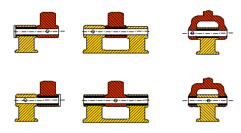

Mafsallar imal edilirken yük taşıma kapasitesine ve uygulamaya göre farklı olabilir. Yukarıda gösterildiği gibi, pim farklı uzuv ile sabitlenmiş ve farklı uzuv ile döner çift oluşturmak için yataklanmış olabilir. Temas yüzeyi sayısı farklı da olabilir.

   

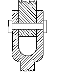

Yük taşıma özelliklerini artırmak için iki uzuv arasında birden fazla temas sağlanabilir.

  

**  Her temas ayrı bir **kinematik çift demek değildir. İki uzuv arasında sadece bir kinematik çift olabilir.**

---

<!-- Kısım 5 -->
# 2.2 Kinematik Açıdan Hareketi Belirli Mekanizmalar

 **Kinematik açıdan hareketi belirli mekanizma**  iki değişik şekilde olabilir:

 

- Serbestlik derecesi bir olan (F = 1) mekanizmalar.

- Serbestlik derecesi birden fazla olan, ancak kontrol veya tahrik edilen parameter sayısının mekanizma serbestlik derecesine eşit olan mekanizmalar. Her iki tanımdada belirlenmiş olan parametre sayısı serbestlik derecesine eşit olduğundan, bağımsız parametre değerleri belirlendiği takdirde, mekanizmada bulunan uzuvların konumu bulunabilir.
 

** Kinematik açıdan hareketi belirsiz mekanizmalar ** ise, belirlenmiş olan parametre sayısının mekanizma serbestlik derecesinden az olduğu durumdur. Bu durumda mekanizmada bulunan uzuvların hareketi sadece kinematik olarak değil, etki eden dış kuvvetler ve sistem dinamiği ile belirlenecektir. Bu tür mekanizmalar uygun tasarlandığı takdirde kinematik belirli bir mekanizma gibi hareketi incelenebilir. Buna en tipik örnek taşıtlarda kullanılan diferansiyel sistemidir. Virajlarda iki tahrik tekerinin farklı hızlarda dönmesi için sistem iki serbestlik derecelidir. İki tekere etki eden moment değerine göre mekanizmanın hareketi belirlenecektir.

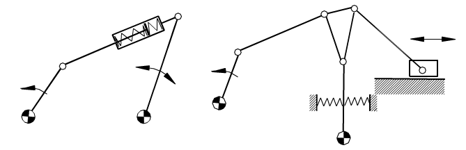

İki farklı örnek ise, yukarıda gösterilmektedir. Genellikle bu mekanizmalarda serbestliklerden birisi mekanizmanın motor ile tahrik edilmesidir. Diğer serbestlik ise bir yay ve mandal mekanizması ile kontrol edilir ve mekanizmaya etki eden kuvvet ve momentler belirli bir değerin üstünde olduğunda mekanizma çıkış uzvu sabit kalacak şekilde hareket eder. Paketleme makinalarında ve preslerde bu tür mekanizmalar çoğunlukla kullanılır.

---

<!-- Kısım 6 -->
# 2.3 Kinematik Yer Değişim

 **Kinematik yer değişim**  (kinematik mübadele, kinematik inversiyon), mekanizmayı oluşturan kinematik zincir içinde farklı uzuvların sabit olmasını sağlamak veya sabit olduğunu varsayarak diğer uzuvların bu sabit olduğu varsayılan uzva göre bağıl hareketlerini incelemek için yapılan işlemdir. Bu yöntem bağıl hareket incelemede çok yararlı olduğu gibi (bu yöntem uygulanarak mekanizmaların analizi ve sentezi yapılabilmektedir), aynı zincirden farklı mekanizmaların türetilmesi içinde kullanılan yararlı bir yöntemdir.

---

<!-- Kısım 7 -->
# 2.4 Grübler Denklemi

Genel serbestlik derecesi denklemi özel durumlar için daha basit hale getirilebilir. Bu şekilde özel durumlar için geçerli olan belirli bazı kuralların elde edilmesi mümkün olacaktır. İlk olarak ele alacağımız durum, uygulamada en sık rastlanılan: bir serbestlik dereceli (F = 1), düzlemsel (λ = 3) ve sadece döner veya kayar mafsal (f i  = 1, ∑f i  = j) kullanan mekanizmalar olacaktır. Bu değerler genel serbestlik derecesi denkleminde kullanıldığında:

 
 
 
 3*l* − 2j − 4 = 0 
 (1) 
 
 
 

Bu denkleme  Grübler Denklemi  diyeceğiz (Grübler denklemi genel serbestlik derecesi denkleminden önce bulunmuştur).

Grübler denklemini inceleyerek bu tip mekanizmalar ile ilgili çeşitli özellikleri belirleyebiliriz:

 

- Grübler denklemini sağlayan mekanizmalarda uzuv sayısı çifttir.
l ve j uzuv ve mafsal sayısını gösterdiğinden, tam sayı olmaları şarttır. Mafsal sayısı j ne olursa olsun 2j daima çift sayıdır. Aynı şekilde, (2j + 4) çift sayı olacaktır. 3l = 2j + 4 olduğundan, bu denklemin sağlanabilmesi 3l in çift sayı olması ile mümkündür. 3 ile çarpılan bir sayının sonuçta çift sayı olabilmesi sadece sayının çift sayı olması ile mümkündür. Bu durumda mekanizmada bulunan uzuv sayısı (l), çifttir.
 

 Mekanizmada bulunan iki elemanlı uzuv sayısı dört veya dörtten fazla olmalıdır. 

Kinematik eleman sayısı k olan uzuvların sayısı *l* k  olsun. Bir elemanlı uzuv olamayacaktır (*l* 1  = 0) çünkü uzuv tanımında, uzvun en az iki elemanlı olduğu belirtilmiştir. Toplam uzuv sayısı bu uzuv sayılarının toplamıdır:

 
 
 
 *l* = *l* 2  + *l* 3  + *l* 4  + *l* 5  + … + *l* n  
 (2) 
 
 
 

veya

 
 
 
 3*l* = 3*l* 2  + 3l 3  + 3l 4  + 3l 5  + … + 3*l* n  
 (3) 
 
 
 

(bu denklemlerde *l* 2  mekanizmada iki elemanlı uzuvların sayısını, *l* 3  üç elemanlı uzuvların sayısını, v.s. belirtmektedir). Mekanizmada bulunan kinematik eleman sayısı ise:

 
 
 
 2*l* 2  + 3*l* 3  + 4*l* 4  + … + n*l* n * = *kinematik eleman sayısı 
 (4) 
 
 
 

İki kinematik eleman bir kinematik çift oluşturduğuna göre, kinematik eleman sayısı mafsal sayısının iki katı olacaktır:

 
 
 
 2j = 2*l* 2  + 3*l* 3  + 4*l* 4  + … + n*l* n  
 (5) 
 
 
 

(3) ve (5) denklemlerini Grübler denklemine (1) yerleştirdiğimizde

*l* 2  − (*l* 4  + 2*l* 5  + 3*l* 6  + … + (n − 3)*l* n ) = 4

veya

*l* 2  = 4 + P

olur. Burada

P = *l* 4  + 2*l* 5  + 3*l* 6  + … + (n − 3)*l* n 

dir. Mekanizmada bulunan bir uzuvda kinematik eleman sayısı mekanizmada bulunan uzuv sayısının yarısından fazla olamaz. P daima pozitif bir değer alacaktır ve en küçük değeri, mekanizmada bulunan uzuvlar iki veya üç elemanlı ise, sıfırdır (uzuv sayısı değerleri eksi olamaz). Bu durumda iki elamanlı uzuvların sayısı P = 0 olduğunda *l* 2  = 4 tür. Bunun dışında durumlarda ise iki elemanlı uzuv sayısı mutlaka 4 ten fazla olacaktır.

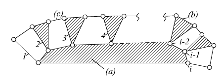

Yukarıdaki şekilde gösterildiği gibi, (a) gibi kinematik eleman sayısı maksimum olacak bir uzuv düşünelim. Maksimum eleman sayısı i olsun. Bu uzvun her bir elemanı bir kinematik çift oluşturacağından, i kadar (b) tipte uzuv (a) uzvuna bağlanacaktır. Mevcut uzuv sayısı (i + 1) olmuştur ancak henüz kapalı bir zincir yok-tur. Eklenecek bir uzuv (a) uzvunun kinematik eleman sayısını artırmaz. Öyle ise minimum sayıda (c) tipinde uzuv kullanarak kapalı bir zincir elde edilir ise, (a) uzvunda kinematik eleman sayısı maksimum olur. Bu düşünüldüğünde, (i − 1) kadar (c) tipinde uzuv kapalı zincir oluşturmak için yeterlidir. Bu mekanizmada uzuv sayısı:

*l* = 1 + i + (i − 1)

veya

i = *l* / 2

olur.

---

<!-- Kısım 8 -->
# 2.5 Mekanizmaların ve Kinematik Zincirlerin Enümerasyonu

 “Enümerasyon”  listeleme veya sayma olarak dilimize çevrilebilir. Kinematik açıdan enümerasyon önceden belirlenmiş kriterleri sağlayan kinematik zincirlerin veya mekanizmaların belirlenmesidir. Mekanizmaların enümerasyonu için çeşitli matematiksel yöntemler bulunmaktadır (çizge kuramı gibi). Burada sadece basit enümerasyon problemleri gösterilecektir.

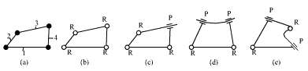

Enümerasyona bir örnek olarak Grübler denklemini sağlayan (yani, bir serbestlik dereceli, düzlemsel, kayar veya döner mafsallara sahip mekanizmalar) ve en az uzva sahip mekanizmaların listelenmesini ele alalım. Minimum uzuv sayısı 4 olmalıdır, çünkü iki elemanlı uzuv sayısı en az dörttür. Mafsal tipi gözardı edilir ise 4 uzvun dört mafsal ile tek bir şekilde bağlanabileceği görülür Her bir mafsalın döner veya kayar olabileceği düşünülür ise, 4 değişik zincir oluşturulabilecektir (Şekil b, c, d ve e). Kinematik zincirde üç veya dört kayar mafsal bulunamaz (neden?). Bu dört zincir elde edildikten sonra, değişik uzuvları sabitleyerek değişik mekanizmalar elde edilebilir.

Dört uzuvlu mekanizmalardan sonra Grübler denklemini sağlayan mekanizmalarda 6 uzuv olabilir (5 uzuv olamaz çünkü Grübler denklemini sağlayan mekanizmalarda uzuv sayısı çift olmalıdır). Bu durumda mafsal sayısı, j, 7 olması gerekir. Grübler denklemi için çıkardığımız sonuçlara göre uzuvlardan 4ü iki elemanlı, 2 si ise üç elemanlı olmalıdır (2j = 2*l* 2  + 3*l* 3  ve j = 7 için *l* 2  = 4, *l* 3  = 2 bu denklemin tek tamsayılı ve pozitif değerli çözümüdür). Bu uzuvlar yedi mafsal ile (mafsal tipi göz önüne alınmadan) Şekilde gösterildiği gibi, iki değişik şekilde bir araya getirilebilir.  **“Watt Zinciri”**  olarak adlandırılan birinci zincirde iki üç kinematik elemanlı uzuv birbirlerine bağlı iken ** “Steffenson Zinciri”**  olarak adlandırılan ikinci zincirde ise üç kinematik elemanlı uzuvlar birbirlerine bağlı değildir (tarihsel olarak Bu iki zinciri ilk bulan kişiler, Watt ve Steffenson, aynı zamanda endüstriyel devrimi başlatan buharlı makinelerin kaşifleridirler). Kinematik zincirler için belirtilmiş olan kurallara uyarak mafsallar kayar veya döner olabilir ve değişik uzuvlar sabitlendiğinde çok sayıda mekanizma elde edilir.

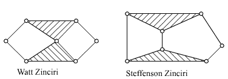

Watt ve Steffenson zincirlerinde bulunan üç kinematik elemanlı uzvun birinde veya her ikisinde iki mafsal arasında kalan uzuv boyutu sıfır alınır ise, zincirde bir veya iki mafsalın derecesi iki olur. Bu zincirler aşağıda gösterilmiştir. Bu zincirlere Watt ve Steffenson zincirlerinin özel boyutlu durumları diyeceğiz.

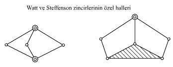

Mafsalların kayar ve döner olması ve değişik uzuvların sabitlenmesi ile çok değişik altı uzuvlu mekanizmalar elde edilebilecektir. Ancak bu mekanizmalar elde edilirken kayar ve döner mafsallardan oluşan kinematik zincirler için belirtilmiş olan sınırlamalar unutulmamalıdır.

Bir basit örnek olarak bir piston silindir ile tahrik edilen 6 uzuvlu mekanizmaları belirleyelim. Bu mekanizmalarda piston mutlaka sabit uzva bir döner mafsalla bağlı olsun ve ayrıca tüm diğer uzuvlar birbirlerine döner mafsallarla birleştirilsin.

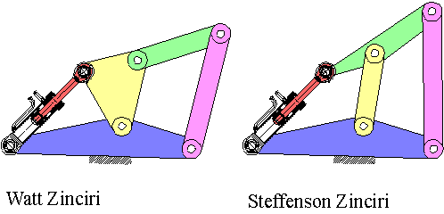

Piston silindir gurubu her biri iki elemanlı iki uzvun birbirlerine kayar mafsalla birleştirilmiş şekli olarak ele alınabilir. Bu durumda piston-silindir gurubu gerek Watt ve gerek Steffenson zincirlerinde birbirlerine bağlı iki elemanlı iki uzvun yerini alacaktır. Steffenson zincirinde bu grubun yerleştirilebileceği yer tektir. Watt zincirinde ise iki değişik yere yerleştirilebilir ise de, mekanizma simetrik olduğundan fark etmeyecektir. Pistonun sabit uzva bir döner mafsalla bağlı olması gerektiğinden her iki zincirde de üç elemanlı uzuvlardan birisi sabit olacaktır. Sonuç yukarıda görülmektedir.

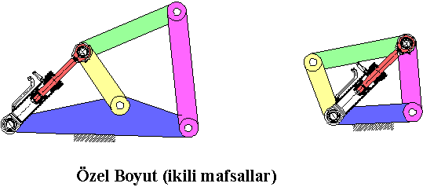

Üç elemanlı uzuvlardan birisinin veya her ikisinin mafsallar arasında uzaklığı sıfıra indirilmesi durumunda yukarıda gösterilen mekanizmalar elde edilecektir (mekanizma uzuv boyutları uygulamaya göre farklı şekiller alacaktır). Pratikte kamyon damperleri, beton pompalarının bomları, yükleyiciler, kepçeler elde edilen bu mekanizmaların uygulamasıdır. İki örnek aşağıda görülmektedir.

---

<!-- Kısım 9 -->
# 2.6 Küresel ve İki Boyutlu Uzay

Genel serbestlik derecesi denklemi sadece bir uzay için elde edilmediği, her boyutlu uzay için kullanılabileceği açıktır. Şu ana kadar verilmiş örneklerde düzlemsel (λ = 3) ve genel uzay (λ = 6) ele alınmıştır. Bunun dışında eğer uzayda tüm dönme eksenleri bir noktada kesişiyor ise bu küresel uzay olacaktır ve serbestlik derecesi 3 tür (λ = 3). Küresel uzay mekanizmasına en yaygın örnek araç transmisyonlarında kullanılan kardan kavramasıdır.

Küresel uzay (λ = 3)

 
        
 
	

Kardan Kavraması-1 (ağır yük altında çalışma için – örneğin araçlarda)

---

<!-- Kısım 10 -->
# 2.7 Mekanizmaların Sınıflandırılması

Mekanizma tekniği konularını bir bilim dalı olarak ele alan Reuleaux’ya göre mekanizmalar 6 temel gurupta sınıflandırılabilirler :

 

- Vida Mekanizmaları

- Çark mekanizmaları (dişli çarklar, sürtünme çarkları)

- Kam mekanizmaları

- Kol mekanizmaları

- Kayış-kasnak mekanizmaları

- Cırcır veya mandal mekanizmaları (Malta Haçı mekanizması dahil)
 

Bu sınıflandırma basit mekanizmalar için uygulanabilir ise de günümüzde kullanılan karmaşık bir mekanizma bu sınıflandırmada yerini bulamıyacaktır (örneğin mekanizmada kam çifti olabildiği gibi dişli çiftide olabilir ve kayar ve döner mafsallar bulunabilir. Bu mekanizmanın sınıflandırılmasında kam mekanizması, kol mekanizması veya çark mekanizması demek zordur).

Mekanizmaları sınıflandırmaktansa bir mekanizmanın tipini belirleyen tüm özelliklerin sıralanması daha önemli olmaktadır. Bu topolojik özellikler:

 

- Mekanizmanın çalıştığı uzay serbestlik derecesi (düzlemsel, küresel, genel uzay)

- Mekanizma serbestlik derecesi (genel serbestlik derecesine göre veya kritik boyutlara göre)

- Mekanizma uzuv sayısı

- Mekanizmada mafsal sayısı

- Mekanizmada bulunan mafsal tipleri
 

Bir mekanizmanın tanımı için yukarıda verilen tüm parametreler geçerlidir ve mekanizmaları sınıflandırmak için kullanılabilir. Reuleaux’nun sınıflandırması kısmen mafsal tipine göre yapılan bir sınıflandırmadır.

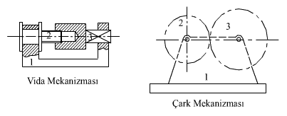

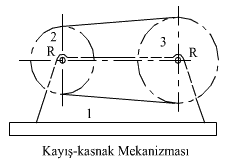

---

<!-- Kısım 11 -->
# Serbestlik Derecesi Denklemi

## Mekanizma Örnekleri

**Basit Örnekler:**

 
 
 
 MEKANİZMA 
 ŞEKİL 
 Serbestlik Derecesi Hesaplaması 
 
 
 **Krank-Biyel Mekanizması**

---

<!-- Kısım 12 -->
# Serbestlik Derecesi Denklemi

## Mekanizma Örnekleri

### İnteraktif Örnekler:

Burada verilen mekanizmalar mümkün olduğunca gerçek kullanımlarındaki görünümleriyle verilip, daha sonra mekanizmalarının daha özel gösterimlerine geçilecek ve bu gösterimlerin yardımıyla serbestlik dereceleri bulunacaktır.

---

<!-- Kısım 13 -->
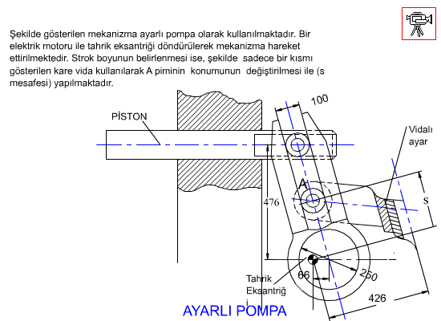

      

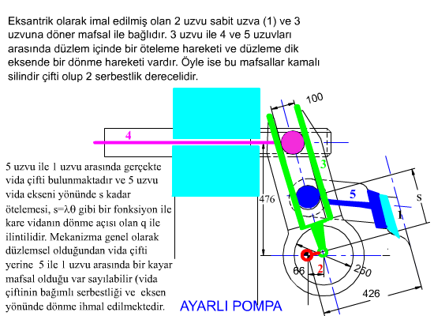

      

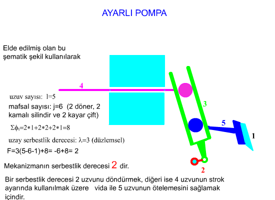

---

<!-- Kısım 14 -->
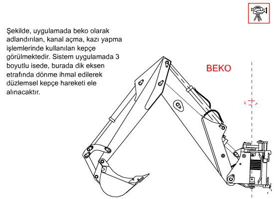

      

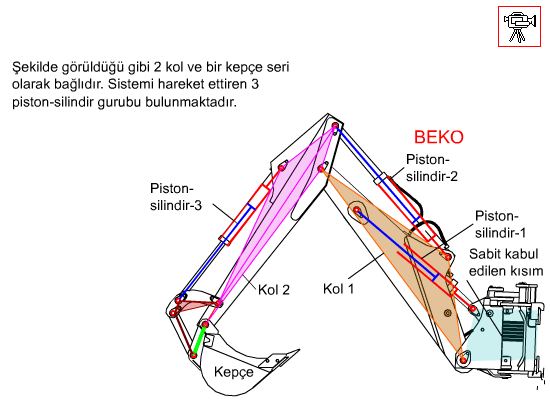

      

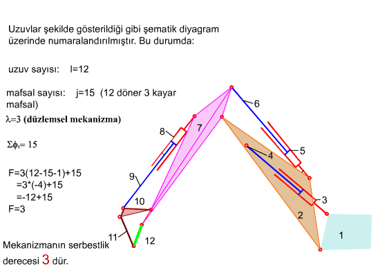

---

<!-- Kısım 15 -->
Alttaki fotoğraf günümüzde her inşaat alanında gördüğümüz beko-yükleyiciyi göstermektedir. Ön kaldırıcı ve arka kepçe kanal açma işlerinde, ön yükleyici ise toprak kazmada, kaldırıp bir kamyona koymada kullanılabilir. Ayrıca kırıcı ve tomruk kepçesi gibi farklı ekipmanlar da bu makinaya takılabilir.

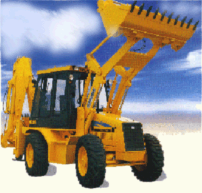

Ön yükleyicinin montaj resmi şekilde görüldüğü gibidir. Bu resim AutoCad’te çizilmiştir.

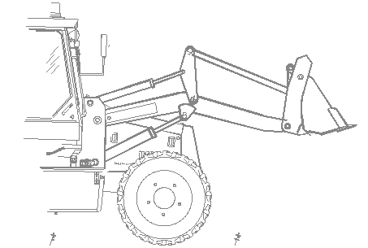

Ön yükleyici mekanizmasının şematik diyagramı:

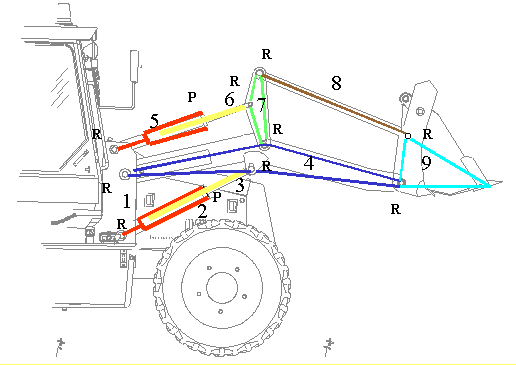

Mekanizmada:

 
 
 
 Uzuv sayısı: *l* = 9 
 
 
 Mafsal sayısı: j= 11 (9 döner mafsal 2 kayar mafsal) 
 
 
 Mafsal serbestlik dereceleri: f i  = 1 (tüm mafsallar için) 
 
 
 Uzay serbestlik derecesi: λ = 3 (düzlemsel hareket) 
 
 
 Mekanizma serbestlik derecesi: F = 3(9 − 11 − 1) + 11 = −9 + 11 = 2 
 
 
 

İki serbestlik, iki piston-silindir arasında bulunan öteleme hareketleridir. Mafsal olarak her bir piston-silindir arasında öteleme hareketi ile birlikte dönme hareketi de mümkün ise de düzlemsel bir mekanizmada silindirlerde bu dönme hareketi gerçekleşemediğinden piston silindir arasında kayar mafsal olduğu kabul edilmelidir. Bu hareketler hidrolik olarak kumanda edilmekte ve bu serbestlikler ile kepçe kaldırılabilmekte ve döndürülebilmektedir (devirme).

---

<!-- Kısım 16 -->
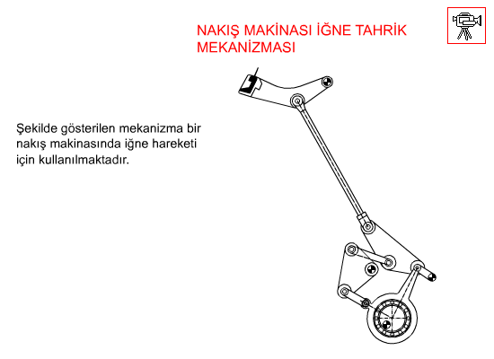

      

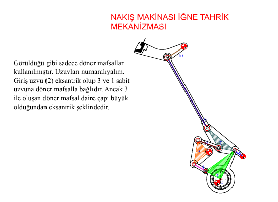

      

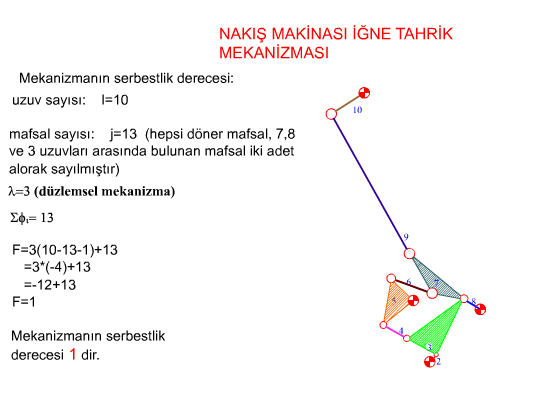

---

<!-- Kısım 17 -->
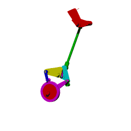

---

<!-- Kısım 18 -->
**Tutucu Mekanizması**

Bu mekanizma silindirik veya silindire yakın geometrisi olan cisimleri kavramak için kullanılan tutucudur. Teknik Resim:

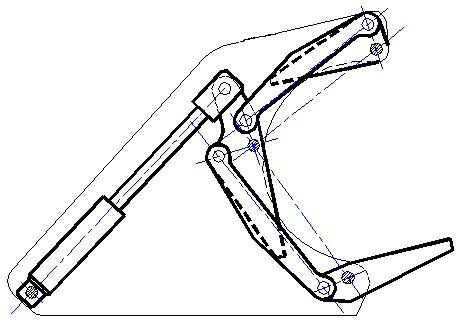

Mekanizma sekiz uzuvlu olup pistonun hidrolik olarak tahrik edilmesi ile hareket etmektedir. 2, 3, 4, 5, 6, 7 ve 8 uzuvları iki elemanlı uzuvlardır. Buna karşın 1 ve 4 uzuvlarında 4 kinematik eleman vardır. Şematik Diyagram:

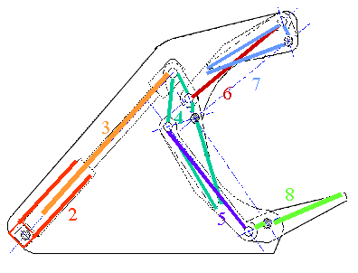

Sadece serbestlik derecesi açısından mekanizma tipi incelenir ise, şematik olarak şekilde görüldüğü gibidir (uzuv boyutları düşünülmemektedir). Serbestlik derecesi hesabı:

 
 
 
 Uzuv sayısı: *l* = 8 
 
 
 Mafsal sayısı: j = 10 (9 döner mafsal ve 1 kayar mafsal) 
 
 
 Mafsal serbestlik dereceleri: f i  = 1 (döner ve kayar mafsallar) 
 
 
 Uzay serbestlik derecesi = λ = 3 
 
 
 Mekanizma serbestlik derecesi: F = 3(8 − 10 − 1)+10 = 1 
 
 
 

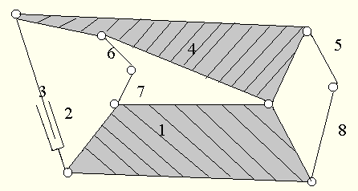

---