# Mekanizmalarda Konum Analizi

*Prof. Dr. Eres Söylemez - Mekanizma Tekniği*

---

<!-- Kısım 1 -->
# III. MEKANİZMALARDA KONUM ANALİZİ

---

<!-- Kısım 2 -->
* “Duyarım, unuturum; Görürüm, hatırlarım; Yaparım Öğrenirim.”  *

# Mekanizmaların Kinematik Analizi

Bu bölümde amacımız gerekli tüm boyutları bilinen mekanizmaların kinematik özelliklerinin bulunmasıdır. Kinematik özellikler olarak cisimlerin ve noktaların yer değişimi, noktaların hız ve ivmeleri, cisimlerin açısal hız ve ivmeleri ele alınacaktır. Bu derste incelemelerimiz düzlemsel mekanizmalar ile sınırlı kalacak, uzaysal mekanizmaların kinematik analizi kapsam dışı tutulacaktır.

Hareketi incelemeden önce belirli terimleri tanımlamamız gerekmektedir:

 
 
 
 **Konum:** 
 Bir rijit cismin (uzvun) veya cisim üzerinde bir noktanın verilmiş olan bir referansa göre yerinin belirlenmesidir. 
 
 
 **Yörünge:** 
 Bir noktanın zaman içinde aldığı konumların referans düzleminde izdüşümüdür. 
 
 
 **Yer Değişim:** 
 Referans eksenlerine göre, bir rijit cismin veya üzerinde bir noktanın konumunu değiştirmesidir. Yer değişim vektörel bir değer olup vektörün şiddeti uzunluktur (metre veya milimetre olarak ölçülür). 
 
 
 **Hız:** 
 Bir cismin veya üzerinde bir noktanın zamana göre konumunu değiştirmesidir. Vektörel bir değer olup şiddeti mm/saniye= mm/s veya m/saniye = m/s olarak ölçülür. 
 
 
 **İvme:** 
 Hızın zamana göre değişimidir. Vektörel bir değer olup şiddeti mm/saniye 2  = mm/s 2  veya m/saniye 2  = m/s 2  olarak ölçülür. 
 
 
 

Eğer bir rijit cismin hareketi, dönmeyi içeriyor ise, bu durumda açısal yer değişim radyan, derece veya devir sayısı olarak ölçülür. Zamana göre değişimi açısal hız olacaktır ve şiddeti rad/saniye = rad/s veya devir/dakika (rpm, dev/dak) olarak ölçülür. Açısal hızın zamana göre değişimi açısal ivme şiddeti ise rad/saniye 2  = rad/s 2  olarak ölçülür. Açısal yer değişim, açısal hız ve açısal ivme vektörel değerler olup yönleri dönme ekseni yönündedir.

# Mekanizmalarda Konum Analizi

Mekanizmalarda konum analizi mekanizma serbestlik derecesine eşit sayıda parametre değeri tanımlandığında:

 

- uzuvların veya uzuv üzerinde bir noktanın sabit veya bir hareketli uzuv üzerinde bulunan referans eksene göre bağıl konumunun bulunmasını,

- bir uzuv üzerindeki bir noktanın başka bir uzuv üzerinde bulunduğu konumun bulunmasını,

- bağımsız parametre değerlerinin değişimine göre bir uzvun açısının değişimi veya bir noktanın diğer uzuv üzerinde çizdiği yörüngenin bulunmasını içerir.
 

Serbestlik derecesi tanımında belirtilmiş olduğu gibi, uzuvların konumlarını belirlemek için serbestlik derecesi kadar parametrenin değeri önceden bilinmelidir. Genellikle bu parametreler bir uzvun konumunu belirlemek için kullanılan mafsal serbestlik dereceleridir. Bu mafsallara ** tahrik mafsalları ** diyeceğiz. Genellikle bu tahrik mafsalları bir hareketli uzvu sabit uzva bağladıkları için bu durumda  **tahrik uzvu**  terimi de kullanılabilir.

---

<!-- Kısım 3 -->
# 3.1 Bir Noktanın Kinematiği

Herhangi bir cismin veya noktanın konumu mutlaka bir referans sistemine göre belirlenir. Örneğin bir noktayı üzerinde bulunduğu rijit cisme bağlı bir referans sistemine göre belirlediğimizde sabit boyutlar noktanın konumunu belirler. Buna karşın hareket eden veya duran bir başka uzvun üzerinde bulunan bir referans sistemine göre aynı noktanın konumu, farklı değişken değerlerle belirlenir. Referans sistemine göre konumu belirlemek için farklı parametreler kullanılabilir.

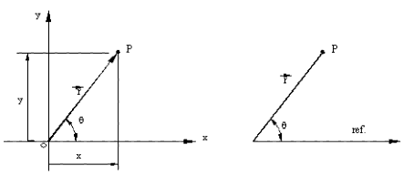

Şekilde de gösterilmiş olan P noktasının konumu O merkezli referans sistemine göre OP uzaklığı ile OP doğrusunun her hangi bir sabit referans doğrusu ile yaptığı açı ile belirlenebilir. Bu iki değer, bilindiği gibi şiddet ve yön içerdiği için bir **vektörel büyüklüğü **gösterir. Öyle ise bir noktanın konumu **OP **=** r konum vektörü** ile belirlidir. Konum vektörünün OP uzunluğu ve yön açısı ile belirlenmesi **kutupsal (polar) gösterim**dir. İstenildiğinde bir dik koordinat eksen takımı kullanılarak **OP** vektörü dik yönde iki bileşenin değeri ile de gösterilebilir. Bu durumda:

**r** = x**i** + y**j**

Bu denklemde **i** ve **j,** x ve y yönünde birim vektörlerdir (şiddeti bir birim olan vektör). x ve y değerleri OP doğrusunun bu yönlerde iz düşümleridir.

Kutupsal eksen kullanıldığında ise:    **r** = r∠θ

Bu denklemde r, OP uzunluğu, θ ise referans doğrusuna göre OP nin yaptığı açıdır. Açı daima saat yelkovanına ters yönde (SYT) pozitif olacak şekilde ölçülecek, eksi açı değerleri saat yelkovanı (SY) yönünde bir açıyı gösterecektir. Genellikle açının ölçüldüğü referans doğru, pozitif x ekseni yönü alınır. Çünkü bu şekilde kutupsal gösterimden dik eksen takımı gösterimine kolayca geçilebilir. İleride göreceğimiz gibi, mekanizma analizi sırasında bu dönüşüm her an gerekli olabilir.

**x, y ve r, θ arasında dönüşümler:**

x = r cosθ          y = r sinθ         r =  $          x  2   +   y  2        \displaystyle \sqrt{{{{x}^{2}}+{{y}^{2}}}}    $                  x            2             +       y            2                         ​                       θ = tan -1 (y/x)

denklemleri kullanılarak sağlanabilir.

Bir noktanın konumunu belirlemek için karmaşık sayılarda kullanılabilir. Karmaşık sayılar vektör olmamalarına rağmen (örneğin vektörler için tanımlanmış olan vektörel çarpım veya skaler çarpım kavramları karmaşık sayılar kullanıldığında bir anlam taşımaz), bir noktanın konumunu belirlemek için rahatlıkla kullanılabilir. Bunun için dik koordinat eksenlerinden x eksenini gerçek, y eksenini ise sanal eksen olarak tanımlamamız gerekir. Bu şekilde elde edilen diyagrama Gauss-Argand diyagramı denir. Bu tanımla P noktasının konumu z karmaşık sayısı ile:

z = x + iy

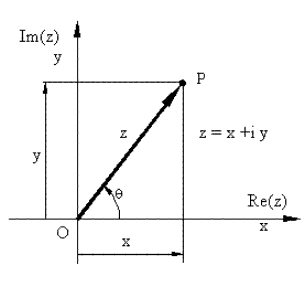

Burada x ve y reel (Re) ve sanal eksenler (Im) yönünde OP nin izdüşümü olup i bir reel sayıyı 90° saat yönüne ters yönde döndüren **dönme operatörüdür** ( $        i  =    −  1        \displaystyle {i=\sqrt{{-1}}}    $       i    =             −  1                ​               ).

Karmaşık sayılar ile ilgili bilgiler

---

<!-- Kısım 4 -->
# 3.2 Bir Rijit Cismin Kinematiği

Rijit cisim bir varsayımdır. Bu varsayım bir cismin hareketini incelememiz sırasında bize önemli kolaylıklar sağlayacaktır. Bunlar:

1. **Bir rijit cismin düzlemsel hareketi o cisim üzerinde bulunan her hangi iki noktanın hareketi belirlendiğinde belirlenmiştir.**

 

Bir cismin A ve B noktalarının zamana göre bulundukları konumlar biliniyor kabul edelim. Bu durumda hareketin her hangi bir t zamanında A ve B noktalarının konumu biliniyor demektir. S rijit cisim üzerinde her hangi bir başka nokta olduğunda, rijit cisim varsayımından dolayı AS ve BS uzunlukları sabit bilinen boyutlardır. A ve B noktalarının her hangi bir t anında konumları bilindiğinde, S noktasının konumu da belirlidir. Örneğin şekilde gösterilen rijit cisim üzerinde bulunan A, B ve S noktalarını ele alalım. Bir süre sonra A ve B noktaları A′ ve B′ konumuna gittiği biliniyor ise, AS ve BS uzunluklarının bilinen sabit uzunluklar olmasından dolayı S′ noktasının konumu A′ ve B′ konumları ile tanımlıdır.

 

Rijit cismin konumunu A ve B noktaları yerine cisim üzerinde sabitlenmiş A noktasından B noktasına uzanan bir **AB** vektörü ile de tanımlayabiliriz.

**AB** vektörü rijit cisim üzerinde sabittir. B her hangi nokta olacağından AB vektör uzunluğu istenilen bir uzunluk seçilebilecektir. Bu durumda seçilmiş olan referans eksen takımına göre cismin konumu vektörün başlangıç noktası konumu (rijit cisim üzerinde bulunan A noktasının konumu) ve AB doğrusunun referans eksene göre açısal konumu (θ açısı) ile belirlenebilir.

2. **Rijit cisimlerde bir doğru üzerinde bulunan noktaların doğru yönünde hız bileşenleri eşit olmalıdır.** Çünkü rijit cisim tanımından dolayı bu yönde uzama veya kısalma olmayacaktır ve iki nokta arasında uzaklık sabittir. A ve B noktaları arasında olası bir bağıl hareket mutlaka AB doğrusuna diktir.

**V**′ A  = **V**′ B 

 

3. **Rijit cismin kinematiği ile ilgilendiğimizden dolayı, cismin fiziksel boyutları önemli değildir.** Bu durumda cismin gerçek fiziksel boyutları unutularak cisim bir AB doğrusu veya basit bir geometrik şekil olarak gösterilebilir. Uzvun gerçek sınırları kinematik açıdan önemli olmadığından her bir uzuv sonsuz bir düzlem gibi kabul edilebilir ve bu düzlem kullanılmak istenilen her hangi bir noktayı içerir.

Düzlemsel hareket için belirtilmiş olan bu üç sonuç mekanizmaların kinematik analizi sırasında kullanılan çok önemli kavramlardır.

Bir başka önemli husus ise, cisimlerin üzerinde ele aldığımız noktaların gerçek cisimlerin üzerinde A, B, C gibi işaretli olmadığı, bu sembolleri bizim o noktaları ayırt etmek için koyduğumuzu unutmamamızdır. Birimizin A dediğine diğerimiz B der ise, bu gayet doğal olup kavga edilmesini gerektirmez (Ancak kitapta devamlı olarak sabit uzva 1, giriş uzvuna 2 denmiş ise, veya giriş kolu mafsalları A 0  ve A olarak gösterilmiş ise, sizler de tabi ki bu konuda ön yargılı olup benzer sayıları kullanacaksınız. Bu karşılıklı iletişimi kolaylaştırır ise de şart değildir). İstenir ise uzuvlar harflerle, ilgilendiğimiz noktalar ise sayılarla gösterilebilir.

---

<!-- Kısım 5 -->
# 3.3 Çakışan Noktalar

Mekanizmalarda bir çok rijit cisimden (uzuvdan) oluşan bir sistem vardır. Bu uzuvlar arasında bağıl hareket, uzuvları birbirlerine bağlayan mafsalların serbestlik derecesi ve tipi ile belirlidir. Yukarıda rijit cisimler için elde edilen üç sonuca göre her bir uzuv sonsuz boyutlu kabul edilebileceğinden krank-biyel mekanizması için şekilde gösterildiği gibi, mekanizmayı oluşturan uzuvları hafızamızda üst üste duran sonsuz boyutlu düzlemlerden oluştuğunu düşünmemiz gerekir.

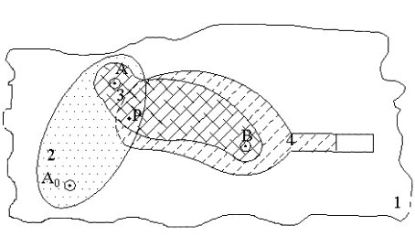

2 uzvunun 1 uzvuna göre hareketini inceleyelim. 2 uzvu 1 uzvuna A 0  noktasından geçen bir eksene sahip döner mafsal ile bağlı olduğundan, 2 uzvu 1 uzvuna göre sadece dönme hareketi yapabilecektir. Mafsalın çapı, uzvun büyüklüğü bu bağıl hareketin şeklini hiç bir şekilde etkilemez. Benzer bir yaklaşım ile 3 uzvunun 2 uzvuna göre ve 4 uzvunun 3 uzvuna göre bağıl hareketleri sırası ile A ve B noktalarından geçen, düzleme dik bir eksen etrafında dönme olacaktır. 4 uzvunun 1 uzvuna göre hareketi ise iki uzuv birbirlerine kayar mafsal ile bağlı olduklarından kayar mafsal ekseni yönünde öteleme hareketidir.

Üst üste düzlemlerden oluşan bu mekanizmaya bir iğne batıralım (şekilde gösterilen P noktası). Bu iğne, mekanizmada 4 uzuv olduğundan, bu uzuvlara bağlı 4 düzlemi de delecektir. Öyle ise 1 uzvu üzerinde P 1 , 2 uzvu üzerinde P 2  , 3 uzvu üzerinde P 3  ve 4 uzvu üzerinde P 4  noktaları bulunacaktır. 1 uzvu üzerinde alınan sabit bir referans eksenine göre bu 4 noktanın konumu aynıdır ve aynı konum vektörü ile gösterilir. Mekanizmanın bir miktar bu ilk konumdan yer değiştirdiğini düşünelim. P 1  noktası, sabit uzuv üzerinde olduğundan, konum vektörü sabit olacak ve konumunu değiştirmeyecektir. 2 uzvu sabit uzva göre A 0  noktası merkez olmak üzere döndüğünden P 2  noktası A 0  merkezli PA 0  yarıçaplı bir daire üzerinde hareket edecektir. Benzer bir şekilde P 2  noktasının 3 uzvu üzerinde izdüşümünü incelersek, bu sefer A merkezli AP yarıçaplı bir daire üzerinde olacaktır. P 2  noktasının 4 uzvu üzerinde çizdiği yörünge basit bir daire olmayacaktır (genellikle krank-biyel mekanizması için bu dördüncü mertebeden bir eğridir). Benzer incelemeyi P 3  ve P 4  noktaları için de yapabiliriz.

Şimdi B noktasını göz önüne alalım. Dört nokta (B 1 , B 2 , B 3  ve B 4 ), o an için çakışmaktadır. B noktası 3 ve 4 uzuvları arasında bulunan döner mafsalın eksen doğrusu üzerinde olduğundan B 3  ve B 4  noktaları her konum için çakışacaktır. Buna  **daima çakışan noktalar**  diyeceğiz. Buna karşın B 2  ve B 1  noktaları sadece inceleme anında diğer iki nokta ile çakışacak, mekanizmanın başka bir konumunda B 3  ve B 4  hala çakışık iken B 2  ve B 1  in konumları farklı olacaklardır. Bu özellikte olan noktalara  **anlık çakışan noktalar**  diyeceğiz.

Mekanizmaları yukarıda gösterildiği gibi çizmek yaygın bir uygulama şekli değildir. Mekanizma uzuvları ya gerçek uygulamada aldıkları şeklin teknik resim kurallarına göre çizilmesi ile (bu şekilde çizmek mekanizmanın kinematik analizi sırasında oldukça zordur) veya basit geometrik şekiller olarak sadece mafsal noktalarını ve ilgilendiğimiz bir nokta veya çizgiyi içerecek şekilde çizilirler.

 **

** **  Analiz sırasında her uzvun sonsuz boyutta olabileceği unutulmamalıdır. **

---

<!-- Kısım 6 -->
# 3.4 Mekanizmalarda Vektör Devreleri

Mekanizmalarda bulunan uzuvlar ile herhangi bir düzlemsel hareket yapan cisimler arasında en önemli fark, mekanizma uzuvları hareketlerini sınırlayan ve onları diğer uzuvlara bağlayan mafsallardan dolayı, girdi parametreleri değerlerine göre sınırlandırılmış bir hareket halindedirler. Birbirlerine mafsallar ile bağlı uzuvlar kapalı çokgenler oluşturacaklardır. Bu çokgenlerin her birine **devre** diyeceğiz. Hareket analizinde temel yaklaşımımızın başlangıç noktası bu devreleri matematiksel olarak ifade etmek olacaktır.

Kinematik analize başlarken her bir uzuvla ilgili tüm boyutları bildiğimizi kabul edeceğiz. Kinematik analiz sadece boyutlarını bildiğimiz (veya boyutlarını bir varsayım ile tahmin ettiğimiz) uzuvlardan oluşan bir mekanizma için yapılabilir. Genel olarak döner mafsal eksenleri arasında uzaklık veya bir döner mafsal orta noktasından aynı uzvun bağlandığı bir kayar mafsal eksenine olan dik uzaklık uzuv boyutlarıdır. Bazı durumlarda ise verilen boyutlar kullanılarak istenilen başka boyutların çıkarılması gerekebilir. Ancak her durumda, mekanizma uzuvları hakkında yeterli boyut bilgisinin olduğu kabul edilecektir.

Önceki kısımda, bir uzvun konumu için bu uzvun üzerinde iki noktanın konumunun bilinmesi gerektiğini ve bu iki noktanın konumu bilinir ise, başka her hangi bir noktanın konumunun bulanabileceğini göstermiştik. Bu durumda konum analizinde hedefimiz her bir uzuv üzerinde iki noktanın konumunu belirlemek olacaktır. Nokta sayısını azaltmak, bir uzvun konumunu belirlediğimizde diğer uzvun konumunun belirlenmesinde kolaylık sağlamak için bu noktaları uzuvlar arasında daima çakışan noktalar seçmek tercih edeceğimiz bir husus olacaktır. Bu şekilde uzuv konumlarını tanımlamak için gereken parametre sayısı azaltılabilecektir. Bir uzvun üzerinde tanımlayacağımız vektörün başlangıç noktası başka bir uzvun üzerinde tanımladığımız vektörün bitiş noktası olabilecektir.

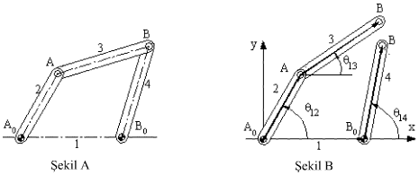

---

<!-- Kısım 7 -->
# Bir Mekanizmada Bulunan Bağımsız Devre Sayısı

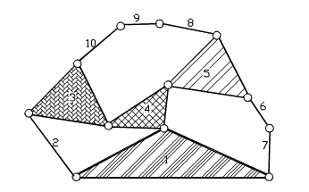

Uzuv sayısı *l* ve mafsal sayısı j olan bir kinematik zinciri ele alalım. Yukarıda 10 uzuvlu (*l* = 10) 12 mafsallı (j = 12) bir mekanizma görülmektedir.

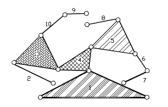

1-2 , 8-9 ve 1-7 numaralı uzuvlar arasında bulunan mafsalları sökelim (isterseniz siz değişik mafsalları sökün). Sökme sırasında kural hiç bir uzuv boşta (zincire bağlanmamış olarak) kalmayacak ve sökme işlemine mekanizmada devre kalmayana kadar (açık kinematik zincir oluşana kadar) edilecektir. Sökülen mafsallar değişik olabilir, ancak kinematik zinciri açık hale getirmek, hiç bir devre bırakmamak için sökülmesi gereken mafsal sayısı daima aynı olacaktır.

Sökülen mafsal sayısı daima kinematik zincirde bulunan bağımsız devre sayısına eşittir. Bağımsız devre sayısını L ile gösterelim. Şekilde gösterilen mekanizma için L = 3 tür. Elde edilen açık kinematik zincirlerde uzuv sayısı yine başlangıç zincirinde olduğu gibi *l* dir ancak kalan mafsal sayısı uzuv sayısından bir eksik (*l* − 1) olacaktır. Yukarıdaki örneğimizde kalan mafsal sayısı 9 dur.

Mafsal sayısı j olduğuna göre:

j = Açık kinematik zincirde mafsal sayısı + Sökülen mafsal sayısı = *l* − 1 + L

veya

L = j − *l* + 1

Bu basit fakat çok önemli denklem Euler tarafından bulunmuştur (Euler’in çokyüzlü denkleminin düzleme indirgenmiş hali) ve bir mekanizmada bağımsız devre kapalılık denklemi sayısını belirlemek için kullanılabilir. Ancak bu, yazacağımız denklemlerin birbirlerinden bağımlı veya bağımsız olup olmadığını gösteremez. Bunu bizim kontrol etmemiz gereklidir (bir devre diğer devrelerin toplamı veya farkı ile elde edilebiliyor ise, bağımlı devredir). Her devre için yazılan vektör devre denklemi iki skaler denklemi oluşturduğundan toplam 2L denklem elde edilir. Bu denklemlerde hareketin kinematik olarak belirli olması için 2L + F kadar konum parametresi bulunmalıdır (F mekanizma serbestlik derecesidir).

** Not: **

 1. Devre sayısı mafsal tipine bağlı değildir. 

 2. Devre sayısı uzay serbestlik derecesine bağlı değildir. 

 3. Devre sayısı mekanizma serbestlik derecesine bağlı değildir. 

**Örnek:**

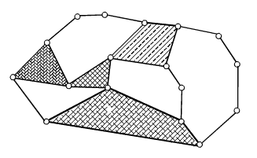

Yukarıda gösterilmiş olan kinematik zincirde kaç bağımsız devre olduğunu bulunuz.

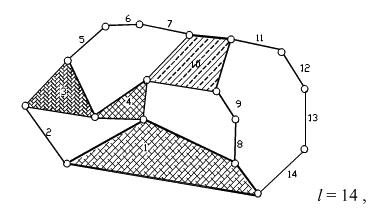

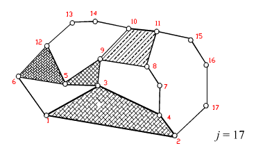

L = 17 − 14 + 1 = 4 adet bağımsız devre vardır.

**Örnek:**

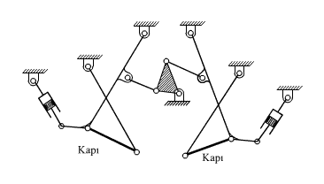

Yukarıda gösterilmiş olan kapı açma mekanizmasında kaç bağımsız devre olduğunu bulunuz.

*l* = 15  ve  j = 19  olup L = 20 – 14 + 1 = 5 tir.

---

<!-- Kısım 8 -->
# Örnek: Altı Uzuvlu Bir Mekanizmadaki Devreler

Şekil 1-A da 6 uzuvlu bir mekanizma görülmektedir. Mekanizmada hiç bir kapalı devre kalmaması için bu sefer iki mafsalın sökülmesi gereklidir. Sökülmesi gereken mafsal kişiden kişiye farklı olabilir. Ancak devre kalmayacak şekilde sökülmesi gereken minimum mafsal sayısı bir mekanizma için sabittir. Ayrıca mafsallar sökülür iken uzuvların zincirden ayrılmaması gereklidir. C ve B noktalarında bulunan mafsallar söküldüğünde (Şekil 1-B), mekanizmada devre bırakılmamış, açık zincirler oluşturulmuştur (istenir ise D ve E veya D ve A gibi iki farklı mafsal sökülebilir. Ancak örneğin B ve D mafsalı sökülemez, çünkü bu durumda bir uzuv zincirden koparılmış olur). C noktasının konumunu 1, 2, 3 ve 1, 5, 4 uzuvlarından oluşan açık kinematik zincirleri kullanarak yazmak istediğimizde (B mafsalı sökülmüş durumda), gerekli konum parametreleri tanımlayarak elde ettiğimiz vektör devre denklemi:

**A o A** + **AC** = **A o D o ** + **D o E** + **EC**

olur. Karmaşık sayılarla vektör devre denklemi yazıldığında:

a 2 e iθ 12   + a 3 e iθ 13   = a 1  + a 5 e iθ 15   + a 4 e iθ 14  

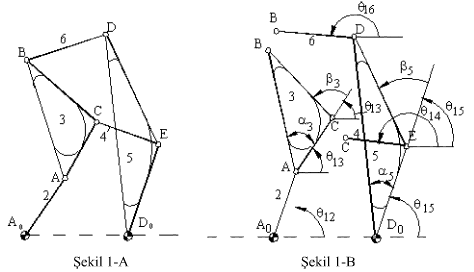

(a 1  = |A o D o |, a 2  = |A o A|, a 3  = |AC|, b 1  = |AB|, c 3  = |CB|, a 4  = |EC|, a 5  = |D o E|, b 5  = |D o D|, c 5  = |ED|, a 6  = |BD|)

B noktasının konumu vektörü, benzer bir şekilde 1, 2, 3 ve 1, 5, 6 uzuvlarından oluşan açık zincirleri kullanarak (C mafsalı açık olduğu varsayılarak), yazıldığında elde edilen vektör devre denklemi ise

**A 0 A** + **AB** = **A 0 D 0 ** + **D 0 D** + **DB**

olacaktır. Karmaşık sayılar kullanılarak yazıldığında:

a 2 e iθ 12   + b 3 e i(θ 13  + α 3 )  = a 1  + b 5 e i(θ 15  +   α 5 )  + a 6 e iθ 16  

Dikkat edilir ise, 3 ve 5 uzuvlarının konumları birinci ve ikinci denklemlerde farklı vektörlerle belirlenmektedir ( 3 uzvu için **AC** ve **AB** vektörleri, 5 uzvu için **D 0 E** ve **D 0 D** vektörleri). Ancak bu vektörlerin şiddetleri yine uzuv boyutları olup aynı uzuv üzerinde bulunan iki vektörün birbirleri arasında sabit bir açı (α 3  ve α 5 ) bulunmaktadır. Bu açılar o uzuvların boyutları ile tanımlıdır. Bu nedenle her bir uzuv için sadece bir açısal konum parametresi (θ 13  ve θ 15 ) tanımlanmıştır.

Yazmış olduğumuz iki devre kapalılık denkleminde beş konum değişkeni bulunmaktadır (θ 12 , θ 13 , θ 14 , θ 15  ve θ 16 ). Bu konum değişkenlerinden birisi bağımsız değişken olarak belirlenir ise, iki vektör devre denkleminden kalan diğer dört değişkenin değeri bulunabilir.

Eğer B mafsalının bağlanmasını C mafsalı bağlandıktan sonra yapar isek bu durumda B mafsalı ile kapatacağımız devre ECBDE devresi olacaktır (4-3 ve 5-6 açık zincirleri) (önceki durumda B mafsalı açık olduğundan B mafsalı ile A 0 ABDD 0 A 0  devresi oluşmuştu). Bu yeni durumda bu yeni devre için devre kapalılık denklemi

**EC** + **CB** = **ED** + **DB**

olacaktır. Karmaşık sayılar ile bu denklem:

a 4 e iθ 14   + c 3 e i(θ 13  + β 3 )  = c 5 e i(θ 15  +   β 5 )  + a 6 e iθ 16  

yazılabilir. Her her üç devre kapalılık denklemi ele alınır ise, elde edilen skaler denklem sayısı bilinmeyen parametre sayısından fazla olacaktır. Bu denklemleri için çözüm ancak bilinmeyen parametre sayısı kadar bağımsız skaler denklem olması ile mümkündür. Nitekim bu örnek için elde edilmiş olan birinci ve üçüncü vektör devre denklemlerini taraf tarafa topladığımızda:

**A 0 A **+ **AC **+ **EC **+ **CB **= **D 0 E** + **EC **+ **ED **+ **DB**

denklemi çıkacaktır. Her iki tarafta bulunan **EC** vektörü gider. Şekil 2 de görüldüğü gibi aynı uzuv üzerinde bulunan üç vektör uzvun θ ile belirlenen konumuna bağımlı kalmaksızın aralarında sabit bir ilişkiyi korurlar. A, B, C noktaları aynı uzuv üzerinde olduğunda:

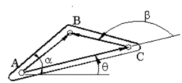

 Aynı uzuv üzerinde bulunan ABC Noktaları 

 b = |AB| , a = |AC|, c = |CB| 

 **AB** = be i(θ + α)  , **AC** = ae iθ  , **CB** = ce i(θ + β)  

** AC  ** + **CB** = **AB** (Daima sağlanacak olan vektör denklemi) 

 Karmaşık sayılar ile yazdığımızda: 

 ae iθ    + ce i(θ + β)  = (a + ce iβ )e iθ  = be i(θ + α)  = be iα e iθ  

 ⇒  a + ce iβ  = be iα  

 Dikkat edilirse, denklemde değişken açı olan ve uzvun konumunu belirleyen θ açısı değeri ne olursa olsun denklem sağlanmaktadır.  

Öyle ise bu değerlendirme, örneğimizde 3 uzvu için **AC** + **CB** = **AB** ve 5 uzvu için **D 0 E **+ **ED **= **D 0 D** sonucunu verecektir. Böylece birinci ve üçüncü vektör devre denklemleri toplandığında ikinci vektör devre denklemi elde edilmiştir. Öyle ise bu üç vektör devre denkleminden birisi diğer iki denkleme bağımlıdır. Bu nedenle elde edilmiş olan üç devre denkleminden sadece ikisi konum değişkenlerinin çözümü için kullanılabilir.

 
        
 
	

**A 0 A** + **AC** + **CE** = **A 0 D 0 ** + **D 0 E**

**A 0 A** + **AB** + **BD** = **A 0 D 0 ** + **D 0 D**

a 2 e iθ 12   + a 3 e iθ 13   + a 4 e iθ 14   = a 1  + a 5 e iθ 15  

a 2 e iθ 12   + b 3 e i(θ 13  +   α 3 )  + a 6 e iθ 16   = a 1  + b 5 e i(θ 15  +   α 5 ) 

 

 
      

 
		

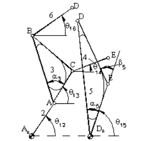

	 

        
 
	

A ve E gibi farklı mafsallar sökülmüş kabul edilebilir (ve sonra birleştirilerek devre denklemi elde edilir). Mafsallar sökülürken hiçbir uzvun zincirden kopmadığına (en az bir mafsal ile bir başka uzva bağlı olduğuna) dikkat edilmelidir. Farklı mafsallar söküldüğünde farklı parametreler tanımlanabilir. Ancak her şartta denklem sayısı ve konum parametresi sayısı bir mekanizma için sabit kalacaktır. Farklı tanımlar kullanıldığında konum parametreleri arasında sabit açı farkları oluşabilir. Bu örnekte B ve C mafsalları yerine D ve E mafsalları söküldüğünde θ 14  ve θ 16  açı tanımları π kadar fark etmiştir.

---

<!-- Kısım 9 -->
# 3.5 Vektör Devre Denklemlerinin Grafik Çözümü

Bir mekanizmanın kinematik analizini yaparken mekanizmayı mümkün olan en basit şekilde çizmemiz yapacağımız işlerini kolaylaştırır. Bu nedenle uzuvlar bir çizgi ile gösterilebilir. Bu çizgilerin uçları bir sembolle gösterilmiş olduğundan, bu çizgiler gerçek anlamda vektördürler ve mutlaka bir ok şeklinde gösterilmelerine gerek yoktur. Yani genel olarak baktığımızda, mafsal merkezlerini (daima çakışan noktaları) değişik semboller (harfler) kullanarak işaretlediğimizde, elde ettiğimiz şekil, vektör devre denklemlerinin grafik gösterimidir. Bu nedenle devre kapalılık denklemleri yazılabilmiştir. Grafik çözüm için yapılması gereken, bu şeklin belirli bir ölçekle kağıt üzerine çizilmesidir (veya bir bilgisayar paket programı kullanarak bilgisayar ekranında benzer bir şekilde çizim yapılabilir. Bu durumda mekanizma ne kadar küçük veya ne kadar büyük olursa olsun görüntüyü ölçeklendirebildiğimizden gerçek boyutlar kullanılabilir).

Birisi sabit uzuv olmak üzere size dört çubuk verilir ve bunları bir zincir haline getirmeniz istenirse, çözüm tek değildir.

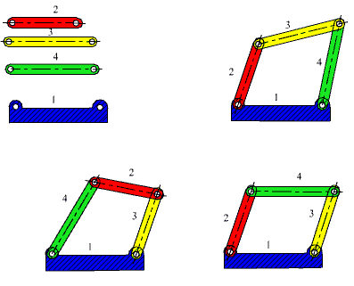

Görüldüğü gibi üç farklı mekanizma elde edilmiştir. Sabit uzva bağlı uzuvların sağ-sol yer değiştirmesi yeni bir mekanizma değildir (sadece aynı mekanizmanın ön veya arka görünüşü olur). Öyle ise bir mekanizmanın tanımlanmış olması için sadece uzuv boyutlarının bilinmesi yeterli değildir. Hangi uzvun hangi uzva hangi mafsalla bağlı olduğu da bilinmelidir.

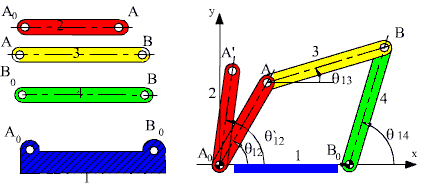

Mekanizmanın monte edilmiş bir konumu biliniyor ise, hareket sırasında uzuvların gelebileceği konumlar sınırlandırılmış ve mekanizmanın hareketi belirlenmiş olacaktır. Şimdi, bu mekanizmanın ekseni A 0  olan döner mafsalı (2 uzvunu) θ 12  açısından θ 12 ′ açısına getirdiğimizde diğer uzuvların konumunu bulalım.

A noktasının yeni konum vektörü (**A 0 A′**) θ 12 ′ verildiğinde şiddet ve yönü bilinmektedir. Vektör devre denklemi:

**A 0 A** + **AB** = **A 0 B 0 ** + **B 0 B**

A noktası A’ (biliniyor) ve B noktası B’ (bilinmiyor) ile değiştirildiğinde, B noktası daima çakışan nokta olduğundan bu yeni konum için:

**A 0 A′**+ **AB′** = **A 0 B 0 ** + **B 0 B′**

olacaktır. Bu denklem aynı zamanda:

**A′B′** = **A 0 B 0 ** − **A 0 A′** + **B 0 B′**

veya:

**A′B′** = **A′A 0 ** + **A 0 B** **0**  + **B 0 B′**

şeklinde yazılabilecektir. **A′A 0 ** + **A 0 B 0 ** vektör toplamı **A′B 0 ** vektörüdür. **A′A 0 ** ve **A 0 B 0 ** vektörleri şiddet ve yön olarak bilinmektedir. **A′B′** ve **B 0 B′** vektörlerinin boyutları bilinmektedir. Bu vektörlerin başlangıç noktaları olan A′ ve B 0  noktalarının konumu bilindiğine göre, B noktasının yeni konumu B′ nü belirlemek için A′ merkezli AB yarı çaplı bir yay ile B 0  merkezli B 0 B yarı çaplı bir yay çizdiğimizde bu yayların kesiştikleri nokta B′ konumunu belirleyecektir.

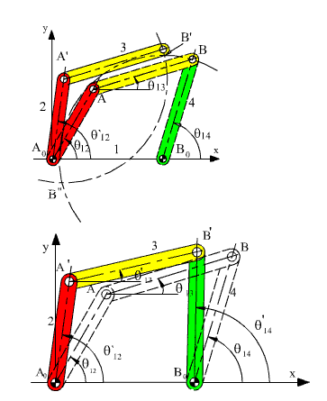

Bu iki yayın iki kesişme noktası (B′ ve B″) olacaktır. Ancak bu kesişme noktalarından birine mekanizma ilk verilmiş olan A 0 ABB 0  konumundan geçebilmesi için mafsallardan birinin sökülüp bir uzuv hareket ettirildikten sonra yeniden bağlanması ile mümkün olacaktır. Eğer bu iki daire kesişmez ise, mekanizma verilmiş olan yeni θ 12 ′ açısı için monte edilmiş olarak bulunamaz.

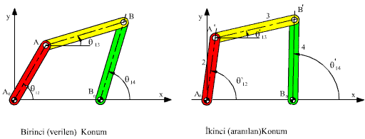

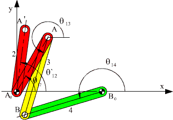

Başlangıçta, aynı uzuvlar yukarıda gösterildiği gibi monte edilmiş olarak verilse ve 2 uzvu θ 12  açısından θ 12 ′ açısına getirdiğimizde diğer uzuvların konumunu bulmak ister isek, bu sefer çözüm farklı olacaktır.

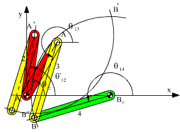

Görüldüğü gibi A′ den AB yarıçaplı daire ve B 0  dan B 0 B yarıçaplı daireler B′ ve B″ noktalarında kesişir. Mekanizmanın verilen A 0 ABB 0  konumundan A 0 A′B′B 0  konumuna geçebilmesi için demonte edilmesi gerekecektir. Bu sefer verilen başlangıç konumuna göre çözüm A 0 A′B″B 0  konumu olacaktır.

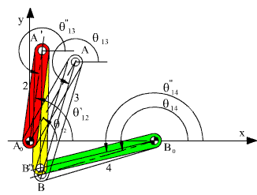

Bu yöntem iki kenarı ve kenarlar arasında kalan açısı verilen bir üçgenin üçüncü kenarının ve açılarının bulunması (AA 0 B 0  üçgeni: A 0 A ve A 0 B 0  kenarı ile θ 12  açısı veriliyor, üçgenin bilinmeyen B 0 A kenarı ve B 0 A nın A 0 B 0  ile yaptığı açı belirleniyor) ve ikinci olarak üç kenarı bilinen bir üçgenin (ABB 0  üçgeni: AB, BB 0  uzuv boyutları olduğundan ve AB 0  ilk üçgenin çözümü sonucu biliniyor) çiziminden farklı bir yöntem değildir.

**Örnek:**

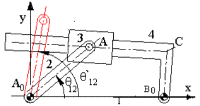

Şekilde gösterilmiş olan mekanizmayı ele alalım. Bu mekanizmada bulunan uzuvların konumunu 2 uzvunun açısal konumu θ 12 ′ iken bulalım. Vektör devre denklemi:

**A 0 A** = **A 0 B 0 ** + **B 0 C** + **CA**

olacaktır. **A 0 B 0 ** vektörünün uzunluğu ve açısı sabittir. **A 0 A** vektörünün ise boyutu sabit olup açısal konumu bağımsız değişken θ 12  nin değeri ile belirlenir. **B 0 C** vektörünün sabit bir boyu vardır. Buna karşın **CA** vektörünün hem boyutu hemde yönü değişecektir. Ancak **B 0 C** ve **CA** vektörleri birbirlerine diktir ve daima böyle kalacaklardır (4 uzvu üzerinde A noktası anlık çakışan nokta olduğundan değişecektir, ancak **CA** vektör yönü 4 uzvu üzerinde kayar çift ekseni olduğundan daima **B 0 C** vektörüne diktir). ACB 0  noktaları daima bir dik açılı üçgeni oluşturacaktır. Dört çubuk mekanizmasında yapıldığı gibi A 0  ve B 0  noktalarını yerleştirdikten sonra ilk olarak verilen θ 12 ′ açısı ile A′ noktasını yerleştirilmiş olan A 0  ve B 0  noktalarına göre yerleştirelim. B 0  merkezli, B 0 C yarıçaplı daireyi çizelim. A′ noktasından bu daireye teğet çizildiğinde kesişen nokta C noktası olacak ve ∠ACB 0  açısı dik açı olacaktır. Bu şekilde 3 ve 4 uzuvlarının yeni konumları belirlenmiştir.

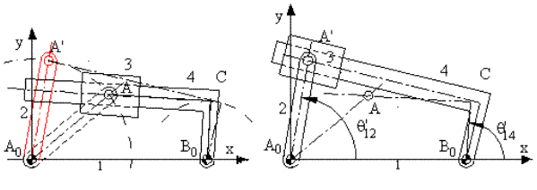

Mekanizmanın tam bir devir için hareket analizi yapılması istenildiğinde, belirli derece aralıklarda yukarıda anlatılmış olan işlemler tekrarlanır. Böyle bir analiz ile mekanizmanın animasyonu gerçekleştirilebilir ve var ise sınır konumları (örneğin θ 12  değerinden sonra saat yelkovanı yönünde veya ters yönünde mekanizmanın kilitlendiği konumları) veya 4 uzvunun dönme yönünü değiştirdiği θ 12  değerleri belirlenebilir.

---

<!-- Kısım 10 -->
# 3.6 Devre Kapalılık Denklemlerinin Konum Değişkenleri İçin Çözümü

Önceki kısımda gördüğümüz gibi, geometrik olarak devre kapalılık denklemlerinin çözümü yeterli parametresi verilmiş olan bir üçgenin diğer parametrelerinin belirlenmesinden ibarettir. Analitik geometri derslerinden bildiğimiz gibi, üçgen bağlantıları aynı zamanda analitik olarak ifade edilerek analitik çözümde yapılabilir. Bu yaklaşımda, tıpkı geometrik yöntemde olduğu, gibi etap etap konum parametrelerinin belirlenmesine çalışılacak ve bunun için seri olarak çözülebilecek bir dizi denklem elde edilecektir. Her bir konum parametresinin sadece bağımsız parametreye göre belirlenmesine çalışılmayacaktır. Yani, bu çalışma sonrası konum parametrelerini bağımsız parametre değerine göre bulabileceği bir “**algoritma**” elde edilecektir. Bu algoritmayı ister bir hesap makinası ile ister özel bir program yazarak veya ister isek çeşitli paket programlarda kolaylıkla çözmemiz mümkün olacaktır.

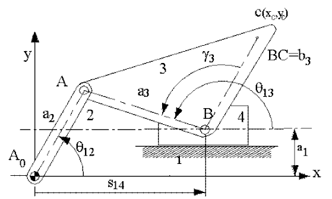

İlk örnek olarak yukarıda görülen bir krank-biyel mekanizmasını ele alalım. Bilinen uzuv boyutlarını a 1 , a 2 , a 3  olarak gösterelim. Amacımız 3 ve 4 uzuvlarının her hangi bir krank açısı, θ 12 , değeri için bulmaktır.

Vektör devre denklemi:

**A 0 A** = **A 0 B** + **BA**

Bu vektörler tanımlanmış olan sabit ve değişken parametrelerle yazıldığında:

**A 0 A** = a 2 (cosθ 12 **i** + sinθ 12 **j**)

**A 0 B** = x**i** + a 1 **j**

**BA** = a 3 (cosθ 13 **i** + sinθ 13 **j**)

olacaktır. x ve y bileşenleri ayrı ayrı birbirlerine eşitlendiğinde, devre kapalılık denklemi iki skaler denkleme dönüşecektir:

 
 
 
 a 2 cosθ 12  = s 14  + a 3 cosθ 13  
 (1) 
 
 
 a 2 sinθ 12  = a 1  + a 3 sinθ 13  
 (2) 
 
 
 

Bu denklemleri bilinmeyen konum parametreleri için yeniden yazdığımızda:

 
 
 
 sinθ 13  = (a 2 sinθ 12  − a 1 )/a 3  
 (3) 
 
 
 s 14  = a 2 cosθ 12  − a 3 cosθ 13  
 (4) 
 
 
 

Verilen giriş kol açısı θ 12  değerine göre, θ 13  değişken değeri (3) denkleminden, s 14  ise (4) denkleminden çözülebilecektir. s 14  değişken değeri θ 13  değeri (3) denkleminden bulunduktan sonra bulunabilir. Her hangi bir C noktasının koordinatlarını, C(x c , y c ), bulmak istediğimizde **A 0 C** = x c **i** + y c **j** konum vektörü **A 0 C** = **A 0 B** + **BC** olarak yazılıp x ve y bileşenleri ayrı ayrı eşitlendiğinde:

 
 
 
 x C  = s 14  + b 3 cos(θ 13  − γ 3 ) 
 (5) 
 
 
 y C  = a 1  + b 3 sin(θ 13  − γ 3 ) 
 (6) 
 
 
 

(5) ve (6) numaralı denklemler (3) ve (4) numaralı denklemler çözüldükten sonra ele alınabilir.

Şu ana kadar göz önüne alınmamış olan çok önemli bir konu bulunmaktadır. Bu, (3) denkleminde θ 13  konum değişkeninin verilen her hangi bir θ 12  açısı için çözümü sırasında denklemi sağlayan iki farklı değerde olabileceğidir. Bunun nedeni kullanılacak olan ters sinüs fonksiyonu çift değerlidir. Yani sinüs açısı karşı kenarın hipotenüse oranı olduğundan, verilen bir sin(θ) değerini θ açısı sağladığı gibi (180° − θ) açısı da sağlayacaktır. Bu açılardan hangisinin mevcut mekanizma için geçerli olduğu, kullanıcı tarafından belirlenmesi gerekir, çünkü yukarıda gösterilmiş olan mekanizma uzuv boyutları aynı olmak üzere, aynı θ 12  krank açısında istenilir ise, aşağıda gösterildiği gibi farklı bir şekilde de monte edilebilir. Matematiğin mekanizmayı nasıl monte ettiğimizi bilmesine imkan yoktur.

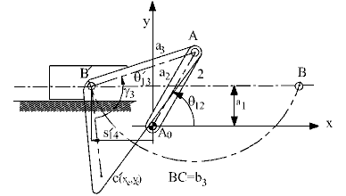

 Krank biyel mekanizmasının aynı krank açısında farklı monte edilişi 

Devre kapalılık denklemi kullanarak elde ettiğimiz konum parametreleri arasındaki ilişki lineer değildir. Bu nedenle her mekanizma için geçerli bir yöntem söylemek mümkün değildir. Yaklaşım genelde üçgenlerin belirlenerek bu üçgenlerin gerekli parametrelere göre çözümünü bulmaktır.

** DÖRT ÇUBUK MEKANİZMASI **

Dört-çubuk mekanizması için kullanılan yönteme **Raven metodu** denmektedir. Aşağıdaki şekilde gösterilmiş olan mekanizma için uzuv boyutları (a 1 , a 2 , a 3 , a 4 ) verilmiştir. Tüm uzuvların konumunu her hangi bir θ 12  değeri için bulmak istiyoruz.

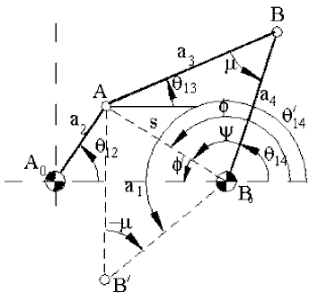

Geometrik yöntemde kullandığımız yönteme benzer bir şekilde ilk olarak A 0 AB 0  üçgenini göz önüne alalım. Bu üçgende iki kenar (a 1 , a 2 ) ve aralarındaki açı (θ 12 ) bilinmektedir. Öyle ise üçüncü kenar (AB 0  = s) ve ϕ′ açısı bu üçgende kosinüs teoremi kullanılarak bulunabilir:

 
 
 
 s =  $           a  1   2   +    a  2   2   −  2   a  1    a  2   cos  ⁡   θ  12        \displaystyle \sqrt{{{{\text{a}}_{1}}^{2}+{\text{a}_{2}}^{2}-2{\text{a}_{1}}{{\text{a}}_{2}}\cos{{\text{θ}}_{{12}}}}}    $                    a             1      ​                      2            +        a            2      ​                      2            −    2     a            1      ​                 a             2      ​               cos        θ              12       ​                    

      ​               
 (1) 
 
 
 ϕ′ = cos -1  $        [      a  1   2   +   s  2   −    a  2   2     2   a  1   s    ]      \displaystyle \left[ {\frac{{{{\text{a}}_{1}}^{2}+{{\text{s}}^{2}}-{{\text{a}}_{2}}^{2}}}{{2{{\text{a}}_{1}}\text{s}}}} \right]    $        [                2      a             1      ​              s                      a             1      ​                      2            +        s             2             −         a             2      ​                      2              ​                ]           (ϕ = π − ϕ′) 
 (2) 
 
 
 
 s ve ϕ′ değerlerini belirlemek için bir başka yöntem ise (ki bu yöntemde ters kosinüs fonksiyonu kullanıldığında ortaya çıkacak olan çifte değerlilik olmayacaktır) **B 0 A** vektörünü **B 0 A** = **B 0 A 0 ** + **A 0 B** olarak yazdıktan sonra :

 
 
 
 s   cosϕ = a 2 cosθ 12  − a 1  (**B 0 A** vektörünün yatay bileşeni ) 
 (1′) 
 
 
 s   sinϕ = a 2 sinθ 12  (**B 0 A** vektörünün dikey bileşeni) 
 (2′) 
 
 
 

Her iki denklemin sağ tarafı bir θ 12  açısı değerine göre **B 0 A** vektörünün yatay ve dikey bileşenlerini verecektir. Vektörü kutupsal koordinatlarda gösteren s ve ϕ değerlerini bulmak ise dik koordinat sisteminden kutupsal koordinat sistemine dönüşümdür. Hesap makinalarında bu işlem (R-P) ile gösterilen tuş ile (dik koordinat sisteminden kutupsal koordinat sistemine dönüşüm) yapılır ise s ve ϕ değerleri elde edilir. Eğer Excel paket programı kullanılır ise ϕ açısının bulunması için ATAN2(X, Y) fonksiyonu kullanılabilir. (s için her iki terimin karelerinin toplamının kare kökü alınır). Mekanizma için s ve geçerli ϕ değeri bulunduktan sonra, ABB 0  üçgeninin her üç kenar uzunluğu bilindiğinden (s = |AB 0 | (θ 12  nin fonksiyonu olarak), |AB| = a 3 , |BB 0 | = a 4 ), kosinüs teoremi ile bu üçgenin açı değerleri bulunabilir:

 
 
 
 μ = cos -1  $        [      a  3   2   +    a  4   2   −   s  2     2   a  3    a  4     ]      \displaystyle \left[ {\frac{{{{\text{a}}_{3}}^{2}+{{\text{a}}_{4}}^{2}-{{\text{s}}^{2}}}}{{2{{\text{a}}_{3}}{{\text{a}}_{4}}}}} \right]    $        [                2      a             3      ​                 a             4      ​                                a             3      ​                      2            +         a             4      ​                      2            −        s             2               ​                ]        
 (3) 
 
 
 ψ = cos -1  $        [      a  4   2   +   s  2   −    a  3   2     2   a  4   s    ]      \displaystyle \left[ {\frac{{{{\text{a}}_{4}}^{2}+{{\text{s}}^{2}}-{{\text{a}}_{3}}^{2}}}{{2{{\text{a}}_{4}}\text{s}}}} \right]    $        [                2      a             4      ​              s                      a             4      ​                      2            +        s             2             −         a             3      ​                      2              ​                ]        
 (4) 
 
 
 

μ ve ψ açıları ters kosinüs fonksiyonu ile elde edildiklerinden 0 ile 180° arasında değer alırlar. Bilinmeyen θ 13  ve θ 14  konum parametreleri eğer mekanizma A 0 ABB 0  şeklinde (açık durum) monte edilmiş ise:

 
 
 
 θ 14  = ϕ − ψ 
 (5) 
 
 
 θ 13  = θ 14  − μ 
 (6) 
 
 
 

Eğer mekanizma A 0 AB’B 0  şeklinde (çapraz durum) monte edilmiş ise:

 
 
 
 θ 14 ′ = ϕ + ψ 
 (5′) 
 
 
 θ 13 ′ = θ 14  + μ 
 (6′) 
 
 
 

olacaktır. Kol-sarkaç boyutlarında mekanizmalar için her θ 12  açısına karşı iki değişik θ 13  ve θ 14  değeri elde edilecektir. Ancak, eğer denklem (3) ve (4) te 1’den büyük bir değerin ters kosinüs fonksiyonunun değeri bulunmak istenir ise, çözüm elde edilemez. Bu, mekanizmanın verilmiş olan θ 12  açısında kapalı bir devre oluşturamayacağını gösterir.

Bu şekilde, konum değişkenleri değerlerini hesaplayabileceğimiz bir denklem dizisi elde etmiş bulunuyoruz.

** KOL-KIZAK MEKANİZMASI **

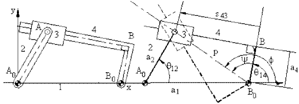

Yukarıda kol-kızak mekanizması gösterilmektedir. Konum analizi için (konum değişkenlerini bulmak için) gereken denklemler:

 
 
 
 p   cosϕ = a 2 cosθ 12  − a 1  
 (1) 
 
 
 p   sinϕ = a 2 sinθ 12  
 (2) 
 
 
 

Excel paket programında ϕ nin çözümü için ATAN2(X,Y) fonksiyonu kullanılır ise her durumda doğru sonuç elde edilebilecektir.

 
 
 
 

ψ = cos -1 (a 4 /p)

s =  $          p  2   −    a  4   2        \displaystyle \sqrt{{{{\text{p}}^{2}}-{{\text{a}}_{4}}^{2}}}    $                   p             2             −         a             4      ​                      2                        ​              

θ 14  = ϕ ± ψ

 
 (3) 
 
 
 (4) 
 
 
 (5) 
 
 
 

Bu denklemlerin çıkarılması okuyucuya bırakılmıştır (sıra ile A 0 AB ve AB 0 B üçgenlerinin çözümünü düşünmek gerekir).

** ÇOK UZUVLU MEKANİZMALAR **

Genellikle çok uzuvlu mekanizmalar dikkatlice incelenir ise, büyük bir kısmının dört uzuvlu devrelerden oluştuğu görülecektir. Her bir devre yukarıda üç temel mekanizma için vermiş olduğumuz yöntem ile çözülebilir. Bu durumda giriş uzvunu içeren devreden başlayarak devreler sırayla çözülebilecektir.

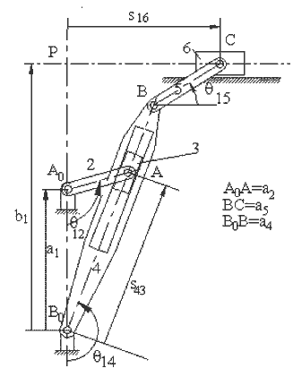

Yukarıda gösterilmiş olan var-gel mekanizmasını ele alalım. 1, 2, 3 ve 4 uzuvlarından oluşan A 0 AB 0  devresi önceden gösterilmiş olan kol-kızak mekanizmasının a 4  = 0 durumundan başka bir şey değildir. Bu devrenin çözümünden θ 14  açısı ve s 43  elde edilebilecektir. 1, 4, 5 ve 6 uzuvlarının oluşturduğu B 0 BCPB 0  devresi ise, bir krank-biyel mekanizmasıdır. Bu devrenin herhangi bir θ 14  açısına göre çözümü ise s 16  ve θ 15  konum parametrelerini verir. Seçilen referans eksenlerine göre konum parametrelerinin tanımına dikkat edilmesi gerekir.

Öyle ise, bilinen θ 12  açısına göre diğer konum değişkenleri:

s 43 cosθ 14  = a 2 cosθ 12  − a 1 

s 43 sinθ 14  = a 2 sinθ 12 

θ 15  = sin -1  $        [     a  4   cos  ⁡   θ  14   +   b  1     a  5    ]      \displaystyle \left[ {\frac{{{{\text{a}}_{4}}\cos{{\text{θ}}_{{14}}}+{{\text{b}}_{1}}}}{{{{\text{a}}_{5}}}}} \right]    $        [                    a             5      ​                               a             4      ​               cos        θ              14       ​               +        b             1      ​                 ​                ]       

s 16  = a 4 sinθ 14  + a 5 cosθ 15 

denklemleri kullanılarak elde edilebilir.

İlk iki denklem kol kızak mekanizması için A 0 AB 0  üçgeninin çözümünü, son iki denklem ise krank biyel mekanizmasının (B 0 BC)çözümünü vermektedir. θ 12  ve θ 14  açılarının istendiğinde dikey bir doğruya göre ölçülmeyip kolaylıkla yatay bir doğruya göre ölçülebileceği açıktır. Ayrıca θ 15  değeri belirlenirken ters sinüs kullanıldığından şekil ile uyumlu olabilmesi için θ 15  açı değeri 90° den küçük olmalıdır.

Bu kısımda açıklanmış olan yöntem pratikte birçok mekanizmanın analizinde kullanılan çok basit bir yöntemdir. Mühim olan mekanizmayı oluşturan basit devreleri belirlemek ve bu basit devrelerin her birini ayrı ayrı çözebilmektir.

**Örnek:**

---

<!-- Kısım 11 -->
# 3.7 Karmaşık Sayılar Kullanılarak Konum Analizi

Karmaşık sayıların devre kapalılık denklemlerinde kullanılışlı olduğunu, genellikle polar gösterim ile devreyi oluşturan her bir vektörü karmaşık sayı kullanarak kolayca tanımlayıp gösterebileceğimizi görmüştük. Karmaşık sayılarla matematiksel işlemler normal sayılarla yapılan cebir işlemleri ile aynı olduğundan (tek bir fark i 2  =  – 1 olacaktır), karmaşık sayılar aynı kolaylıkla mekanizmalarda konum parametrelerinin çözümü için kullanılabilir.

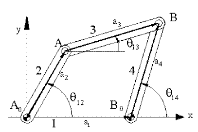

İlk örnek olarak dört-çubuk mekanizmasını ele alalım. Vektör devre denklemi

**A 0 A**** + ****AB**** = ****A 0 B 0 **** + ****B 0 B**

olacaktır. Her bir uzva bağlı konum vektörünün uzunluğu a j , pozitif x-ekseni ile yaptığı açı θ 1j  dersek, karmaşık sayı olarak bu konum vektörü a j e iθ ij   olarak gösterilebilir. Bu durumda devre kapalılık denklemi karmaşık sayılar ile:

 
 
 
 a 2 e iθ 12   + a 3 e iθ 13   = a 1  + a 4 e iθ 14   
 (1) 
 
 
 

Bu denkleminin reel ve sanal kısımları ayrı ayrı eşitlenerek üç konum parametresini (θ 12 , θ 13  ve θ 14 ) içeren iki skaler denklem elde edilebilir. Konum parametrelerinden birisi bağımsız parametre olacağından iki bilinmeyenli iki denklem vardır. Bu denklemler:

a 2 cosθ 12  + a 3 cosθ 13  = a 1  + a 4 cosθ 14 

a 2 sinθ 12  + a 3 sinθ 13  = a 4 sinθ 14 

Bu iki denklemden verilen bir θ 12  açısı değerine göre θ 13  ve θ 14  değerlerini bulabilmek deneme-yanılma gerektirecektir. Bu denklemleri θ 13  ve θ 14  değerlerinin kolayca elde edilebilir hale getirmek gerekmektedir. İsterseniz bu skaler denklemleri kullanarak bu çözümü yapabilirsiniz.

Karmaşık düzlemde kalarak çözüm yapmak istediğimizde, mekanizma için geçerli olan ikinci bir denkleme ihtiyaç vardır. Bu denklemi elde etmek için Mekanizmanın devre denklemini yazdığımız eksen takımına göre, bir aynanın alt yüzeyini x-ekseni ile çakışacak şekilde yerleştirelim. Ayna üzerinde mekanizmanın görüntüsü görülecektir. Gerçek mekanizma hareket ettiği zaman aynadaki görüntü de hareket edecektir ve mekanizmanın oluşturduğu her bir kapalı devreye karşılık ayna görüntüde bir kapalı devre olacaktır.

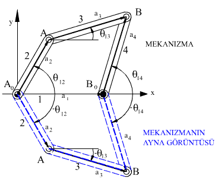

Gerçek devre ile görüntüde oluşan devrede vektörlerin boyutları aynı görülecek ancak gerçek mekanizmada saat yelkovanına ters yönde alınan açılar, ayna görüntüde saat yelkovanı yönünde olacaklardır. Bu görüntüde oluşan devre için, devre kapalılık denklemini yazdığımızda:

 
 
 
 

a 2 e −i  θ 12   + a 3 e −i  θ 13   = a 1  + a 4 e −iθ 14  

 
 (2) 
 
 
 

Elde edilen bu ikinci denkleme **devre kapalılık denkleminin sanal eşleniği** denmektedir. (1) denkleminin geçerli olduğu her durumda bu sanal eşlenik de (2 denklemi) geçerlidir.

Karmaşık sayı düzleminde (1) ve (2) denklemleri iki konum değişkenini bulmak için kullanılabilir. (1) ve (2) denklemlerinin reel ve sanal kısımlarını ayrı ayrı eşitler ve skaler denklemler elde edersek, her iki denklemden elde edilecek olan denklemlerin aynı skaler denklemlere dönüştüğü görülecektir. Yakınsama yöntemi ile nümerik çözüm, ileride açıklanacaktır. Burada bilinmeyen konum parametrelerinden her biri bağımsız konum değişkeninin fonksiyonu olarak nasıl çözülebilir, onu görelim.

Dört çubuk mekanizmasında θ 14  değişkenini θ 12  parametresine göre çözmeyi hedefleyelim. Bu durumda θ 13  konum değişkenini 1 ve 2 numaralı denklemlerden yok etmemiz gereklidir. Devre kapalılık denklemi ve sanal eşleniğinden θ 13  ün yok edilmesi için yok etmek istediğimiz açıyı içeren terimi denklemin sol tarafına alarak yazalım:

 
 
 
 

a 3 e i  θ 13   = a 1  + a 4 e iθ 14   − a 2 e i  θ 12  

 
 (3) 
 
 
 

a 3 e −i  θ 13   = a 1  + a 4 e −iθ 14   − a 2 e −i  θ 12  

 
 (4) 
 
 
 

(yok edeceğimiz değişkeni içeren terim denklemin bir tarafına alınmıştır). (3) ve (4) denklemlerini taraf tarafa çarpar isek :

 
 
 
 

a 3  2 e i(θ 13  − θ 13 )  = (a 1  + a 4 e iθ 14   − a 2 e i  θ 12  )(a 1  + a 4 e −iθ 14   − a 2 e −i  θ 12  )

 
 (5) 
 
 
 

e i(θ − θ)  = e i0  =1 olduğunu hatırlarsak:

 
 
 
 

a 3  2  = a 1  2  + a 4  2  + a 2  2  + a 1 a 4 [e iθ 14   − e −iθ 14  ] − a 1 a 2 [e i  θ 12   + e −i  θ 12  ] − a 2 a 4 [e i(θ 14  −   θ 12 )  − e −i(θ 14  −   θ 12 ) ]

 
 (6) 
 
 
 

Euler denklemine göre  cosθ = (e iθ  + e −iθ )/2 olacağından, (6) numaralı denklem:

a 3  2  = a 1  2  + a 2  2  + a 4  2  + 2a 1 a 4 cosθ 14  − 2a 1 a 2 cosθ 12  − 2a 2 a 4 cos(θ 14  − θ 12 )

olacaktır. Bu denklem:

 
 
 
 

K 1 cosθ 14  − K 2 cosθ 12  + K 3  = cos(θ 14  − θ 12 )

 
 (7) 
 
 
 

şeklinde yazılabilir. Burada K 1  = a 1 /a 2  , K 2  = a 1 /a 4  , K 3  = (a 1  2  + a 2  2  − a 3  2  + a 4  2  )/2a 2 a 4  tür. (7) numaralı denkleme, bunu ilk tanımlayan kişiye atfen **Freudenstein denklemi** denmektedir. Bu denklem dört-çubuk mekanizmalarının sentezinde önemli rol oynar. θ 14  ve θ 12  değişkenleri arasında ilişki bu denklem ile belirlidir. Ancak verilen bir θ 12  değerine karşı gelen θ 14  açısını (7) numaralı denklemden kolayca belirlemek mevcut durumu ile mümkün değildir. Freudenstein denklemini

 
 
 
 

K 1 cosθ 14  − K 2 sinθ 12  + K 3  = cosθ 12 cosθ 14  + sinθ 12 sinθ 14 

 
 (8) 
 
 
 

şeklinde yazabiliriz. t = tan(θ 14 /2) ise

sinθ 14  = 2t/(1 + t 2 )     ve     cosθ 14  = (1 − t 2 )/(1 + t 2 )

olur. Bir açının yarısını kullanarak açının tüm trigonemetrik fonksiyonlarını sadece yarım açının tanjant fonksiyonu ile ifade edilmesi **yarım tanjant yöntemi** olarak bilinir). Bu durumda (8) denklemi:

 
 
 
 At 2  + Bt + C = 0 
 (9) 
 
 
 

olarak yazılabilir. Burada

A = cosθ 12 (1 − K 2 ) + K 3  − K 1 

B = −2 sinθ 12 

C = cosθ 12 (1 + K 2 ) + K 3  + K 1 

dir. Dikkat edilirse, θ 12  bağımsız parametre değeri ve uzuv boyutları biliniyor ise A, B ve C parametre değerlerini hesaplayabiliriz. (9) numaralı denklem t’ye göre ikinci dereceden bir denklemdir ve çözümü

 $       tan  ⁡   (    θ  14   2   )   =    −  B  ±     B  2   −  4  AC      2  A       \displaystyle \tan \left( {\frac{{{{\text{θ}}_{{14}}}}}{2}} \right)=\frac{{-\text{B}\pm \sqrt{{{{\text{B}}^{2}}-4\text{AC}}}}}{{2\text{A}}}    $      tan      (               2                   θ              14       ​                 ​                )      =                    2   A                 −   B     ±                 B             2             −    4   AC                 ​               ​                 

dır. Bilinmeyen θ 14  açısı bu durumda

 
 
 
  $         θ  14   =  2   tan  ⁡   −  1     [    −  B  ±     B  2   −  4  AC      2  A    ]       \displaystyle {{{\text{θ}}_{{14}}}=2{{\tan }^{{-1}}}\left[ {\frac{{-\text{B}\pm \sqrt{{{{\text{B}}^{2}}-4\text{AC}}}}}{{2\text{A}}}} \right]}    $           θ              14       ​               =    2     tan             −  1                [                2   A                 −   B     ±                 B             2             −    4   AC          

      ​               ​                ]         
 (10) 
 
 
 
 olur. (10) denklemi diskriminantın artı veya eksi işaret almasına göre iki değişik θ 14  değeri verecektir. Bu mekanizmanın iki farklı şekilde monte edilmesi ile ilgilidir.

Benzer yöntem kullanılarak devre kapalılık denkleminden θ 14  açısı yok edilerek θ 13  açısı için θ 12  ye göre aynı şekilde elde edilebilir (veya θ 12  değeri ile birlikte bu değere göre bulunan θ 14  açı değeri kullanılarak θ 13  açısı değeri bulunabilir). Montaj şekline göre uygulamada bir tanesi geçerli olacaktır. A, B ve C sadece uzuv boyutlarına ve bağımsız konum parametresi olan giriş kolu açısına bağlıdır. B 2  − 4AC < 0 ise, verilmiş olan kol açısında (θ 12 ) mekanizma monte

edilemez.

Benzer yöntem kullanılarak devre kapalılık denkleminden θ 14  açısı yok edilerek θ 13  açısı için θ 12  ye göre aynı şekilde elde edilebilir (veya θ 12  değeri ile birlikte bu değere göre bulunan θ 14  açı değeri kullanılarak θ 13  açısı değeri bulunabilir).

Denklem (8)’i θ 14  açısına göre çözmek için kullanılabilecek farklı bir yöntem için bu denklemi

 
 
 
 (K 1  − cosθ 12 )cosθ 14  − sinθ 14 sinθ 12  = K 2 cosθ 12  − K 3  
 (11) 
 
 
 

şeklinde yazalım. Ayrıca:

 
 
 
 

D cosϕ = K 1  − cosθ 12 

D sinϕ = sinθ 12 

 
 (12) 
 
 
 

der isek:

 
 
 
  $        D  =      (    K  1   −  cos  ⁡   θ  12    )   2   +   sin  ⁡  2    θ  12     =    1  +    K  1   2   −  2   K  1   cos  ⁡   θ  12         \displaystyle {\text{D}=\sqrt{{{{{\left( {{{\text{K}}_{1}}-\cos {{\text{θ}}_{{12}}}} \right)}}^{2}}+{{{\sin }}^{2}}{{\text{θ}}_{{12}}}}}=\sqrt{{1+{{\text{K}}_{1}}^{2}-2{{\text{K}}_{1}}\cos {{\text{θ}}_{{12}}}}}}    $        D     =                  (       K             1      ​               −    cos        θ              12       ​              )              2             +        sin             2               θ              12       ​                    

      ​             =             1    +         K             1      ​                      2            −    2      K             1      ​               cos        θ              12       ​                           ​               

 $        ϕ  =   tan  ⁡   −  1      sin  ⁡   θ  12      K  1   −  cos  ⁡   θ  12         \displaystyle {\text{ϕ} ={{\tan }^{{-1}}}\frac{{\sin {{\text{θ}}_{{12}}}}}{{{{\text{K}}_{1}}-\cos {{\text{θ}}_{{12}}}}}}    $        ϕ     =       tan             −  1                            K             1      ​               −    cos        θ              12       ​                           sin        θ              12       ​                 ​                   
 (13) 
 
 
 
 olacaktır. Bu tanımlarla denklem (11):

Dcosϕcosθ 14  − Dsinϕsinθ 14  = K 2 cosθ 12  − K 3 

tür. cos (θ + ϕ) = cosθcosϕ − sinθsinϕ trigonometrik eşitliği kullanır isek:

 
 
 
 cos(θ 14  + ϕ) = (K 2 cosθ 12  − K 3 )/D 
 (14) 
 
 
 

veya

 
 
 
 θ 14  = cos -1 [(K 2 cosθ 12  − K 3 )/D] − ϕ 
 (15) 
 
 
 

(13) numaralı denklemin ϕ açısına göre çözümü sırasında açının doğru değerini bulmak için R-P tuşu veya ATAN2(x.y) fonksiyonunun kullanımı ihmal edilmemelidir. (15) numaralı denklemde ters kosinüs fonksiyonunun iki değişik değeri mekanizmanın iki farklı montaj şeklini verecektir.

Devre kapalılık denklemlerinin konum değişkenleri için çözümüne bir başka örnek olarak kol-kızak mekanizmasını ele alalım. Bu mekanizmada θ 12  bağımsız konum değişkeni, θ 14  ve s 43  ise bağımlı konum değişkenleridir. Amacımız her θ 12  açısına karşı gelen θ 14  değerini elde edebileceğimiz denklemi elde etmektir.

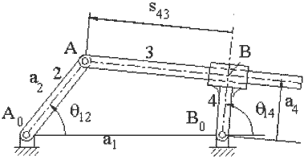

Vektör devre denklemi:

**A 0 A** = **A 0 B 0 ** + **B 0 B** + **BA**

olacaktır ve karmaşık sayılar ile yazıldığında:

a 2 e i  θ 12   = a 1  + a 4 e iθ 14   + s 43 e i(θ 14  + π/2) 

veya

 
 
 
 a 2 e i  θ 12   = a 1  + a 4 e iθ 14   + is 43 e iθ 14   
 (1) 
 
 
 

Bu denklemin karmaşık eşleniği (mekanizmanın ayna görüntüsünde devre denklemi):

 
 
 
 a 2 e −i  θ 12   = a 1  + a 4 e −i  θ 14   − is 43 e −i  θ 14   
 (2) 
 
 
 

olacaktır. s 43  parametresini bu iki denklemden yok etmek için bunu ihtiva eden terimi tek başına bırakalım.

 
 
 
 

is 43 e iθ 14   = a 2 e i  θ 12   − a 1  − a 4 e iθ 14  

 
 (3) 
 
 
 

is 43 e −i  θ 14   = a 1  + a 4 e −i  θ 14   − a 2 e −i  θ 12  

 
 (4) 
 
 
 

s 43  parametresini yok etmek için 3 denklemini e −i  θ 14   ve 4 denklemini e i  θ 14   ile çarpıp birbirlerine eşitleyelim:

a 2 e i(θ 12  −   θ 14 )  − a 1 e −i  θ 14   − a 4  = a 1 e i  θ 14   + a 4  − a 2 e −i(θ 12  −   θ 14 ) 

veya

 
 
 
 

a 2 [e i(θ 12  −   θ 14 )  + e −i(θ 12  − θ 14 ) ]− a 1 [e i  θ 14   + e −i  θ 14  ] − 2a 4  = 0

 
 (5) 
 
 
 

e i  θ  + e −i  θ  = 2cosθ olduğu hatırlanır ise:

 
 
 
 a 2 cos(θ 14  − θ 12 ) − a 1 cosθ 14  − a 4  = 0 
 (6) 
 
 
 

Denklem 6 yı kullanarak verilen bir θ 12  değerine göre θ 14  değerini çözmemiz için cos(θ 14  − θ 12 ) yi trigonometrik eşitlik kullanarak açalım:

a 2 cosθ 14 cosθ 12  + a 2 sinθ 14 sinθ 12  − a 1 cosθ 14  − a 4  = 0

veya:

a 2 (cosθ 12  − a 1 )cosθ 14  + a 2 sinθ 14 sinθ 12  − a 4  = 0

olacaktır. Dört-çubuk mekanizması için elde edilmiş olan denklemde yapılmış olduğu gibi, cosθ 14  ve sinθ 14  fonksiyonları t = tan(θ 14 /2) ile gösterilerek gerekli basitlemeler yapıldığında:

 
 
 
 At 2  + Bt + C = 0 
 (7) 
 
 
 

bu denklemde:

A = a 1  − a 4  − a 2 cosθ 12 

B = 2sinθ 12 

C = a 2 cosθ 12  − a 1  − a 4 

Bu ikinci derece denklemin θ 14  açısı için çözümü kolayca yapılabilir. Genel olarak yarım tanjant yöntemi kapalı çözüm elde edilmesi için kuvvetli bir yöntem olarak görülmektedir (eğer istenilir ise dört-çubuk mekanizması için verilen ve (11)-(15) numaralı denklemlerle açıklanmış olan farklı yöntem de kullanılabilir).

Eğer s 34  konum değişkenini θ 12  ye göre bulmamız gerekiyor ise bu sefer θ 14  parametresini devre denkleminden yok etmemiz gerekecektir. Bu durumda devre kapalılık denklemi ve onun karmaşık eşleniği:

(a 4  + is 43 )e iθ 14   = a 2 e i  θ 12   − a 1 

(a 4  − is 43 )e −iθ 14   = a 2 e −i  θ 12   − a 1 

şeklinde yazılabilir. Taraf tarafa çarpım yapıldığında θ 14  açısı yok edilecek ve s 43  için çözüm:

s 43  2  = a 1  2  + a 2  2  − a 4  2  − 2a 1 a 2 cosθ 12 

olacaktır. Bu çözümleri elde ederken sin -1 , cos -1 , tan -1  gibi ters trigonometrik fonksiyonlar kullanılır iken bu fonksiyonların iki değerli olduğu ve hesap makinesi, veya başka herhangi bilgisayar program paketinin bu değerlerden birini vereceğini, mekanizmanın bağlanış şekline göre hangi değerin geçerli olduğuna kullanıcı olarak bizim karar vermemiz gerektiği unutulmamalıdır.

Geometrik çözümde gördüğümüz gibi, uygulamada birçok çok uzuvlu mekanizma basit mekanizmaların bağlanması ile elde edilmiştir. Basit mekanizmalar için elde edilen bu çözümler daha karmaşık mekanizmaların çözümünde kolayca kullanılabilir.

---

<!-- Kısım 12 -->
# 3.8 Devre Kapalılık Denklemlerinin Sayısal Çözümü

Elde etmiş olduğumuz denklemler ve benzer yöntemlerle başka mekanizmalar için elde edeceğimiz denklemler bir mekanizmanın her hangi bir konumunu veya mekanizmanın olası tüm konumlarını belirlememizi sağlar. Bunun için uzuv boyutları bilindiğinde bu denklemlerin sayısal olarak çözülmesi gereklidir. **Mühendislikte analitik çalışmalar sonucunda elde edilenler sayısal değerlere dönüştürülmeden yapılanların uygulamaya indirilebilmesi mümkün değildir.**

Mekanizmaların sayısal çözümü uzun yıllar çizim masasında pergel ve cetvel kullanılarak geometrik yöntemlerle yapılmıştır. Bu yöntemin olumlu yanı kişinin yapmakta olduğu işi çok iyi canlandırmasına olanak tanımasıdır. Benzer geometrik çözüm bilgisayarlarda günümüzde AUTOCAD ® , SOLIDWORKS ®  ve benzeri çizim programları kullanılarak yapılabilir. Geometrik yöntem açıklanırken bu tür çözümün örnekleri verilmiştir. Ancak geometrik yöntemler çok zaman aldığı gibi, hassasiyetleri sınırlı olup uygulayan kişinin becerilerine çok bağlı olduğundan mühendislikte sayısal çözüme daima ihtiyaç duyulmuştur.

Bilgisayarların uygulamaya girdiği ilk yıllarda mekanizmaların bilgisayar destekli analizi ve sentezi söz konusu olmuştur. 1950’li yıllardan itibaren ilk olarak elde edilmiş olan analitik denklemler ve algoritma FORTRAN programlama dili ile bilgisayarlara uyarlanmıştır. Bilgisayarlar teknolojisinde gelişmelerle birlikte BASIC, PASCAL ve C lisanları da bu algoritmaların bilgisayarlarda uyarlanmasında kullanılmıştır. Bu uygulamaların sonucu ne yazıkki görsel açıdan çok zayıf olup genellikle çok sayıda rakamlardan oluşan uzun bilgisayar çıktıları olmuştur. Bu nedenle işin uzmanları tarafından çok özel uygulamalar için kullanılabilmiştir. Bu bilgisayar lisanlarına günümüzde grafik komutlar kazandırılmış olmalarına rağmen, genellikle grafik uygulamalar için grafik özellikleri daha uygun ve kullanıcı ile etkileşimli program yazılmasına uygun olanaklar ve ortam oluşturabilen VisualBasic, VisualC++ ve Delphi gibi program yazma platformları geliştirilmiştir.

Kişisel bilgisayarlarla birlikte bilgisayar kullanımının daha yaygınlaşabilmesi için kullanıcılara öğrenilmesi programlama dillerinden nispeten daha kolay, genel amaçlı kullanıcı ile iletişimli paket programlar geliştirilmiştir. En yaygın olan paket programlar bilgisayarın bir yazıcı olarak çalışmasını sağlayan paket programlardır. Daktilodan çok daha farklı olarak, değişik yazı karakterleri ve boyutları kullanmamıza olanak tanıyan, satır sonlarını düzenleyen bu paket programlar günümüzde daktilolardan daha fazla kullanılmaktadır. İkinci yaygın paket program ise, çarşaf liste hazırlamak için kullanılan programlardır. Bu programlar ilk olarak muhasebe işlemlerini kolaylaştırmak için düşünülmüştür. Örneğin masrafları gösteren bir kolondaki sayılar kolayca toplanabilir veya maliyeti gösteren bir kolon belirli bir genel gider yüzdesi ile çarpıldıktan sonra elde edilmesi hedeflenen yüzde kar ile çarpılarak bir başka kolona satış fiyatı kolonu olarak elde edilmesi açısından bu tür liste programları çok kullanılışlı olmuştur. Bir başka benzer bir örnek bir derste öğretmenin her bir öğrenci için girdiği değişik ağırlıkta (sınav, final, ödev, laboratuvar notları) notların girilip her bir öğrenci için sonuç ortalamanın belirlenmesi de olabilir. Ancak zamanla basit çarpma, bölme toplama gibi hesaplamalardan çok daha fazla fonksiyonları (her türlü istatistik işlemleri, trigonometrik fonksiyonları) içerir hale getirilen bu programlar günümüzde mühendisler için her türlü analizi yapabilecek, sonucu grafik olarak gösterebilecek vazgeçilemeyen bir paket olmuştur. Günümüzde Microsoft Excel ®  en fazla kullanılan çarşaf liste programıdır. Ancak son yıllarda tamamen açık ortamda, kullanımı yaygınlaşan ofis programları bulunmaktadır. Örneğin, ücretsiz olarak kullanılabilecek bir paket program olan LibreOffice içinde bulunan Calc paket programı da çarşaf liste programı olup Excel’de yapılan tüm işlemler yapılabilmektedir. Günümüzde bu paket programlarının çok yaygın olarak bilgisayarlarda olması, bu paket programların her mühendis tarafından öğrenilmesini gerekli kılmaktadır. Burada Excel kullanılarak açıklanan tüm işlemler Calc kullanılarak da aynı şekilde yapılabilir hatta Excel veya Calc’ta hazırlanan bir sayfa diğer programda açılarak kullanılabilir (ufak farklılıklar bulunmaktadır ancak önemli sorun teşkil etmemektedir. Her iki program Windows ortamında çalıştırılabilmektedir).

Mühendislik hesaplarında Excel kullanımı için

---

<!-- Kısım 13 -->
# 3.9 Devre Kapalılık Denklemlerinin İteratif Yöntemle Çözülmesi

Önceki kısımlarda devre kapalılık denklemleri kullanılarak konum değişkenleri arasında analitik ilişkiler değişik yöntemlerle bulunmaya çalışılmıştır.  Genel olarak her bir devre kapalılık denkleminde iki yeni bilinmeyen konum değişkeni bulunuyor ise, bu iki bilinmeyen için analitik bir çözüm elde edilebilecektir.  Bu durumlarda denklemleri bilinmeyen konum parametrelerine göre önceki kısımlarda gösterildiği gibi, doğrudan çözmek daha uygundur. Eğer devre kapalılık denklemlerinin her birinde ikiden fazla bilinmeyen konum değişkeni var ise, bu konum değişkenlerini bağımsız konum değişkenine göre belirlemek genel olarak mümkün değildir (bazı özel durumlarda mümkün olabilir). Bu durumlar geometrik yöntem uygulandığında deneme-yanılma gerektirmiştir. Ancak eğer mekanizma serbestlik derecesine uyuyor ise, elde edilen vektör devre denkleminin iki katı kadar bilinmeyen konum değişkeni ve serbestlik derecesi kadar bağımsız konum değişkeni bulunacaktır. Analitik çözüm elde edilemediği durumlarda veya her türlü mekanizmanın analizini yapmak için genel bir algoritma oluşturmak istediğimizde, devre kapalılık denklemlerinin sayısal yöntemlerle iteratif (yinelemeli) çözümü düşünülmelidir.

Devre kapalılık denklemlerine baktığımızda, her birinden iki lineer olmayan cebirsel denklem elde edeceğimize göre, bu denklemler:

 
 
 
 F j (**x**) = 0 
 j = 1, 2, 3, …, n 
 (1) 
 
 
  
 **x** = [x 1  x 2  x 3  … x n ] T  
  
 
 
 

şeklinde yazılabilir. Bu gösterimde F k (**x**) devre kapalılık denkleminden elde edilen karmaşık sayılar veya reel sayılarla ifade edilebilen devre sayısının iki katı kadar lineer olmayan denklem takımıdır. Vektör **x** ise bilinmeyen konum değişkenleri: θ 1j  veya s ij  den oluşur. F j (**x**) ve türevleri, çözümü olduğu bölgede tanımlı ise, F j (**x**) = 0 denklemlerinin bilinmeyen değerlere göre çözümü **Newton-Raphson metodu** olarak bilinen iterasyon metodu ile yapılabilir. Bu metod denklemleri küçük aralıklarda lineer olarak kabul eder ve bu lineer denklem takımı için çözüm bularak lineer olmayan denklem takımının çözüme doğru yaklaşıp yaklaşmadığını kontrol eder (F j (**x**) = ε ise, her basamakta lineer denklem çözümünün ε değerini daha küçültüp küçültmediği) ε’un yeteri kadar küçük değerini veren x bilinmeyen değerleri çözümdür. Bu tür lineer olmayan denklem takımlarını çözmek için başka nümerik yöntemler de mevcuttur. Burada gerek basit olması ve gerekse mekanizmaların çözümünde oldukça iyi sonuç vermesi nedeni ile Newton-Raphson metodu açıklanacaktır. Okuyucu herhangi bir nümerik metod kitabından diğer yöntemleri öğrenebilir.

F(x) = 0 gibi tek değişkenli bir denklemi ele alalım. Denklem skaler değişken x’e göre lineer değildir. Bu denklemde x = x* değerinin denklemin çözümü (kökü) olduğunu (yani F(x*) = 0) ve x (k)  nın ise, x* değerine yakın bir değer olduğunu kabul edelim. F(x) denkleminin x = x (k)  noktası civarında Taylor serisi açılımını yaparsak

 
 
 
 F(x) = F(x (k) ) + F x (x (k) )(x − x (k) ) + (yüksek mertebe terimler) 
 (2) 
 
 
 

olur. F x (x), F(x) denkleminin x’e göre birinci türevidir: F x (x) = dF(x)/dx. Eğer x (k)  = x* olsa idi, F(x (k) ) = 0 olacak ve x (k)  aradığımız çözüm olacak idi. Hatalardan dolayı bu olmayacaktır.

x = x (k+1)  in x* çözüm değerine x (k)  dan daha yakın bir tahmin olduğunu varsayalım. F(x (k+1) ) ≈ 0 olduğu varsayılır ve F(x (k+1) ) için Taylor serisi kullanılarak x (k)  ya göre açılımı yazıldığında:

 
 
 
 F(x (k+1) ) ≈ F(x (k) ) + F x (x (k) )(x (k+1)  − x (k) ) = 0 
 (3) 
 
 
 

olacaktır. x (k+1)  − x (k)  aralığı yeterince küçük ise veya denklem lineer ise, yüksek mertebe terimlerin ihmal edilmesi büyük bir yanlışa neden olmayacaktır (tabi eğer sonsuz sayıda terim kullanıp seriyi sıfıra eşitleyip çözüm yapsak x*’ı hemen bulabilirdik. Ne yazık ki bu mümkün değil, ve sadece ilk terimle yetineceğiz). Eğer F x (x (k) ) sıfıra eşit değil ise, (3) denkleminden x (k+1)  çözülebilir:

 
 
 
 x (k+1)  = x (k)  − F(x (k) )/F x (x (k) ) 
 (4) 
 
 
 

(4) denklemi Newton-Raphson metodu ile elde edilen tekrarlama denklemidir. Yüksek mertebe terimler ihmal edilmiş olduğundan, x (k+1)  denklemi sıfıra eşitleyen çözüm değildir. Ancak x (k)  ya göre x*’a daha yakın bir noktaya gelinebilecektir. Yeni değer ile denklemin sıfıra daha yaklaştığı görülür ise, (4) denklemini tekrar tekrar kullanmamız mümkün olacak ve m defa uygulandıktan sonra |F(x (m) )| < ε olacaktır. Burada ε, kendisinden küçük olan değerleri sıfır kabul edebileceğimiz küçük bir değerdir. Tabi ki ε probleme göre değişecek ve bazı problemlerde m sayısı ne kadar büyük olursa olsun |F(x (m) )| < ε şartı sağlanamayacaktır (yakınsama olmayacaktır). Birçok uygulama için örneğin ε = 10 -6  gibi küçük bir değer kabul edilebilir. Bu durumda F(x) = 0 denklemini sağlayan x değerini bulmak için bir algoritma ortaya çıkacaktır:

 

- F(x) = 0 denklemini sağlayacak x* değeri için x(0) değerini tahmin edelim.

- F(x(k+1)) değerini k = 0, 1, 2, …, m, basamak kadar (4) numaralı denklem kullanarak etap etap belirleyelim ve her etapta |F(x(k+1))| < εe olup olmadığını veya |x(k+1) − x(k)| < εs olup olmadığını kontrol edelim. Bu iki eşitsizlikten birisi sağlanıyor ise duralım. x(k+1) aradığımız çözümdür. (εe denklem hata toleransı, ve εs ise çözüm hata toleransıdır). Eğer Fx(x(k+1)) = 0 ve F(x(k+1)) ≠ 0 ise, 1. basamağa gidip yeni bir x(0) tahmini yapılması gereklidir. Aksi takdirde işlem devam eder.

- k+1 yerine k yerleştirip 2 basamak tekrarlanır. Eğer işlem m defa tekrarlandığı halde |F(x(k+1))| < εe veya |x(k+1) − x(k)| < εs sağlanamamış ise, çözüm bulunamamıştır. Durulması gerekir. İşleme yeni bir x(0) değeri ile yeniden başlanabilir veya farklı bir yöntem denenebilir.
 

Newton-Raphson algoritması çoğu uygulama probleminde gittikçe çözüme yaklaşan bir dizi sonuç verecektir. Genel olarak |F(x)| < ε e  şartına sınırlı sayıda basamakta erişilecektir. Ancak eğer x (0)  değeri x*’a yeteri kadar yakın değilse, ε e  ve ε s  değerleri eldeki probleme göre çok küçük seçildi ise, veya çözülmesi istenilen problemde F(x) fonksiyonu ve türevleri düzgün ve yumuşak bir davranış göstermiyorlarsa, çözüm bulunamayabilir. Bazı durumlarda ise, bulunan çözüm aranılan x* çözümü olmayabilir (lineer olmayan denklemlerde F(x) = 0 denklemini sağlayan birden fazla kök olabilir).

Geometrik olarak Newton-Raphson yöntemi aşağıda Şekil (a) da gösterilmektedir. Her noktada F(x) eğrisi, eğimi F x  olan bir doğru olduğu kabul edilmekte ve o doğrunun kökü (sıfır olan x değeri) bulunmaktadır. Normal durumlarda kök çok az sayıda basamakta hızla bulunabilir. Ancak Şekil (b),(c), ve (d) de görüldüğü gibi, yöntem bazı durumlarda istenilen çözüme yönelmeyebilir, veya hiçbir çözüm bulunamayabilir.

 

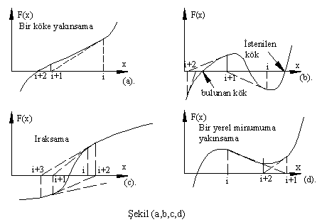

      

Şu ana kadar Newton-Raphson metodu bir değişkenli bir denklem için açıklanmıştır. Aynı yöntem kolaylıkla n bilinmeyenli n lineer olmayan denklem takımının çözümü için kullanılabilir. Bu durumda Newton-Raphson algoritmasını genelleştirmemiz gerekecektir. n bilinmeyenli n lineer olmayan denklem takımı:

 
 
 
 F 1 (**x**) = F 1 (x 1 , x 2 , x 3 , …., x n ) = 0**
F 2 ( x ) = F 2 (x 1 , x 2 , x 3 , …, x n ) = 0

F 3 ( x ) = F 3 (x 1 , x 2 , x 3 , …, x n ) = 0

……

F n ( x ) = F n (x 1 , x 2 , x 3 , …, x n ) = 0 
 (5) 
 
 
 

veya:

 F ( x ) =  0 

olarak yazılabilir. Çözüm  x*** = [x* 1  x* 2  x* 3  … x* n ] T  dir. Denklemleri kök olduğunu tahmin ettiğimiz değer olan **x** (k)  = [x (k)  1  x (k)  2  x (k)  3  … x (k)  n ] T  noktasında Taylor serisine göre açalım ve seride sadece birinci mertebe terimleri tutalım (diğer terimleri tek denklem için yaptığımız gibi, sıfıra çok yakın değerler olduğunu kabul edip ihmal edeceğiz). Bu durumda:

 
 
 
 **F**(**x**) ≈ **F**(**x** (k) ) + **F x **(**x** (k) )(**x** − **x** (k) ) 
 (6) 
 
 
 

olacaktır. Bu denklemde **F x **(**x** (k) ), **x** (k)  noktasında hesaplanan **Jacobian matrisi**dir # . Eğer **x** = **x** (k+1)  çözüme daha yakın bir değer olması isteniyor ise, **x** (k)  dan daha iyi bir değer:

**F**(**x** (k+1) ) ≈ **F**(**x** (k) ) + **F x **(**x** (k) )(**x** (k+1)  − **x** (k) ) = **0**

 

 #  Jacobian matrisi: **F x ** =  $        [       F   1   x  1          F   1   x  2         ⋯       F   1   x  n            F   2   x  1          F   2   x  2         ⋯       F   2   x  n            ⋮            ⋮           ⋱       ⋮              F   nx  1         F   nx  2        ⋯       F   nx  n        ]      \displaystyle \left[ {\begin{array}{cccc} \text{F}_{1\text{x}_1}&\text{F}_{1\text{x}_2}&\cdots&\text{F}_{1\text{x}_\text{n}} \\ \text{F}_{2\text{x}_1}&\text{F}_{2\text{x}_2}&\cdots&\text{F}_{2\text{x}_\text{n}} \\ \vdots&\vdots&\ddots&\vdots \\ \text{F}_{\text{nx}_1}&\text{F}_{\text{nx}_2}&\cdots&\text{F}_{\text{nx}_\text{n}} \end{array}} \right]    $                ⎣                  ⎡     ​                           F            1    x           1     ​                ​                    F            2    x           1     ​                ​                   ⋮             F              nx           1     ​                ​               ​                         F            1    x           2     ​                ​                    F            2    x           2     ​                ​                   ⋮             F              nx           2     ​                ​               ​                       ⋯        ⋯        ⋱        ⋯     ​                         F            1    x            n      ​                ​                    F            2    x            n      ​                ​                   ⋮             F              nx            n      ​                ​               ​                         ⎦                  ⎤     ​                

burada F kx  m , F k  nın x m  e göre kısmi türevidir.

 
 
 
 **F** x (**x** (k) )Δ**x** (k) = −**F**(**x** (k) ) 
 (7) 
 
 
 

yazılır. Burada Δ**x** (k) = **x** (k+1)  − **x** **(**k)  veya **x** (k+1) = **x** (k)  + Δ**x** (k)  dır.

Denklem takımı için Newton-Raphson algoritması:

 

- Başlangıçta F(x) = 0 için x(0) değerlerinin çözüm olduğunu varsayalım.

- k = 0, 1, 2, …, m iterasyonlarında, Δx(k), x(k+1) ve F(x(k+1)) değerlerini hesaplayın. Eğer |F(x(k+1))| < εe ve |x(k+1) − x(k)| < εs ise durun. x(k+1) aranılan sonuçtur (εe denklem hata toleransı ve εs ise çözüm tolerans vektörleridir). Eğer |Fx(x(k+1))| = 0 ve F(x(k+1)) ≠ 0 ise, kökler için yeni bir tahmin yapıp birinci basamağa dönülür. Aksi takdirde 3. basamakla devam edilir.

- k + 1 değerlerini k olarak ele alıp 2. basamağa dönülür. Eğer bu işlem m defa yapıldığı halde |F(x(k+1))| < εe veya |x(k+1) − x(k)| < εs sağlanamadı ise, çözüm bulunamamıştır. Algoritmanın durdurulması gerekir. İşleme yeni bir x(0) tahmin vektörü ile yeniden başlanabilir veya farklı bir yöntem denenebilir.
 

**Örnek:**

Newton-Raphson algoritmasını göstermek için aşağıdaki şekilde görülen mekanizmayı ele alalım. Bu mekanizmanın bilinmeyen konum değişkenlerini belirlemek için deneme yanılma yapmadan verecek kapalı denklemler elde etmemiz mümkün değildir. Karmaşık sayılar ile devre kapalılık denklemleri:

a 2 e iθ 12   = b 1  − ic 1  + a 5 e iθ 15   + s 4 e iθ 14  

a 5 e iθ 15   + a 4 e iθ 14   = −b 1  + ia 1  + s 6 

şeklindedir. Bu denklemler:

b 1  − ic 1  − a 2 e iθ 12   + a 5 e iθ 15   + s 4 e iθ 14   = 0

b 1  − ia 1  − s 6  + a 5 e iθ 15   + a 4 e iθ 14   = 0

olarak yazılabilir.

 

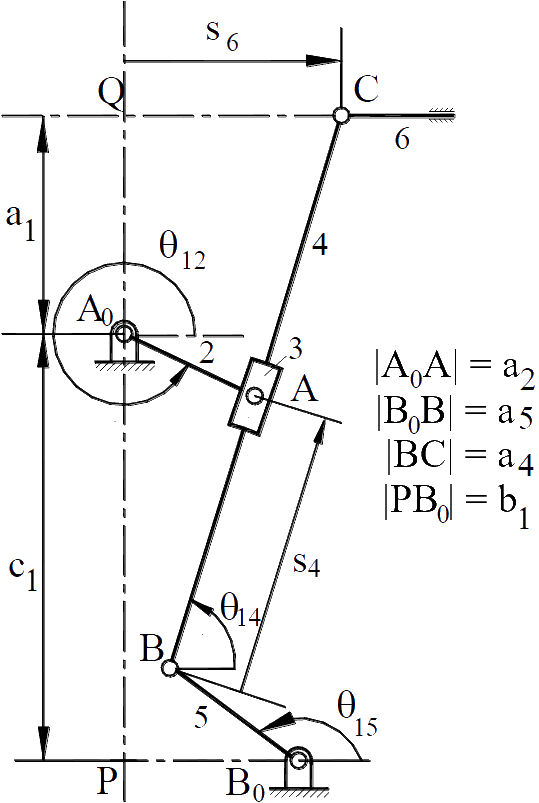

 

veya reel sayılarla:

b 1  − a 2 cosθ 12  + a 5 cosθ 15  + s 4 cosθ 14  = 0

−c 1  − a 2 sinθ 12  + a 5 sinθ 15  + s 4 sinθ 14  = 0

b 1  − s 6    + a 5 cosθ 15  + a 4 cosθ 14  = 0

−a 1    + a 5 sinθ 15  + a 4 sinθ 14  = 0

denklemleri elde edilir (karmaşık sayılar kullanarak denklemlerin karmaşık eşlenikleri kullanarak da dört denklem elde edilebilir. Bu örnekte reel sayılar kullanılacaktır). Elde edilen denklem takımı:

F 1 (θ 14 , θ 15 , s 4 ) = 0

F 2 (θ 14 , θ 15 , s 4 ) = 0

F 3 (θ 14 , θ 15 , s 6 ) = 0

F 4 (θ 14 , θ 15 ) = 0

şeklindedir. Verilen θ 12  değerine göre bilinmeyen konum değişkenleri: θ 14 , θ 15 , s 4  ve s 6  değerlerini bulmak istiyoruz. Bu konum değişkenlerinin değeri olarak başlangıçta yapabileceğimiz ilk tahminler: θ 14  0 , θ 15  0 , s 4  0 , s 6  0  olsun. Bu değerleri devre kapalılık denklemlerine yerleştirir isek denklemler sıfıra eşit olmayacak, her biri ε i  gibi bir farklı değerlere eşit olacaktır. Bu değerin küçük olması bizim çözüme ne kadar yakın olduğumuzun göstergesidir. θ 14  1  , θ 15  1 , s 4  1 , s 6  1  değerleri ise aranılan çözüm için daha iyi bir tahmin ise, ve δs 4  = s 4  1  − s 4  0 , δs 6  = s 6  1  − s 6  0 , δθ 14 = θ 14  1  − θ 14  0 , δθ 15  = θ 15  1  − θ 15  0  değerleri bu iki tahmin arasında fark olduğu kabul edilir ise bu fark Newton-Raphson algoritmasına göre denklem (7) kullanılarak:

 $        [       i   s  4    e   i    θ  14   k           i   a  5    e   i    θ  15   k           e   i    θ  14   k         0         i   a  4    e   i    θ  14   k           i   a  5    e   i    θ  15   k          0       −  1          −  i   s  4    e   −  i    θ  14   k           −  i   a  5    e   −  i    θ  15   k           e   −  i    θ  14   k         0         −  i   a  4    e   −  i    θ  14   k           −  i   a  5    e   −  i    θ  15   k          0       −  1       ]    [       δ   θ  14           δ   θ  15           δ   s  4           δ   s  6        ]   =  −   [        b  1   −  i   c  1   −   a  2    e   i    θ  12   k     +   a  5    e   i    θ  15   k     +   s  4    e   i    θ  14   k              b  1   −  i   a  1   −    s  6   k   +   a  5    e   i    θ  15   k     +   a  4    e   i    θ  14   k              b  1   +  i   c  1   −   a  2    e   −  i    θ  12   k     +   a  5    e   −  i    θ  15   k     +   s  4    e   −  i    θ  14   k              b  1   +  i   a  1   −    s  6   k   +   a  5    e   −  i    θ  15   k     +   a  4    e   −  i    θ  14   k          ]      \displaystyle \left[ {\begin{array}{cccc} {\text{i}{{\text{s}}_{4}}{{\text{e}}^{{\text{i}{{\text{θ}}_{{14}}}^{\text{k}}}}}} & {\text{i}{{\text{a}}_{5}}{{\text{e}}^{{\text{i}{{\text{θ}}_{{15}}}^{\text{k}}}}}} & {{{\text{e}}^{{\text{i}{{\text{θ}}_{{14}}}^{\text{k}}}}}} & 0 \\ {\text{i}{{\text{a}}_{4}}{{\text{e}}^{{\text{i}{{\text{θ}}_{{14}}}^{\text{k}}}}}} & {\text{i}{{\text{a}}_{5}}{{\text{e}}^{{\text{i}{{\text{θ}}_{{15}}}^{\text{k}}}}}} & 0 & {-1} \\ {-\text{i}{{\text{s}}_{4}}{{\text{e}}^{{-\text{i}{{\text{θ}}_{{14}}}^{\text{k}}}}}} & {-\text{i}{{\text{a}}_{5}}{{\text{e}}^{{-\text{i}{{\text{θ}}_{{15}}}^{\text{k}}}}}} & {{{\text{e}}^{{-\text{i}{{\text{θ}}_{{14}}}^{\text{k}}}}}} & 0 \\ {-\text{i}{{\text{a}}_{4}}{{\text{e}}^{{-\text{i}{{\text{θ}}_{{14}}}^{\text{k}}}}}} & {-\text{i}{{\text{a}}_{5}}{{\text{e}}^{{-\text{i}{{\text{θ}}_{{15}}}^{\text{k}}}}}} & 0 & {-1} \end{array}} \right]\left[ {\begin{array}{c} {\text{δ} {{\text{θ}}_{{14}}}} \\ {\text{δ} {{\text{θ}}_{{15}}}} \\ {\text{δ} {{\text{s}}_{4}}} \\ {\text{δ} {{\text{s}}_{6}}} \end{array}} \right]=-\left[ {\begin{array}{c} {{{\text{b}}_{1}}-\text{i}{{\text{c}}_{1}}-{{\text{a}}_{2}}{{\text{e}}^{{\text{i}{{\text{θ}}_{{12}}}^{\text{k}}}}}+{{\text{a}}_{5}}{{\text{e}}^{{\text{i}{{\text{θ}}_{{15}}}^{\text{k}}}}}+{{\text{s}}_{4}}{{\text{e}}^{{\text{i}{{\text{θ}}_{{14}}}^{\text{k}}}}}} \\ {{{\text{b}}_{1}}-\text{i}{{\text{a}}_{1}}-{{\text{s}}_{6}}^{\text{k}}+{{\text{a}}_{5}}{{\text{e}}^{{\text{i}{{\text{θ}}_{{15}}}^{\text{k}}}}}+{{\text{a}}_{4}}{{\text{e}}^{{\text{i}{{\text{θ}}_{{14}}}^{\text{k}}}}}} \\ {{{\text{b}}_{1}}+\text{i}{{\text{c}}_{1}}-{{\text{a}}_{2}}{{\text{e}}^{{-\text{i}{{\text{θ}}_{{12}}}^{\text{k}}}}}+{{\text{a}}_{5}}{{\text{e}}^{{-\text{i}{{\text{θ}}_{{15}}}^{\text{k}}}}}+{{\text{s}}_{4}}{{\text{e}}^{{-\text{i}{{\text{θ}}_{{14}}}^{\text{k}}}}}} \\ {{{\text{b}}_{1}}+\text{i}{{\text{a}}_{1}}-{{\text{s}}_{6}}^{\text{k}}+{{\text{a}}_{5}}{{\text{e}}^{{-\text{i}{{\text{θ}}_{{15}}}^{\text{k}}}}}+{{\text{a}}_{4}}{{\text{e}}^{{-\text{i}{{\text{θ}}_{{14}}}^{\text{k}}}}}} \end{array}} \right]    $                ⎣                  ⎡     ​                           i       s             4      ​                 e               i        θ              14       ​                       k                              i       a             4      ​                 e               i        θ              14       ​                       k                             −   i       s             4      ​                 e              −   i        θ              14       ​                       k                             −   i       a             4      ​                 e              −   i        θ              14       ​                       k                         ​                         i       a             5      ​                 e               i        θ              15       ​                       k                              i       a             5      ​                 e               i        θ              15       ​                       k                             −   i       a             5      ​                 e              −   i        θ              15       ​                       k                             −   i       a             5      ​                 e              −   i        θ              15       ​                       k                         ​                            e               i        θ              14       ​                       k                            0             e              −   i        θ              14       ​                       k                            0     ​                       0         −  1         0         −  1      ​                         ⎦                  ⎤     ​                         ⎣                  ⎡     ​                           δ       θ              14       ​                      δ       θ              15       ​                      δ       s             4      ​                      δ       s             6      ​                 ​                         ⎦                  ⎤     ​               =        −              ⎣                  ⎡     ​                              b             1      ​               −     i       c             1      ​               −        a             2      ​                 e               i        θ              12       ​                       k                       +        a             5      ​                 e               i        θ              15       ​                       k                       +        s             4      ​                 e               i        θ              14       ​                       k                                 b             1      ​               −     i       a             1      ​               −         s             6      ​                       k             +        a             5      ​                 e               i        θ              15       ​                       k                       +        a             4      ​                 e               i        θ              14       ​                       k                                 b             1      ​               +     i       c             1      ​               −        a             2      ​                 e              −   i        θ              12       ​                       k                       +        a             5      ​                 e              −   i        θ              15       ​                       k                       +        s             4      ​                 e              −   i        θ              14       ​                       k                                 b             1      ​               +     i       a             1      ​               −         s             6      ​                       k             +        a             5      ​                 e              −   i        θ              15       ​                       k                       +        a             4      ​                 e              −   i        θ              14       ​                       k                         ​                         ⎦                  ⎤     ​                

denklem takımından (karmaşık sayılar ile) veya:

 $        [       −   s  4   sin  ⁡    θ  14   k         −   a  5   sin  ⁡    θ  15   k         cos  ⁡    θ  14   k        0          s  4   cos  ⁡    θ  14   k          a  5   cos  ⁡    θ  15   k         sin  ⁡    θ  14   k   0       0         −   a  4   sin  ⁡    θ  14   k          a  5   sin  ⁡    θ  15   k        0      1          a  4   cos  ⁡    θ  14   k          a  5   cos  ⁡    θ  15   k        0      0      ]    [       δ   θ  14           δ   θ  15           δ   s  4           δ   s  6        ]   =  −   [        b  1   −   a  2   cos  ⁡    θ  12   k   +   a  5   cos  ⁡    θ  14   k   +   s  4   cos  ⁡    θ  14   k           −   c  1   −   a  2   sin  ⁡    θ  12   k   +   a  5   sin  ⁡    θ  14   k   +   s  4   sin  ⁡    θ  14   k            b  1   −    s  6   k   +   a  5   cos  ⁡    θ  15   k   +   a  4   cos  ⁡    θ  14   k           −   a  1   +   a  5   sin  ⁡    θ  15   k   +   a  4   sin  ⁡    θ  14   k        ]      \displaystyle \left[ {\begin{array}{cccc} {-{{\text{s}}_{4}}\sin {{\text{θ}}_{{14}}}^{k}}&{-{{\text{a}}_{5}}\sin {{\text{θ}}_{{15}}}^{\text{k}}}&{\cos {{\text{θ}}_{{14}}}^{\text{k}}}&0 \\ {{{\text{s}}_{4}}\cos {{\text{θ}}_{{14}}}^{\text{k}}}&{{{\text{a}}_{5}}\cos {{\text{θ}}_{{15}}}^{\text{k}}}&{\sin {{\text{θ}}_{{14}}}^{\text{k}}0}&0 \\ {-{{\text{a}}_{4}}\sin {{\text{θ}}_{{14}}}^{\text{k}}}&{{{\text{a}}_{5}}\sin {{\text{θ}}_{{15}}}^{\text{k}}}&0&1 \\ {{{\text{a}}_{4}}\cos {{\text{θ}}_{{14}}}^{\text{k}}}&{{{\text{a}}_{5}}\cos {{\text{θ}}_{{15}}}^{\text{k}}}&0&0 \end{array}} \right] \left[ {\begin{array}{c} {\text{δ} {{\text{θ}}_{{14}}}} \\ {\text{δ} {{\text{θ}}_{{15}}}} \\ {\text{δ} {{\text{s}}_{4}}} \\ {\text{δ} {{\text{s}}_{6}}} \end{array}} \right]=-\left[ {\begin{array}{c} {{{\text{b}}_{1}}-{{\text{a}}_{2}}\cos {{\text{θ}}_{{12}}}^{\text{k}}+{{\text{a}}_{5}}\cos {{\text{θ}}_{{14}}}^{\text{k}}+{{\text{s}}_{4}}\cos {{\text{θ}}_{{14}}}^{\text{k}}} \\ {-{{\text{c}}_{1}}-{{\text{a}}_{2}}\sin {{\text{θ}}_{{12}}}^{\text{k}}+{{\text{a}}_{5}}\sin {{\text{θ}}_{{14}}}^{\text{k}}+{{\text{s}}_{4}}\sin {{\text{θ}}_{{14}}}^{\text{k}}} \\ {{{\text{b}}_{1}}-{{\text{s}}_{6}}^{\text{k}}+{{\text{a}}_{5}}\cos {{\text{θ}}_{{15}}}^{\text{k}}+{{\text{a}}_{4}}\cos {{\text{θ}}_{{14}}}^{\text{k}}} \\ {-{{\text{a}}_{1}}+{{\text{a}}_{5}}\sin {{\text{θ}}_{{15}}}^{\text{k}}+{{\text{a}}_{4}}\sin {{\text{θ}}_{{14}}}^{\text{k}}} \end{array}} \right]    $                ⎣                  ⎡     ​                          −      s             4      ​               sin         θ              14       ​                      k                      s             4      ​               cos         θ              14       ​                       k                   −      a             4      ​               sin         θ              14       ​                       k                       a             4      ​               cos         θ              14       ​                       k               ​                        −      a             5      ​               sin         θ              15       ​                       k                       a             5      ​               cos         θ              15       ​                       k                       a             5      ​               sin         θ              15       ​                       k                       a             5      ​               cos         θ              15       ​                       k               ​                        cos         θ              14       ​                       k                   sin         θ              14       ​                       k           0         0        0     ​                       0        0        1        0     ​                         ⎦                  ⎤     ​                         ⎣                  ⎡     ​                           δ       θ              14       ​                      δ       θ              15       ​                      δ       s             4      ​                      δ       s             6      ​                 ​                         ⎦                  ⎤     ​               =        −              ⎣                  ⎡     ​                              b             1      ​               −        a             2      ​               cos         θ              12       ​                       k             +        a             5      ​               cos         θ              14       ​                       k             +        s             4      ​               cos         θ              14       ​                       k                   −      c             1      ​               −        a             2      ​               sin         θ              12       ​                       k             +        a             5      ​               sin         θ              14       ​                       k             +        s             4      ​               sin         θ              14       ​                       k                       b             1      ​               −         s             6      ​                       k             +        a             5      ​               cos         θ              15       ​                       k             +        a             4      ​               cos         θ              14       ​                       k                   −      a             1      ​               +        a             5      ​               sin         θ              15       ​                       k             +        a             4      ​               sin         θ              14       ​                       k               ​                         ⎦                  ⎤     ​                

denklem takımından (reel sayılar ile) elde edilebilir. Dikkat edilir ise, denklem takımı bilinmeyen farklara göre lineer olup:

**Aδ** = **E**

şeklinde yazılabilir. **A** “**katsayı matrisi**” (**Jacobian**) reel veya karmaşık şekilde olabilir. ε i  elemanlarından oluşan **E** = [ε 1  ε 2  ε 3  … ε n ] T  kolon vektörü ise, konum değişkenlerinin ilk tahmin değerleri ile devre kapalılık denklemlerini hesapladığımızda ortaya çıkan denklem hatasıdır (yani her bir denklem sıfır olmayıp farklı bir ε i  değeri alacaktır ve bu da devrenin kapalı olmadığını gösteren hata değerleridir). Bu denklem takımından daha iyi olacağını beklediğimiz tahmin ile o an yaptığımız tahmin arasında fark ise:

**δ** = **A** -1 **E**

olarak çözebiliriz. Bu fark değerleri, kullanmakta olduğumuz örnekte δθ 14 , δθ 15 , δs 4  ve δs 5  olsun. Bu durumda konum değişkenleri için bir sonraki etapta yapacağımız daha iyi tahmin:

s 4  (k+1)  = s 4  k  + δs 4 

s 5  (k+1)  = s 5  k  + δs 5 

θ 14  (k+1)  = δ 14  k  + δθ 14 

θ 15  (k+1)  = θ 15  k  + δθ 15 

olacaktır. Yukarıda açıklanmış olan işlem, istenildiği kadar tekrarlanabilir. Durma kriteri olarak |**F**(**x** (k+1) )| < **ε e ** veya |**x** (k+1)  − **x** (k) | < **ε s ** kullanılabilir. Mekanizmalarda devre denklemlerinin çözümü sırasında genellikle çok küçük hata değerleri kullanılsa bile yaklaşık 10 etapta çözüm bulunabilmektedir. Bunun mümkün olmadığı durumlar mekanizmanın kilitlendiği veya kilitlenmeye yakın olduğu konumlar veya ilk yapmış olduğumuz tahminin gerçek konum değişkenlerine göre çok uzak olduğu durumlardır. Bir mekanizmanın ölçekli çizimi üzerinde gözle bile yapabileceğimiz ilk tahminler genel olarak uygun bir ilk tahmin olabilir.

Eğer mekanizma tüm bir çevrim için incelenecek ise, bu işlem her bir krank açısı için yapılmalı ve her bir krank açısında konum değişkenleri değerleri için tahminde bulunulmalıdır. Ancak uygulamada mekanizmanın birinci konumu için tahmin yapılması, ikinci konum, eğer mekanizma bağımsız parametresinin ufak bir değişimi sonucu oluşuyor ise (örneğin krank dönmesi iki konum arasında 10° az olduğunda), bir önceki konumda elde edilen konum değerlerini bir sonraki konum değişkenleri için tahmin edilen değerler olarak kullanılmasının mümkün olduğu görülmüştür. Bu farkların büyük olduğu durumlarda çözüm yakınsamayabilir veya mekanizmanın farklı bir montaj şekline (ilk konumdan bu şekle mekanizma sökülüp takılmadan getirilemez) yakınsama olabilir. Benzer bir şekilde Jacobian matrisinin sıfır veya sıfıra yakın olduğu durumlarda bazı sorunlar ortaya çıkabilir. Genellikle lineer olmayan denklemlerin çözümü sırasında karşılaşılan problemler aynen mekanizmaların çözümü içinde geçerlidir.

Bu yöntem çok genel olup düzlemsel veya uzaysal, kayar, döner veya kamalı silindir mafsallı her türlü mekanizma için kolayca uygulanabilir. Uzaysal mekanizmalar için elde edilecek olan denklem sayısı tabi ki daha fazla olacaktır. Aynı yöntem günümüzde kullanılmakta olan çeşitli mekanizma analiz programlarında da kullanılmaktadır.

**Örnek:**

---