# Mekanizmalarda Hız ve İvme Analizi

*Prof. Dr. Eres Söylemez - Mekanizma Tekniği*

---

<!-- Kısım 1 -->
# IV. MEKANİZMALARDA HIZ VE İVME ANALİZİ

    4.1

---

<!-- Kısım 2 -->
# 4.1 Hız ve İvme Analizi -1

 Düzlemde üç değişik tipte hareketi ayırabiliriz: 

**  Öteleme:  **

---

<!-- Kısım 3 -->
# 4.1 Hız ve İvme Analizi -2

**  Genel Düzlemsel Hareket:  **

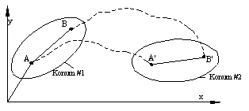

Düzlemde dönme veya öteleme hareketi olarak tanımlanmayan hareket genel düzlemsel harekettir. Genel düzlemsel hareket dönme ve öteleme hareketlerinin birleşimi olan ** bağıl hareket  **kavramı kullanılarak ele alınabilir.

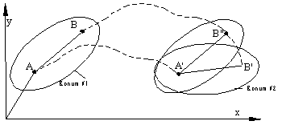

 AB konumundan A′B″ konumuna öteleme, A′B′ konumuna A′ merkezli dönme 

AB noktaları ile tanımlanan bir cismin düzlemsel hareketini ele alalım. Cismin birinci konumdan ikinci konuma belirli bir Δt zamanında yer değişimi, cismin ilk olarak AB konumundan bir ara konum olan A′B″ konumuna ötelemesi ve A′ noktasından geçen düzleme dik bir eksen etrafında dönerek A’B’ konumuna gelmesi olarak ele alınabilir. Yani genel hareket dönme ve öteleme hareketlerinin süperpozisyonudur. AB konumu ile A′B′ konumu arasında hareket sadece yukarıda açıklandığı şekilde olmayabilir. Örneğin istenir ise AB konumunu A″B′ gibi bir ara konuma getirip B′ den geçen bir eksen etrafında dönme yaparak son konuma erişilebilir, veya ilk olarak A noktasından geçen bir eksen etrafında dönülerek AB″ A′B′ ne paralel konuma getirildikten sonra öteleme yapılarak son konuma geçilebilir Noktaların gerçek yörüngeleri sonlu yakın konumlarda bu hareketlerle aynı olmayacağı tabiidir. Ancak bu iki konum birbirlerine sonsuz yakın duruma geldiğinde, bu hareketler arasında fark kalmayacaktır.

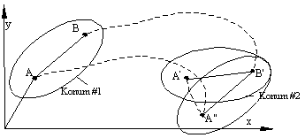

 AB konumundan A″B′ konumuna öteleme, A′B′ konumuna B′ merkezli dönme 

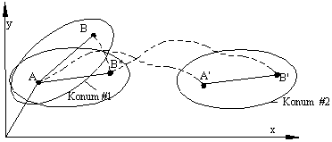

 AB konumundan AB″ konumuna A merkezli dönme, A′B′ konumuna öteleme 

Cisim öteleme yaparken her nokta cisim üzerinde seçilen bir noktanın hız ve ivmesi ile hareket edecektir. Cismin dönme yapması sırasında ise, cisim seçilen noktadan geçen düzleme dik bir eksen etrafında dönerken, seçilen nokta konumunu değiştirmeyecek, diğer noktalar bu noktaya göre bir dairesel hareket yapacaktır. Seçilmiş olan nokta sabit bir nokta değildir ve bu nedenle cismin bu noktaya göre hareketi  **bağıl hareket** tir.

Hareketi incelemek için hareketli düzlem üzerinde A noktasından geçen, sabit koordinat eksenine paralel bir x-y koordinat eksenini yerleştirelim. Öteleme sırasında bu koordinat ekseni sabit koordinat eksenine (X-Y) paralel kalır.

---

<!-- Kısım 4 -->
# 4.2 Mekanizmalarda Hız ve İvme Analizi -1

Mekanizmalarda hız ve ivme analizi vektörel olarak bağıl hız ve ivme kavramı ile yapılır. Genel olarak verilen değerler ile başlanılır ve A, B, C, … gibi genellikle mafsal eksenlerinin geçtiği noktalar sırası ile kullanılarak analiz gerçekleştirilir. Elde edilecek olan hız denklemleri:

**v** B  = **v** A  + **v** B/A 

**v** C  = **v** B  + **v** C/B 

ve benzeri denklemler olacaktır. İvme için ise, benzer şekilde:

**a** B  = **a** A  + **a t ** B/A  + **a n ** B/A 

**a** C  = **a** B  + **a t ** C/B  + **a n ** C/B 

veya

**a** D4  = **a** D3  + **a t ** D4/D3  + **a c ** D4/D3 

benzer denklemler yazılacaktır. Seçilen A, B, C, D noktalarının mümkün olduğunca döner mafsal ekseni üzerinde olmasının en önemli nedeni mafsal ekseninde olan bu noktanın mafsalla birleştirilen iki uzuv üzerinde daima çakışan nokta olmasıdır. Daima çakışan bu noktalar arasında bağıl hız ve ivme olmayacağından (sıfır olacağından) dolayı her iki uzuvda da bu noktaların hız ve ivmesi eşit olacaktır. Bu nedenle genel kural olarak bir uzvun üzerinde bulunan her hangi bir noktanın hız ve ivmesini belirlemeden önce bu uzvu diğer uzuvlar ile birleştiren mafsalların merkezlerinde bulunan noktaların hız ve ivmesi bulunmalıdır.

 **

     Dikkat edilmesi gereken diğer bir önemli nokta ise, konum hız ve ivme analizi sıra ile yapılabilir.**  Konum analizi yapılmadan hız analizi, konum ve hız analizi yapılmadan ivme analizi yapılamaz. Bunun nedeni, hız ve ivmelerin belirlenmesi sırasında gerekli olan yönler konum analizi ile belirlenecek, ivme analizi için normal ve Coriolis ivmesi terimleri sadece hız analizinde elde edilen terimlerin fonksiyonu olacaktır.

Devre kapalılık denklemleri hız ve ivme analizi için kolaylıkla kullanılabilir çünkü, bu denklemlerde mekanizmada bulunan tüm değişkenler yer almaktadır. Devre kapalılık denklemlerinin zamana göre birinci ve ikinci türevleri alındığında, ve konum değişkenlerinin birinci ve ikinci türevlerine göre çözüm yapıldığında bu değerler her hangi bir noktanın hız ve ivmesinin belirlenmesi için gerekli tüm terimleri belirleyecektir. Vektör devre denkleminin zamana göre birinci türevi bize  **vektörel hız devre denklemi** ni, ikinci türevi ise  **vektörel ivme devre denklemi** ni verecektir. Eğer konum değişkenleri vektör devre denklemi kullanılarak çözülmüş ise, vektör hız denklemleri konum değişkenlerinin birinci türevlerine göre (bu değişkenlere ** hız değişkenleri ** diyeceğiz) ve vektör ivme denklemleri de konum değişkenlerinin ikinci türevine göre (bu değişkenlere ** ivme değişkenleri ** diyeceğiz) lineer bir denklem takımı oluşturacaktır. Hız ve ivme değişkenleri bu denklemlerden çözüldükten sonra herhangi bir uzvun üzerinde her hangi bir noktanın hız ve ivmesi kolaylıkla bulunacaktır.

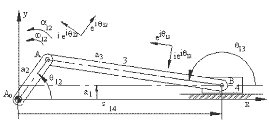

İlk örnek olarak şekilde gösterilen krank-biyel mekanizmasını ele alalım. Giriş kolunun (2 uzvu) yatay ile yaptığı açı, θ 12 , açısal hızı  $        ω  12   =    θ  ˙   12   =    d   θ  12    dt      \displaystyle {{\text{ω}}_{{12}}}={{\dot{θ}}_{{12}}}=\frac{{\text{d}{{\text{θ}}_{{12}}}}}{\text{dt}}    $          ω              12       ​               =                  θ       ˙                   12       ​               =                    dt                 d       θ              12       ​                 ​                  ve açısal ivmesi  $        α  12   =    θ  ¨   12   =     d  2    θ  12     d   t  2        \displaystyle {{\text{α}}_{{12}}}={{{\ddot{θ}}}_{{12}}}=\frac{{{{\text{d}}^{2}}{{\text{θ}}_{{12}}}}}{{\text{d}{{\text{t}}^{2}}}}    $          α              12       ​               =                   θ       ¨                    12       ​               =                     d       t             2                             d             2               θ              12       ​                 ​                  verildiği kabul edilmektedir. Devre kapalılık denklemi ve eşleniği karmaşık sayılar ile yazıldığında:

 
 
 
 

s 14  + ic 1  + a 3 e iθ 13   = a 2 e iθ 12  

s 14  − ic 1  + a 3 e −  iθ 13   = a 2 e −  iθ 12  

 
 

(1a)

(1b)

 
 
 
 

Verilen bir θ 12  değerine göre x ve θ 13  konum değişkenlerinin nasıl bulunduğu bir önceki kısımda incelenmişti. Burada bu denklemlerin zamana göre birinci türevini alarak vektör hız devre denklemi ve eşleniğini elde edelim.

 
 
 
 

 $        s  ˙      \displaystyle {\dot{\text{s}}}   $               s        ˙             14  + ia 3 ω 13 e iθ 13   = ia 2 ω 12 e iθ 12  

 $        s  ˙      \displaystyle {\dot{\text{s}}}   $               s        ˙             14  − ia 3 ω 13 e −  iθ 13   = −ia 2 ω 12 e −  iθ 12  

 
 

(2a)

(2b)

 
 
 
 

Bu denklemlerde ω 12  = dθ 12 /dt, ω 13  = dθ 13 /dt,  $        s  ˙      \displaystyle {\dot{\text{s}}}   $               s        ˙             14  = ds 14 /dt hız değişkenleridir. (2) denklemi dikkatli bir şekilde incelendiği takdirde bu vektör denkleminin:

**v** B  + **v** A/B  = **v** A 

bağıl hız denkleminden farklı bir denklem olmadığı görülecektir. Bu denklemin pratik açıklaması, A ve B noktaları 3 uzvunda bulunan 2 nokta olduğu gibi mafsal merkezleri olduklarından dolayı A noktası aynı zamanda 2 uzvunda ve B noktası 4 uzvunda bulunan noktalarla daima çakışan noktalardır. Öyle ise **v** A2  = **v** A3  = **v** A  ve **v** B3  = **v** B4  = **v** B  dir. 2 uzvunu ele aldığımızda bu uzuv sabit eksen etrafında dönme yaptığından A noktasının hızı AA 0  doğrusuna dik yönde (ω 12 ‘ye göre) ve şiddeti ω 12 |AA 0 |= ω 12 a 2  olan bir vektördür. 3 uzvu dikkate alındığında, A noktasının hızı B noktasının hızı ve bağıl hız ile ifade edildiğinde: **v** A3  = **v** B  + **v** A/B  = **v** A  olacaktır. Bu denklemde **v** A/B , A noktasının B noktasına göre bağıl hızı olup, AB doğrusuna diktir ve şiddeti θ 13 a 3  dir. B noktası 3 ve 4 uzuvlarında daima çakışan iki noktadır ve 4 uzvu üzerinde bulunan B noktasının yörüngesi 1 ve 4 uzuvları arasında bulunan kayar mafsaldan dolayı, kayar mafsal eksenine paralel bir doğrudur. Bu durumda **v** A  hız vektörünün gerek şiddeti ve gerek yönü bilinmekte, **v B ** ve **v A/B ** vektörlerinin ise yönleri bilinmektedir (**v** B  kayar mafsal eksenine paralel ve **v** A/B  AB doğrusuna diktir). Bu durumda **v** B  ve** v** A/B  hız vektörlerinin şiddeti bilinmemektedir. Bu bilinmeyenler hız devre denkleminde  $        s  ˙      \displaystyle {\dot{\text{s}}}   $               s        ˙             14  ve ω 13 a 3  değerleridir.

Eğer devre denklemini grafik olarak çözmek istersek, denklemin her bir tarafında bir bilinmeyenin olması daha uygun olacaktır (analitik çözümlerde, genellikle bilinen terimler denklemin sağına bilinmeyen terimler solunda bulunması istenilir). Bu durumda hız devre denklemi:

 $        s  ˙      \displaystyle {\dot{\text{s}}}   $               s        ˙             14  = ia 2 ω 12 e iθ 12   − ia 3 ω 13 e iθ 13  

olarak yazılacaktır. Bu denklem vektörel olarak

**v** B  = **v** A  + **v** A/B 

dir ve dikkat edilir ise:

**v** B/A  = −**v** A/B  = −ia 3 ω 13 e iθ 13  

tür.

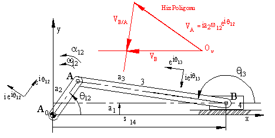

Bilinmeyen değerlerin grafik çözümü için ilk olarak **v** A  hız vektörünün şiddeti, |**v** A |= ω 12 |AA 0 |= ω 12 a 2  bulunur. Belirli bir k v  ölçeği kullanılarak (birimi mm/(mm/s) = s dir) uzunluğu **v** A  vektörü şiddetine orantılı, yönü **v** A  vektörü yönünde olan (bu yön A 0 A doğrusuna diktir) bir doğru (vektör) çizilir. Kullanılan ölçekten dolayı, şiddet ölçüsü uzunluk birimidir. Bu **v** A  vektörünün başlangıç noktasından **v B ** vektörü yönünde (ki bu kayar mafsal ekseni yönüdür) bir doğru, bitiş noktasından ise **v** A/B  vektörü yönünde bir doğru (ki bu yön BA doğrusuna diktir) çizilir. Bu iki doğrunun kesiştikleri nokta **v** B  ve **v** A/B  vektörlerinin şiddetini ve yönlerini bize verecek, elde edilen üçgende **v** B  = **v** A  + **v** A/B  denklemi sağlanmış olacaktır. Bu şekle ** hız vektör çokgeni ** denmektedir. Bu vektörlerin uzunluklarını ölçer, k v  ölçeği ile böler isek, hız şiddetlerini belirlemiş oluruz. Örneğin ω 13  = dθ 13 /dt açısal hızı bulmak için ilk olarak okunan **v** A/B  uzunluğu k v  ile bölünerek hız şiddeti bulunduktan sonra, **v** A/B  = ω 13 a 3  olduğundan ve a 3  = |AB| olduğundan, açısal hız ω 13  = |**v** A/B |/a 3  denklemi kullanılarak belirlenebilir. Açısal hızın yönünü bulmak için ise, bulunan **v** A/B  hız vektörü yönü kullanılarak karar verilebilir. Örneğin şekilde **v** A/B  hız vektörü aşağıya doğru olduğundan ve bu vektörde B noktasının A noktasına göre bağıl hızı incelendiğinden, 3 uzvunun saat yelkovanı yönünde bir açısal hızı olduğu görülecektir.

---

<!-- Kısım 5 -->
# 4.2 Mekanizmalarda Hız ve İvme Analizi -2

**Örnek:**

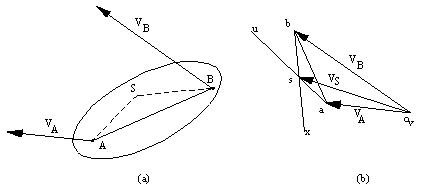

Cismin A ve B noktalarının hızları şekilde gösterildiği gibidir. S noktasının hız vektörünü bulun.

**v** A  ve **v** B  hız vektörleri o v  başlangıç noktasından çizildiğinde uçları a ve b noktaları olarak işaretlenecektir. Hız poligonunda oluşacak olan abs üçgeni ile cisim üzerinde mevcut ABS üçgenlerinin benzer yapacak şekilde oluşturulması gerekmektedir. Benzer üçgenlerin açıları aynıdır. Bu nedenle b noktasından xb doğrusunu ∠xba = ∠SBA olacak şekilde ve a noktasından ua doğrusunu ∠uab = ∠SAB olacak şekilde çizdiğimizde ua ve xb doğrularının kesim noktası s dir ve **o v  s** vektörü S noktasının **v** S  hız vektörüdür (Şekil b).

**Örnek:**

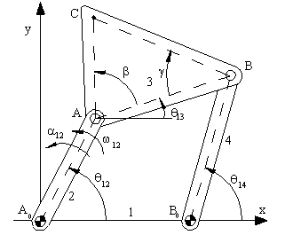

Şekilde gösterilen bir dört-çubuk mekanizmasında |A 0 B 0 | = a 1 , |A 0 A| = a 2 , |AB| = a 3 , |AC| = b 3 , |B 0 B| = a 4 . Hız ve ivme analizini yapalım. Devre kapalılık denklemi ve eşleniği:

a 2 e iθ 12   + a 3 e iθ 13   = a 1  + a 4 e iθ 14  

a 2 e −iθ 12   + a 3 e −  iθ 13   = a 1  + a 4 e -iθ 14  

Devre kapalılık denkleminin birinci türevi alındığında elde edilen hız devre denklemi:

ia 2 ω 12 e iθ 12   + ia 3 ω 13 e iθ 13   = ia 4 ω 14 e iθ 14  

−ia 2 ω 12 e −  iθ 12   − ia 3 ω 13 e −  iθ 13   = −ia 4 ω 14 e −  iθ 14  

elde edilecektir. Dikkat edilir ise, hız devre denklemi vektörel olarak:

**v** A  + **v** B/A  = **v** B 

denklemidir. Karmaşık sayılarla yazılmış olan her bir hız teriminin tanımı genellikle kolayca yapılabilir ve mutlaka bağıl hız kavramı ile elde edilecek vektör eşitlik denklemi ile aynı sonuç vermesi gereklidir. Bir başka anlatımla, karmaşık sayılar ile yazılan hız devre denklemleri, vektörel hız denklemlerinin farklı bir yazılış şeklidir. Vektörel hız denklemleri analitik veya geometrik yöntemle çözülebilir. Analitik olarak karmaşık sayılar ile yazılmış olan hız devre denklemlerinin bilinmeyen hız denklemlerine göre çözümü genellikle daha basit sonuç vermektedir. Denklemler verilen giriş hızı ω 12  ile bilinmeyen ω 13  ve ω 14  açısal hız değişkenlerine göre lineer olup eğer konum analizi önceden yapılmış ve verilen θ 12  açısına göre θ 13  ile θ 14  açılarının o konumda aldığı değerler bulunmuş ise ω 13  ve ω 14  hız değişkenlerine Cramer kuralı kullanılarak çözüm yapılabilir:

 $        ω  13   =    ∣       −   a  2    ω  12    e   i   θ  12           −   a  4    e   i   θ  14             −   a  2    ω  12    e   −  i   θ  12           −   a  4    e   −  i   θ  14          ∣    ∣        a  3    e   i   θ  13           −   a  4    e   i   θ  14              a  3    e   −  i   θ  13           −   a  4    e   −  i   θ  14          ∣    =     a  2    a  4    (    e   i   (    θ  12   −   θ  14    )     −   e   −  i   (    θ  12   −   θ  14    )      )      a  3    a  4    (   −   e   −  i   (    θ  14   −   θ  13    )     +   e   i   (    θ  14   −   θ  13    )      )      ω  12   =    a  2    a  3      sin  ⁡   (    θ  12   −   θ  14    )     sin  ⁡   (    θ  14   −   θ  13    )      ω  12      \displaystyle {{\text{ω}}_{{13}}}=\frac{{\left| {\begin{array}{cc} {-{{\text{a}}_{2}}{{\text{ω}}_{{12}}}{{\text{e}}^{{\text{i}{{\text{θ}}_{{12}}}}}}} & {-{{\text{a}}_{4}}{{\text{e}}^{{\text{i}{{\text{θ}}_{{14}}}}}}} \\ {-{{\text{a}}_{2}}{{\text{ω}}_{{12}}}{{\text{e}}^{{-\text{i}{{\text{θ}}_{{12}}}}}}} & {-{{\text{a}}_{4}}{{\text{e}}^{{-\text{i}{{\text{θ}}_{{14}}}}}}} \end{array}} \right|}}{{\left| {\begin{array}{cc} {{{\text{a}}_{3}}{{\text{e}}^{{\text{i}{{\text{θ}}_{{13}}}}}}} & {-{{\text{a}}_{4}}{{\text{e}}^{{\text{i}{{\text{θ}}_{{14}}}}}}} \\ {{{\text{a}}_{3}}{{\text{e}}^{{-\text{i}{{\text{θ}}_{{13}}}}}}} & {-{{\text{a}}_{4}}{{\text{e}}^{{-\text{i}{{\text{θ}}_{{14}}}}}}} \end{array}} \right|}}=\frac{{{{\text{a}}_{2}}{{\text{a}}_{4}}\left( {{{\text{e}}^{{\text{i}\left( {{{\text{θ}}_{{12}}}-{{\text{θ}}_{{14}}}} \right)}}}-{{\text{e}}^{{-\text{i}\left( {{{\text{θ}}_{{12}}}-{{\text{θ}}_{{14}}}} \right)}}}} \right)}}{{{{\text{a}}_{3}}{{\text{a}}_{4}}\left( {-{{\text{e}}^{{-\text{i}\left( {{{\text{θ}}_{{14}}}-{{\text{θ}}_{{13}}}} \right)}}}+{{\text{e}}^{{\text{i}\left( {{{\text{θ}}_{{14}}}-{{\text{θ}}_{{13}}}} \right)}}}} \right)}}{{\text{ω}}_{{12}}}=\frac{{{{\text{a}}_{2}}}}{{{{\text{a}}_{3}}}}\frac{{\sin \left( {{{\text{θ}}_{{12}}}-{{\text{θ}}_{{14}}}} \right)}}{{\sin \left( {{{\text{θ}}_{{14}}}-{{\text{θ}}_{{13}}}} \right)}}{{\text{ω}}_{{12}}}    $          ω              13       ​               =                              ∣                  ∣     ​                              a             3      ​                 e               i       θ              13       ​                                   a             3      ​                 e              −   i       θ              13       ​                           ​                        −      a             4      ​                 e               i       θ              14       ​                               −      a             4      ​                 e              −   i       θ              14       ​                           ​                         ∣                  ∣     ​                                     ∣                  ∣     ​                          −      a             2      ​                 ω              12       ​                 e               i       θ              12       ​                               −      a             2      ​                 ω              12       ​                 e              −   i       θ              12       ​                           ​                        −      a             4      ​                 e               i       θ              14       ​                               −      a             4      ​                 e              −   i       θ              14       ​                           ​                         ∣                  ∣     ​                 ​                =                        a             3      ​                 a             4      ​                 (    −      e              −   i     (        θ              14       ​             −      θ              13       ​               )                +        e               i     (        θ              14       ​             −      θ              13       ​               )                )                      a             2      ​                 a             4      ​                 (        e               i     (        θ              12       ​             −      θ              14       ​               )                −        e              −   i     (        θ              12       ​             −      θ              14       ​               )                )        ​                  ω              12       ​               =                        a             3      ​                               a             2      ​                 ​                          sin     (       θ              14       ​               −        θ              13       ​              )                 sin     (       θ              12       ​               −        θ              14       ​              )       ​                  ω              12       ​                

Benzer bir şekilde:

 $        ω  14   =    ∣        a  3    e   i   θ  13           −   a  2    ω  12    e   i   θ  12              a  3    e   −  i   θ  13           −   a  2    ω  12    e   −  i   θ  12          ∣    ∣        a  3    e   i   θ  13           −   a  4    e   i   θ  14              a  3    e   −  i   θ  13           −   a  4    e   −  i   θ  14          ∣    =     a  3    a  2    (   −   e   −  i   (    θ  12   −   θ  13    )     +   e   i   (    θ  12   −   θ  13    )      )      a  3    a  4    (   −   e   −  i   (    θ  14   −   θ  13    )     +   e   −  i   (    θ  14   −   θ  13    )      )      ω  12   =    a  2    a  4      sin  ⁡   (    θ  12   −   θ  13    )     sin  ⁡   (    θ  14   −   θ  13    )      ω  12      \displaystyle {{\text{ω}}_{{14}}}=\frac{{\left| {\begin{array}{cc} {{{\text{a}}_{3}}{{\text{e}}^{{\text{i}{{\text{θ}}_{{13}}}}}}} & {-{{\text{a}}_{2}}{{\text{ω}}_{{12}}}{{\text{e}}^{{\text{i}{{\text{θ}}_{{12}}}}}}} \\ {{{\text{a}}_{3}}{{\text{e}}^{{-\text{i}{{\text{θ}}_{{13}}}}}}} & {-{{\text{a}}_{2}}{{\text{ω}}_{{12}}}{{\text{e}}^{{-\text{i}{{\text{θ}}_{{12}}}}}}} \end{array}} \right|}}{{\left| {\begin{array}{cc} {{{\text{a}}_{3}}{{\text{e}}^{{\text{i}{{\text{θ}}_{{13}}}}}}} & {-{{\text{a}}_{4}}{{\text{e}}^{{\text{i}{{\text{θ}}_{{14}}}}}}} \\ {{{\text{a}}_{3}}{{\text{e}}^{{-\text{i}{{\text{θ}}_{{13}}}}}}} & {-{{\text{a}}_{4}}{{\text{e}}^{{-\text{i}{{\text{θ}}_{{14}}}}}}} \end{array}} \right|}}=\frac{{{{\text{a}}_{3}}{{\text{a}}_{2}}\left( {-{{\text{e}}^{{-\text{i}\left( {{{\text{θ}}_{{12}}}-{{\text{θ}}_{{13}}}} \right)}}}+{{\text{e}}^{{\text{i}\left( {{{\text{θ}}_{{12}}}-{{\text{θ}}_{{13}}}} \right)}}}} \right)}}{{{{\text{a}}_{3}}{{\text{a}}_{4}}\left( {-{{\text{e}}^{{-\text{i}\left( {{{\text{θ}}_{{14}}}-{{\text{θ}}_{{13}}}} \right)}}}+{{\text{e}}^{{-\text{i}\left( {{{\text{θ}}_{{14}}}-{{\text{θ}}_{{13}}}} \right)}}}} \right)}}{{\text{ω}}_{{12}}}=\frac{{{{\text{a}}_{2}}}}{{{{\text{a}}_{4}}}}\frac{{\sin \left( {{{\text{θ}}_{{12}}}-{{\text{θ}}_{{13}}}} \right)}}{{\sin \left( {{{\text{θ}}_{{14}}}-{{\text{θ}}_{{13}}}} \right)}}{{\text{ω}}_{{12}}}    $          ω              14       ​               =                              ∣                  ∣     ​                              a             3      ​                 e               i       θ              13       ​                                   a             3      ​                 e              −   i       θ              13       ​                           ​                        −      a             4      ​                 e               i       θ              14       ​                               −      a             4      ​                 e              −   i       θ              14       ​                           ​                         ∣                  ∣     ​                                     ∣                  ∣     ​                              a             3      ​                 e               i       θ              13       ​                                   a             3      ​                 e              −   i       θ              13       ​                           ​                        −      a             2      ​                 ω              12       ​                 e               i       θ              12       ​                               −      a             2      ​                 ω              12       ​                 e              −   i       θ              12       ​                           ​                         ∣                  ∣     ​                 ​                =                        a             3      ​                 a             4      ​                 (    −      e              −   i     (        θ              14       ​             −      θ              13       ​               )                +        e              −   i     (        θ              14       ​             −      θ              13       ​               )                )                      a             3      ​                 a             2      ​                 (    −      e              −   i     (        θ              12       ​             −      θ              13       ​               )                +        e               i     (        θ              12       ​             −      θ              13       ​               )                )        ​                  ω              12       ​               =                        a             4      ​                               a             2      ​                 ​                          sin     (       θ              14       ​               −        θ              13       ​              )                 sin     (       θ              12       ​               −        θ              13       ​              )       ​                  ω              12       ​                

C noktasının hızı isteniyor ise, C nin konum vektörü:

**r** C  = a 2 e iθ 12   + b 3 e i(θ 13  +   β) 

**r** C  konum vektörünün zamana göre türevi, C noktasının hız vektörünü tanımlar:

**v** C  =  $        x  ˙      \displaystyle {\dot{\text{x}}}    $               x        ˙             C  + i $        y  ˙      \displaystyle {\dot{\text{y}}}    $               y        ˙     ​                C  = ia 2 ω 12 e iθ 12   + ib 3 ω 13 e i(θ 13  +   β) 

Bu denklem

**v** C  = **v** A  + **v** C/A 

vektörel hız denklemidir. x ve y bileşenleri:

 $        x  ˙      \displaystyle {\dot{\text{x}}}    $               x        ˙             C  = −ia 2 ω 12 sinθ 12  − ib 3 ω 13 sin(θ 13  +   β)

 $        y  ˙      \displaystyle {\dot{\text{y}}}    $               y        ˙     ​                C  = a 2 ω 12 cosθ 12  + b 3 ω 13 cos(θ 13  +   β)

dır. Eğer devre kapalılık denklemi ve hız devre denklemleri önceden çözülmüş ise, yukarıda verilmiş olan denklemlerin sağ tarafında kalan terimlerin tümü bilinmektedir. Hızın x ve y bileşenleri çözüldükten sonra istenildiğinde kutupsal koordinat sistemi kullanılarak hız bir şiddet ve yön açısı ile gösterilebilir. Bu durumda C noktasının hız vektörü karmaşık sayı ile

**v** C  = v C e iη 

dır. Bu denklemde v C  =  $            x  ˙   C   2   +     y  ˙   C   2        \displaystyle \sqrt{{{{{\dot{\text{x}}}}_{\text{C}}}^{2}+{{{\dot{\text{y}}}}_{\text{C}}}^{2}}}    $                            x        ˙                    C       ​                      2            +                 y        ˙     ​                       C       ​                      2                        ​               hız şiddeti ve η = tan -1 ( $        y  ˙      \displaystyle {\dot{\text{y}}}    $               y        ˙     ​                C / $        x  ˙      \displaystyle {\dot{\text{x}}}    $               x        ˙             C ) hız vektörünün pozitif x eksenine göre yaptığı açıdır.

İvme analizi için karmaşık sayı ile yazılmış olan hız devre denkleminin türevi alınarak ivme devre denklemi elde edilecektir:

ia 2 α 12 e iθ 12   − a 2 ω 12  2 e iθ 12   + ia 3 α 13 e iθ 13   − a 3 ω 13  2 e iθ 13   = ia 4 α 14 e iθ 14   − a 4 ω 14  2 e iθ 14  

−ia 2 α 12 e −  iθ 12   − a 2 ω 12  2 e −  iθ 12   − ia 3 α 13 e −  iθ 13   − a 3 ω 13  2 e −  iθ 13   = −ia 4 α 14 e −  iθ 14   − a 4 ω 14  2 e −  iθ 14  

Dikkat edilir ise yazılmış olan hız devre denklemi vektörel olarak:

**a t ** A  + **a n ** A  + **a t ** B/A  + **a n ** B/A  = **a t ** B  + **a n ** B 

denkleminden farklı değildir. İvme devre denkleminde bilinen terimleri denklemin sağ tarafında kümeler isek:

  ia 3 α 13 e iθ 13   − ia 4 α 14 e iθ 14   = −ia 2 α 12 e iθ 12   + a 2 ω 12  2 e iθ 12   + a 3 ω 13  2 e iθ 13   − a 4 ω 14  2 e iθ 14  

−ia 3 α 13 e −  iθ 13   + ia 4 α 14 e −  iθ 14   = ia 2 α 12 e −  iθ 12   + a 2 ω 12  2 e −  iθ 12   + a 3 ω 13  2 e −  iθ 13   − a 4 ω 14  2 e −  iθ 14  

Denklemi bilinmeyen ivme değişkenleri α 13  ve α 14  için çözdüğümüzde:

α 13  =  $          a  2    α  12   sin  ⁡   (    θ  12   −   θ  14    )   +   a  2     ω  12   2   cos  ⁡   (    θ  12   −   θ  14    )   −   a  4     ω  12   2   +   a  3     ω  13   2   cos  ⁡   (    θ  14   −   θ  13    )      a  3   sin  ⁡   (    θ  14   −   θ  13    )        \displaystyle \frac{{{{\text{a}}_{2}}{{\text{α}}_{{12}}}\sin \left( {{{\text{θ}}_{{12}}}-{{\text{θ}}_{{14}}}} \right)+{{\text{a}}_{2}}{{\text{ω}}_{{12}}}^{2}\cos \left( {{{\text{θ}}_{{12}}}-{{\text{θ}}_{{14}}}} \right)-{{\text{a}}_{4}}{{\text{ω}}_{{12}}}^{2}+{{\text{a}}_{3}}{{\text{ω}}_{{13}}}^{2}\cos \left( {{{\text{θ}}_{{14}}}-{{\text{θ}}_{{13}}}} \right)}}{{{{\text{a}}_{3}}\sin \left( {{{\text{θ}}_{{14}}}-{{\text{θ}}_{{13}}}} \right)}}    $                      a             3      ​               sin     (       θ              14       ​               −        θ              13       ​              )                     a             2      ​                 α              12       ​               sin     (       θ              12       ​               −        θ              14       ​              )     +        a             2      ​                  ω              12       ​                      2            cos     (       θ              12       ​               −        θ              14       ​              )     −        a             4      ​                  ω              12       ​                      2            +        a             3      ​                  ω              13       ​                      2            cos     (       θ              14       ​               −        θ              13       ​              )       ​                 

ve

α 14  =  $          a  2    α  12   sin  ⁡   (    θ  12   −   θ  13    )   +   a  2     ω  12   2   cos  ⁡   (    θ  12   −   θ  13    )   −   a  3     ω  12   2   cos  ⁡   (    θ  14   −   θ  13    )   +   a  3     ω  13   2      a  4   sin  ⁡   (    θ  14   −   θ  13    )        \displaystyle \frac{{{{\text{a}}_{2}}{{\text{α}}_{{12}}}\sin \left( {{{\text{θ}}_{{12}}}-{{\text{θ}}_{{13}}}} \right)+{{\text{a}}_{2}}{{\text{ω}}_{{12}}}^{2}\cos \left( {{{\text{θ}}_{{12}}}-{{\text{θ}}_{{13}}}} \right)-{{\text{a}}_{3}}{{\text{ω}}_{{12}}}^{2}\cos \left( {{{\text{θ}}_{{14}}}-{{\text{θ}}_{{13}}}} \right)+{{\text{a}}_{3}}{{\text{ω}}_{{13}}}^{2}}}{{{{\text{a}}_{4}}\sin \left( {{{\text{θ}}_{{14}}}-{{\text{θ}}_{{13}}}} \right)}}    $                      a             4      ​               sin     (       θ              14       ​               −        θ              13       ​              )                     a             2      ​                 α              12       ​               sin     (       θ              12       ​               −        θ              13       ​              )     +        a             2      ​                  ω              12       ​                      2            cos     (       θ              12       ​               −        θ              13       ​              )     −        a             3      ​                  ω              12       ​                      2            cos     (       θ              14       ​               −        θ              13       ​              )     +        a             3      ​                  ω              13       ​                      2              ​                 

C noktasının ivmesi ise C noktasının hız vektörünün zamana göre türevi alınarak elde edilir.

**a** C  = ia 2 α 12 e iθ 12   − a 2 ω 12  2 e iθ 12   + ib 3 α 13 e i(θ 13  +   β)  − b 3 ω 13  2 e i(θ 13  +   β) 

Dikkat edilir ise, devre kapalılık denklemi, hız ve ivme devre denklemleri çözülmüş ise, sağ tarafta bulunan terimler bilinen değerlerdir. Bu denklem vektörel olarak

**a** C  = **a n ** A  + **a t ** A  + **a n ** C/A  + **a t ** C/A 

denklemi ile aynıdır. Görüldüğü gibi devre kapalılık denklemi ve türevleri olan hız ve ivme denklemleri çözüldükten sonra mekanizmada bulunan her hangi bir uzvun üzerinde bir noktanın konumu, hızı ve ivmesi kolaylıkla belirlenebilir.

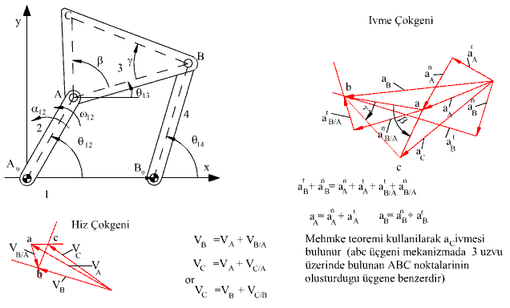

Yukarıda ki şekilde dört-çubuk mekanizması için hız ve ivme analizinin grafik çözümü gösterilmiştir.

Hız ve ivme analizini kademe kademe incelemek için aşağıda verilen flash animasyonunu kullanabilirsiniz.

---

<!-- Kısım 6 -->
# 4.2 Mekanizmalarda Hız ve İvme Analizi -3

**Örnek:**

Şekilde gösterilen mekanizmada pistonun (2 uzvu) yukarıya doğru sabit hızı v B  = v 2/1  = 180 mm/s dir. D noktasının hız ve ivmesini bulmamız istenmektedir. Aşağıda Excel programları kullanılarak sayısal çözüm gösterilmektedir. Devre denklemlerinden elde edilen bu denklemlerin çıkarılışı okuyucuya bırakılmıştır.

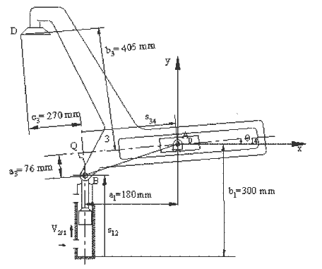

Konum analizi için gerekli olan denklemler:

s 34  =  $           (    b  1   −   s  12    )   2   +    a  1   2   +    a  3   2        \displaystyle \sqrt{{{{{\left( {{{\text{b}}_{1}}-{{\text{s}}_{{12}}}} \right)}}^{2}}+{{\text{a}}_{1}}^{2}+{{\text{a}}_{3}}^{2}}}    $                    (       b             1      ​               −        s              12       ​              )              2             +         a             1      ​                      2            +         a             3      ​                      2                        ​                        γ = tan -1 (s 34 /a 3 )

ϕ = tan -1 [a 1 /(b 1  − s 12 )]          θ 14  = ϕ − γ

Şekilde θ 14  açısı gösterilmişdir. ϕ ve γ açıları bulunurken ATAN2() fonksiyonunun kullanılması doğru olacaktır. Karmaşık sayı ile D noktasının konum vektörü (A 0  merkezli ve x ekseni yatay olan bir referans koordinat ekseni kullanılmıştır):

**r** D  = (−s 34  − c 3  + ib 3 )e iθ 14  

Reel sayıların kullanılması durumunda D noktası koordinatları (**r** D  = x D  + iy D ):

x D  = −(s 34  + c 3 )cosθ 14  − b 3 sinθ 14 

y D  = −(s 34  + c 3 )sinθ 14  + b 3 cosθ 14 

Hız analizi sırasında 2 uzvunun 180 mm/s hızla yukarıya doğru hareket ettiği kabul edilmiştir (v 12  = 180 mm/s). Hız denklemleri:

ω 14  = −(v 12 /s 34 )cosθ 14      ,    v 34  =  $        s  ˙      \displaystyle {\dot{\text{s}}}    $               s        ˙             34  = −(v 12 /s 34 )(a 3 cosθ 14  + s 34 sinθ 14 )

D noktasının x ve y yönünde hız bileşenleri:

v Dx  = −y D ω 14  − v 34 cosθ 14      ,     v Dy  = x D ω 14  − v 34 sinθ 14 

Yukarıda gösterilmiş olan bileşenler D noktasının hızını karmaşık sayılarla yazdığımızda (**v** D  = v Dx  + iv Dy ):

**v** D  = (−s 34  − c 3  + ib 3 )iω 14 e iθ 14   − v 34 e iθ 14  

Bu denklemin reel ve sanal kısımları ayrı, ayrı x ve y yönünde hız bileşenlerini verir.

2 pistonunun sabit hızda hareket ettiği düşünülerek ivme analizi yapıldığında elde edilen gerekli denklemler:

α 14  = (v 12 /s 34  2 )(ω 14 s 34 sinθ 14  + v 34 cosθ 14 )

a 34  =  $        s  ¨      \displaystyle {\ddot{\text{s}}}    $               s        ¨             34  = (v 12 /s 34  2 )[(a 3 ω 14  − v 34 )sinθ 14  − ω 14 s 34 cosθ 14 ]

D noktasının x ve y yönünde ivme bileşenleri:

a Dx  = −x D ω 1  4  2  − y D α 14  + 2v 34 ω 14 sinθ 14  − a 34 cosθ 14 

a Dy  = −y D ω 1  4  2  + x D α 14  + 2v 34 ω 14 cosθ 14  − a 34 sinθ 14 

Denklemler Excel paket programı kullanılarak 60 mm < s < 500 mm aralığında her 10 mm için hesap edilerek şekilde gösterilen D noktasının konumu hızı ve ivmesi elde edilmiştir. Bu şekilde, konum hız ve ivme vektörleri (0, 0) noktasından ilgili eğri üzerinde bulunan noktaya giden vektördür. Yatay ve dikey eksenler konum için mm, hız için mm/s, ivme için ise mm/s 2  dir. Örneğin değer olarak s 12  = 60 mm iken:

 
 
 
 s 34  = 309.48 mm 
 θ 14  = 39.33° 
 x D  = −704.91 mm 
 y D  = −54.03 mm 
 
 
 ω 14  = −0.45 rad/s 
 v 34  = −148.28 mm/s 
 v Dx  = 90.39 mm/s 
 v Dy  = 411.11 mm/s 
 
 
 α 14  = −0.38 rad/s 2  
 a 34  = 0.34 mm/s 2  
 a Dx  = 206.36 mm/s 2  
 a Dy  = 176.38 mm/s 2  
 
 
 

olarak elde edilmiştir. s 12  = 200 mm iken ise:

 
 
 
 s 34 = 219.49 mm 
 θ 14  = 9.96° 
 x D  = −552.14 mm 
 y D  = 314.27 mm 
 
 
 ω 14  = −0.81 rad/s 
 v 34  = −92.51 mm/s 
 v Dx  = 344.96 mm/s 
 v Dy  = 461.97 mm/s 
 
 
 α 14  = −0.46 rad/s 2  
 a 34  = 0.67 mm/s 2  
 a Dx  = 528.39 mm/s 2  
 a Dy  = −101.15 mm/s 2  
 
 
 

olarak elde edilmiştir.

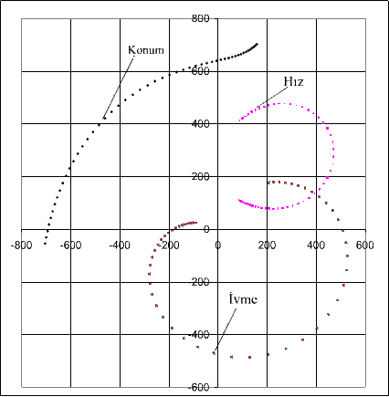

 Excel kütüğü için tıklayınız: –

---

<!-- Kısım 7 -->
# 4.2 Mekanizmalarda Hız ve İvme Analizi -4

**Örnek:**

Şekilde gösterilmiş olan mekanizma saman balyalama makinasında kullanılmıştır. 6 uzvu üzerinde bulunan F noktasının konum, hız ve ivmesini giriş kolu 4 rad/s sabit açısal hız ile dönerken her açıda bulmak istiyoruz.

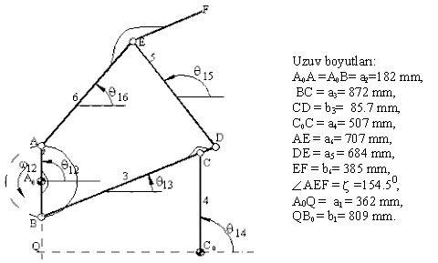

Bu problemde konum analizi için üçgen çözümleri kullanılacak, hız analizi için ise matris çözümü uygulanacaktır.

**C 0 B** = x B  + iy B  = −b 1  − a 2 cosθ 12  + i(a 1  − a 2 sinθ 12 )

Görüldüğü gibi, x B  ve y B  B noktasının C 0  noktasına göre, pozitif x ekseni QC 0  olmak üzere, koordinatlarıdır. C 0 B vektörünü dik koordinat sisteminden polar koordinat sistemine dönüştürdüğümüzde:

**C 0 B** = s∠ϕ

s =  $           x  B   2   +    y  B   2        \displaystyle \sqrt{{{{\text{x}}_{\text{B}}}^{2}+{{\text{y}}_{\text{B}}}^{2}}}    $                    x              B       ​                      2            +         y              B       ​                      2                        ​                        ϕ = atan2(x B , y B )

olacaktır. BCC 0  üçgeninde ∠BC 0 C = β ve ∠BCC 0  = μ 1  dersek, kosinüs teoremine göre bu açılar:

β = cos -1  $        [     s  2   +    a  4   2   −    a  3   2     2   s  4   s    ]     \displaystyle \left[ {\frac{{{{\text{s}}^{2}}+{{\text{a}}_{4}}^{2}-{{\text{a}}_{3}}^{2}}}{{2{{\text{s}}_{4}}\text{s}}}} \right]    $        [                2      s             4      ​              s                     s             2             +         a             4      ​                      2            −         a             3      ​                      2              ​                ]       

μ 1  = cos -1  $        [      a  3   2   +    a  4   2   −   s  2     2   a  3    a  4     ]     \displaystyle \left[ {\frac{{{{\text{a}}_{3}}^{2}+{{\text{a}}_{4}}^{2}-{{\text{s}}^{2}}}}{{2{{\text{a}}_{3}}{{\text{a}}_{4}}}}} \right]    $        [                2      a             3      ​                 a             4      ​                                a             3      ​                      2            +         a             4      ​                      2            −        s             2               ​                ]       

olacaktır. θ 14  ve θ 13  açıları:

θ 14  = ϕ − β        ve       θ 13  = θ 14  − μ 1 

olacaktır. Burada θ 14  = ϕ − β alınması, incelenmekte olan dört-çubuk mekanizmasının bağlantı şekline uygundur. Şimdi A ve D noktalarının C 0  noktasına göre konumlarını belirleyelim.

**C 0 A** = x A  + iy A  = −b 1  + a 2 cosθ 12  + i(a 1  + a 2 sinθ 12 )

**C 0 A** = x D  + iy D  = a 4 cosθ 14  + b 3 cosθ 13  + i(a 4 sinθ 14  + b 3 sinθ 13 )

**DA** = **C 0 A** − **C 0 D** = r∠χ dersek r =  $           (    x  A   −   x  D    )   2   +    (    y  A   −   y  D    )   2        \displaystyle \sqrt{{{{{\left( {{{\text{x}}_{\text{A}}}-{{\text{x}}_{\text{D}}}} \right)}}^{2}}+{{{\left( {{{\text{y}}_{\text{A}}}-{{\text{y}}_{\text{D}}}} \right)}}^{2}}}}    $                    (       x              A       ​               −        x              D       ​              )              2             +         (       y              A       ​               −        y              D       ​              )              2                         ​                ve  χ = atan2(x A  − x D , y A  − y D ) olur. Bu şekilde bir kenarının boyutunu bulduğumuz ADE üçgeninde ∠ADE = γ ve ∠AED = μ 2  dersek, kosinüs teoremine göre bu açılar:

γ = cos -1  $        [     r  2   +    a  5   2   −    a  6   2     2   a  5   r    ]     \displaystyle \left[ {\frac{{{{\text{r}}^{2}}+{{\text{a}}_{5}}^{2}-{{\text{a}}_{6}}^{2}}}{{2{{\text{a}}_{5}}\text{r}}}} \right]    $        [                2      a             5      ​              r                     r             2             +         a             5      ​                      2            −         a             6      ​                      2              ​                ]       

μ 2  = cos -1  $        [      a  5   2   +    a  6   2   −   a  2     2   a  5    a  6     ]     \displaystyle \left[ {\frac{{{{\text{a}}_{5}}^{2}+{{\text{a}}_{6}}^{2}-{{\text{a}}^{2}}}}{{2{{\text{a}}_{5}}{{\text{a}}_{6}}}}} \right]    $        [                2      a             5      ​                 a             6      ​                                a             5      ​                      2            +         a             6      ​                      2            −        a             2               ​                ]       

olacaktır. Bulunan bu değerler kullanılarak θ 15  ve θ 16  açıları:

θ 15  = χ − γ        ve       θ 16  = θ 15  − μ 2 

F noktasının A 0  noktasına göre konum vektörü:

**A 0 F** = **A 0 A** + **AE** + **EF**

veya karmaşık sayılar ile:

**A 0 F** = x F  + iy F  = a 2 e iθ 12   + a 6 e iθ 16   + b 6 e i(θ 16  +   ζ   +   π) 

Bu denklemden:

x F  = a 2 cosθ 12  + a 6 cosθ 16  − b 6 cos(θ 16  +   ζ)

y F  = a 2 sinθ 12  + a 6 sinθ 16  − b 6 sin(θ 16  +   ζ)

Verilen bir θ 12  krank açısından başlayarak yukarıda verilmiş olan denklemler sıra ile çözülerek F noktasının konumu bulunabilir. Dikkat edilir ise, elde edilmiş olan bir çözüm algoritmasıdır ve sayısal olarak bu algoritmanın uygulanabileceği çeşitli programlama ortamında kullanılabilir. Örneğin Excel, Mathcad, Matlab gibi matematik işlem ağırlıklı paket programları veya Basic ve C gibi bilgisayar lisanları kullanarak kolaylıkla bu denklemlerle bir algoritma yapısı içinde bilgisayarda çözüm yapabilir ve sayısal değerler elde edebiliriz. Şekilde F noktasının yörüngesi görülmektedir (A 0  merkez olarak) (yörünge üzerinde × ile işaretlenen nokra θ 12  = 90° deki konumdur).

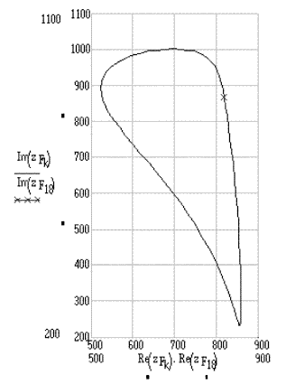

F noktasının yörüngesi

Hız ve ivme analizi için kullanılmak üzere katsayı matrisi karmaşık sayılar ile:

**A** =  $        [       i   a  3    e   i   θ  13           −  i   a  4    e   i   θ  14          0      0         −  i   a  3    e   −  i   θ  13           i   a  4    e   −  i   θ  14          0      0         i   c  3    e   i   θ  13          0       i   a  5    e   i   θ  15           −  i   a  6    e   i   θ  16             −  i   c  3    e   −  i   θ  13          0       −  i   a  5    e   −  θ   θ  15           i   a  6    e   −  i   θ  16          ]      \displaystyle \left[ {\begin{array}{cccc} {\text{i}{{\text{a}}_{3}}{{\text{e}}^{{\text{i}{{\text{θ}}_{{13}}}}}}} & {-\text{i}{{\text{a}}_{4}}{{\text{e}}^{{\text{i}{{\text{θ}}_{{14}}}}}}} & 0 & 0 \\ {-\text{i}{{\text{a}}_{3}}{{\text{e}}^{{-\text{i}{{\text{θ}}_{{13}}}}}}} & {\text{i}{{\text{a}}_{4}}{{\text{e}}^{{-\text{i}{{\text{θ}}_{{14}}}}}}} & 0 & 0 \\ {\text{i}{{\text{c}}_{3}}{{\text{e}}^{{\text{i}{{\text{θ}}_{{13}}}}}}} & 0 & {\text{i}{{\text{a}}_{5}}{{\text{e}}^{{\text{i}{{\text{θ}}_{{15}}}}}}} & {-\text{i}{{\text{a}}_{6}}{{\text{e}}^{{\text{i}{{\text{θ}}_{{16}}}}}}} \\ {-\text{i}{{\text{c}}_{3}}{{\text{e}}^{{-\text{i}{{\text{θ}}_{{13}}}}}}} & 0 & {-\text{i}{{\text{a}}_{5}}{{\text{e}}^{{-\text{θ}{{\text{θ}}_{{15}}}}}}} & {\text{i}{{\text{a}}_{6}}{{\text{e}}^{{-\text{i}{{\text{θ}}_{{16}}}}}}} \end{array}} \right]    $                ⎣                  ⎡     ​                           i       a             3      ​                 e               i       θ              13       ​                               −   i       a             3      ​                 e              −   i       θ              13       ​                                i       c             3      ​                 e               i       θ              13       ​                               −   i       c             3      ​                 e              −   i       θ              13       ​                           ​                        −   i       a             4      ​                 e               i       θ              14       ​                                i       a             4      ​                 e              −   i       θ              14       ​                              0        0     ​                       0        0          i       a             5      ​                 e               i       θ              15       ​                               −   i       a             5      ​                 e              −   θ       θ              15       ​                           ​                       0        0         −   i       a             6      ​                 e               i       θ              16       ​                                i       a             6      ​                 e              −   i       θ              16       ​                           ​                         ⎦                  ⎤     ​                

dir. Hız denklemi:

**AΩ** = **b**

olup burada:

**Ω** = [ω 13    ω 14    ω 15    ω 16 ] T           ve        **b** = [ia 2 ω 12 e iθ 12     −ia 2 ω 12 e −iθ 12     2ia 2 ω 12 e iθ 12    −2ia 2 ω 12 e −iθ 12  ] T 

dir. Benzer bir şekilde, ivme denklemi:

**Aα** = **c**

olup  **α** = [α 13   α 14   α 15   α 16 ] T    ve  (ω 12  sabit olduğu için α 12  = 0)

**c** =  $        [       −   a  2     ω  12   2    e   i   θ  12     +   a  3     ω  13   2    e   i   θ  13     −   a  4     ω  14   2    e   i   θ  14             −   a  2     ω  12   2    e   −  i   θ  12     +   a  3     ω  13   2    e   −  i   θ  13     −   a  4     ω  14   2    e   −  i   θ  14             −  2   a  2     ω  12   2    e   i   θ  12     +   c  3     ω  13   2    e   i   θ  13     +   a  5     ω  15   2    e   i   θ  15     −   a  6     ω  16   2    e   i   θ  16             −  2   a  2     ω  12   2    e   −  i   θ  12     +   c  3     ω  13   2    e   −  i   θ  13     +   a  5     ω  15   2    e   −  i   θ  15     −   a  6     ω  16   2    e   −  i   θ  16          ]      \displaystyle \left[ {\begin{array}{c} {-{{\text{a}}_{2}}{{\text{ω}}_{{12}}}^{2}{{\text{e}}^{{\text{i}{{\text{θ}}_{{12}}}}}}+{{\text{a}}_{3}}{{\text{ω}}_{{13}}}^{2}{{\text{e}}^{{\text{i}{{\text{θ}}_{{13}}}}}}-{{\text{a}}_{4}}{{\text{ω}}_{{14}}}^{2}{{\text{e}}^{{\text{i}{{\text{θ}}_{{14}}}}}}} \\ {-{{\text{a}}_{2}}{{\text{ω}}_{{12}}}^{2}{{\text{e}}^{{-\text{i}{{\text{θ}}_{{12}}}}}}+{{\text{a}}_{3}}{{\text{ω}}_{{13}}}^{2}{{\text{e}}^{{-\text{i}{{\text{θ}}_{{13}}}}}}-{{\text{a}}_{4}}{{\text{ω}}_{{14}}}^{2}{{\text{e}}^{{-\text{i}{{\text{θ}}_{{14}}}}}}} \\ {-2{{\text{a}}_{2}}{{\text{ω}}_{{12}}}^{2}{{\text{e}}^{{\text{i}{{\text{θ}}_{{12}}}}}}+{{\text{c}}_{3}}{{\text{ω}}_{{13}}}^{2}{{\text{e}}^{{\text{i}{{\text{θ}}_{{13}}}}}}+{{\text{a}}_{5}}{{\text{ω}}_{{15}}}^{2}{{\text{e}}^{{\text{i}{{\text{θ}}_{{15}}}}}}-{{\text{a}}_{6}}{{\text{ω}}_{{16}}}^{2}{{\text{e}}^{{\text{i}{{\text{θ}}_{{16}}}}}}} \\ {-2{{\text{a}}_{2}}{{\text{ω}}_{{12}}}^{2}{{\text{e}}^{{-\text{i}{{\text{θ}}_{{12}}}}}}+{{\text{c}}_{3}}{{\text{ω}}_{{13}}}^{2}{{\text{e}}^{{-\text{i}{{\text{θ}}_{{13}}}}}}+{{\text{a}}_{5}}{{\text{ω}}_{{15}}}^{2}{{\text{e}}^{{-\text{i}{{\text{θ}}_{{15}}}}}}-{{\text{a}}_{6}}{{\text{ω}}_{{16}}}^{2}{{\text{e}}^{{-\text{i}{{\text{θ}}_{{16}}}}}}} \end{array}} \right]    $                ⎣                  ⎡     ​                          −      a             2      ​                  ω              12       ​                      2              e               i       θ              12       ​                         +        a             3      ​                  ω              13       ​                      2              e               i       θ              13       ​                         −        a             4      ​                  ω              14       ​                      2              e               i       θ              14       ​                               −      a             2      ​                  ω              12       ​                      2              e              −   i       θ              12       ​                         +        a             3      ​                  ω              13       ​                      2              e              −   i       θ              13       ​                         −        a             4      ​                  ω              14       ​                      2              e              −   i       θ              14       ​                               −  2      a             2      ​                  ω              12       ​                      2              e               i       θ              12       ​                         +        c             3      ​                  ω              13       ​                      2              e               i       θ              13       ​                         +        a             5      ​                  ω              15       ​                      2              e               i       θ              15       ​                         −        a             6      ​                  ω              16       ​                      2              e               i       θ              16       ​                               −  2      a             2      ​                  ω              12       ​                      2              e              −   i       θ              12       ​                         +        c             3      ​                  ω              13       ​                      2              e              −   i       θ              13       ​                         +        a             5      ​                  ω              15       ​                      2              e              −   i       θ              15       ​                         −        a             6      ​                  ω              16       ​                      2              e              −   i       θ              16       ​                           ​                         ⎦                  ⎤     ​                

dır. Uzuvların açısal hız ve ivmeleri devre hız ve ivme denklemlerinden çözüldükten sonra F noktasının hız ve ivmesi **A 0 F** konum vektörünün birinci ve ikinci türevlerinin alınması ile belirlenir:

**v** F  = ia 2 ω 12 e iθ 12   + iω 16 e iθ 16  (a 6  − b 6 e iζ )

**a** F  = ia 2 ω 12  2 e iθ 12   + iα 16 e iθ 16  (a 6  − b 6 e iζ ) − iω 16  2 e iθ 16  (a 6  − b 6 e iζ )

Bu karmaşık denklemlerin her an reel ve sanal kısımları ayrı ayrı yazılması mümkündür. Ayrıca istenir ise, matris hız ve ivme denklemlerinin uzuvların açısal hız ve ivmelerine göre ayrı ayrı çözülmesi de mümkündür (Matris denklemleri incelendiğinde, ilk iki hız denkleminden ω 13  ve ω 14  doğrudan ω 12  ye göre çözülebilir. Son iki hız denkleminden ise ω 15  ve ω 16 , ω 13  ve ω 12  ye göre çözülebilir. Aynı durum açısal ivme için söz konusudur).

Tüm çevrim için hız ve ivmenin polar diyagramı aşağıda (a) ve (b) şekillerinde gösterilmiştir (× ile gösterilen nokta kol açısının 90° olduğu konumdur). Hız ve ivme mm/s ve mm/s 2  olarak ölçülmüştür.

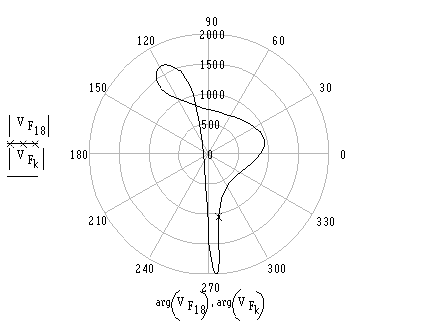

(a) Polar hız diyagramı

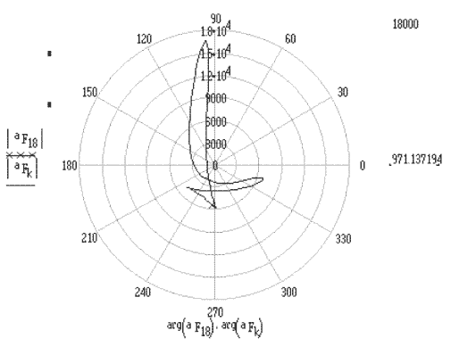

(b) Polar ivme diyagramı

 Mekanizmanın konum analizi için hazırlanmış olan eksel kütüğü buradadır: –

---

<!-- Kısım 8 -->
# 4.2 Mekanizmalarda Hız ve İvme Analizi -5

**Örnek:**

Yukarıda işleyişi gösterilen mekanizmanın A 0 A kolu 200 devir/dakika sabit hızla dönerken P noktasının hız ve ivmesini bulalım.

---