# Ani Dönme Merkezi

*Prof. Dr. Eres Söylemez - Mekanizma Tekniği*

---

<!-- Kısım 1 -->
# V. ANİ DÖNME MERKEZİ

  **         **

---

<!-- Kısım 2 -->
# Ani Dönme Merkezi

Önceki bölümlerde hız ve ivme analizinin bağıl hareket ile nasıl yapılabileceğini gördük ve bu yöntemi mekanizmaların analizi için geometrik veya analitik olarak kullanarak sonuçlar elde ettik. Sadece hız analizi için geçerli olan bir başka yöntem ise, dönme ve ötelemenin dışında kalan tüm genel düzlemsel hareketin bir dönme ile tanımlanabilmesidir. Bunun için şekilde gösterilen bir düzlemin iki genel konumunu ele alalım.Hareketi incelemeden önce belirli terimleri tanımlamamız gerekmektedir: Cismin birinci konumdan (AB) ikinci konuma (A′B′) sonlu uzaklıkta yerdeğişimi, P 12  olarak adlandıracağımız ve AA′ ile BB′ doğrularının orta dikmelerinin kesiştiği noktada yer alan nokta etrafında dönmesi ile sağlanabilir. Bunu temel bir teoremle ifade edelim:

 **

**   **Chasles Teoremi (Şal teoremi olarak okunur):** 

 **Düzlemsel harekette bir cismin bir konumdan diğer sonlu uzaklıkta bir konuma hareketi en basit bir şekilde P 12  dönme polü etrafında bir dönme hareketi ile gerçekleştirilebilir. Dönme polü, P 12 , cisim üzerinde alınan iki noktanın iki konumda bulundukları konumların orta dikmelerinin kesiştiği noktadır.** 

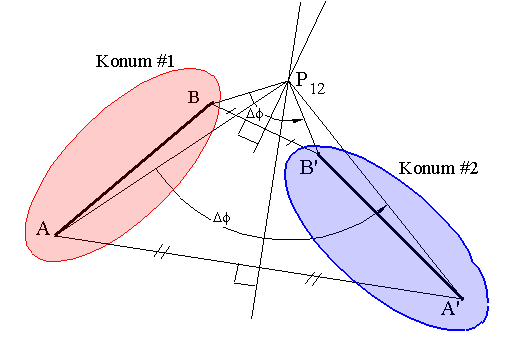

Rijit cismi bu yöntemle elde edilen P 12  merkezi etrafında döndürdüğümüzde, cismin rijit kalarak ikinci konuma varacağını ispat etmemiz gerekmektedir. Bunun için P 12  noktası sabit kalmak şartı ile, cismin üzerinde bulunan ABP 12  üçgeninin ikinci konumda A′B′P 12  üçgeni olduğunda birinci konumdaki üçgene (ABP 12 ) eşit olduğunu göstermemiz gerekir. Bu şekilde cisim şekil değişimine uğramamış olur. AB ve A′B′ kenarları rijit cisim üzerinde alınan aynı noktalar olduğundan eşittir. BP 12  ile B′P 12  kenarı ve AP 12  ile A′P 12  kenarları ise P 12  noktasının AA′ ve BB′ doğrularının orta dikmeleri üzerinde olmasından dolayı eşit olacaktır. Bu nedenle üçgenlerin üç kenarı birbirlerine eşit olduğundan, üçgenler eşittir. Bu durumda ∠AP 12 A′ = ∠BP 12 B′ = Δϕ = cismin iki konum arasında açısal dönmesidir.

Birinci konumdan ikinci konuma hareket en basit bir şekilde dönme ile olur ise de, genel düzlemsel hareketin bu dönme hareketine tam olarak eşdeğer olması şart değildir (öyle olsa idi, bu hareketi sabit bir eksen etrafında dönme olarak tanımlayıp genel düzlemsel hareket demezdik). Bu nedenle her hangi bir noktanın cismin genel düzlemsel hareketi sırasındaki yörüngesi ile cismin P 12  etrafında dönmesi ile elde edilen P 12  merkezli daire yayı yörüngesi arasında fark olacaktır. İki konum arasında bu iki değişik hareket, konumlar arası sonlu uzaklık kısaldıkça azalacaktır. İki konumun sonsuz yakın olması durumunda (limit durumu) her türlü düzlemsel hareket birinci dereceden bu dönme hareketine eşit olacaktır. Bu limit durumunda, orta dikmeler A ve B noktalarının yörüngelerine dik doğrulardır (Şekil aşağıda) ( yörünge normalleri ). Limit durumunda dönme polü  ani dönme merkezi  olarak adlandırılır (sentro, hız polü veya ani dönme polü terimleri bazı yayınlarda kullanılmaktadır).

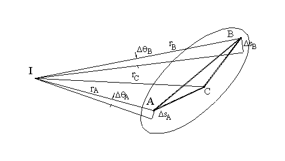

yukarıda gösterilen şekilden:

|**r** A |Δθ A  = |Δ**s** A |          ;          |**r** B |Δθ B  = |Δ**s** B |          (**r** A  = **IA** ve **r** B  = **IB**)

Bu yer değişim Δt zaman aralığında olacaktır:

|**r** A |Δθ A /Δt = |Δ**s** A /Δt|          ;          |**r** B |Δθ B /Δt = |Δ**s** B /Δt|

Ancak Δθ A  = Δθ B  = Δϕ = rijit cismin dönme açısı olacağından ve Δt sıfıra giderken:

dθ A /dt = dθ B /dt = dϕ/dt = ω

Bu denklemde ω cismin açısal dönme hızıdır. Öyle ise, herhangi bir düzlemsel hareket bir an için bir ani dönme merkezi etrafında dönme yapıyor olarak düşünülebilir ve cismin üzerinde bulunan her hangi bir C noktasının hız vektörünün şiddeti :

|**v** C | = ω|**r** C | = ω|**IC**|

Bu denklemden yola çıkarak, düzlemsel hareket sırasında hareketli cisim üzerinde sadece ani dönme merkezinin hızının sıfır olduğu sonucuna varırız. Diğer noktaların, örneğin C noktasının, hız vektörünün yönü ise IC doğrusuna dik olup ω hız vektörünün yönüne bağlı olarak IC doğrusuna 90° saat yelkovanı yönünde veya ters yönünde dönmüştür. Vektörel olarak:

**v** C  = **ω** × **r** C 

yazılabilir. Burada × vektör çarpımıdır. **ω** z yönünde bir açısal hız vektörü olup **r** C  = **IC** vektörüdür.

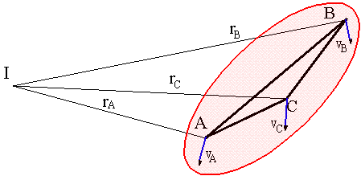

Ani dönme polü ve cisim üzerinde bulunan noktaların hızları

 **

**  **Genel düzlemsel hareket için bu durumda varılacak sonuçlar şunlardır:** 

 i)   Her düzlemsel hareket için, incelendiği anda geçerli olmak üzere, bir ani dönme merkezi bulunur. Bu nokta hareketli düzlemde o an için sıfır hıza sahip tek noktadır. 

 ii)  Cisim üzerinde bulunan her hangi bir noktanın hızının şiddeti o noktanın ani dönme merkezinden uzaklığının cismin açısal hızı ile çarpımıdır. Noktanın hızı noktayı ani dönme polüne bağlayan doğruya dik olup açısal hıza göredir. 

 iii) Hız analizi açısından her türlü düzlemsel hareket anlık olarak ani dönme merkezi etrafında dönme olarak düşünülebilir.

---

<!-- Kısım 3 -->
# 5.1 Mekanizmalarda Ani Dönme Merkezlerinin Bulunması

Bir rijit cisim sabit bir eksen etrafında dönüyor ise, ani dönme merkezi bu eksenin merkezi ile çakışır ve bu nokta sürekli olarak aynıdır (sürekli dönme merkezidir). Cisim öteleme yapıyor ise, ani dönme merkezi öteleme eksenine dik yönde sonsuzdadır. Bu şekilde her türlü düzlemsel hareket hız analizi açısından anlık bir dönme olarak incelenebilecektir.

Dikkat edilmesi gereken bir başka nokta ise, bir cismin hareketi bir referans eksenine göre inceleneceğidir. Bu referans ekseni bir sabit cisim üzerinde olabileceği gibi hareketli bir cismin üzerinde de bulunabilir. Bu nedenle eğer düzlemsel hareket sabit bir referans eksenine göre ise, bu durumda  mutlak ani dönme merkezi , referans ekseni hareketli bir düzlem üzerinde ise  bağıl ani dönme merkezi  denecektir. Yukarıda varılmış olan sonuçlar mutlak ani dönme merkezi içindir. Örneğin bağıl ani dönme merkezi durumunda o noktanın hızının sıfır olduğunu söylemek mümkün değildir. Ancak bağıl ani dönme merkezinde çakışan referans ekseninin bulunduğu düzlem üzerindeki nokta ile hareketini incelediğimiz cisim üzerinde bulunan noktaların arasında bağıl hız sıfır olacaktır. Bu nokta göz önüne alınarak ani dönme merkezi şu şekilde tanımlanır: Düzlemsel hareket yapan iki farklı cisim üzerinde bulunan birbirlerine göre bağıl hızları sıfır olan anlık çakışan iki nokta  **ani dönme merkezi** dir. Bu durumda *l* uzuvlu bir mekanizmada o an için her iki uzuv arasında bir ani dönme merkezi olacağına göre (*l* nesne ikişer ikişer alınıyor), ani dönme merkezi sayısı:

N = *l*(*l* − 1)/2

olacaktır. Mekanizmalar için cisimlerimiz uzuvlar olduğundan ve ani dönme merkezi iki uzuv arasında anlık çakışan bir nokta olacağından, ani dönme merkezlerini I ij  olarak gösterelim. Burada i ve j o ani dönme merkezi ile ilgili iki uzvun numarasıdır (I ij  = I ji  olup indis sıralı değildir).

---

<!-- Kısım 4 -->
# 5.2 Ani Dönme Merkezleri ile Mekanizmalarda Hız analizi

Önceki kısımda bir mekanizmada ani dönme merkezlerinin Aranhold-Kennedy teoremi kullanılarak bulunmasını gördük. Ayrıca düzlemsel hareket yapan cisimlerde I ij  ani dönme merkezinin i ve j uzuvlarında anlık çakışan iki nokta oldukları ve bu iki çakışan nokta arasında o an için bağıl hızın sıfır olacağını belirledik. Burada bu kavram kullanılarak mekanizmalarda hız analizi yapılacaktır.

---

<!-- Kısım 5 -->
# 5.3 Mekanik Avantaj

İlkokul yıllarından itibaren bildiğimiz basit levye prensibinde, şekilde gösterilen sistemde olduğu gibi, sistem dengede ise, dönme ekseninde moment toplamı sıfır olması gerekliliğinden:

F 1 *l* 1  = F 2 *l* 2      veya    F 2 /F 1  = *l* 1 /*l* 2  = Mekanik Avantaj

olarak tanımlanmaktadır. Bu yöntemle yüksek F 2  kuvvetini sınırlı bir F 1  kuvveti ile elde etmek ister isek *l* 1 /*l* 2  oranını yüksek seçmemiz gerekecektir. Buna bir farklı yaklaşım ise, kaybın olmadığını kabul ederek, enerji sakınımından birim zamanda yapılan iş ile elde edilen işin eşit olması şartından: F 1 v 1  = F 2 v 2  olacaktır. Burada v 1  ve v 2  kuvvetlerin etki ettiği noktada hızıdır.

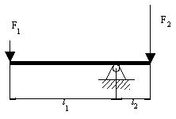

Aynı kavramı mekanizmalarda uygular isek, örneğin bir dört-çubuk mekanizması için giriş momenti T 12  ve çıkış kolu direnci T 14  ise, enerji sakınımından dolayı (kayıplar ihmal edilerek):

Giriş Gücü = Çıkış Gücü

T 12 ω 12  = T 14 ω 14      veya    Mekanik Avantaj = m a  = T 14 /T 12  = ω 12 /ω 14  = |I 14 I 24 |/|I 12 I 24 |

olacaktır. Dikkat edilir ise mekanik avantaj hız oranının tersidir. Ayrıca, eğer giriş ve çıkış kollarına belirli bir kol boyunda bu kuvvetler uygulanıyor ise:

Mekanik Avantaj = m a  = F 14 /F 12  = (T 14 /r 14 )/(T 12 /r 12 ) = (ω 12 r 12 )/(ω 14 r 14 ) = (|I 14 I 24 |r 12 )/(|I 12 I 24 |r 14 )

olacaktır. I 14 I 24  = B 0 I 24  uzunluğu sıfır olur ise mekanik avantaj sıfır olacak, I 12 I 24  = A 0 I 24  uzunluğu sıfır ise, mekanik avantaj sonsuz olacaktır. Tabi ki sistem elastikliğinden ve boşluklardan dolayı sonuçta mekanik avantaj sonsuz olamaz. Ancak mekanik avantaj çok yüksek değerlere ulaşacaktır. Bu şekilde basit levyelerle elde edilemeyecek kadar büyük mekanik avantaj elde edilebilecektir. Nitekim preslerde, sıkıştırma penslerinde, taş kırma gibi yüksek güç isteyen her işte yüksek mekanik avantaj sağlayan mekanizmalar kullanılmaktadır (aşağıdaki şekle bakınız).

Sonucun daha da genelleştirilmesi mümkündür. 1 uzvuna bağlı i ve j uzuvları olduğunda (i giriş, j ise çıkış uzvu olacaktır), bu iki uzvun hızı arasında (çakışan I ij  ani dönme merkezinde bağıl hız sıfır olduğundan) ω 1i |I 1i I ij | = ω 1j |I 1j I ij | ilişkisinin olduğu belirlenmişti. Öyle ise, enerjinin sakınımı prensibi kullanıldığında

Mekanik Avantaj = m a  = T 1j /T 1i  = ω 1i /ω 1j  = |I 1j I ij |/|I 1i I ij |

olacaktır (uzuvlara kuvvet uygulandığında denklemde uygun değişiklikler yapılır). Bu şekilde, mekanizmaların mekanik avantajlarının belirlenmesi hız oranlarının belirlenmesi problemine indirgenmiştir. Dikkat edilir ise, yüksek mekanik avantaj elde edilmesi için mekanizmanın ölü konumlara yakın olması gerekecektir.

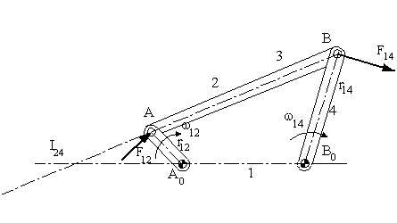

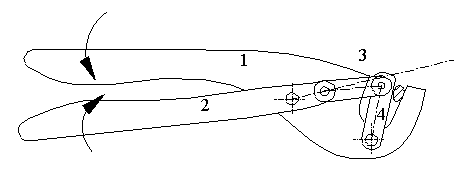

**Örnek:**

Şekilde gösterilen perçin makinası için θ 12  = 110° iken F 16 /T 12  oranını bulun.

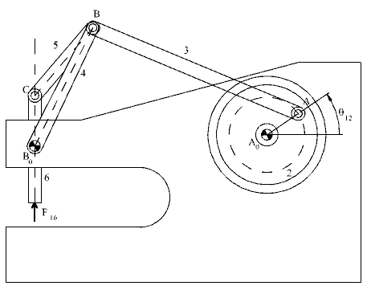

Mekanizma θ 12  = 110° konumunda çizilmiştir. Sürtünme ihmal edildiğinde, enerjinin sakınımından dolayı :

T 12 ω 12  = F 16 v 16 

yazabiliriz. 1, 2 ve 6 uzuvları arasında bulunan ani dönme merkezlerinden yararlanarak:

v 16  = |I 12 I 26 |ω 12 

olacaktır. Öyle ise:

F 16 /T 12  = ω 12 /v 16  = ω 12 /(|I 12 I 26 |ω 12 ) = 1/|I 12 I 26 |

dir. I 12 , A 0  merkezidir. Bu durumda problem I 26  ani dönme merkezini bulunması ile çözülecektir. Şekilde gösterildiği gibi, mafsal eksenleri dönme merkezleri olarak belirlendiğinde I 26  ani dönme merkezini bulmak için ilk olarak I 24  ve I 46  ani dönme merkezlerini bulmamız gerekir. I 24 , I 12 I 14  ile I 32 I 34  doğrularının kesim noktası ve I 46  ise I 14 I 16  ile I 45 I 56  doğrularının kesim noktası olarak belirlenir (kullanılan ani dönme merkezleri mafsal eksenleridir). Bu iki ani dönme merkezi belirlendikten sonra I 26 , I 12 I 16  ile I 24 I 46  doğrularının kesim noktasıdır. Dikkat edilir ise, I 16  sonsuzda olduğundan I 12 I 16  doğrusu A 0  dan çizilen 1, 6 uzuvları arasındaki kayar mafsala dik bir doğrudur. I 46  ise BC doğrusu (bu doğru I 45 I 56  doğrusudur) ile B 0  dan kayar mafsal eksenine dik doğrudur (I 45 I 56  doğrusu). BC ile B 0 C doğruları çakıştığında B 0  (I 14 ) ile I 26  çakışacaktır. Bu durumda I 26  ani dönme merkezi ise, A 0  (I 12 ) ile çakışır. Aynı durum A 0 A ile AB doğrularının çakışması durumunda söz konusudur. Bu durumda I 24 , A 0  noktası ile çakışacaktır. Bu durumda perçinleme sırasında I 12 I 26  mesafesi çok kısa olacağından F 16 /T 12  oranı büyük değerler alacaktır.

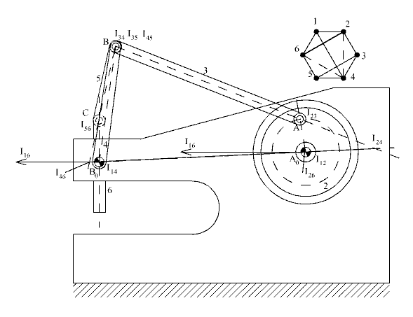

AutoCad kütüğü için tıklayınız:

---

<!-- Kısım 6 -->
# 5.4 Eşdeğer Mekanizmalar

Analizi yapılacak mekanizmalarda kam gibi yüksek eleman çiftleri bulunduğunda bu mekanizmaların analizi için genelde sadece bulundukları konumda geçerli olmak üzere adi kinematik çiftlerden oluşan bir eşdeğer mekanizma kullanmak gerekir. Bu eşdeğer mekanizma o an için ayni harekete sahip olmalıdır. Bulduğumuz eşdeğer mekanizmanın orijinal mekanizma ile o anda aynı hız ve ivme özelliklerinin aynı genellikle istenilir.

Bir örnek olması açısından Aşağıdaki şekilde gösterilen kam mekanizmasını ele alalım. Eşdeğer mekanizma gösterilen konumda orijinal mekanizma ile aynı hız özelliklerine sahip olması isteniyor ise, eşdeğer mekanizmanın I 12 , I 13  ve I 23  ani dönme merkezleri kam mekanizması ile aynı olması gerekir. Döner mafsal eksenleri A ve B nin 2 ve 3 uzuvlarının temas noktasında çizilen normal doğrusu üzerinde alındığı bir A 0 ABB 0  dört çubuk mekanizması ile bu şart sağlanacaktır (kam mekanizması ile bu dört çubuk mekanizması hız analizi açısından verilen konumda eşdeğer olacaktır). Ancak ivme analizininde bu iki mekanizmanın aynı olması istendiğinde, dört-çubuk mekanizmasının kam mekanizması ile eşdeğer olabilmesi için A ve B mafsal merkezlerinin eğri profillerinin eğrilik merkezlerinde olması gerekir. Dikkat edilir ise, adi çiftlerden oluşan eşdeğer mekanizmada fazla bir uzuv bulunmaktadır. Bu uzuv incelediğimiz esas mekanizmada yoktur.

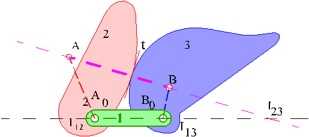

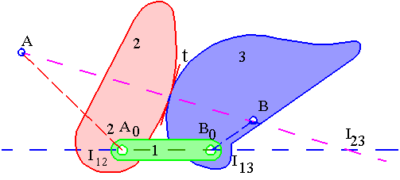

Aşağıdaki şekillerde bazı eşdeğer mekanizmalar gösterilmektedir. İlk şekilde gösterilen mekanizmalar için anlık eşdeğerlilik hız ve ivme için geçerlidir. İkinci şekilde gösterilen mekanizmalarda ise, eğrilik merkezleri sabit olduğundan hız ve ivme eşdeğerliliği mekanizmanın her konumu için geçerli olacaktır.

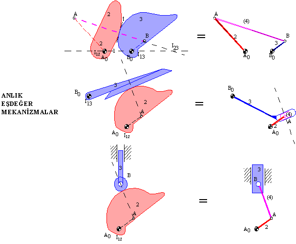

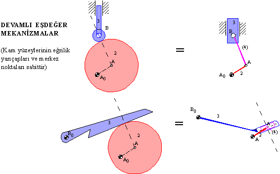

Yüksek eleman çiftleri bulunan bir mekanizma yerine bu mekanizmaya eşdeğer sadece adi eleman çiftleri bulunan bir mekanizmanın hız ve ivme analizi yapıldığında ilk mekanizmanın hız ve ivme analizi de yapılmış olacaktır.

---