# Lineer Mekanik Sistemler

*Prof. Dr. Eres Söylemez - Mekanizma Tekniği*

---

<!-- Kısım 1 -->
# IV. LİNEER MEKANİK SİSTEMLER

  **         **

---

<!-- Kısım 2 -->
#### “Bana ne kadar çok çalıştığını söyleme, ne kadar iş çıkardığını göster!”

#### James J. Ling

# Lineer Mekanik Sistemler:

Dişliler, sabit hız oranı ile bir milden diğer mile moment ve hareket iletmek için kullanılırlar. Dişli çift temas noktası her iki uzuv için bir daire çemberi üzerindedir ve bu iki dairenin merkezleri arasında uzaklık sabittir. Bu şekilde iki serbestlik dereceli şekil kapalı bir dişli çift oluşur. Şekil kapalılık ancak dişli çifti oluşturan iki uzvun bir başka uzva merkezlerinden bir döner mafsal ile bağlı olmaları ile mümkündür. Dairesel olmayan ve dolayısı ile sabit hız iletmeyen özel dişliler varsada yaygın olmadıklarından, konumuz dışında tutulacaktır.

Kinematik açıdan dişli çift, üzerinde özel işlenmiş kinematik elemanların teması ile elde edilen bir kinematik çifttir. Günlük hayatta ise dişli: çevresine diş açılmış ve diğer bir cisim ile bir dişli çifti oluşturabilen bir rijit cisimdir. Her iki tanımda kullanılabilirsede, karışıklık olmaması için özen gösterilmesi şarttır.

Dişli çift kapalı bir kinematik çift olup birleştirdiği iki uzuv arasında sabit bir hız oranını sağlar ve kaymaya müsaade etmez. Bu nedenle kayış kasnak, sürtünmeli merdane gibi sistemlere göre pozitif hareket iletimi söz konusudur.

Dişlilerden oluşan dişli zincirlerinin giriş ve çıkış millerinin açısal konumları lineer bir denklemle ilişkili olduğundan bu sistemlere aynı zamanda  **lineer mekanik sistem**  denmektedir. Diğer lineer mekanik sistemler kayış kasnak sistemleri (triger, düz veya v kayış), zincir dişli sistemleri, ve sürtünmeli merdane sistemleridir. Bu lineer mekanik sistemler bu kısımda açıklanacak olan yöntemlerle incelenebilirler, ancak sürtünmeli sistemlerde kaymanın olmadığı varsayılmalı, zincir dişlide ise, hız titremesi ihmal edilmelidir.

Uzuvların dönme yönleri saat yelkovanı yönünde veya ters yönde olabilir. Bu yönlerden birine artı, diğerine ise eksi diyebiliriz (genel kural, saat yelkovanına ters dönüşler, SYT, artı; saat yelkovanı yönünde, SY, dönüşler ise eksi alınır). Uzaysal dişli sistemlerde bu tür bir uygulama yanlış olacaktır ve yön bakış noktasına göre değişecektir. Bu durumda şekil üzerinde oklar veya dönme eksenlerinin vektörel tanımı kullanılabilir.

---

<!-- Kısım 3 -->
# 6.1 Basit Dişli Zincirleri

Eğer dişli çiftini oluşturan kinematik elemanları taşıyan uzuvlar aynı zamanda sabit uzva bir döner çift ile bağlı ise, bu tür dişli zincirlerine basit dişli zincir denecektir. Tek bir dişli çifte sahip ** basit dişli zincir ** Şekilde görülmektedir. Iki uzuv arasında anlık çakışan P temas noktasında, iki uzuv arasında kayma olmayıp sadece yuvarlanma olduğundan, bağıl hız sıfırdır. Bu durumda P 2  ve P 3  noktalarının hızları aynı olacaktır. ** Hız oranı ** olarak N 23  ü:

 $        N  23   =    ω  13    ω  12    =    n  13    n  12       \displaystyle {{\text{N}}_{{23}}}=\frac{{{\text{ω}_{{13}}}}}{{{\text{ω}_{{12}}}}}=\frac{{{{\text{n}}_{{13}}}}}{{{{\text{n}}_{{12}}}}}   $          N              23       ​               =                       ω             12       ​                              ω             13       ​                 ​                =                        n              12       ​                               n              13       ​                 ​                 

tanımlayalım. Burada n 1j  devir/dakika cinsinden j uzvunun hızıdır. P noktasının hızı:

 $        v   P  3       =   v   P  2    =   ω  13    r  3   =   ω  12    r  2      \displaystyle {\text{v}_{{{\text{P}_{3}}}}}~={\text{v}_{{{\text{P}_{2}}}}}={\text{ω}_{{13}}}{\text{r}_{3}}={\text{ω}_{{12}}}{\text{r}_{2}}    $         v                P            3      ​                  ​                  =           v                P            2      ​                  ​               =           ω             13       ​                r            3      ​               =           ω             12       ​                r            2      ​                

dır. Bu durumda:

 $        N  23   =    ω  13    ω  12    =    n  13    n  12    =    r  2    r  3    =    d  2    d  3       \displaystyle {{\text{N}}_{{23}}}=\frac{{{{\text{ω}}_{{13}}}}}{{{{\text{ω}}_{{12}}}}}=\frac{{{{\text{n}}_{{13}}}}}{{{{\text{n}}_{{12}}}}}=\frac{{{\text{r}_{2}}}}{{{\text{r}_{3}}}}=\frac{{{\text{d}_{2}}}}{{{\text{d}_{3}}}}   $          N              23       ​               =                        ω              12       ​                               ω              13       ​                 ​                =                        n              12       ​                               n              13       ​                 ​                =                       r            3      ​                              r            2      ​                 ​                =                       d            3      ​                              d            2      ​                 ​                 

bu denklemde d i  ve r i  i uzvunda dişli bölüm dairesi çapı ve yarı çapıdır.

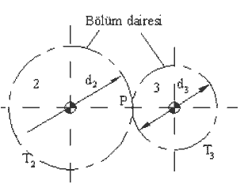

Dişli teorisine göre, dişli çifti oluşturan kinematik elemanların birbirleri ile uyumlu olabilmeleri için, her bir dişin bölüm dairesi üzerinde kapsadığı yay uzunluğu aynı olmalıdır. Eğer çevredeki diş sayısı  $        T  i      \displaystyle T_{i}   $       T           i      ​                ise bu yay uzunluğu m = πd i /T i   (sabit), veya T i /d i  = π/C = P D  ( sabit). Birbirleri ile çalışan iki dişli için bu oran aynı olması gerektiğinden:

 $         T  3    d  3    =    T  2    d  2       \displaystyle \frac{{{\text{T}_{3}}}}{{{\text{d}_{3}}}}=\frac{{{\text{T}_{2}}}}{{{\text{d}_{2}}}}   $                     d            3      ​                              T            3      ​                 ​                =                       d            2      ​                              T            2      ​                 ​                 

olması gerekir. Bunun sağlanması için dişli çift oluşturacak dişlilerin belirli m veya P D  değerleri ile üretilmesi gerekir. Avrupada genellikle dişliler değişik m – modül (birimi mm dir) değerlerinde, İngilizce konuşulan ülkelerde ise genellikle dişliler değişik P D  – çap adımı (birimi 1/inch dir) değerlerinde üretilir ve bu değerlerin standardları bulunmaktadır.

Hız oranını dişli çift ile birleştirilen iki uzuv aynı yönde dönüyor ise pozitif, birbirlerine göre ters yönde dönüyor ise negatif olarak tanımlayalım. yukarıdaki şekilde görüldüğü gibi P temas noktası döner mafsal eksenleri arasında ise (buna ** dış dişli çift ** diyeceğiz), uzuvlar ters yönde; aşağıdaki şekilde görüldüğü gibi P temas noktası döner mafsal eksenleri dışında ise (buna ** iç dişli çift ** diyeceğiz), uzuvlar aynı yönde döneceklerdir.

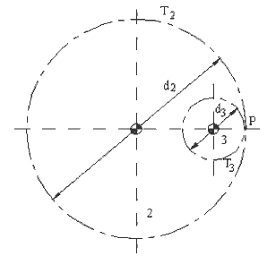

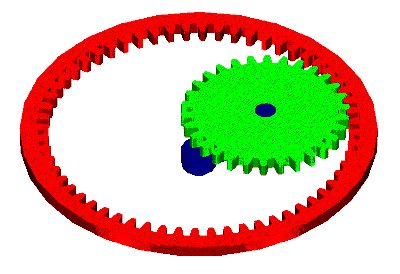

Basit dişli zincirde hız oranı:

 $        N  23   =    ω  13    ω  12    =    n  13    n  12    =  ±    r  2    r  3    =  ±    d  2    d  3    =  ±    T  2    T  3    =   R  23      \displaystyle {\text{N}_{{23}}}=\frac{{{\text{ω}_{{13}}}}}{{{\text{ω}_{{12}}}}}=\frac{{{\text{n}_{{13}}}}}{{{\text{n}_{{12}}}}}=\pm \frac{{{\text{r}_{2}}}}{{{\text{r}_{3}}}}=\pm \frac{{{\text{d}_{2}}}}{{{\text{d}_{3}}}}=\pm \frac{{{\text{T}_{2}}}}{{{\text{T}_{3}}}}={\text{R}_{{23}}}    $         N             23       ​               =                       ω             12       ​                              ω             13       ​                 ​                =                       n             12       ​                              n             13       ​                 ​                =        ±                 r            3      ​                              r            2      ​                 ​                =        ±                 d            3      ​                              d            2      ​                 ​                =        ±                 T            3      ​                              T            2      ​                 ​                =           R             23       ​                 = ** Dişli Oranı **

dır. Bu denklemde işaret dişli çift iç dişli çift ise artı (+), dış dişli çift ise eksi (−) dir.

Görüldüğü gibi, ** basit dişli zincirler için hız oranı (N ij ) ile dişli oranı (R ij ) birbirlerine eşittir **.

Aşağıdaki şekilde görülen basit dişli zinciri ele alalım. 2 uzvu 3 uzvu ile ve 3 uzvu aynı kinematik elemanı kullanarak 4 uzvu ile dişli çift oluşturmuştur. Dişli oranını her bir dişli çift için yazdığımızda:

 $        R  23   =    n  13    n  12    =  −    T  2    T  3     ,    R  34   =    n  14    n  13    =  −    T  3    T  4       \displaystyle {\text{R}_{{23}}}=\frac{{{\text{n}_{{13}}}}}{{{\text{n}_{{12}}}}}=-\frac{{{\text{T}_{2}}}}{{{\text{T}_{3}}}}\text{ , }{\text{R}_{{34}}}=\frac{{{\text{n}_{{14}}}}}{{{\text{n}_{{13}}}}}=-\frac{{{\text{T}_{3}}}}{{{\text{T}_{4}}}}    $         R             23       ​               =                       n             12       ​                              n             13       ​                 ​                =        −                 T            3      ​                              T            2      ​                 ​                ,       R             34       ​               =                       n             13       ​                              n             14       ​                 ​                =        −                 T            4      ​                              T            3      ​                 ​                 

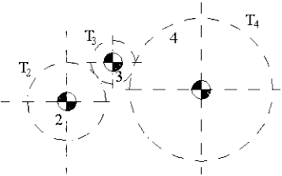

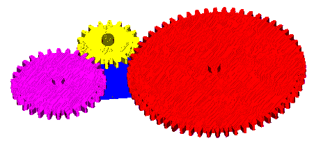

ve

 $        R  24   =    n  14    n  12    =    n  13    n  12      n  14    n  13    =   R  23    R  34   =   (   −    T  2    T  3     )    (   −    T  3    T  4     )   =    T  2    T  4       \displaystyle {\text{R}_{{24}}}=\frac{{{\text{n}_{{14}}}}}{{{\text{n}_{{12}}}}}=\frac{{{\text{n}_{{13}}}}}{{{\text{n}_{{12}}}}}\frac{{{\text{n}_{{14}}}}}{{{\text{n}_{{13}}}}}={\text{R}_{{23}}}{\text{R}_{{34}}}=\left( {-\frac{{{\text{T}_{2}}}}{{{\text{T}_{3}}}}} \right)\left( {-\frac{{{\text{T}_{3}}}}{{{\text{T}_{4}}}}} \right)=\frac{{{\text{T}_{2}}}}{{{\text{T}_{4}}}}   $         R             24       ​               =                       n             12       ​                              n             14       ​                 ​                =                       n             12       ​                              n             13       ​                 ​                             n             13       ​                              n             14       ​                 ​                =           R             23       ​                R             34       ​               =          (    −                 T            3      ​                              T            2      ​                 ​                )        (    −                 T            4      ​                              T            3      ​                 ​                )      =                       T            4      ​                              T            2      ​                 ​                 

olacaktır. Denklemden görüldüğü gibi, 3 uzvu üzerinde bulunan diş sayısı hız oranı şiddetini etkilememekte, ancak iki dış dişli olduğundan oran artı olmaktadır. Bu ara dişliler genellikle ** avare dişli ** olarak adlandırılırlar. Öncelikle hız yönünü istenilen yöne değiştirmek için veya aralarında büyük mesafe bulunan iki milin belirli bir hız oranı ile birbirine bağlanması gerektiğinde dişli çapını küçük değerlerde tutmak için kullanılır.

** Birleşik basit dişli zincir  **sistemlerinde ise, her bir uzuv üzerinde dişli çift oluşturan iki değişik çapta dişli bulunmaktadır. Aşağıdaki şekilde bir örnek görülmektedir. Bu tür zincirlerde bazı uzuvlar avare dişlide olabilir. Tüm zincirin hız oranını belirlemek için her bir dişli çift teker teker ele alınabilir:

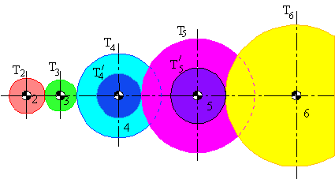

Dişli çift ile bağlanan uzuvlar için:

 $        R  23   =    n  13    n  12    =  −    T  2    T  3       ,      R  34   =    n  14    n  13    =  −    T  3    T  4       ,      R  45   =    n  15    n  14    =  −     T  4   ′    T  5       ,      R  56   =    n  16    n  15    =  −     T  5   ′    T  6       \displaystyle {\text{R}_{{23}}}=\frac{{{\text{n}_{{13}}}}}{{{\text{n}_{{12}}}}}=-\frac{{{\text{T}_{2}}}}{{{\text{T}_{3}}}}\text{   ,   }{\text{R}_{{34}}}=\frac{{{\text{n}_{{14}}}}}{{{\text{n}_{{13}}}}}=-\frac{{{\text{T}_{3}}}}{{{\text{T}_{4}}}}\text{   ,   }{\text{R}_{{45}}}=\frac{{{\text{n}_{{15}}}}}{{{\text{n}_{{14}}}}}=-\frac{{{\text{T}_{4}}^{\prime }}}{{{\text{T}_{5}}}}\text{   ,   }{\text{R}_{{56}}}=\frac{{{\text{n}_{{16}}}}}{{{\text{n}_{{15}}}}}=-\frac{{{\text{T}_{5}}^{\prime }}}{{{\text{T}_{6}}}}   $         R             23       ​               =                       n             12       ​                              n             13       ​                 ​                =        −                 T            3      ​                              T            2      ​                 ​                  ,         R             34       ​               =                       n             13       ​                              n             14       ​                 ​                =        −                 T            4      ​                              T            3      ​                 ​                  ,         R             45       ​               =                       n             14       ​                              n             15       ​                 ​                =        −                 T            5      ​                               T            4      ​                      ′              ​                  ,         R             56       ​               =                       n             15       ​                              n             16       ​                 ​                =        −                 T            6      ​                               T            5      ​                      ′              ​                 

dir. Bu durumda denklemlerin sağ tarafları ile sol taraflarının çarpımından:

 $        R  26   =    n  16    n  12    =    n  13    n  12      n  14    n  13      n  15    n  14      n  16    n  15    =   R  23    R  34    R  45    R  56   =    (   −  1   )   4      T  2    T  3     T  4   ′     T  5   ′      T  3    T  4    T  5    T  6     =     T  2     T  4   ′     T  5   ′      T  4    T  5    T  6        \displaystyle {\text{R}_{{26}}}=\frac{{{\text{n}_{{16}}}}}{{{\text{n}_{{12}}}}}=\frac{{{\text{n}_{{13}}}}}{{{\text{n}_{{12}}}}}\frac{{{\text{n}_{{14}}}}}{{{\text{n}_{{13}}}}}\frac{{{\text{n}_{{15}}}}}{{{\text{n}_{{14}}}}}\frac{{{\text{n}_{{16}}}}}{{{\text{n}_{{15}}}}}={\text{R}_{{23}}}{\text{R}_{{34}}}{\text{R}_{{45}}}{\text{R}_{{56}}}={{\left( {-1} \right)}^{4}}\frac{{{\text{T}_{2}}{\text{T}_{3}}{\text{T}_{4}}^{\prime }{\text{T}_{5}}^{\prime }}}{{{\text{T}_{3}}{\text{T}_{4}}{\text{T}_{5}}{\text{T}_{6}}}}=\frac{{{\text{T}_{2}}{\text{T}_{4}}^{\prime }{\text{T}_{5}}^{\prime }}}{{{\text{T}_{4}}{\text{T}_{5}}{\text{T}_{6}}}}   $         R             26       ​               =                       n             12       ​                              n             16       ​                 ​                =                       n             12       ​                              n             13       ​                 ​                             n             13       ​                              n             14       ​                 ​                             n             14       ​                              n             15       ​                 ​                             n             15       ​                              n             16       ​                 ​                =           R             23       ​                R             34       ​                R             45       ​                R             56       ​               =            (   −  1   )             4                          T            3      ​                T            4      ​                T            5      ​                T            6      ​                              T            2      ​                T            3      ​                 T            4      ​                      ′              T            5      ​                      ′              ​                =                       T            4      ​                T            5      ​                T            6      ​                              T            2      ​                 T            4      ​                      ′              T            5      ​                      ′              ​                 

olacaktır. Dikkat edilir ise, payda bulunan bütün dişli sayıları tahrik eden dişlilerdir; paydada bulunan dişli sayıları ise tahrik edilen dişlilere aittir. Ayrıca her bir dış dişli çifti hız oranının işaretini değiştireceğinden çift sayıda dış dişli çifti olduğu durumlarda giriş ve çıkış uzuvları aynı yönde dönerken tek sayıda dış dişli var ise giriş ve çıkış uzuvları birbirlerine göre ters yönde döneceklerdir. İç dişlinin ise yön değiştirmede etkisi yoktur. Birleşik dişli için çıkardığımız bu neticeyi genelleştirirsek:

 $        R  ij   =   N  ij   =    n  1j    n  1i    =    (   −  1   )   k    Tahrik eden diş sayılarının çarpımı  Tahrik edilen diş sayılarının çarpımı      \displaystyle {\text{R}_{\text{ij}}}={\text{N}_{\text{ij}}}=\frac{{{\text{n}_{\text{1j}}}}}{{{\text{n}_{\text{1i}}}}}={{\left( {-1} \right)}^{\text{k}}}\frac{{\text{Tahrik eden diş sayılarının çarpımı}}}{{\text{Tahrik edilen diş sayılarının çarpımı}}}   $         R             ij       ​               =           N             ij       ​               =                       n             1i       ​                              n             1j       ​                 ​                =            (   −  1   )              k                         Tahrik edilen di  ş   say  ı  lar  ı  n  ı  n çarp  ı  m  ı                  Tahrik eden di  ş   say  ı  lar  ı  n  ı  n çarp  ı  m  ı       ​                 

Bu denklemde k  **dış dişli çifti sayısı** dır. Önemli bir not ise, diğer mekanizmalarda hız analizi sırasında açısal hız için radyan/saniye kullanılması gerekli iken, burada hızların oranı söz konusu olduğundan açısal hız birimi olarak devir/dakika veya radyan/saniye veya uygun herhangi bir başka birim kullanılabilir ve giriş için kullanılan birim ne ise, o birime göre sonuç elde edilir.

Hız oranı sabittir. Öyle ise, açısal konum hız oranının zamana göre integ-ralinden açısal ivme oranı ise hız oranının zamana göre türevinden bulunabilir. Örneğin eğer i uzvu Δθ 1i  kadar döndü ise, j uzvunun dönme miktarı Δθ 1j  = R ij Δθ 1i  olacaktır.

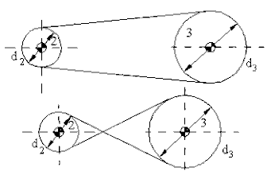

Birleşik basit dişli zincirler için elde etmiş olduğumuz bu genel denklemi diğer lineer mekanik sistemler içinde kullanmamız mümkündür. Şekilde görülen kayış kasnak sisteminde, kaymanın olmadığı var sayılır ise, hız oranları çap oranı olacak, açık kayış sistemi ise, içden dişli çifti gibi olup kayış ile bağlanan her iki uzuvda aynı yönde dönecektir. Merdaneli sistemlerde diş sayısı yerine çap kullanılabilir. Zincir dişli için yine diş sayısı kullanılacaktır. Bu durumda:

 $        R  ij   =    n  1j    n  1i    =    (   −  1   )   k    Tahrik eden kasnak (merdane, dişli) çapı  Tahrik edilen kasnak (merdane, dişli) çapı      \displaystyle {\text{R}_{\text{ij}}}=\frac{{{\text{n}_{\text{1j}}}}}{{{\text{n}_{\text{1i}}}}}={{\left( {-1} \right)}^{\text{k}}}\frac{{\text{Tahrik eden kasnak (merdane, dişli) çapı}}}{{\text{Tahrik edilen kasnak (merdane, dişli) çapı}}}   $         R             ij       ​               =                       n             1i       ​                              n             1j       ​                 ​                =            (   −  1   )              k                         Tahrik edilen kasnak (merdane, di  ş  li) çap  ı                  Tahrik eden kasnak (merdane, di  ş  li) çap  ı       ​                 

Bu denklemde k merdanelerde, dıştan temas sayısına, kayışlarda ise, çapraz bağlantı sayısına eşittir.

Açık kayış:           $        R  23   =  −    d  2    d  3       \displaystyle {\text{R}_{{23}}}=-\frac{{{\text{d}_{2}}}}{{{\text{d}_{3}}}}   $         R             23       ​               =        −                 d            3      ​                              d            2      ​                 ​                          ,         Çapraz kayış:           $        R  23   =  +    d  2    d  3       \displaystyle {\text{R}_{{23}}}=+\frac{{{\text{d}_{2}}}}{{{\text{d}_{3}}}}   $         R             23       ​               =        +                 d            3      ​                              d            2      ​                 ​                 

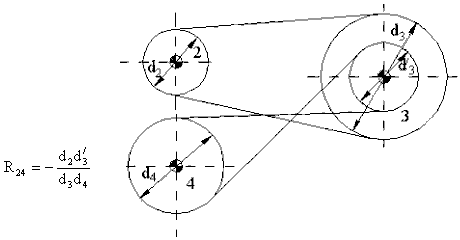

Yukarıda basit bir birleşik kayış-kasnak sistemi ve hız oranı gösterilmektedir.

Basit dişli zincirlerinin yoğunlukla kullanıldığı durumlardan biriside, sabit giriş hızına karşı çıkış milinden kademeli değişik hızların elde edilmesidir. Araçların dişli kutusu veya takım tezgahlarında kullanılan dişli kutuları tipik örneklerdir. ** Kademeli dişli kutuları ** olarak adlandırabileceğimiz bu tip sistemlerde her hız durumunda farklı bir basit dişli zinciri oluşacaktır. Aşağıdaki şekillerde iki örnek gösterilmektedir. Bu şekillerde ön görünüm kullanıldığı takdirde iç içe değişik çapta daireler görüleceğinden ve hangi uzuvların dişli çifti oluşturduğunu belirlemek zor olduğundan genellikle yan görünüş kullanılır.

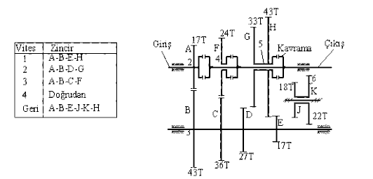

 Araç dişli kutusu 

Bu tür dişli kutularında bir başka özellik ise, giriş ve çıkış millerinin aynı eksende olabilmesi için dişli çifti oluşturan iki uzvun yarı çapları toplamı her kademede eşit olmasıdır. Bu, dişli çifti oluşturan uzuvların diş sayıları toplamının her kademede eşit olmasını gerektirir (diş sayısı farkı bir veya iki diş olduğundada eksenlerin aynı olması sağlanabilir). Örneğin üstteki şekilde A + B = C + F = D + G = E + H = 60 diştir. Alttaki şekilde ise bu toplam 42 dişdir, bu tip dişli kutularına ** eksenel dişli kutusu ** diyeceğiz.

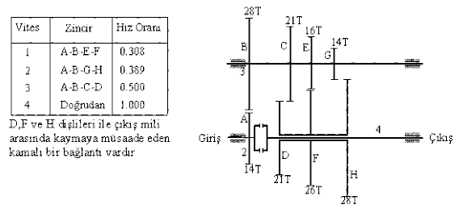

 Takım tezgahı dişli kutusu 

**Örnek:**

Şekilde 6 vitesli bir takım tezgahı dişli kutusu görülmektedir. 6 vites için hız oranlarını bulmamız gerekmektedir.

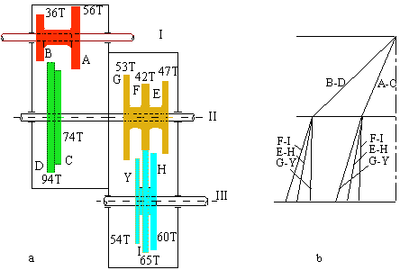

 Altı kademeli takım tezgahı dişli kutusu 

I ve II milleri arasında iki değişik hız oranı elde edilebilecek, II ve III milleri arasında ise üç değişik hız oranı elde edilebilecektir ve bu şekilde I ve III mili arasında 6 değişik hız oranı elde edilecektir. Dikkat edilir ise, iki mil arasında bulunan ve dişli çifti oluşturan dişlilerin diş sayıları toplamı aynıdır. Bu özellik tasarımda önemli sınırlamalar getirir. Zincirler A-C-F-I, A-C-E-H, A-C-G-Y, B-D-F-I, B-D-E-H ve B-D-G-Y dir. Her bir zinciri ayrı ayrı çözmektense I ve II mili arasında bulunan iki hız oranı, II ve III mili arasında bulunan üç hız oranı çözüldükten sonra bunların çarpımı bize hız oranlarını verir. Hız oranlarını bir diagram şeklinde gösterilmesi ise Şekil. (b) de gösterildiği gibi olabilir. I, II ve III milleri çizildikten sonra I ve II arasında bulunan iki hız oranı (56/74 = 0.7568, 36/94 = 0.3830) belirlenerek belirli bir ölçek kullanılarak çizilir. II ve III milleri arasında F-I, E-H veya G-J dişli çiftleri oluşacağından dolayı, üç değişik hız oranı (53/54 = 0.9815, 47/60=0.7833, 42/60 = 0.6462) bulunur. I – II milleri ile II – III milleri arasında hız oranları birbirleri ile çarpılarak I-III mili arasında bulunan 6 değişik hız oranı elde edilmiş olur ve bu oranlar yatay eksende belirli bir ölçek ile gösterildiğinde hız oranlarının boyutları görsel olarak görülecektir. Genel olarak bu tür dişli kutularında hız oranlarının geometrik bir seri takip etmesi istenilir.

*** ÇEVRENİZDE ERİŞEBİLECEĞİNİZ BİR BASİT DİŞLİ KUTUSUNU İNCELEYİN. BAZILARINDA DİŞLİLERİN ÇOK İLGİNÇ ŞEKİLLERDE MONTE EDİLDİĞİNİ GÖRECEKSİNİZ. ***

---

<!-- Kısım 4 -->
# 6.2 Planet Dişli Sistemleri

Basit dişli zincirlerinde uzvun bir kinematik elemanı dişli çifti oluşturuyor ise, diğer kinematik elemanı sabit uzuv ile döner mafsal oluşturması gerekmekte idi. Eğer diğer kinematik eleman hareketli bir uzuv ile döner mafsal oluşturuyor ise, elde edilen zincire**  planet dişli sistem ** diyeceğiz. Dikkat edilir ise, şekil kapalı dişli çiftinin oluşturulabilmesi için dairesel dişlilerin eksenleri arasında uzaklığın sabit bir uzaklık olması şarttır. Planet dişli sistemlerde bazı dişlilerin dönme merkezi sabit olmayacak ancak diş eksenleri arasında uzaklık bir kol aracılığı ile sabit kalacaktır. Bu durumda dönen uzuvlar arasında hız oranı ile dişli oranı basit dişli sistemlerde olduğu gibi eşit değildir. Planet dişli sistemleri küçük hacimde yüksek hız oranları elde etmeyi sağlayan önemli bir sistemdir. Diferansiyel kutularında, otomatik vitesli arabalarda, çeşitli alet ve cihazda, iş makinalarında, vinçlerde kullanılmaktadır.

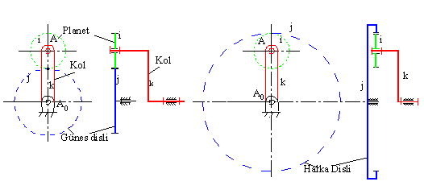

Planet dişli sistemin tek bir dişli çiftten oluşan en basit şekli aşağıdaki şekilde görülmektedir. Kol (k uzvu) A 0  dan geçen bir eksen etrafında dönebilmektedir. j uzvu (genellikle bu uzva, dıştan dişli oluşturuyorsa ** güneş dişli **, içten dişli oluşturuyor ise ** halka dişli ** denir) bir döner mafsal ile sabit uzva A 0  noktasından bağlanmıştır. ** Planet dişli ** olarak adlandırılan i uzvu ise, j uzvu ile dişli çift oluştururken, kola A noktasından bir döner mafsal ile bağlıdır. Sistem bu şekli ile iki serbestlik derecelidir.

Şematik gösterimde planet dişli sistemlerinin yan görünümü tercih edilir.

Planet dişli üzerinde bulunan her hangi bir noktanın konumunun koordinatları parametrik olarak:

x = a 1 cosθ + a 2 cos(Rθ)

y = a 1 sinθ + a 2 sin(Rθ)

veya karmaşık sayılar ile:

z = a 1 e iθ  + a 2 e iRθ 

denklemi ile ifade edilebilir. Bu denklemde θ bağımsız değişkendir ve genellikle kolun dönme açısıdır. a 1 , a 2  ve R sabit değerlerdir (R diş sayılarının oranına bağlıdır, a 1  ve a 2  ise kol uzunluğu ve incelenen noktanın planet dönme merkezi, A noktasına uzaklığıdır). Yörünge genellikle çok ilginç eğriler oluşturur. Bu eğriler episkloid ve hiposikloid eğrilerdir. Planet dişli sistemlerin bu özelliğinden dolayı ** episikloid dişli sistem ** olarakda adlandırılırlar. Aşağıda bir örnek gösterilmiştir. Bu tür hareketler, örneğin karıştırıcılarda karıştırıcı kanadın her defada değişik bir nokta ile temas etmesi ve tüm hacmi taraması için kullanılır.Diş oranlarına ve planet dişli üzerinde seçilen noktanın geometrik yerine göre bu eğri bir elips olabileceği gibi, doğruda olabilir.

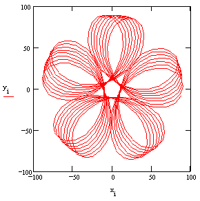

Büyük yük altında çalışan planet dişli sistemlerde yükü dengelemek ve bölmek için aynı kola mafsallanmış ve aynı güneş dişli ile dişli çift oluşturan çok sayıda planet dişli bulunabilir. Genellikle planet dişliler eşit aralıklarla güneş dişli çevresine yerleştirilmiştir. Üç planet dişlili bir örnek Şekilde görülmektedir. Bu planet dişlilerin kinematik analizleri sırasında tek bir planet dişli göz önüne alınması gerekir.

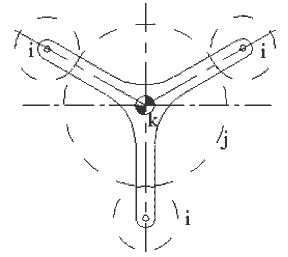

 

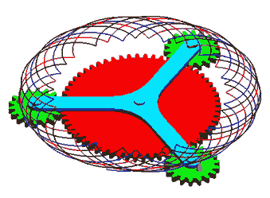

Planet dişli sistemlerin hareket analizi için önceden açıklanmış olan bağıl hareket kavramı göz önüne alınmalıdır. Planetin hareketi iki hareketin toplamı olarak düşünülebilir. Bunlardan birisi planet dişlinin A merkezli dönme hareketidir. İkinci hareket ise, A noktası sabit olmadığından, planet dişli üzerinde bulunan A noktasının kol üzerinde hareketidir.

Aşağıda gösterilmiş olan planet dişli sistemini ele alalım. P noktası iki dişli elemanının temas noktasıdır ve sadece yuvarlanma olduğundan P i  ve P j  noktalarının hızları aynıdır. Öyle ise:

**v** Pi  = **v** Pj  = **v** A  + **v** P/A 

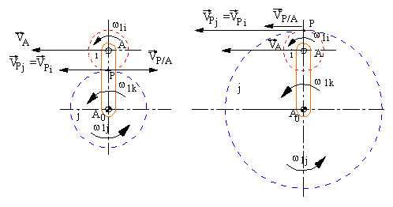

Açısal hızları saat yelkovanına ters yönde olduklarında pozitif kabul edelim. Hız bileşenlerinin yönleri aynı doğrultuda olacaklarından hızlar pozitif veya negatif olacak ve vektörel hız denklemi skaler toplam olarak ele alınabilecektir. Hız bileşenleri açısal hız ve dişli yarıçapları ile yazıldığında

v pj  = v pi  = ω 1j  r j 

v A  = ω 1k (r j  ± r i )            (+ dış dişli, − iç dişli olur ise)

v P/A  = ±ω 1i r i                   (− dış dişli, + iç dişli olur ise)

Bu denklemlerde r i  ve r j  şekilde görüldüğü gibi dişli bölüm dairesi yarıçapıdır. Bu durumda hız denklemi:

ω 1j r j  = ω 1k (r j   $       ∓     \displaystyle \mp    $      ∓      r i ) ± ω 1i r i 

olur. veya:

 $       ∓    r  i    r  j    =     ω  1j   −   ω  1k      ω  1i   −   ω  1k        \displaystyle \mp \frac{{{{\text{r}}_{\text{i}}}}}{{{{\text{r}}_{\text{j}}}}}=\frac{{{{\text{ω}}_{{\text{1j}}}}-{{\text{ω}}_{{\text{1k}}}}}}{{{{\text{ω}}_{{\text{1i}}}}-{{\text{ω}}_{{\text{1k}}}}}}   $      ∓                  r              j       ​                               r              i       ​                 ​                =                        ω               1i        ​               −        ω               1k        ​                               ω               1j        ​               −        ω               1k        ​                 ​                           (− dış dişli, + iç dişli olur ise)

denklemin sol tarafı için dişli teorisi kullanılarak:

 $       ∓    r  i    r  j    =  ∓    d  i    d  j    =  ∓    T  i    T  j    =   R  ij      \displaystyle \mp \frac{{{{\text{r}}_{\text{i}}}}}{{{{\text{r}}_{\text{j}}}}}=\mp \frac{{{{\text{d}}_{\text{i}}}}}{{{{\text{d}}_{\text{j}}}}}=\mp \frac{{{{\text{T}}_{\text{i}}}}}{{{{\text{T}}_{\text{j}}}}}={{\text{R}}_{{\text{ij}}}}   $      ∓                  r              j       ​                               r              i       ​                 ​                =        ∓                  d              j       ​                               d              i       ​                 ​                =        ∓                  T              j       ​                               T              i       ​                 ​                =            R               ij        ​                

yazılabilir. Dikkat edilir ise R ij  diş sayısı oranıdır ve basit dişli sistemlerde olduğu gibi, o uzuvların hız oranı değildir. Dış dişli çift için R ij  = −T i /T j  ve iç dişli için R ij  = +T i /T j  basit dişli sistemler için tanımlandığı gibidir. Ayrıca denklem incelendiğinde diş sayısı oranı hız oranına eşit değilsede, ω 1j  − ω 1k  teriminin ω 1i  − ω 1k  terimine oranıdır. Bu terimler ise, düzlemsel harekette i ve j uzuvlarının kola (k uzvu) göre bağıl hızlarıdır. Yani:

ω kj  = ω 1j  − ω 1k             (j uzvunun k uzvuna göre bağıl hızı)

ω ki  = ω 1i  − ω 1k             (i uzvunun k uzvuna göre bağıl hızı)

Öyle ise:

 $        R  ij   =    ω  kj    ω  ki    =     ω  1j   −   ω  1k      ω  1i   −   ω  1k        \displaystyle {{\text{R}}_{{\text{ij}}}}=\frac{{{{\text{ω}}_{{\text{kj}}}}}}{{{{\text{ω}}_{{\text{ki}}}}}}=\frac{{{{\text{ω}}_{{\text{1j}}}}-{{\text{ω}}_{{\text{1k}}}}}}{{{{\text{ω}}_{{\text{1i}}}}-{{\text{ω}}_{{\text{1k}}}}}}   $          R               ij        ​               =                        ω               ki        ​                               ω               kj        ​                 ​                =                        ω               1i        ​               −        ω               1k        ​                               ω               1j        ​               −        ω               1k        ​                 ​                 

Bazı durumlarda bu denklemi:

ω 1i R ij  + ω 1k (1 − R ij ) − ω 1j  = 0

yazmak doğru olacaktır. Eğer diş sayısı veya dişli çapları biliniyor ise, denklemde üç açısal hız değişkeni vardır (ω 1j , ω 1i , and ω 1k ). Eğer iki açısal biliniyor ise, üçüncü açısal hız bulunabilir.

Basit dişli sistemlerde hız oranı (N ij  = ω 1j /ω 1i  ) ve dişli sayısı oranı (R ij  = T i /T j ) aynıdır. Bu nedenle R ij  sembolü her iki oran için kullanılmıştır. Planet dişli sistemler için bu iki oran farklı olacağından, R ij  sembolü dişli çifti oluşturan iki dişlinin diş sayısı oranı olarak (T i /T j  ) kullanılacak, uzuvlar arasında hız oranı ise N ij  sembolü ile gösterilecektir. Sadece basit dişli sistemler için R ij  = N ij  geçerlidir.

**Örnek:**

Basit bir örnek olarak Şekilde görülen planet dişli sistemini ele alalım. Güneş dişlide 60 diş ve planet dişlide 22 diş bulunmaktadır. Kol 100 dev/dk hızla saat yelkovanına ters yönde güneş dişli ise 150 dev/dk saat yelkovanı (SY) yönünde dönmektedir. Saat yelkovanına ters (SYT) yönde dönmeyi pozitif kabul ederek:

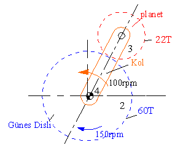

 $       −   60  22   =     ω  1j   −  100    150  −  100       \displaystyle -\frac{{60}}{{22}}=\frac{{{{\text{ω}}_{{\text{1j}}}}-100}}{{150-100}}   $      −              22                60      ​                =                    150    −    100                    ω               1j        ​               −    100      ​                 

veya:

ω 13  = 250×60/22 + 100 = 782 dev/dk (SYT)

**Örnek:**

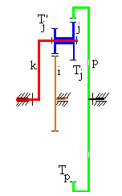

İkinci bir örnek olarak da yukarıda görülen planet dişli sistemini ele alalım. Diş oranı olarak:

i ve j uzuvları arasında  $        R  ij   =    ω  kj    ω  ki    =     ω  1j   −   ω  1k      ω  1i   −   ω  1k        \displaystyle {{\text{R}}_{{\text{ij}}}}=\frac{{{{\text{ω}}_{{\text{kj}}}}}}{{{{\text{ω}}_{{\text{ki}}}}}}=\frac{{{{\text{ω}}_{{\text{1j}}}}-{{\text{ω}}_{{\text{1k}}}}}}{{{{\text{ω}}_{{\text{1i}}}}-{{\text{ω}}_{{\text{1k}}}}}}   $          R               ij        ​               =                        ω               ki        ​                               ω               kj        ​                 ​                =                        ω               1i        ​               −        ω               1k        ​                               ω               1j        ​               −        ω               1k        ​                 ​                 

p ve j uzuvları arasında  $        R  pj   =    ω  kj    ω  kp    =     ω  1j   −   ω  1k      ω  1p   −   ω  1k        \displaystyle {{\text{R}}_{{\text{pj}}}}=\frac{{{{\text{ω}}_{{\text{kj}}}}}}{{{{\text{ω}}_{{\text{kp}}}}}}=\frac{{{{\text{ω}}_{{\text{1j}}}}-{{\text{ω}}_{{\text{1k}}}}}}{{{{\text{ω}}_{{\text{1p}}}}-{{\text{ω}}_{{\text{1k}}}}}}   $          R               pj        ​               =                        ω               kp        ​                               ω               kj        ​                 ​                =                        ω               1p        ​               −        ω               1k        ​                               ω               1j        ​               −        ω               1k        ​                 ​                 

i ve p uzuvları arsında  $        R  ip   =    ω  ik    ω  pk    =     ω  1p   −   ω  1k      ω  1i   −   ω  1k        \displaystyle {{\text{R}}_{{\text{ip}}}}=\frac{{{{\text{ω}}_{{\text{ik}}}}}}{{{{\text{ω}}_{{\text{pk}}}}}}=\frac{{{{\text{ω}}_{{\text{1p}}}}-{{\text{ω}}_{{\text{1k}}}}}}{{{{\text{ω}}_{{\text{1i}}}}-{{\text{ω}}_{{\text{1k}}}}}}   $          R               ip        ​               =                        ω               pk        ​                               ω               ik        ​                 ​                =                        ω               1i        ​               −        ω               1k        ​                               ω               1p        ​               −        ω               1k        ​                 ​                 

R jp  = 1/R pj  olduğundan:

 $        R  ip   =   R  ij    R  jp   =    (   −  1   )   1      T  j    T  i       T  j   ′    T  p     =     ω  1p   −   ω  1k      ω  1i   −   ω  1k           \displaystyle {{\text{R}}_{{\text{ip}}}}={{\text{R}}_{{\text{ij}}}}{{\text{R}}_{{\text{jp}}}}={{\left( {-1} \right)}^{1}}\frac{{{{T}_{\text{j}}}{{T}_{\text{i}}}}}{{{{T}_{\text{j}}}^{\prime }{{T}_{\text{p}}}}}=\frac{{{{\text{ω}}_{{\text{1p}}}}-{{\text{ω}}_{{\text{1k}}}}}}{{{{\text{ω}}_{{\text{1i}}}}-{{\text{ω}}_{{\text{1k}}}}}}    $          R               ip        ​               =            R               ij        ​                 R               jp        ​               =            (   −  1   )             1                           T             j       ​                      ′             T             p       ​                              T             j       ​                T             i       ​                 ​                =                        ω               1i        ​               −        ω               1k        ​                               ω               1p        ​               −        ω               1k        ​                 ​                    

olacaktır. Dikkat edilir ise, k kol uzvu sabit olduğunda, sistem basit dişli sistemidir ve dişli oranı yukarıda belirtildiği gibi olur (tahrik eden dişli, diş sayılarının çarpımının tahrik edilen dişlilerde diş sayılarının çarpımına oranı). Basit dişliye göre bir önemli fark bu tahrik edilen uzuv hızının tahrik eden uzuv hızına oranı olmayıp, tahrik edilen uzvun kola göre bağıl hızının tahrik eden uzvun kola göre bağıl hızına oranıdır.

Eğer bir dişli sistemde birden fazla kol ile taşınan faklı planet dişliler var ise bu durumda ** birleşik planet dişli sistemi ** vardır. Bu durumda her bir basit planet dişli sistemi için yukarıda gösterilmiş olan denklem yazılmalıdır. Genel olarak birleşik planet dişli sistemlerde ilk olarak planet dişli tanımlanmalıdır. Planet dişli ekseni sabit olmayan dişlidir. Bu planet dişli tanımlandıktan sonra, onu taşıyan ve planet dişliye döner mafsalla bağlı kolu tanımlamak gereklidir. Her kol bir basit planet dişli sistemidir. Kolu sabit kabul ederek dişli oranı ve bu orana eşit olan dişlilerin kola göre bağıl hızları oranı yazılabilir. Aşağıda verilmişm olan iki örnekle konu açıklanmaya çalışılacaktır.

**Örnek:**

Şekilde gösterilen dişli kutusunda giriş mili 3000 dev/dk dönerken çıkış milinin açısal hızını bulun.

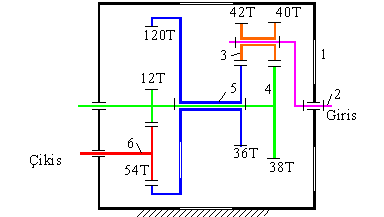

3 uzvu, sabit bir eksen etrafında dönmediğinden planet dişlidir. 2 uzvuna döner mafsal ile bağlı olduğundan 2 uzvu koldur. Kolun sabit olduğu var sayılır ise, 5 ile 4 uzvu arasında dişli oranı:

 $        R  45   =    (   −  1   )   2     38  ⋅  42    40  ⋅  36    =     n  15   −   n  12      n  14   −   n  12        \displaystyle {{\text{R}}_{45}}={{\left( {-1} \right)}^{2}}\frac{{38\cdot 42}}{{40\cdot 36}}=\frac{{{{\text{n}}_{15}}-{{\text{n}}_{12}}}}{{{{\text{n}}_{14}}-{{\text{n}}_{12}}}}    $          R             45      ​               =            (   −  1   )             2                       40    ⋅    36                38    ⋅    42      ​                =                        n             14      ​               −        n             12      ​                               n             15      ​               −        n             12      ​                 ​                 

veya

n 15  − n 12  = (133/120)(n 14  − n 12 )

olacaktır. Bu denklemde n 12  bilinmekte, n 14  ve n 15  bilinmemektedir. Dişli kutusunun kalan kısmında bulunan 5, 4 ve 6 uzuvları sabit eksen etrafında döndüğünden basit dişli sistemlerini oluşturur. Bu durumda:

 $        R  46   =   N  46   =  −   12  54   =    n  16    n  14       \displaystyle {{\text{R}}_{46}}={{\text{N}}_{46}}=-\frac{{12}}{{54}}=\frac{{{{\text{n}}_{16}}}}{{{{\text{n}}_{14}}}}   $          R             46      ​               =            N             46      ​               =        −              54                12      ​                =                        n             14      ​                               n             16      ​                 ​                      ve     $        R  56   =   N  56   =   120  54   =    n  16    n  15       \displaystyle {{\text{R}}_{56}}={{\text{N}}_{56}}=\frac{{120}}{{54}}=\frac{{{{\text{n}}_{16}}}}{{{{\text{n}}_{15}}}}   $          R             56      ​               =            N             56      ​               =                    54                120      ​                =                        n             15      ​                               n             16      ​                 ​                 

veya

n 14  = −(9/2)n 16      ;    n 15  = (9/20)n 16 

olacaktır. Bu denklemler ilk planet dişli denklemine yerleştirilir ve n 16  için çözüm yapılır ise (n 12  = 3000 dev/dk):

n 15  = −(26/1305)n 12  ≅ −59.8 dev/dk      (giriş miline ters yöndedir)

**Örnek:**

Yüksek hız elde etmek için tasarlanmış bir dişli kutusu Şekilde görülmektedir. Giriş mili 1800 dev/dk. hızla dönmektedir. Çıkış milinin hızını ve giriş miline göre dönme yönünü bulunuz.

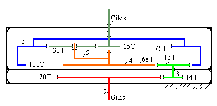

Dişli kutusunun ilk kısmında (2, 3, 4 ve 6 uzuvları) dişlilerin sabit eksenleri bulunmaktadır. Öyle ise:

 $        R  24   =    (   −  1   )   2     70  ⋅  16    14  ⋅  68    =    n  14    n  12       \displaystyle {{\text{R}}_{24}}={{\left( {-1} \right)}^{2}}\frac{{70\cdot 16}}{{14\cdot 68}}=\frac{{{{\text{n}}_{14}}}}{{{{\text{n}}_{12}}}}   $          R             24      ​               =            (   −  1   )             2                       14    ⋅    68                70    ⋅    16      ​                =                        n             12      ​                               n             14      ​                 ​                      veya    n 14  = (20/17)n 12  ≅ 2117.65 dev/dk

 $        R  26   =    (   −  1   )   1     70  ⋅  16    14  ⋅  100    =    n  16    n  12       \displaystyle {{\text{R}}_{26}}={{\left( {-1} \right)}^{1}}\frac{{70\cdot 16}}{{14\cdot 100}}=\frac{{{{\text{n}}_{16}}}}{{{{\text{n}}_{12}}}}   $          R             26      ​               =            (   −  1   )             1                       14    ⋅    100                70    ⋅    16      ​                =                        n             12      ​                               n             16      ​                 ​                     veya    n 16  = −(4/5)n 12  = 1440 dev/dk

Dişli kutusunun üst kısmında 5 uzvunun sabit bir ekseni olmadığına göre bu uzuv bir planet dişlidir. 4 uzvu planet dişliye döner mafsal ile bağlı olduğuna göre koldur. Bu durumda:

 $        R  67   =    (   −  1   )   1    75  15   =     n  17   −   n  14      n  16   −   n  14     =  −  5     \displaystyle {{\text{R}}_{{67}}}={{\left( {-1} \right)}^{1}}\frac{{75}}{{15}}=\frac{{{{\text{n}}_{{17}}}-{{\text{n}}_{{14}}}}}{{{{\text{n}}_{{16}}}-{{\text{n}}_{{14}}}}}=-5   $          R              67       ​               =            (   −  1   )             1                       15                75      ​                =                        n              16       ​               −        n              14       ​                               n              17       ​               −        n              14       ​                 ​                =        −  5     

yazılabilir. n 17  için çözüm yapıldığında:

n 17  = 6n 14  − 5n 16  = (120/17 + 20/5)n 12  = (940/85)n 12  ≅ 19906 dev/dk     (dönüş yönü, giriş uzvu ile aynı yöndedir)

Genellikle tam sayı olan diş sayılarını en son hesap yapılana kadar tam sayı olarak korumak doğru olacaktır. Aksi takdirde küçük farklardan oluşan büyük bir dişli oranı ve küçük bir dişli oranı bulunamaz ve çok hatalı sonuçlar çıkabilir. Bu nedenle son etaba kadar hesap makinasının kullanılmaması önerilir.

**Örnek:**

Şekilde gösterilen dişli kutusunda 2 uzvu giriş uzvu olup 2000 dev/dk. açısal hızla dönmektedir. 6 uzvununun açısal hızını ve giriş uzvuna göre yönünü bulunuz.

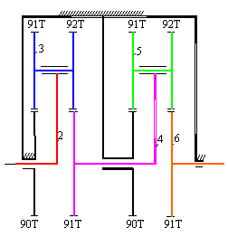

Dişli kutusu incelendiğinde, 3 ve 5 uzuvlarının sabit bir eksen etrafında dönmediği görülecektir. 3 uzvu 2 uzvuna 5 uzvuda 4 uzvuna döner mafsalla bağlı olduğundan, iki ayrı kol ve iki ayrı planet dişli gurubu bulunmaktadır. 2 uzvunu sabit alarak elde ettiğimiz sistem için diş oranını yazdığımızda:

 $        R  14   =    (   −  1   )   2     90  ⋅  92    91  2    =     n  14   −   n  12      n  11   −   n  12        \displaystyle {{\text{R}}_{{14}}}={{\left( {-1} \right)}^{2}}\frac{{90\cdot 92}}{{{{{91}}^{2}}}}=\frac{{{{\text{n}}_{{14}}}-{{\text{n}}_{{12}}}}}{{{{\text{n}}_{{11}}}-{{\text{n}}_{{12}}}}}   $          R              14       ​               =            (   −  1   )             2                           91             2                         90    ⋅    92      ​                =                        n              11       ​               −        n              12       ​                               n              14       ​               −        n              12       ​                 ​                 

n 11  = 0 olduğundan:

n 14  = (1 − 90×92/91 2 )n 12  = n 12 /8281

dir. Benzer bir şekilde 4 uzvunu sabit alarak elde ettiğimiz sistem için diş oranını yazdığımızda:

 $        R  16   =    (   −  1   )   2     90  ⋅  92    91  2    =     n  16   −   n  14      n  11   −   n  14        \displaystyle {{\text{R}}_{{16}}}={{\left( {-1} \right)}^{2}}\frac{{90\cdot 92}}{{{{{91}}^{2}}}}=\frac{{{{\text{n}}_{{16}}}-{{\text{n}}_{{14}}}}}{{{{\text{n}}_{{11}}}-{{\text{n}}_{{14}}}}}   $          R              16       ​               =            (   −  1   )             2                           91             2                         90    ⋅    92      ​                =                        n              11       ​               −        n              14       ​                               n              16       ​               −        n              14       ​                 ​                 

olacaktır ve n 11  = 0 olduğundan:

n 16  = (1 − 90×92/91 2 )n 14  = n 14 /8281 = n 12 /68574961

n 12  = 2000 dev/dk olduğuna göre n 16  = 2.916516×10 -5  dev/dk = 0.041998 devir/gün veya 23.81 günde bir devir yapacaktır!!!!. Eğer yanılıp 90×92/91 2  ≅ 1 derseniz, 6 uzvunun hareketsiz olduğu sonucuna varabilirsiniz.

---

<!-- Kısım 5 -->
# 6.3 Konik Dişli Kullanan Dişli Kutuları

Hareket iletimi paralel olmayan miller arasında yapılacak ise, genellikle konik dişliler kullanılır. Kinematik açıdan konik dişliler birbiri üzerinde yuvarlanan iki koniğe eşdeğerdir. Konik dişliler basit veya planet dişli sistemlerde kullanılabilirler. Kinematik analizleri, iki fark dışında düz dişliler ile oluşturulan dişli sistemlerle aynıdır. Birinci önemli fark burada anlatılacak olan yöntem ekseni sabit olmayan planet dişlilerin açısal hızlarının hesaplanmasında kullanılamaz, çünkü uzayda paralel olmayan eksenler etrafında dönemler toplanamaz. İkinci fark ise, düz dişlilerde kullanılan açısal yön belirleme yöntemi konik dişliler için uygulanamaz.

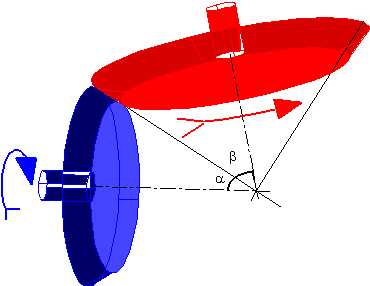

Şekilde birbirleri ile dişli çift oluşturan iki konik dişli görülmektedir. Eksenler arasında açı θ dır. P noktasında sadece yuvarlanma olduğundan, iki uzuv üzerinde hızlar eşit olacaktır:

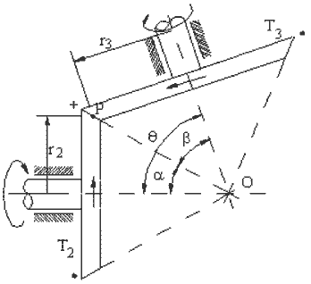

      θ = α + β

ve

 $         ω  13    ω  12    =    r  2    r  3    =    T  2    T  3    =     r  2   /  OP     r  3   /  OP    =    sin  ⁡  α    sin  ⁡  β    =   R  23      \displaystyle \frac{{{{\text{ω}}_{{13}}}}}{{{{\text{ω}}_{{12}}}}}=\frac{{{\text{r}_{2}}}}{{{\text{r}_{3}}}}=\frac{{{\text{T}_{2}}}}{{{\text{T}_{3}}}}=\frac{{{{\text{r}}_{2}}/\text{OP}}}{{{{\text{r}}_{3}}/\text{OP}}}=\frac{{\sin \text{α}}}{{\sin \text{β}}}={{\text{R}}_{{23}}}   $                      ω              12       ​                               ω              13       ​                 ​                =                       r            3      ​                              r            2      ​                 ​                =                       T            3      ​                              T            2      ​                 ​                =                        r             3      ​             /   OP                     r             2      ​             /   OP       ​                =                    sin     β                 sin     α       ​                =            R              23       ​                

dür. Uzuvların dönme yönünü belirlemek için yine P noktasında iki koninin hızının aynı olması gerektiğini not edelim. Eğer 2 uzvu O noktasından baktığımızda saat yelkovanı yönünde dönüyor ise, 3 uzvu O noktasından baktığımızda saat yelkovanına ters yönde dönecektir. Bunu belirlemek için dönen bir ok düşünelim 2 uzvu saat yelkovanı yönünde döndüğünden bu ok şekilde görülen kesit düzlemine P noktasından (koninin üst kısmından) girecek, koninin alt kısmından ise dışarı çıkacaktır. Bir oka arkadan baktığımızda “+” önden baktığımızda ise “**•**” görürüz. Öyle ise 2 uzvu için ok şekilde gösterildiği gibi yukarıda + aşağıda ise **•** görülecektir. 3 uzvunda ise koninin P tarafında “+” yani okun içeriye doğru olduğu bilindiğine göre, diğer tarafta “**•**” yani okun kağıdı delerek çıkması gerekir. O noktasından baktığımızda ise 3 uzvu saat yelkovanı yönüne ters dönüyor görülecektir. Bu yöntem ile uzuvların dönme yönleri belirlenebilir.

**Örnek:**

Şekilde gösterilen birleşik basit dişli zincirinde 4 uzvunun 2 uzvuna göre açısal hız oranını (R 24  = N 24 ) bulunuz.

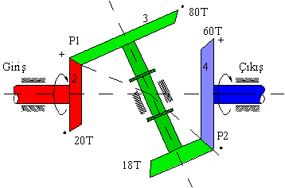

 $        R  23   =   80  20   =    ω  13    ω  12       \displaystyle {{\text{R}}_{{23}}}=\frac{{80}}{{20}}=\frac{{{\text{ω}_{{13}}}}}{{{\text{ω}_{{12}}}}}   $          R              23       ​               =                    20                80      ​                =                       ω             12       ​                              ω             13       ​                 ​                    ve    $        R  34   =   18  60   =    ω  14    ω  13       \displaystyle {{\text{R}}_{{34}}}=\frac{{18}}{{60}}=\frac{{{\text{ω}_{{14}}}}}{{{\text{ω}_{{13}}}}}   $          R              34       ​               =                    60                18      ​                =                       ω             13       ​                              ω             14       ​                 ​                 

veya

 $        R  24   =    ω  14    ω  12    =    20  ⋅  18    80  ⋅  60    =   3  40   =   Tahrik eden dişli diş sayıları çarpımı  Tahrik edilen dişli diş sayıları çarpımı      \displaystyle {{\text{R}}_{{24}}}=\frac{{{\text{ω}_{{14}}}}}{{{\text{ω}_{{12}}}}}=\frac{{20\cdot 18}}{{80\cdot 60}}=\frac{3}{40}=\frac{{\text{Tahrik eden dişli diş sayıları çarpımı}}}{{\text{Tahrik edilen dişli diş sayıları çarpımı}}}   $          R              24       ​               =                       ω             12       ​                              ω             14       ​                 ​                =                    80    ⋅    60                20    ⋅    18      ​                =                   40              3     ​                =                     Tahrik edilen di  ş  li di  ş   say  ı  lar  ı   çarp  ı  m  ı                  Tahrik eden di  ş  li di  ş   say  ı  lar  ı   çarp  ı  m  ı       ​                 

0larak bulunur. Ancak bu hesaplamada düz dişlilerde olduğu gibi yön göz önüne alınmamıştır. 2 uzvunun her hangi bir yönde döndüğünü kabul edelim. Örneğin sağdan baktığımızda 2 uzvu saat yelkovanı yönünde dönüyor olsun. Bu dönme yönünü gösteren ok dişlinin üst tarafından kağıttan dışarı çıkacak, alt tarafından ise içeri doğru girecektir. Buna uygun olarak ilk işaretimizi koyduğumuzda, 3 uzvunun dönme yönü, P 1  noktasında okun içeri doğru girmesi, P 2  noktasında ise okun dışarı doğru çıkması ile neticelenir. 4 uzvu ise bu durumda P 2  noktasında ok dışarı çıkıyor ise, koninin üst tarafında ok içeri doğru girecektir. Öyle ise, 2 ve 4 uzuvları aynı yönde dönmektedirler. Şekilde görüldüğü gibi (+) ve (**•**) sembollerini sıra ile bu kurala uygun yerleştirdiğimizde uzuvların yönleri belirlenmiş olur. Öyle ise:

 $        R  24   =    ω  14    ω  12    =    20  ⋅  18    80  ⋅  60    =  +   3  40   =  +  0.075     \displaystyle {{\text{R}}_{{24}}}=\frac{{{\text{ω}_{{14}}}}}{{{\text{ω}_{{12}}}}}=\frac{{20\cdot 18}}{{80\cdot 60}}=+\frac{3}{40}=+0.075   $          R              24       ​               =                       ω             12       ​                              ω             14       ​                 ​                =                    80    ⋅    60                20    ⋅    18      ​                =        +             40              3     ​                =        +  0.075     

Eğer konik dişliler planet dişlilerde kullanılıyor ise, sabit eksenli dişliler arasında dişli oranını, hızların kola göre bağıl hızlarına eşitliyerek bulmamız mümkündür. Ancak planet dişlinin hızını bu yöntemle bulmak doğru değildir.

**Örnek:**

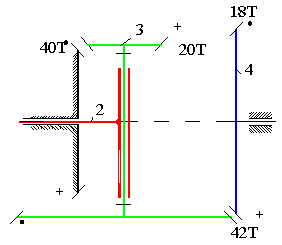

Şekilde gösterilen dişli sisteminde 2 ve 4 uzuvları arasında açısal hız oranlarını ve bu açısal hızların birbirlerine göre yönünü bulmak istiyoruz. Dikkat edilir ise 3 uzvu planet dişlidir ve 2 uzvuna döner mafsalla bağlı olduğundan 2 uzvu koldur. 2 uzvunu sabit tuttuğumuzda 1, 3 ve 4 uzuvları arasında elde edilen basit dişli sistem için dişli oranı:

 $        R  14   =    40  ⋅  42    20  ⋅  18    =   14  3   =     n  14   −   n  12      n  11   −   n  12        \displaystyle {{\text{R}}_{{14}}}=\frac{{40\cdot 42}}{{20\cdot 18}}=\frac{14}{3}=\frac{{{{\text{n}}_{{14}}}-{{\text{n}}_{{12}}}}}{{{{\text{n}}_{{11}}}-{{\text{n}}_{{12}}}}}    $          R              14       ​               =                    20    ⋅    18                40    ⋅    42      ​                =                   3              14     ​                =                        n              11       ​               −        n              12       ​                               n              14       ​               −        n              12       ​                 ​                 

Bu basit dişli sistem için (2 uzvu sabit varsayıldığında) dönme yönleri dönme okunun yönüne uygun olacak şekilde işaretlenerek belirlendiğinde, 1 ve 4 uzuvlarının aynı yönde döndükleri görülmektedir. n 11  = 0 olduğundan n 14  için:

n 14  = (1 − 14/3)n 12 

veya

N 24  = n 14 /n 12  = −11/3

elde edilir. Dikkat edilir ise, sonuçta 2 ve 4 uzuvları birbirlerine ters yönde dönmektedir.

**Örnek:**

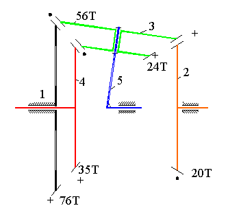

Şekilde “Humpage’in konik dişli diferansiyeli” olarak adlandırılan sistem görülmektedir. N 24  hız oranını bulmamız istenmektedir.

2, 3 ve 1 uzvundan oluşan zincir incelendiğinde, 3 uzvu planet dişli ve 5 uzvu koldur. Öyle ise:

 $        R  12   =     n  12   −   n  15      n  11   −   n  15     =  −    76  ⋅  56    56  ⋅  20    =  −   19  5      \displaystyle {{\text{R}}_{12}}=\frac{{{{\text{n}}_{12}}-{{\text{n}}_{15}}}}{{{{\text{n}}_{11}}-{{\text{n}}_{15}}}}=-\frac{{76\cdot 56}}{{56\cdot 20}}=-\frac{19}{5}    $          R             12      ​               =                        n             11      ​               −        n             15      ​                               n             12      ​               −        n             15      ​                 ​                =        −              56    ⋅    20                76    ⋅    56      ​                =        −             5              19     ​                 

n 11  = 0 olduğundan n 15  = (5/24)n 12 

1, 3 ve 4 uzvundan oluşan zincirde 3 uzvu planet ve 5 uzvu onu taşıyan koldur. Öyle ise:

 $        R  14   =     n  14   −   n  15      n  11   −   n  15     =  +    76  ⋅  24    56  ⋅  35    =  +   228  245      \displaystyle {{\text{R}}_{14}}=\frac{{{{\text{n}}_{14}}-{{\text{n}}_{15}}}}{{{{\text{n}}_{11}}-{{\text{n}}_{15}}}}=+\frac{{76\cdot 24}}{{56\cdot 35}}=+\frac{228}{245}    $          R             14      ​               =                        n             11      ​               −        n             15      ​                               n             14      ​               −        n             15      ​                 ​                =        +              56    ⋅    35                76    ⋅    24      ​                =        +             245              228     ​                 

yazılabilir. n 11  = 0 olduğundan n 14  = (1 − 228/245)n 15  = (17/245)n 15  = (17/1176)n 12  veya N 24  = n 14 /n 12  = 0.0145 olacaktır.

***Bir diferansiyel nasıl çalışır?***

Tüm arabalarda viraj alırken dışarda bulunan teker daha fazla mesafe kat edeceğinden daha içerde bulunan tekere göre daha hızlı dönecektir. Tahrik edilen tekerler aynı motor tarafından tahrik edildiğinden eğer tek serbestlik dereceli bir mekanizma kullanılır ise, her iki teker aynı miktar döndürüleceğinden dolayı, araç kayar. Bunu önlemek için tekerlekler diferansiyel olarak adlandırılan iki serbestlik dereceli bir konik planet dişli sistemi ile tahrik edilirler.

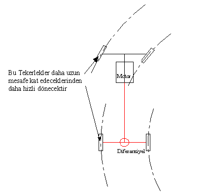

Viraj sırasında teker dönmesi

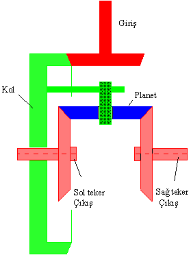

Dişli kutusundan çıkan milin çevirdiği giriş dişlisi planet dişli sistemde kolu çevirmektedir. Kola döner mafsal ile planet dişli bağlıdır (genellikle 3 veya 4 planet dişli bulunur). Sağ ve sol teker dişlileri sabit ve çakışan bir eksende dönmektedir. Sistem görüldüğü şekilde iki serbestlik derecesine sahiptir.

Eğer iki tekere gelen yük eşit ise tüm sistem, kolun dönme açısı hızında birlikte döner.

Eğer tekerlerden birine etki eden yük diğer tekere gelen yüke göre çok fazla ise, bir teker sabit durur ve diğer teker iki misli hız ile döner. Virajlarda iç teker dış tekere göre daha fazla sürtünme kuvveti ile karşılacağından iç teker dış tekere göre daha az dönecektir.

Sistem iki serbestlik dereceli olduğundan uygulamada tekerleklerin dönme miktarı etki eden dış kuvvetlere ve sistemin dinamiğine bağlı olacaktır.

Benzer diferansiyel sistemi bir engele çarptığında yön değiştiren oyuncak arabalarda görürsünüz.

 ***Güneyi Gösteren Savaşcı (*** ***Milattan önce 2600 yıllarında):***

Aşağıda görülen araba Çinliler tarafından Gobi çölünü geçerken kullanılan öküzler tarafından çekilen bir arabanın temsili resmidir. Dişliler görüldüğü gibi zamanında tahta pimlerden yapılmıştır. Ancak o devirdede planet dişli sistemi ve diferansiyel kavramını bildikleri görülmektedir. Araba düz giderken savaşcının yönü değişmemekte, araç sağa veya sola döndüğünde, aynı açıda savaşcı arabaya göre ters yönde dönmekte ve yere göre hiç bir açısal dönme yapmamış olmaktadır. Bu şekilde savaşcı yola başlarken gösterdiği yönü devamlı göstermektedir.

 *

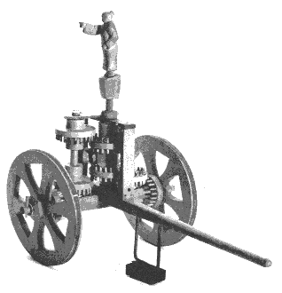

* 

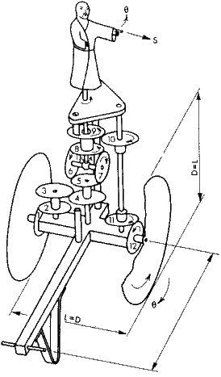

---