# Dört Uzuvlu Mekanizmalar

*Prof. Dr. Eres Söylemez - Mekanizma Tekniği*

---

<!-- Kısım 1 -->
# VII. DÖRT UZUVLU MEKANİZMALAR

---

<!-- Kısım 2 -->
#### “Exempla Non Minus doceunt quom Precaepta”

#### (“Örneksiz bir teori, boştur”)

#### Isaac Newton

# Dört Uzuvlu Düzlemsel Mekanizmalar

 

- Birçok makinada kullanılan mekanizmalar bu yapıdadır (uygulamada en fazla kullanılan mekanizmalardır)

- Daha karmaşık mekanizmalar genellikle analizde gördüğümüz gibi dört uzuvlu mekanizmaların birleşmesi ile oluşturulmaktadır.
 

Bu kısımda dört uzuvlu mekanizmaların genel yapısı daha detaylı olarak incelenecektir. Bu mekanizmaların konum, hız ve ivme analizleri önceden açıklandığı gibi yapılır.

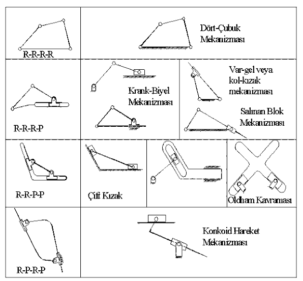

#### Dört uzuvlu mekanizmalarda döner veya kayar mafsallar bulunabilir. Bu mafsalların mekanizma içinde dağılımı ve bu mafsallara göre sabit uzvun yeri yedi değişik tipte dört uzuvlu mekanizmayı verir. (Yukarıda farklı bazı dört uzuvlu mekanizmalar farklı isimlerle anılsalarda aynı tipte mekanizmalardır. Fark uzuv boyutları ile ilgilidir).

---

<!-- Kısım 3 -->
#  7.1 Dört Çubuk Mekanizması

Dört uzuvlu ve dört döner mafsala sahip mekanizmaya  **dört-çubuk mekanizması**  denmektedir. Genelde hareket eden üç uzuv görülse de, sabit gövde de bir uzuv sayılmaktadır.

Dört-çubuk mekanizmalarının uygulamada çeşitliliği hayret edici miktarlarda olup genelde kullanan kişiler onun bir mekanizma olduğunun bile farkına varmayabilirler. Uygulama alanı bu kadar geniş olsa bile, bu uygulamalar üç değişik gurupta toplanabilir:

a) Sabit uzva bağlı uzuvların açısal dönme miktarları arasında belirli bir ilişkinin olması (bu ** fonksiyon sentezi ** olarak bilinir). Bu tür uygulamalarda giriş ve çıkış uzuvlarının açısal konumları arasında θ 14  = f(θ 12 ) gibi bir fonksiyonun dört-çubuk mekanizması kullanılarak sağlanması istenmektedir. Buna basit bir örnek, aşağıda görüldüğü gibi, lineer bir ölçü ile dönmeyi (1 < x <10) belirli bir aralıkda logaritmik bir ölçüde dönmeye (y = ln(x)) çevirmek olabilir. Bir pencerenin belirli bir açı kadar açılmasını uzak bir noktadan sağlama, bir vananın 90° açılmasını, bir kolun 180° dönmesi ile sağlama (bu şekilde mekanik avantaj sağlanacaktır) gibi çok değişik alanlarda kullanılabilir (örneğin araç gaz pedalı)

---

<!-- Kısım 4 -->
# 7.2 Krank-Biyel Mekanizması

Makina tasarımında yoğun bir şekilde kullanılan bir başka mekanizmada krank-biyel mekanizmasıdır. Genel olarak bir dönme hareketini bir öteleme hareketine çevirmek için kullanıldığı gibi bir öteleme hareketini dönme hareketine çevirmek içinde kullanılabilir. Şekilde krank-biyel mekanizması, değişken açıları ve boyutları tanımlayan sabit parametreleri görülmektedir. Dört-çubuk mekanizmasında olduğu gibi, ölü konumlar krank ile biyelin aynı doğru üzerinde olduğu konumlardır. Krankın tam bir dönmesi için c eksantrikliğinin biyel ile krank uzunluklarının farkından az ve krankın en kısa uzuv boyutu olması gerekir. (yani c < a 3  − a 2  ve a 3  > a 2  olmalıdır).

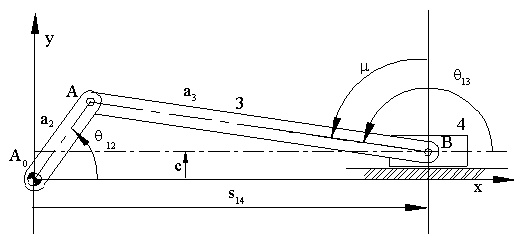

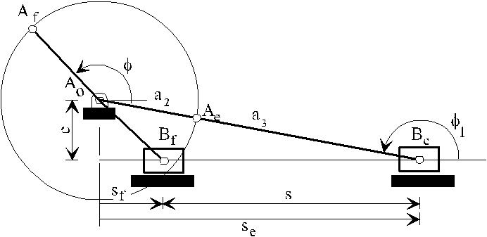

---

<!-- Kısım 5 -->
# 7.3 Kol-Kızak Mekanizması

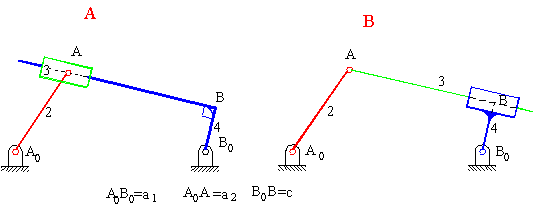

Kol-kızak mekanizması, krank-biyel mekanizmasında farklı bir uzvun sabit alınması ile kayar mafsalın sabit olmayan bir eksen yönünde öteleme yapmasıdır. Genel olarak yukarıda görüldüğü iki değişik yapıda olabilir. 2 uzvu giriş uzvu olup 4 uzvu çıkış uzvu olarak kullanım en yaygın uygulama şeklidir. Her iki değişik yapı içinde giriş uzvu ile çıkış uzvu dönme açıları arasında bağlantı aynı denklemle ifade edilir. Ancak bu iki değişik yapının kuvvet iletim özellikleri farklıdır.

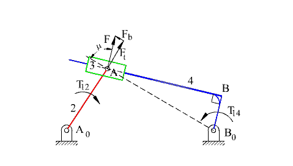

---

<!-- Kısım 6 -->
# 7.4 Biyel Eğrileri

Şu ana kadar bu kısımda söz konusu olan sabit uzva bağlı uzuvların mafsal parametreleri arasında ilişki mekanizmada bir giriş ve bir çıkış olarak ele alınmakta idi. Birçok uygulamada ise, biyel uzvunun üzerinde bir noktanın hareketi o mekanizmanın çıktısı olarak kullanılabilir. Bu noktaların hareket sırasında çizdikleri yörüngelere  **biyel eğrileri**  denmektedir. Aşağıda da tipik dört-çubuk, krank biyel ve kol-kızak mekanizmaları biyel eğrileri gösterilmektedir. İstenilen bir biyel eğrisini verecek mekanizma uzuv boyutlarının belirlenmesi bu kısımda kapsam dışıdır. Eğer uzuv boyutları verilmiş ise, kısım 3 te açıklanmış olan yöntemler ile biyel eğrilerinin elde edilmesi kolayca mümkün olacaktır.

---

<!-- Kısım 7 -->
# 7.5 Dört Çubuk ve Krank-Biyel Mekanizmaları Eşlenikleri: Robert- Çebişev Teoremi

Bir dört-çubuk veya bir krank-biyel mekanizmasında temel sorunumuz bir biyel eğrisi ise, aynı biyel eğrisini çizen başka dört-çubuk veya krank-biyel meka-nizması boyutları bulmamız mümkündür. Aynı biyel eğrisini veren farklı uzuv boyutlarına sahip dört çubuk mekanizmalarına **birbirlerinin eşleniği** diyeceğiz. Bu eşleniklerin bulunması için geçerli kural Robert-Çebişev teoremi ile verilmektedir:

** Robert-Çebişev Teoremi **

Aynı biyel eğrisini çizen değişik uzuv boyutları olan üç değişik dört-çubuk mekanizması vardır.

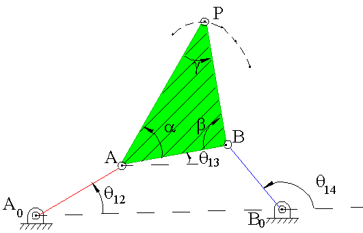

Şekilde gösterilen dört-çubuk mekanizmasını ele alalım (|A 0 B 0 | = a 1 , |A 0 A| = a 2 , |AB| = a 3 , |B 0 B| = a 4 , |AP| = b 3 , |BP| = c 3  tür). P biyel noktası gösterilen bir biyel eğrisini çizmektedir. Bu mekanizma için devre kapalılık denklemi:

 
 
 
 a 2 e iθ 12   + a 3 e iθ 13   = a 1  + a 4 e iθ 14   
 (1) 
 
 
 

P biyel noktasının her hangi θ 12  açısı için kompleks konum vektörü:

 
 
 
 Z P  = a 2 e iθ 12   + b 3 e i(θ 13  +   α)  
 (2) 
 
 
 

veya

 
 
 
 Z P  = a 1  + a 4 e iθ 14   + c 3 e i(θ 13  +   π   −   β)  
 (3) 
 
 
 

ile tanımlanır. Dikkat edilir ise (2) ve (3) denklemlerinde bulunan bağımlı konum değişkenleri θ 13  ve θ 14  her krank açısı θ 12  için (1) numaralı devre kapalılık denkleminden 3. kısımda açıklandığı gibi çözülür.

Eşleniklerin bulunması:

---

<!-- Kısım 8 -->
# Alt Bağlama Açısı Problemi:

“Verilen bir salınım açısını (ψ) ve buna karşı gelen bir krank dönme açısını (ϕ) sağlayan, ve ayrıca bağlama açısının 90° den sapması en az olan kol-sarkaç oranlarında dört-çubuk mekanizmasının boyutlarını belirleyin.”

Problem iki kısımdan oluşmaktadır:

 

- Verilen bir salınım açısını (ψ) ve buna karşı gelen bir krank dönme açısını (ϕ) sağlayan kol-sarkaç mekanizmalarının bulunması,

- Elde edilen kol-sarkaç mekanizmaları arasında bağlama açısı en iyi olan kol-sarkaç mekanizmasının belirlenmesi.
 

Verilen bir salınım açısını (ψ) ve buna karşı gelen bir krank dönme açısını (ϕ) sağlayan kol-sarkaç mekanizmalarının bulunması:

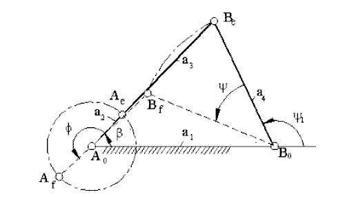

Kol-sarkaç mekanizmasını iki ölü konumda çizelim. Her iki konumda krank ve biyel uzuvları aynı doğrultudadır. Açık konumda biyel açısı krank açısına eşittir, kapalı konumda ise krank açısından 180° farklıdır. Bu konumlar için devre kapalılık denklemlerini yazalım:

 
 
 
 a 2 e iβ  + a 3 e iβ  = a 1  + a 4 e iψ 1   
 (7) 
 
 
 a 2 e i(β + ϕ)  + a 3 e i(β + ϕ − π)  = a 1  + a 4 e i(ψ 1  + ψ)  
 (8) 
 
 
 

Bu denklemler:

 
 
 
 (a 2  + a 3 )e iβ  − a 4 e iψ 1   = a 1  
 (9) 
 
 
 (a 2  − a 3 )e iβ e iϕ  − a 4 e iψ 1  e iψ  = a 1  
 (10) 
 
 
 

şeklinde yazabiliriz. Z 1 , Z 2  ve λ yeni parametreler olup:

Z 1  = a 2 e iβ 

Z 2  = a 4 e iψ 1  

λ = a 3 /a 2 

olarak tanımlayalım. Z 1  ve Z 2 , **A 0 A e ** ve **B 0 B e ** vektörlerini gösteren kompleks sayılardır. λ ise biyel uzuv boyutunun krank uzuv boyutuna oranıdır. Önceden söylenildiği gibi uzuv boyutları belirli bir ölçekle büyültülüp küçültüldüğü halde dönme açıları değişmiyeceğinden, sabit uzuv boyutunu bir birim alalım (a 1  = 1 ). Şimdi ölü konumlar için devre kapalılık denklemleri:

 
 
 
 (1 + λ)Z 1  − Z 2  = 1 
 (11) 
 
 
 e iϕ (1 − λ)Z 1  − Z 2 e iψ  = 1    
 (12) 
 
 
 

olacaktır. Kinematik analiz problemlerinin aksine, şimdi bu denklemlerde ϕ ve ψ açıları bilinen değerler olup bu değerler için mekanizma boyutlarını bulmamız gerekmektedir. Bu iki kompleks sayılarla yazılmış olan denklem Z 1  ve Z 2  parametreleri için lineer bir denklem takımını oluşturur. Çözümü bilinen Kramer kuralı ile yapıldığında:

 
 
 
  $        Z  1   =    1  −   e  iψ      e  iϕ   −   e  iψ   −  λ   (    e  iϕ   +   e  iψ    )     =   a  2    e  iβ      \displaystyle {{\text{Z}}_{1}}=\frac{{1-{\text{e}^{{\text{iψ}}}}}}{{{\text{e}^{{\text{iϕ}}}}-{\text{e}^{{\text{iψ}}}}-\text{λ}\left( {{\text{e}^{{\text{iϕ}}}}+{\text{e}^{{\text{iψ}}}}} \right)}}={{\text{a}}_{2}}{\text{e}^{{\text{iβ}}}}    $          Z             1      ​               =                       e              iϕ               −       e              iψ               −     λ      (      e              iϕ               +       e              iψ              )                 1    −       e              iψ                 ​                =            a             2      ​                e              iβ                 
 (13) 
 
 
  $        Z  2   =    1  −   e  iψ   +  λ   (   1  +   e  iψ    )      e  iϕ   −   e  iψ   −  λ   (    e  iϕ   +   e  iψ    )     =   a  4    e   iψ  1       \displaystyle {{\text{Z}}_{2}}=\frac{{1-{\text{e}^{{\text{iψ}}}}+\text{λ}\left( {1+{\text{e}^{{\text{iψ}}}}} \right)}}{{{\text{e}^{{\text{iϕ}}}}-{\text{e}^{{\text{iψ}}}}-\text{λ}\left( {{\text{e}^{{\text{iϕ}}}}+{\text{e}^{{\text{iψ}}}}} \right)}}={{\text{a}}_{4}}{\text{e}^{{{{\text{iψ}}_{1}}}}}    $          Z             2      ​               =                       e              iϕ               −       e              iψ               −     λ      (      e              iϕ               +       e              iψ              )                 1    −       e              iψ               +     λ       (    1    +       e              iψ               )        ​                =            a             4      ​                e                 iψ             1      ​                           
 (14) 
 
 
 

elde edilir. λ değeri −∞ dan +∞ a kadar değişik değerler aldığında, Z 1  ve Z 2  vektörlerinin uç noktaları bir eğri çizecektir, ve bu uç noktalar **A e ** ve **B e ** noktalarının geometrik yerleridir. Bu geometrik yerler verilen ϕ ve ψ değerlerine göre bir dairedir. Örneğin ϕ = 160° ve ψ = 80° için bu iki daire aşağıda gösterildiği gibi çizilmiştir (bu iki daireyi aynı sabit eksen referansında çizmek için A 0  merkezli ve x ekseni sabit uzuv ile çakışan bir referans eksen alınmıştır. Bu durumda Z 2  vektörü yerine 1 + Z 2  vektörü bu eksen takımında bize **B e ** nin geometrik yerini vereceğinden bu vektör çizilmiştir). Görüldüğü gibi her bir λ oranı farklı bir çözüm verecektir ve sonsuz sayıda çözüm vardır. Ancak kol sarkaç oranı için krankın en küçük uzuv olması gerektiğinden λ > 1 gerekli bir şarttır ve dairelerin belirli bir kısmı için bu geçerlidir. Elde edilen konum ölü konum olduğundan, **A 0 **, **A e ** ve **B e ** bir doğru üzerinde olması gerekir. Öyle ise, λ parametresi yerine A 0  dan A 0 B 0  doğrusuna β açısı yapan bir doğru çizelim. Bu doğru daireleri **A e ** ve **B e ** noktalarında kesecektir ve mekanizma ölü konumda elde edilecektir. Bu durumda β bağımsız parametre olacaktır ve geometrik olarak uzuv boyutları şekilden: |A 0 A e | = a 2 , |A e B e | = a 3 , |B 0 B e | = a 4 , |A 0 B 0 | = a 1  = 1 bulunacaktır. β açısı krankın ölü konum açısıdır.

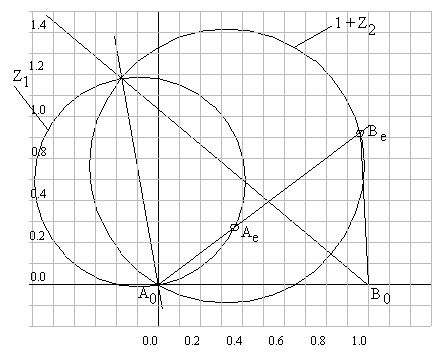

Yukarıdaki eğriyi geometrik olarak çizme yöntemini öğrenmek için alttaki animasyonu inceleyiniz.

    

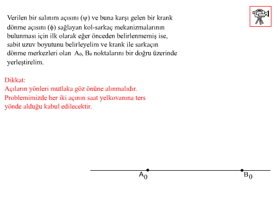

      

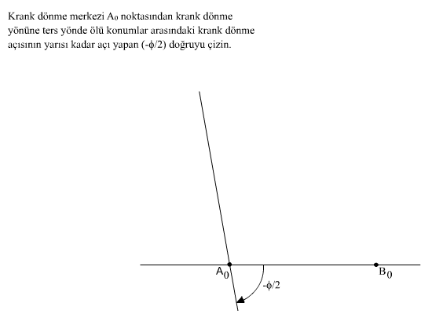

      

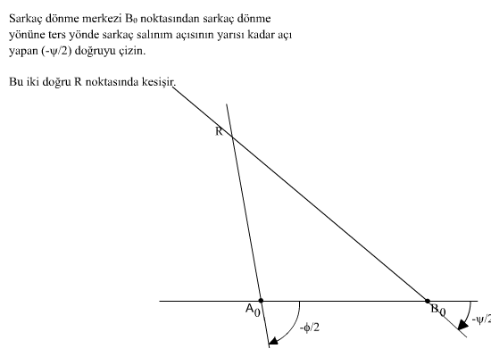

      

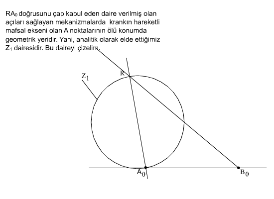

      

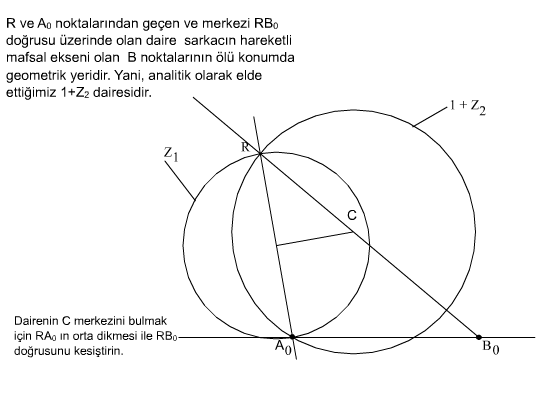

      

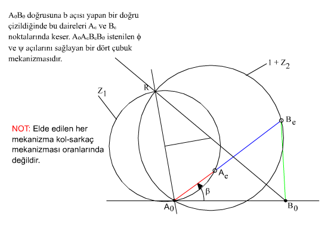

      

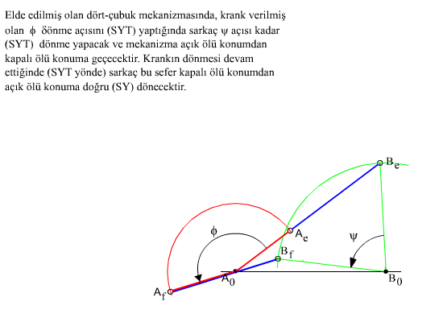

    

Uzuv boyutlarını β parametresine göre analitik olarak elde etmek istediğimizde:

 
 
 
  $         a  2   =  −  sin  ⁡   (   ψ  2   )     cos  ⁡   (    ϕ  2   +  β   )     sin  ⁡   (    ϕ  −  ψ   2   )         \displaystyle {{\text{a}}_{2}=-\sin\left( \frac{\text{ψ}}{2}\right)\frac{{\cos\left( {\frac{\text{ϕ}}{2}+\text{β}} \right)}}{{\sin\left( {\frac{{\text{ϕ}-\text{ψ}}}{2}} \right)}}}    $          a             2      ​              =    −    sin      (              2               ψ      ​               )                  sin      (                2                  ϕ   −   ψ        ​                )                  cos      (                2                 ϕ       ​                +     β     )        ​                   
 (15) 
 
 
  $        a  3   =  +  sin  ⁡   (   ψ  2   )     sin  ⁡   (    ϕ  2   +  β   )     cos  ⁡   (    ϕ  −  ψ   2   )        \displaystyle {{\text{a}}_{3}}=+\sin\left( \frac{\text{ψ}}{2}\right)\frac{{\sin\left( {\frac{\text{ϕ}}{2}+\text{β}} \right)}}{{\cos\left( {\frac{{\text{ϕ}-\text{ψ}}}{2}} \right)}}    $          a             3      ​               =        +    sin      (              2               ψ      ​               )                  cos      (                2                  ϕ   −   ψ        ​                )                  sin      (                2                 ϕ       ​                +     β     )        ​                  
 (16) 
 
 
 a 4  2  = (a 2  + a 3 ) 2  + 1 − 2(a 2  + a 3 )cosβ 
 (17) 
 
 
 a 1  = 1 
  
 
 
 

denklemleri kullanılabilir. λ parametresine göre ise uzuv boyutları denklem (13) ve (14) kullanılarak:

 $         a  2   2   =   Z  1     Z  1   ‾      \displaystyle {{\text{a}}_{2}}^{2}={{\text{Z}}_{1}}\overline{{{{\text{Z}}_{1}}}}   $           a             2      ​                      2            =            Z             1      ​                          Z             1      ​                       ​              

 $         a  4   2   =   Z  2     Z  2   ‾      \displaystyle {{\text{a}}_{4}}^{2}={{\text{Z}}_{2}}\overline{{{{\text{Z}}_{2}}}}   $           a             4      ​                      2            =            Z             2      ​                          Z             2      ​                       ​              

a 3  = λa 2 

a 1  = 1

elde edilir. Verilen bir salınım açısı ve karşı gelen bir krank dönme açısına göre β veya λ parametresi kullanılarak istenilen açıları sağlayan sonsuz sayıda mekanizma elde edilebilmektedir. Kol-sarkaç oranlarının sağlanabilmesi için ayrıca sarkaç salınım açısı:

0° < ψ < 180°

90° + ψ/2 < ϕ < 270° + ψ/2

denklemlerini sağlamalıdır. ϕ ve ψ parametrelerinden elde edilebilecek t, u ve v parametrelerini:

t = tan(ϕ/2)  ,  u = tan[(ϕ − ψ)/2]  ,  v = tan(ψ/2)

tanımlayalım. Bu yeni parametreler kullanılarak uzuv boyutlarını şu şekilde gösterebiliriz:

 
 
 
  $         a  1   2   =     u  2   +   λ  2     1  +   u  2        \displaystyle {{\text{a}}_{1}}^{2}=\frac{{{{\text{u}}^{2}}+{{\text{λ}}^{2}}}}{{1+{{\text{u}}^{2}}}}    $           a             1      ​                      2            =                    1    +        u             2                             u             2             +        λ             2               ​                  
 (18) 
 
 
  $         a  2   2   =    v  2    1  +   v  2        \displaystyle {{\text{a}}_{2}}^{2}=\frac{{{{\text{v}}^{2}}}}{{1+{{\text{v}}^{2}}}}    $           a             2      ​                      2            =                    1    +        v             2                             v             2               ​                  
 (19) 
 
 
  $         a  3   2   =   λ  2     a  2   2   =     λ  2    v  2     1  +   v  2        \displaystyle {{\text{a}}_{3}}^{2}={\text{λ}}^{2}{{\text{a}}_{2}}^{2}=\frac{{\text{λ}}^{2}{\text{v}}^{2}}{{1+{{\text{v}}^{2}}}}    $           a             3      ​                      2            =           λ             2               a             2      ​                      2            =                    1    +        v             2                           λ             2             v             2             ​                  
 (20) 
 
 
  $         a  4   2   =     t  2   +   λ  2     1  +   t  2        \displaystyle {{\text{a}}_{4}}^{2}=\frac{{{{\text{t}}^{2}}+{{\text{λ}}^{2}}}}{{1+{{\text{t}}^{2}}}}    $           a             4      ​                      2            =                    1    +        t             2                             t             2             +        λ             2               ​                  
 (21) 
 
 
 

**Örnek:**

Sabit uzuv boyu 120 mm olan, salınım açısı ψ =40 0  ve buna karşı gelen krank dönme açısı ϕ =160° olan bir kol-sarkaç mekanizmasını ve bulunan mekanizmanın kritik bağlama açısını bulun.

a) Krank ölü konum açısını β = 60° olarak seçelim. (15)-(17) denklemlerini kullanarak:

 $        a  2   =  −  sin  ⁡   (   20     ∘    )     cos  ⁡   (   80     ∘   +  60     ∘    )     sin  ⁡   (   80     ∘   −  20     ∘    )     =  0.30254     \displaystyle {{\text{a}}_{2}}=-\sin \left( {20{}^\circ } \right)\frac{{\cos \left( {80{}^\circ +60{}^\circ } \right)}}{{\sin \left( {80{}^\circ -20{}^\circ } \right)}}=0.30254    $          a             2      ​               =        −    sin     (   20             ∘          )                 sin     (   80             ∘           −    20             ∘          )                 cos     (   80             ∘           +    60             ∘          )       ​                =        0.30254     

 $        a  3   =  sin  ⁡   (   20     ∘    )     sin  ⁡   (   80     ∘   +  60     ∘    )     cos  ⁡   (   80     ∘   −  20     ∘    )     =  0.43969     \displaystyle {{\text{a}}_{3}}=\sin \left( {20{}^\circ } \right)\frac{{\sin \left( {80{}^\circ +60{}^\circ } \right)}}{{\cos \left( {80{}^\circ -20{}^\circ } \right)}}=0.43969    $          a             3      ​               =        sin     (   20             ∘          )                 cos     (   80             ∘           −    20             ∘          )                 sin     (   80             ∘           +    60             ∘          )       ​                =        0.43969     

ve

a 4  2  = (0.30254 + 0.43969) 2  + 1 − 2(0.30254 + 0.43969)cos60° = 0.80867    ⇒     a 4  = 0.89926

a 1  = 120 mm olduğunda a 2  = 36.3 mm, a 3  = 52.76 ve a 4  = 107.91 mm olacaktır.

Bağlama açısının 90° den en fazla sapması ise denklem (5) kullanılarak:

 $        cos  ⁡   μ       min        max        =     107.91  2   +   52.76  2   −   120  2   −   36.30  2     2  ⋅  107.91  ⋅  52.76    ±    120  ⋅  36.30    107.91  ⋅  52.76    =  −  0.113247  ±  0.765106      \displaystyle {\cos \text{μ}_{\begin{smallmatrix} \text{min} \\ \text{max} \end{smallmatrix}}=\frac{{107.91}^{2}+{52.76}^{2}-{120}^{2}-{36.30}^{2}}{2 \cdot 107.91 \cdot 52.76} \pm \frac{120 \cdot 36.30}{107.91 \cdot 52.76}=-0.113247 \pm 0.765106}   $       cos      μ                       min          max      ​                 ​              =               2    ⋅    107.91    ⋅    52.76                107.91            2            +      52.76            2            −      120            2            −      36.30            2             ​                ±               107.91    ⋅    52.76              120    ⋅    36.30     ​                =    −  0.113247    ±    0.765106      

Buradan μ max  = 151.44° (Δ1 = 61.44°)  ve  μ min  = 49.32° (Δ 2  = 40.68°) elde edilecektir. μ max  ın 90° den sapması 61.44° olduğundan μ max  göz önüne alınması gereken kritik bağlama açısıdır.

b) Eğer biyel uzunluğunun krank uzunluğuna oranı λ = 1.4 olarak seçilir ise, (18)-(21) denklemlerini kullanarak:

t = tan(80°) = 5.671282  ,  u = tan(60°) = 1.732051  ,  v = tan(20°) = 0.36397

 $         a  1   2   =     1.732051  2   +   1.4  2     1  +   1.732051  2     =  1.24     ⇒      a  1   =  1.113553     \displaystyle {{\text{a}}_{1}}^{2}=\frac{{{{{1.732051}}^{2}}+{{{1.4}}^{2}}}}{{1+{{{1.732051}}^{2}}}}=1.24\text{ }\Rightarrow \text{ }{{\text{a}}_{1}}=1.113553    $           a             1      ​                      2            =                    1    +        1.732051             2                             1.732051             2             +        1.4             2               ​                =        1.24         ⇒                 a             1      ​               =        1.113553     

 $         a  2   2   =    0.363970  2    1  +   0.363970  2     =  0.116978     ⇒      a  2   =  0.342020     \displaystyle {{\text{a}}_{2}}^{2}=\frac{{{{{0.363970}}^{2}}}}{{1+{{{0.363970}}^{2}}}}=0.116978\text{ }\Rightarrow \text{ }{{\text{a}}_{2}}=0.342020    $           a             2      ​                      2            =                    1    +        0.363970             2                             0.363970             2               ​                =        0.116978         ⇒                 a             2      ​               =        0.342020     

 $        a  3   =  1.4  ⋅  0.342020  =  0.478828     \displaystyle {{\text{a}}_{3}}=1.4\cdot 0.342020=0.478828    $          a             3      ​               =        1.4    ⋅        0.342020    =        0.478828     

 $         a  4   2   =     5.671282  2   +   1.4  2     1  +   5.671282  2     =  1.028948     ⇒      a  4   =  1.0114371     \displaystyle {{\text{a}}_{4}}^{2}=\frac{{{{{5.671282}}^{2}}+{{{1.4}}^{2}}}}{{1+{{{5.671282}}^{2}}}}=1.028948\text{ }\Rightarrow \text{ }{{\text{a}}_{4}}=1.0114371    $           a             4      ​                      2            =                    1    +        5.671282             2                             5.671282             2             +        1.4             2               ​                =        1.028948         ⇒                 a             4      ​               =        1.0114371     

elde edilir. a 1  = 120 mm olduğunda: a 2  = (0.342020/1.113553)×120 = 36.86 mm, a 3  = 51.60 mm, a 4  = 109.31 mm olacaktır. Bu mekanizma için kritik bağlama açısı denklem (5) ten:

 $        cos  ⁡   μ       min        max        =     109.31  2   +   51.60  2   −   120  2   −   36.86  2     2  ⋅  109.31  ⋅  51.60    ±    120  ⋅  36.86    109.31  ⋅  51.60    =  −  0.101715  ±  0.784200      \displaystyle {\cos \text{μ}_{\begin{smallmatrix} \text{min} \\ \text{max} \end{smallmatrix}}=\frac{{{{{109.31}}^{2}}+{{{51.60}}^{2}}-{{{120}}^{2}}-{{{36.86}}^{2}}}}{{2\cdot 109.31\cdot 51.60}}\pm \frac{{120\cdot 36.86}}{{109.31\cdot 51.60}}=-0.101715 \pm 0.784200}   $       cos      μ                       min          max      ​                 ​              =                2    ⋅    109.31    ⋅    51.60                    109.31             2             +        51.60             2             −        120             2             −        36.86             2               ​                ±                109.31    ⋅    51.60                120    ⋅    36.86      ​                =    −  0.101715    ±    0.784200      

Buradan μ max  = 152.36° (Δ1 = 62.36°)  ve  μ min  = 49.96° (Δ 2  = 43.04°). μ max  ın dik açıdan sapması 62.36° olduğundan μ max  kritik bağlama açısıdır.

Görüldüğü gibi, istenilen sarkaç salınım açısı ve karşı gelen kol dönme açısını sağlayan sonsuz sayıda kol-sarkaç mekanizması elde edilebilecektir. Elde edilen her mekanizmanın bağlama açısı farklı olacağından 90° den sapmalarıda farklı olacaktır. Basit bir çalışma olarak λ veya β parametrelerinden birisi kullanılarak bu parametre serbest olduğundan değişik değerler verelim. Her bir değer için bağlama açısının 90° den maksimum sapması farklı olacaktır. Bu sapmaların değişimini kullandığımız parametreye göre çizelim. Şekilde görüldüğü gibi bir eğri elde edilecektir. Dik açıdan sapmanın en az olduğu mekanizma bağlama açısı bakımından en iyi mekanizmadır ve onu seçtiğimizde uygulamada en az sorun ile karşılaşılacağı büyük bir ihtimaldir.

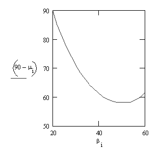

Bu en iyi bağlama açısına sahip mekanizmayı bulmak için her durumda yukarıda açıklanan yöntemi izlemektense, uzuv boyutları tek bir parametre ile (λ) ifade edilebildiğine göre bağlama açısı da sadece bu parametrenin fonksiyonu olacaktır. (5) numaralı denklemde:

 
 
 
  $        cos  ⁡   μ       min        max        =      a  3   2   +    a  4   2   −    a  1   2   −    a  2   2     2   a  3    a  4     ±     a  1    a  2      a  3    a  4         \displaystyle {\cos \text{μ}_{\begin{smallmatrix} \text{min} \\ \text{max} \end{smallmatrix}}=\frac{{{{\text{a}}_{3}}^{2}+{{\text{a}}_{4}}^{2}-{{\text{a}}_{1}}^{2}-{{\text{a}}_{2}}^{2}}}{{2{{\text{a}}_{3}}{{\text{a}}_{4}}}} \pm \frac{{{{\text{a}}_{1}}{{\text{a}}_{2}}}}{{{{\text{a}}_{3}}{{\text{a}}_{4}}}}}   $       cos      μ                       min          max      ​                 ​              =                2      a             3      ​                 a             4      ​                                a             3      ​                      2            +         a             4      ​                      2            −         a             1      ​                      2            −         a             2      ​                      2              ​                ±                    a             3      ​                 a             4      ​                               a             1      ​                 a             2      ​                 ​                   
 (5) 
 
 
 

uzuv boyutlarını λ ile ifade eden (18)-(21) numaralı denklemler kullanılır ise, bağlama açısı bu parametre ile ifade edilmiş olacaktır. Bağlama açısının dik açıdan sapmasını minimum veya maksimum edecek λ değerine (λ opt ) dersek, denklem (4) ün λ ya göre türevini alıp sıfıra eşitlediğimizde elde ettiğimiz değer bu en iyi durumu içerecektir. Bu işlem yapıldığında λ opt  değeri:

 
 
 
 Q 3  +2Q 2  − t 2 Q − t 2 (1 + t 2 )/u 2  = 0 
 (22) 
 
 
 

Üçüncü derece denklemin köklerinden birisi olarak elde edilir. Bu denklemde Q = t 2 /λ opt  2  dir ve denklemin üç kökünden 1/u 2  < Q < t 2  olanı kol-sarkaç oranını sağlayacağı gibi, bu (λ opt ) değeri kullanılarak elde edilen kol-sarkaç mekanizmasının bağlama açısı diğer λ değerleri kullanılarak elde edilecek kol-sarkaç mekanizmalarına göre dik açıdan en az sapma gösterecektir.

(22) numaralı denklem basit Newton-Raphson iteratif yöntemi ile çözülebilir. Kök aralığı 1/u 2  < Q < t 2  orta noktası ilk tahmin alınarak ( Q 0  = (1/u 2  + t 2 )/2 ) ve bu kökün bulunması için tekrarlama denklemi:

 
 
 
  $        Q   i  +  1    =    2   Q  i    (    Q  i   +  1   )   +   t  2    (   1  +   t  2    )   /   u  2      Q  i    (   3   Q  i   +  4   )   −   t  2        \displaystyle {{Q}_{{i+1}}}=\frac{{2{{Q}_{i}}\left( {{{Q}_{i}}+1} \right)+{{\text{t}}^{2}}\left( {1+{{\text{t}}^{2}}} \right)/{{\text{u}}^{2}}}}{{{{Q}_{i}}\left( {3{{Q}_{i}}+4} \right)-{{\text{t}}^{2}}}}    $         Q             i  +  1       ​               =                       Q            i      ​                (   3     Q            i      ​               +    4   )     −        t             2                         2     Q            i      ​                (      Q            i      ​               +    1   )     +        t             2               (    1    +        t             2             )      /      u             2               ​                  
 (23) 
 
 
 

kullanılarak yeni köke daha yakın değerler elde edilebilir. İterasyona  (Q i+1 /Q i )/Q i   yeteri kadar küçük olduğunda (örneğin 10 -6  dan küçük) son verilir.

Bir salınım açısı ve karşı gelen kol açısına göre en iyi bağlama açısı değerlerini veren kol ölü konum açısı ve en iyi bağlama açısı değerler grafik olarak Abak 1 de görülmektedir (bu abak ilk olarak Alt tarafından hazırlanmış, soradan Volmer tarafından düzenlenmiştir. Bu nedenle Alt diyagramı denmektedir). Bu abak kullanılarak kol ölü konum açısı β ve en kritik bağlama açısının en iyi değeri maxmmin verilmektedir. Uzuv boyutları bu abaktan elde edilen β değerinin (15)-(17) numaralı denklemde kullanılması ile elde edilir.

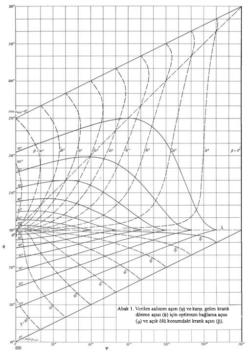

**Örnek:**

Sabit uzuv boyutu 120 mm, salınım açısı ψ = 40 0  ve karşı gelen krank dönme açısı ϕ = 160 0  olan ayrıca en iyi bağlama açısına sahip kol-sarkaç mekanizmasını bulun.

Verilen açılar kullanılarak t = 5.671282 ve u = 1.732051 bulunur, öyle ise aranan kök: 0.333333 < Q < 32.163437 aralığındadır. Q 0  = 16.248 alalım ve iterasyon denklemi kullanarak:

 
 
 
 i 
 0 
 1 
 2 
 3 
 4 
 5 
 6 
 7 
 
 
  Q 
  16.248 
  11.47207 
  8.095663 
  7.982059 
  7.857866 
  7.855707 
  7.855706 
  7.855706 
 
 
 

Öyle ise aranan kök (6 basamak doğrulukta): Q = 7.855706 dir. Buna göre λ opt  = 2.023432 bulunur. Bu λ opt  değeri uzuv boyutlarını bulmak için kullanıldığında:

 $         a  1   2   =     1.732051  2   +   2.023432  2     1  +   1.732051  2     =  1.773569     ⇒      a  1   =  1.331754     \displaystyle {{\text{a}}_{1}}^{2}=\frac{{{{{1.732051}}^{2}}+{{{2.023432}}^{2}}}}{{1+{{{1.732051}}^{2}}}}=1.773569\text{ }\Rightarrow \text{ }{{\text{a}}_{1}}=1.331754    $           a             1      ​                      2            =                    1    +        1.732051             2                             1.732051             2             +        2.023432             2               ​                =        1.773569         ⇒                 a             1      ​               =        1.331754     

 $         a  2   2   =    0.363970  2    1  +   0.363970  2     =  0.116978     ⇒      a  2   =  0.342020     \displaystyle {{\text{a}}_{2}}^{2}=\frac{{{{{0.363970}}^{2}}}}{{1+{{{0.363970}}^{2}}}}=0.116978\text{ }\Rightarrow \text{ }{{\text{a}}_{2}}=0.342020    $           a             2      ​                      2            =                    1    +        0.363970             2                             0.363970             2               ​                =        0.116978         ⇒                 a             2      ​               =        0.342020     

 $        a  3   =  2.023432  ⋅  0.342020  =  0.692054     \displaystyle {{\text{a}}_{3}}=2.023432\cdot 0.342020=0.692054    $          a             3      ​               =        2.023432    ⋅        0.342020    =        0.692054     

 $         a  4   2   =     5.671282  2   +   2.023432  2     1  +   5.671282  2     =  1.093304     ⇒      a  4   =  1.045612     \displaystyle {{\text{a}}_{4}}^{2}=\frac{{{{{5.671282}}^{2}}+{{{2.023432}}^{2}}}}{{1+{{{5.671282}}^{2}}}}=1.093304\text{ }\Rightarrow \text{ }{{\text{a}}_{4}}=1.045612    $           a             4      ​                      2            =                    1    +        5.671282             2                             5.671282             2             +        2.023432             2               ​                =        1.093304         ⇒                 a             4      ​               =        1.045612     

a 1  = 120 mm olduğunda : a 2  = (0.342020/1.331754)×120 = 30.82 mm, a 3  = 62.36 mm, a 4  = 94.22 mm olarak bulunur. Bu mekanizma için bağlama açısının dik açıdan en fazla sapması ise:

 $        cos  ⁡   μ       min        max        =     94.22  2   +   62.36  2   −   120  2   −   30.82  2     2  ⋅  94.22  ⋅  62.36    ±    120  ⋅  30.82    94.22  ⋅  62.36    =  0.219938  ±  0.629455      \displaystyle {\cos \text{μ}_{\begin{smallmatrix} \text{min} \\ \text{max} \end{smallmatrix}}=\frac{{{{{94.22}}^{2}}+{{{62.36}}^{2}}-{{{120}}^{2}}-{{{30.82}}^{2}}}}{{2\cdot 94.22\cdot 62.36}}\pm \frac{{120\cdot 30.82}}{{94.22\cdot 62.36}}=0.219938\pm 0.629455}   $       cos      μ                       min          max      ​                 ​              =                2    ⋅    94.22    ⋅    62.36                    94.22             2             +        62.36             2             −        120             2             −        30.82             2               ​                ±                94.22    ⋅    62.36                120    ⋅    30.82      ​                =    0.219938    ±    0.629455      

Bu denklemden: μ max  = 114.17° (Δ1 = 24.17°)  ve  μ min  = 31.85° (Δ 2  = 58.15°). μ min  daha fazla sapma gösterdiğinden μ min  kritik bağlama açısıdır. Verilen salınım açısı ve karşı gelen kol dönme açısını sağlayan ve bağlama açısı dik açıdan en az sapan mekanizma boyutları bu elde edilmiş olan boyutlardır. Farklı bir λ veya β parametre değeri ile bulunan kol-sarkaç mekanizmasının bağlama açısının dik açıdan sapması bu bulunan mekanizmadaki sapmadan mutlaka daha fazla olacaktır.

Abak 1’e baktığımızda ise, verilen ψ =40 0  ve ϕ = 160 0  değerleri için abakdan: max(μ min ) ≈ 32 0  ve β ≈ 50.5° okunabilir. Tabii ki abaktan sınırlı bir hassasiyetle okumak mümkündür. Uzuv boyutlarını bu b değeri ile bulduğumuzda: a 1  = 1, a 2  = 0.2565, a 3  = 0.5201 ve a 4  = 0.784 değerlerini elde ederiz. a 1  = 120 mm olduğunda a 2  = 30.78 mm, a 3  = 62.41 mm ve a 4  = 94.08 mm bulunur. Sonuç mekanizma şekilde gösterilmiştir.

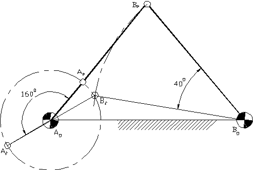

Yukarıda anlatılmaya çalışılmış olan ölü konumlara göre (verilen herhangi bir ϕ ve ψ değerine göre) bir kol-sarkaç mekanizması tasarımı için hazırlanmış olan  Excel kütüğünü alabilirsiniz .

Yukarıda verilmiş olan genel çözümün dışında iki özel durum oluşmaktadır. Bunlardan birisi santrik kol-sarkaç mekanizmasıdır. Bu durumda ölü konumlar arasında kol dönme açısı ϕ =180° dir ve bağlama açısının maksimum ve minimum değerleri:

 $        cos  ⁡   μ       min        max        =  ±     a  1    a  2      a  3    a  4         \displaystyle {\cos \text{μ}_{\begin{smallmatrix} \text{min} \\ \text{max} \end{smallmatrix}}= \pm \frac{{{{\text{a}}_{1}}{{\text{a}}_{2}}}}{{{{\text{a}}_{3}}{{\text{a}}_{4}}}}}   $       cos      μ                       min          max      ​                 ​              =    ±                  a             3      ​                 a             4      ​                               a             1      ​                 a             2      ​                 ​                  

dir. Eğer dik açıdan sapmanın en az olması istenir ise a 2  = 0 olması (a 1  = 1 alınmıştı) veya a 3  veya a 4  uzuv boyutlarından birisinin sonsuz olması gerekir. Pratikte bu durumlar mümkün olamayacağından, bağlama açısı ve uzuv boyutları arasında oran makul değerlerde olacak şekilde kol-sarkaç mekanizması boyutlarını ararız (örneğin bağlama açısının dik açıdan sapması λ değerinin büyümesi ile azalacaktır).

İkinci özel durum ise ϕ − ψ =180° olmasıdır (u = tan[(ϕ − ψ)/2] = ∞). Bu durumda bağlama açısının optimum değeri

 $        λ  opt   =  1  +   1   sin  ⁡   (   ψ  /  2   )        \displaystyle {{\text{λ}}_{{\text{opt}}}}=1+\frac{1}{{\sin \left( {\text{ψ}/2} \right)}}    $          λ               opt        ​               =        1    +                    sin     (    ψ   /2   )                1     ​                 

ve uzuv boyları

a 1  = 1

 $        a  2   =  sin  ⁡   (   ψ  /  2   )      \displaystyle {\text{a}_{2}}=\sin \left( {\text{ψ}/2} \right)    $         a            2      ​               =        sin     (    ψ   /2   )      

 $        a  3   =     a  2    (   1  +   a  2    )        \displaystyle {\text{a}_{3}}=\sqrt{{{\text{a}_{2}}\left( {1+{\text{a}_{2}}} \right)}}    $         a            3      ​               =                    a            2      ​                (   1    +       a            2      ​              )                 ​              

 $        a  4   =    1  +   a  2        \displaystyle {\text{a}_{4}}=\sqrt{{1+{\text{a}_{2}}}}    $         a            4      ​               =                 1    +       a            2      ​                           ​              

olur.

---

<!-- Kısım 9 -->
# Bağlama Açısı En İyi Olan Çift Kol Mekanizması Tasarımı

Çift kol mekanizması genel olarak düzgün bir dönme hareketini düzgün olmayan bir dönme hareketine dönüştürmek için kullanılır. Değişik hareket özellikleri için bazen bir kol-sarkaç mekanizması ile birlikte kullanılabilir (örneğin zaman oranını artırmak için bir çift-kol mekanizması ile bir kol-sarkaç mekanizmasının seri bağlanması ile elde edilen bir 6-çubuk mekanizması kullanılabilir). Şekilde çift kol oranlarında bir dört-çubuk mekanizması görülmektedir. Bağlama açısının 90° den sapmasının maksimum olduğu noktalar sabit uzuv ile giriş kolu olan krankın aynı doğrultuda olduğu konumlardır. Bağlama açısının dik açıdan yaptığı maksimum sapmanın azaltılabilmesi için bu iki sapma değerinin eşit olması gerekir (μ max  − 90° = 90° − μ min ).

Giriş kolunun 180° dönmesine karşı çıkış kolu bir ψ açısı kadar dönecek (ψ < 180° kabul edilecektir. Kalan ikinci 180° giriş kolu dönmesi sırasında çıkış kolu 360° − ψ kadar dönmesi gerekmektedir). Bağlama açısının en küçük değeri μ min  olsun. İki sınır değer şekilde görüldüğü gibidir. Bu iki sınır konum için bağlama açılarının dik açıdan sapmaları eşitlendikten sonra devre kapalılık denklemi yazılır ise:

 
 
 
 −a 1  − a 2  + a 3 e i(ψ 1  − π + μ min )   = a 4 e iψ 1   
 (1) 
 
 
 −a 1  + a 2  + a 3 e i(ψ 1  + ψ − μ min )  = a 4 e i(ψ 1  + ψ)  
 (2) 
 
 
 

elde edilir. Ayrıca bu maksimum ve minimum bağlama açısı değerlerinin birbirlerine eşit olması şartı kullanıldığında:

 
 
 
 a 1  2  + a 2  2  = a 3  2  + a 4  2  
 (3) 
 
 
 

elde edilir. a 1  = 1 olarak alındığında λ = a 4 /a 3  ve Z = a 3 e iψ 1   için denklem (1) ve (2)

 
 
 
 −1 − a 2  − Ze iμ min    = λZ 
 (4) 
 
 
 −1 + a 2  + Ze i(ψ − μ min )  = λZe iψ  
 (5) 
 
 
 

    

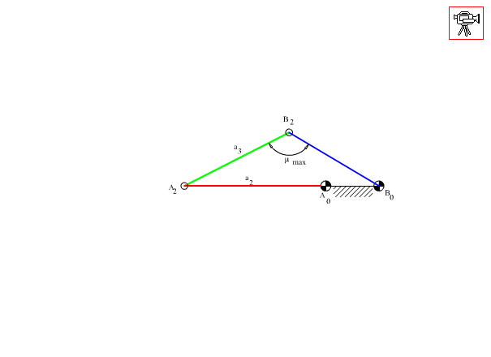

      

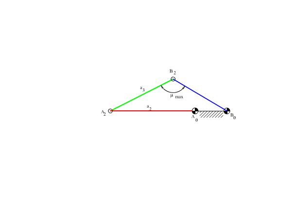

    

olarak yazılabilir. Z parametresini (4) ve (5) denklemlerini kullanarak yok edersek

 
 
 
  $         1  +   a  2     1  −   a  2     =    λ  +   e   i   μ  min        e  iψ    (   λ  −   e   i   μ  min      )        \displaystyle \frac{{1+{{\text{a}}_{2}}}}{{1-{{\text{a}}_{2}}}}=\frac{{\text{λ}+{{\text{e}}^{{\text{i}{{\text{μ}}_{{\text{min}}}}}}}}}{{{{\text{e}}^{{\text{iψ}}}}\left( {\text{λ}-{{\text{e}}^{{\text{i}{{\text{μ}}_{{\text{min}}}}}}}} \right)}}    $                  1    −        a             2      ​                           1    +        a             2      ​                 ​                =                        e               iψ                (    λ     −        e               i       μ               min        ​                        )                  λ     +        e               i       μ               min        ​                           ​                  
 (6) 
 
 
 

elde edilir. Bu denklem

 
 
 
 a 2 [λcos(ψ/2) − i sin(ψ/2 − μ min )] + i λsin(ψ/2) − cos(ψ/2 − μ min ) = 0 
 (7) 
 
 
 

olarak yazılabilir. Denklemin sanal ve reel kısımlarını ayrı ayrı sıfıra eşitler, λ ve a 2  için çözüm yaparsak:

 
 
 
  $        λ  2   =    sin  ⁡   (   ψ  −  2   μ  min    )     sin  ⁡   (  ψ  )        \displaystyle {{\text{λ}}^{2}}=\frac{{\sin \left( {\text{ψ}-2{{\text{μ}}_{{\text{min}}}}} \right)}}{{\sin \left( \text{ψ} \right)}}    $          λ             2             =                    sin     (   ψ   )                 sin     (    ψ     −    2      μ               min        ​              )       ​                  
 (8) 
 
 
  $         a  2   2   =    tan  ⁡   (   ψ  /  2   )     tan  ⁡   (   ψ  /  2  −   μ  min    )        \displaystyle {{\text{a}}_{2}}^{2}=\frac{{\tan \left( {\text{ψ}/2} \right)}}{{\tan \left( {\text{ψ}/2-{{\text{μ}}_{{\text{min}}}}} \right)}}    $           a             2      ​                      2            =                    tan     (    ψ   /2    −        μ               min        ​              )                 tan     (    ψ   /2   )       ​                  
 (9) 
 
 
 

0< ψ <180° olduğundan sinψ > 0 ve λ 2  > 0 olacaktır ve ψ − 2μ min  > 0 veya μ min  < ψ/2 sonucu elde edilir. Farklı bir deyiş ile en küçük bağlama açısı değeri bir çift kol mekanizması için ψ/2 den daha iyi olamaz. Eğer ψ açısı küçülür ise, bağlama açısının 90° den sapması artacaktır (λ = 1 iken mekanizma katlanabilir bir konuma sahiptir, yani en kısa uzuv boyu ile en uzun uzuv boyu toplamı diğer iki uzuv boyu toplamına eşittir).

 $         a  3   2   =  Z   Z  ˉ      \displaystyle {\text{a}_{3}}^{2}=\text{Z}\bar{\text{Z}}    $          a            3      ​                      2            =         Z           Z        ˉ            olduğundan a 3  uzuv boyutu:

 
 
 
  $         a  3   2   =     (    a  2   +  1   )   2     (   λ  +   e   i   μ  min      )    (   λ  +   e   -i   μ  min      )        \displaystyle {{\text{a}}_{3}}^{2}=\frac{{{{{\left( {{{\text{a}}_{2}}+1} \right)}}^{2}}}}{{\left( {\text{λ}+{{\text{e}}^{{\text{i}{{\text{μ}}_{{\text{min}}}}}}}} \right)\left( {\text{λ}+{{\text{e}}^{{\text{-i}{{\text{μ}}_{{\text{min}}}}}}}} \right)}}    $           a             3      ​                      2            =                     (    λ     +        e               i       μ               min        ​                        )      (    λ     +        e               -i       μ               min        ​                        )                      (       a             2      ​               +    1   )              2               ​                  
 (7) 
 
 
 

(8) ve (9) numaralı denklemlerden a 2  ve λ değerleri kullanılır ise:

 
 
 
  $         a  3   2   =    sin  ⁡   (  ψ  )     sin  ⁡   (   2   μ  min    )      [     tan  ⁡   (   ψ  /  2   )     tan  ⁡   (   ψ  /  2  −   μ  min    )     −  1   ]   =    sin  ⁡   (  ψ  )     sin  ⁡   (   2   μ  min    )      (     a  2   2   −  1   )      \displaystyle {{\text{a}}_{3}}^{2}=\frac{{\sin \left( \text{ψ} \right)}}{{\sin \left( {2{{\text{μ}}_{{\text{min}}}}} \right)}}\left[ {\frac{{\tan \left( {\text{ψ}/2} \right)}}{{\tan \left( {\text{ψ}/2-{{\text{μ}}_{{\text{min}}}}} \right)}}-1} \right]=\frac{{\sin \left( \text{ψ} \right)}}{{\sin \left( {2{{\text{μ}}_{{\text{min}}}}} \right)}}\left( {{{\text{a}}_{2}}^{2}-1} \right)    $           a             3      ​                      2            =                    sin     (   2      μ               min        ​              )                 sin     (   ψ   )       ​                  [                tan     (    ψ   /2    −        μ               min        ​              )                 tan     (    ψ   /2   )       ​                −    1    ]      =                    sin     (   2      μ               min        ​              )                 sin     (   ψ   )       ​                  (         a             2      ​                      2            −    1    )        
 (11) 
 
 
 

Ayrıca a 4  = λa 3  tür. Elde edilen sonuç mekanizma mutlaka Grashof kuralına göre kontrol edilmelidir.

**Örnek:**

Çift- kol oranında bir dört-çubuk mekanizmasında krankın ilk yarım tur dönüşünde çıkış kolunun 150° dönmesi istenilmekte ve minimum bağlama açısının 45° den fazla olması gerekmektedir. Sabit uzuv uzunluğu 100 mm olarak seçilmiştir.

ψ = 150°, μ min  = 45° ve a 1  = 100 mm olarak alındığında denklem (8), (9) ve (11) kullanılarak:

 $        λ  2   =    sin  ⁡   (   150     ∘   −  90     ∘    )     sin  ⁡   (   150     ∘    )     =  1.73205       ⇒     λ  =  1.31607     \displaystyle {{\text{λ}}^{2}}=\frac{{\sin \left( {\text{150}{}^\circ -90{}^\circ } \right)}}{{\sin \left( {150{}^\circ } \right)}}=1.73205\text{   }\Rightarrow \text{   λ}=1.31607    $          λ             2             =                    sin     (   150             ∘          )                 sin     (    150              ∘           −    90             ∘          )       ​                =        1.73205           ⇒            λ     =        1.31607     

 $         a  2   2   =    tan  ⁡   (   75     ∘    )     tan  ⁡   (   75     ∘   −  45     ∘    )     =  6.464101       ⇒        a  2   =  2.54246     \displaystyle {{\text{a}}_{2}}^{2}=\frac{{\tan \left( {75{}^\circ } \right)}}{{\tan \left( {75{}^\circ -45{}^\circ } \right)}}=6.464101\text{   }\Rightarrow \text{   }{{\text{a}}_{2}}=2.54246    $           a             2      ​                      2            =                    tan     (   75             ∘           −    45             ∘          )                 tan     (   75             ∘          )       ​                =        6.464101           ⇒                   a             2      ​               =        2.54246     

 $         a  3   2   =    sin  ⁡   (   150     ∘    )     sin  ⁡   (   90     ∘    )      (     tan  ⁡   (   75     ∘    )     tan  ⁡   (   75     ∘   −  45     ∘    )     −  1   )   =  2.73205       ⇒        a  3   =  1.65289     \displaystyle {{\text{a}}_{3}}^{2}=\frac{{\sin \left( {150{}^\circ } \right)}}{{\sin \left( {90{}^\circ } \right)}}\left( {\frac{{\tan \left( {75{}^\circ } \right)}}{{\tan \left( {75{}^\circ -45{}^\circ } \right)}}-1} \right)=2.73205\text{   }\Rightarrow \text{   }{{\text{a}}_{3}}=1.65289    $           a             3      ​                      2            =                    sin     (   90             ∘          )                 sin     (   150             ∘          )       ​                  (                tan     (   75             ∘           −    45             ∘          )                 tan     (   75             ∘          )       ​                −    1    )      =        2.73205           ⇒                   a             3      ​               =        1.65289     

a 4  = λa 3  = 2.17533

olur. a 1  = 100 mm alındığında a 2  = 254 mm, a 3  = 165 mm ve a 4  = 218 mm olacaktır. Grashof kuralına göre dört-çubuk mekanizması çift koldur. Sonuç şekilde görülmektedir.

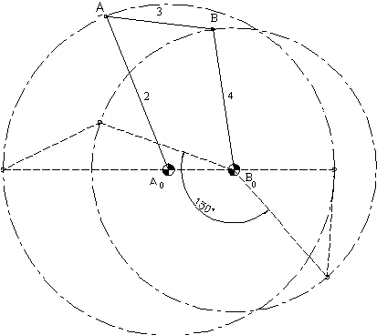

Yukarıda açıklanmış olan tasarım kolayca Excel programında yapılabilir. Excel kütüğü için  tıklayınız.

---