# Kam Mekanizmaları

*Prof. Dr. Eres Söylemez - Mekanizma Tekniği*

---

<!-- Kısım 1 -->
# VIII. KAM MEKANİZMALARI

---

<!-- Kısım 2 -->
#### “Bir kişinin bir olayı değerlendirmesi, bu değerlendirmeye esas olan bilgiden daha iyi olamaz. Ona gerçeği verdiğinizde doğru karara varma şansı olsa bile yanlış yapabilir. Ancak ona bilgi vermez, yanlış, saptırılmış veya yetersiz bilgiyi taraflı, mesuliyetsiz yayıncılık ahlakı ile veya bilerek hatalı verirseniz o insanın tüm değer yargılarını alt üst eder onu insandan daha alt seviyelere indirirsiniz.”

#### Arthur Hays Sulzberger

# Kam Mekanizmaları

---

<!-- Kısım 3 -->
# 8.1 Çalışma Alanı

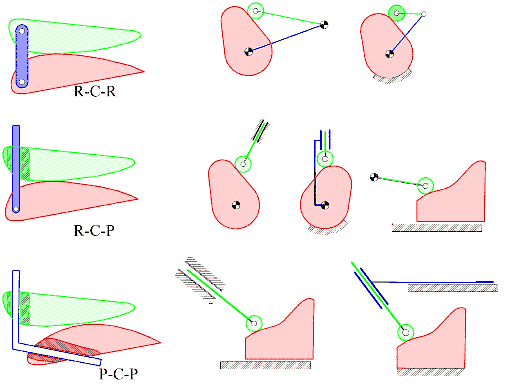

En basit yapı olarak bir serbestlik dereceli kam mekanizmaları üç uzuvlu bir kinematik zincirden oluşur. Mekanizma serbestlik derecesi bir olması için zincirde kam çiftinin dışında bulunan diğer kinematik çiftlerin serbestlik derecesi bir olması gerekir. Bu durumda, diğer kinematik çiftler kayar veya döner mafsal olabilirler. Yukarıda gösterildiği gibi, 3 değişik zincir ve bu zincirlerden elde edilebilen yedi değişik mekanizma mümkündür. Genel olarak kam çiftini oluşturan her iki yüzeyde farklı bir eğri olabilir isede, imalat kolaylığından dolayı yüzeylerden biri bir doğru veya dairedir. Daire olarak kendi ekseni etrafında dönebilen bir toparlak yerleştirilerek kayma sürtünmesi dönme sürtünmesine dönüştürülür.

Kam mekanizmalarının yukarıda de gösterildiği şekilde sınıflandırılması yeterli olmamıştır. Bu nedenle uygulamada kam mekanizmalarının sınıflandırılmasında üç değişik kriter kullanılır.

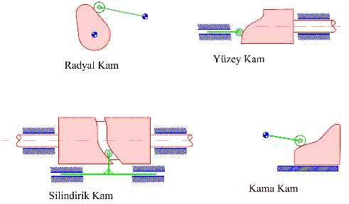

Kamın şekline göre, radyal, yüzeysel, silindirik, kama, konik, küresel veya üç boyutlu olarak kamların sınıflandırılmaları mümkündür.

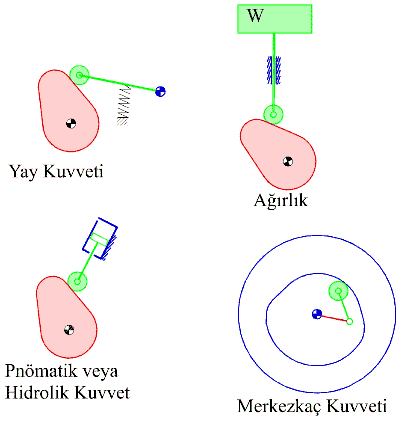

Kam ile izleyicinin temas şekline göre kam çiftleri **kuvvet kapalı** veya **şekil kapalı** olarak sınıflandırılabilir. Kuvvet kapalı kam çiftleri daha yaygın olup kam çifti yüzeyine etkiyen normal kuvvetin ne şekilde oluştuğuna göre sınıflandırılabilir (yay, ağırlık, pnömatik, santrifüj, vb).

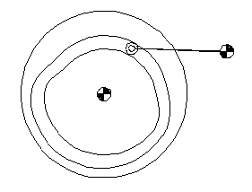

Şekil kapalı kamlarda uzuvlar iki noktadan temas ederler ve kinematik çiftlerin teması için ek bir kuvvete ihtiyaç yoktur.

İzleyici uzuv olarak adlandıracağımız, genellikle basit geometrik yapıya sahip kinematik elemanı olan uzuv ise iki değişik şekilde sınıflandırılır:

 

-       Kinematik elemanın geometrik şekline göre, düz yüzeyli, toparlaklı, küresel izleyiciler,

-       İzleyici uzvun hareket şekline bağlı olarak, öteleyen veya salınan izleyicilerdir.
 

Ayrıca, öteleme yapan izleyiciler kaçık veya eksenel olarakda ayrılırlar.

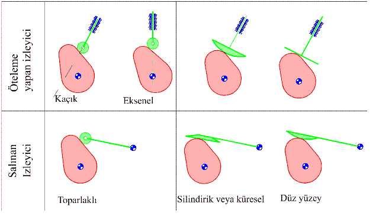

Bir Kam mekanizmasını tanımlarken yukarıda verilmiş olan sınıflandırmalardan mümkün olduğunca fazlası verilmeye çalışılır: eksenel öteleme yapan, düz-yüzeyli izleyicili, kuvvet kapalı radyal kam (Şekil a), toparlaklı öteleme yapan izleyicili, şekil kapalı, kamalı kam (Şekil b) veya öteleme yapan silindirik izleyicili silindirik kam (Şekil c) gibi.

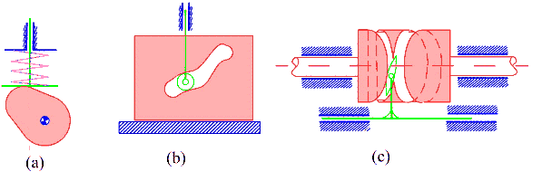

---

<!-- Kısım 4 -->
# 8.2 Kam Tasarımı

Kinematik olarak kam tasarımı, istenilen bir hareket için gerekli kam profilinin belirlenmesidir. Tasarım açısından kamlar iki değişik guruba ayrılırlar:

   

 

- Düşük hız kamlar: Bu kamlar için kinematik tasarım düşünülecek olan tek kriter olabilir. Atalet kuvvetleri ihmal edilebilir. Yüzey kalitesi pek önemli olmadığından bu tür kamlar çok ucuza üretilebilir (örneğin bir saç presinde basılarak pul gibi veya plastik enjeksiyon yöntemi ile imal edilmeleri mümkündür). Bu tür uygulamalarda, kamlar döner ve kayar mafsallı mekanizmaların yerine kullanılarak hareketli parça sayısı azaltılabilir. Kam profili sadece kinematik açıdan tasarlanabilirse de yüzey profilinin sürekli olması sağlanmalı ve bağlama açısı tasarım sırasında göz önüne alınmalıdır. Bu tür kam tasarımına örnek olarak oyuncaklar, ölçüm aletleri, göstergeler ve evlerde kullanılan dikiş makinaları kamları gösterilebilir.

- Yüksek hız kamlar: Yüksek hızda, büyük kütlelerin bulunduğu durumlarda ve esnek sistemlerde kullanılan kam mekanizmaları (tüm bu sistemlere yüksek hız kam diyeceğiz), sadece kinematik tasarım yapılması ve istenilen her hareketin elde edilebilmesi mümkün değildir. Sistemin dinamiği kinematiğinden çok daha önemlidir. Örneğin içten yanmalı motorlarda motor hızı 6000 devir/dakikaya kadar çıkabildiği düşünülür ise, sipobun 0.05 saniye içinde açılması gerekecek ve çıkış uzvunda gereken ivme yerçekimi ivmesinin çok üstünde değerler alacaktır.
 

Burada kam mekanizmalarının dinamiği incelenmeyecektir. Ancak bu tür kamların kinematik tasarımında göz önüne alınması gerekli hususlar irdelenecektir. Çünkü yüksek hızda kamlar kullanılırken hareket eğrisi üzerinde belirli sınırlamalar getirilmesi gereklidir.

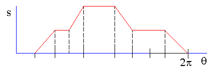

Düşük hızda kamlar için hareket diyagramı istenilen herhangi bir eğri olabilir. Buna tipik bir örnekler otomat kamları, dikiş makinası kamları veya oyuncaklarda kullanılan kamlardır. Genel olarak kamın bir tam dönmesi ile hareket tekrarlanır. Tipik bir örnek vida gibi küçük paraçaların seri işlenmesinde kullanılan otomat kamlarıdır. Hareket diyagramları yukarıda gösterildiği gibi çizilebilir.

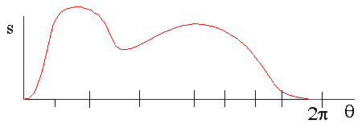

Kam hareket diyagramının s = f(θ) (0 < θ < 2π) fonksiyonu verilmiş olabilir. Düşük hızlarda bile bu eğrilerin kamlarla elde edilmesinde sorunlar çıkabilir (sürekli olmayan hareket ve eğimin belirli bir değerden fazla olması sorun yaratabilir).

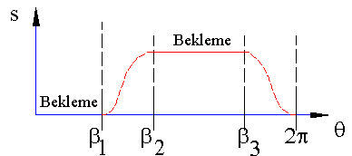

Kamların çoğunlukla kullanıldığı alanlarda çıkış uzvu için beklemeli hareket istenir. Örneğin içten yanmalı motorlarda motor sipoplarının kapalı durması, belirli bir konumdan sonra süratle açılmasını ve bir süre açık kalmasını, bu beklemeden sonra ise süratle kapanması istenilir. Bu gereksinim yukarıda gösterildiği gibi olabilir.

Bu tip bir uygulamada genellikle (β 2 , β 3 ) aralığı ile (0, β 1 ) aralığının oldukca geniş olması, sipopun açılıp kapanması için geçen sürelerin ise mümkün olduğunca az olması istenilir. Ancak, örneğin (β 1 , β 2 ) aralığı daraltılır ise, bu kısımda eğimin artması ve dolayısı ile izleyicide hız ve ivmenin artmasını gerekir. Hareketin tümü için baktığımızda, genel olarak üç çeşit hareket şekli belirleyebiliriz.

1.*     Bekleme-Hareket-Bekleme* (BHB): İzleyici uzuv durağan bir konumdan başlayarak hareket eder tekrar beklemeye girer. Benzer bir BHB geri dönüş içinde olacaktır.

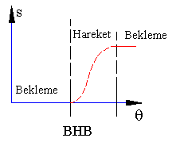

      2.      *Bekleme-Hareket* (BH): Bekleme durumundan başlayan hareket salınım yaparak tekrar bekleme konumuna gelir. İzleyici uzvun hareketi yön değiştirecektir.

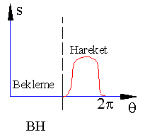

      3.    *Hareket* (H): Hiç bir bekleme olmayan kam hareketidir. Bu kam hareketleri arasında en az istenilen tiptir. Kolaylıkla bu tür kamların yerine bir krank-biyel veya dört çubuk mekanizmaları kullanılabilecetir (Bu tür harekete sahip kamlar genellikle eksantrik olan dönen bir dairedir).

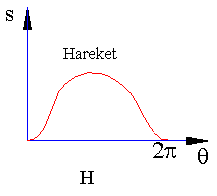

İstenilen hareket eğrisini verecek olan kam profilinin grafik olarak belirlenmesi aşağıda gösterilmekte olan santrik toparlaklı radyal kam için açıklanacaktır. Kam profilini belirlemek için ilk olarak belirli bir toparlak çapı ve temel dairesi çapı belirlenmelidir. Temel dairesi yarı çapı (r t ) değeri kinematik olarak bağlama açısına göre bulunur. Toparlak çapı (r r ) ise genel olarak kama gelen yükler belirlendikten sonra Hertz temas gerilimi göz önüne alınarak belirlenir. Burada her iki değerin bilindiği var sayılacaktır. Yarı çapı r t  + r r  olan bölüm dairesini çizelim. Hareket eğrisini ve bölüm dairesini aynı sayıda eşit aralıklarda bölelim (şekilde 30° aralıklar ele alınmıştır. Uygulamada, bilhassa yükseliş ve geri dönüş kısımlarında, bu aralığın istenilen hassasiyetin elde edilebilmesi için çok küçük seçilmesi gereklidir). Kam profilinin belirlenmesinde kinematik yer değişim uygulanır. Bunun için kam sabit olarak kabul edilecek ve sabit uzuv kamın dönme yönünün tersine bağıl konumlar aynı kalacak şekilde döndürülecektir. Örneğin şekilde, kamın 30° saat yelkovanına ters yönde dönmesi bu kinematik yer değişim ile, sabit uzvun 30° saat yelkovanı yönünde dönmesidir ve izleyici ekseni bu durumda dikey ile 30° açı yapmaktadır. Kam ile izleyici arasında aynı bağıl konumun korunabilmesi için bu arada izleyicinin bu yeni eksen yönünde hareket eğrisinde gösterilen s 1  kadar yukarıya öteleme yapması gerekir (İlk konumda toparlak merkezi kam merkezinden r t  + r r  kadar uzakta olduğundan 1 numaralı konumda toparlak merkezi kam merkezinden r t  + r r  + s 1  kadar uzakta olacaktır). Bu durumda, kinematik yer değişime göre, izleyicinin yeni konumu belirlenmiş olur (kesik çizgi ile izleyicinin konumu gösterilmiştir). Benzer işlem diğer konumlar için yapıldığında, kamın her dönme açısı için toparlağın kama göre bağıl konumu belirlenir. Kam profili toparlağın tüm bağıl konumlarına teğet olan düzgün eğridir.

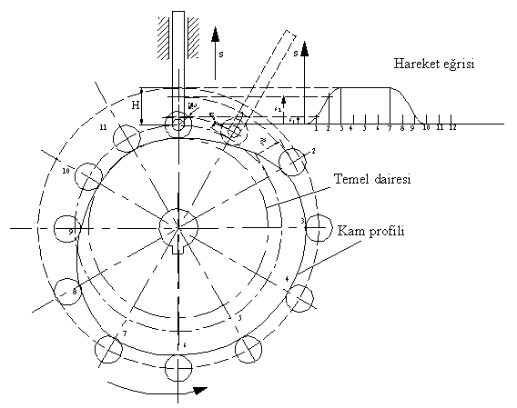

---

<!-- Kısım 5 -->
# 8.3 Hareket Eğrileri

Uygulamada çok sayıda farklı hareket eğrileri kullanılmaktadır. Burada genel özellikleri açıklayan temel hareket eğrileri ele alınacaktır.

**1. **   *** Doğrusal Hareket: *** Doğrusal hareket eğrisi:

s = Ct

Kam için sabit açısal hız (ω) kabul edilir ise:

s = Cθ/ω  dır.

H = Strok boyu, β = kamın tüm hareket sırasında döndüğü açı ise, s = 0 iken θ = 0 ve s = H iken θ = β sınır şartları kullanılarak

s = Hθ/β

ve

v = Hω/β

a = 0, ancak başlangıç ve bitiş noktalarında a = ∞ olacaktır.

Şekilde Hareket, hız ve ivme eğrileri gösterilmiştir. Uç noktalarda ivmenin sonsuz olması bu tip bir eğrinin düşük hızlarda bile kullanılmasına müsaade etmemek-tedir. Ayrıca bu eğri kam eğrisi olarak çizildiğinde, süreksizlik hareket diyagramında görüldüğü gibi kam profilinde de olacaktır.

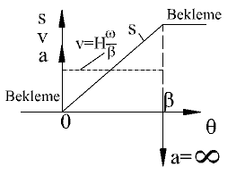

**2.   ** *** Basit Harmonik Hareket: ***

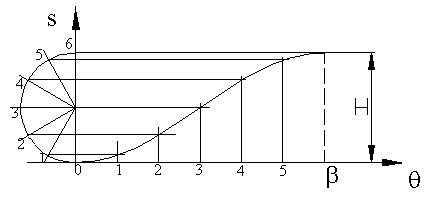

Tasarımı kolay ve sürekli bir hareket olmasından dolayı basit harmonik hareket bilhassa düşük veya orta hızlı kamlarda çok sıkca kullanılan bir harekettir. Geometrik olarak basit harmonik hareket Şekilde gösterildiği gibi, bir daire üzerinde bulunan noktaların s öteleme eksenine projeksiyonu ile elde edilir. Çapı toplam öteleme strokuna eşit yarım daire kam yükselme açısı bölümü kadar bölümlere ayrılır ve daire üzerinde alınan her noktanın dikey eksene projeksiyonu sırasında kamın belirlenen aralık kadar döndüğü öngörülür. Şekilden anlaşılacağı gibi, hareket başlangıç ve bitişte daha yavaş, orta noktalarda daha hızlı olacaktır. Bu tüm bekleme-hareket-bekleme için kullanılan eğrilerde aranılan özelliktir. Basit harmonik hareketin denklemi:

 $       s  =   H  2    [   1  −  cos  ⁡   (   πθ  β   )    ]      \displaystyle \text{s}=\frac{\text{H}}{2}\left[ {1-\cos \left( {\frac{{\text{πθ}}}{\text{β}}} \right)} \right]    $       s     =                   2               H      ​                  [    1    −    cos      (                β                 πθ       ​                )      ]       

 $       v  =   Hπω   2  β    sin  ⁡   (   πθ  β   )      \displaystyle \text{v}=\frac{{\text{Hπω}}}{{2\text{β}}}\sin \left( {\frac{{\text{πθ}}}{\text{β}}} \right)    $       v     =                    2   β                  Hπω       ​                sin      (                β                 πθ       ​                )       

 $       a  =   H  2     (   πω  β   )   2   cos  ⁡   (   πθ  β   )      \displaystyle \text{a}=\frac{\text{H}}{2}{{\left( {\frac{{\text{πω}}}{{\text{β}}}} \right)}^{2}}\cos \left( {\frac{{\text{πθ}}}{\text{β}}} \right)    $       a     =                   2               H      ​                   (                 β                  πω       ​                )              2             cos      (                β                 πθ       ​                )       

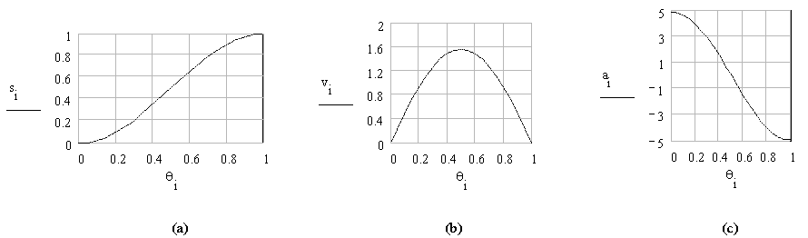

Hız ve ivme diyagramları şekilde görülmektedir ve maksimum hız ve ivme değerleri:

 $        v  max   =   Hπω   2  β       \displaystyle {{\text{v}}_{{\text{max}}}}=\frac{{\text{Hπω}}}{{2\text{β}}}    $          v               max        ​               =                    2   β                  Hπω       ​                      ,      $        a  max   =   H  2     (   πω  β   )   2      \displaystyle {{\text{a}}_{{\text{max}}}}=\frac{\text{H}}{2}{{\left( {\frac{{\text{πω}}}{\text{β}}} \right)}^{2}}    $          a               max        ​               =                   2               H      ​                   (                β                 πω       ​                )              2              

**3. **   ** *Parabolik veya Sabit İvmeli* *****  Hareket: ***

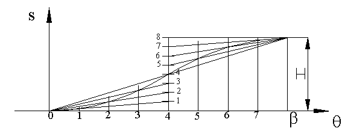

Parabolik harekette hareketin ilk yarısında izleyici sabit bir ivme ile hızlandırılırken ikinci yarısında sabit bir eksi ivme ile yavaşlatılır. Bu hareket eğrisini grafik olarak çizmek için izleyici yükselişi ile kamın dönme açılarını eşit sayılara bölmemiz gerekir. Yükseliş bölümlerini orta noktada bir dikey doğru üzerinde gösterelim. O başlangıç noktasından dikey doğru üzerinde bulunan 1, 2, 3 ve 4 noktalarına çizilen doğrular ile kam dönme açısı bölümlerinden çizilen dikey doğruların kesiştiği noktalar bu parabol üzeride bulunan noktalardır. Hareketin ikinci yarısı için O yerine O′ noktası kullanılarak aynı işlem tekrarlanır.

İzleyicinin hareketi, hızı ve ivmesi kam dönme açısına göre:

0 < θ < β/2 için           β/2 < θ < β için

s = 2Hθ 2 /β 2                 s = H[1 − 2(1 − θ/β) 2 ]

v = 4Hωθ/β 2               v = 4Hω(β − θ)/β 2 

a = 4Hω 2 /β 2                a = −4Hω 2 /β 2 

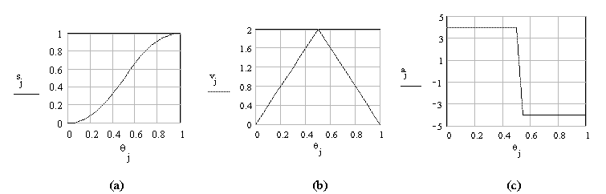

İvme her konumda belirli bir değer alırsa da, ivme değişimi (sadme) sonsuz olacaktır. Hareket, hız ve ivme diyagramları Şekilde gösterilmektedir.

**4.   ** ** *Sikloid* *****  Hareket: ***

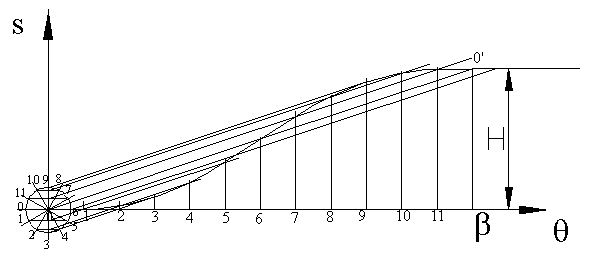

Eğer bir daire bir doğru üzerinde yuvarlanır ise, daire çemberi üzerinde bir nokta sikloid eğrisini çizer. İzleyicide sikloid hareketi elde etmek için çevresi H veya çapı H/π olan, merkezi ise OO′ doğrusu üzerinde bulunan daire çizilir. Daire çemberi ve kam yükseliş açısı aynı sayıda eşit aralıklara bölünür. Bu daire üzerinde bulunan bir noktadan (örneğin 1 noktası) çizilen yatay doğrunun dikey ekseni kestiği noktadan OO′ ye paralel çizilen doğru ile aynı noktaya karşı gelen yatay eksen üzerindeki noktadan (1 noktası) çizilen dikey doğrunun kesiştiği nokta yükselme eğrisi üzerinde bir noktayı belirler. Analitik olarak hareket, hız ve ivme eğrileri :

 $       s  =   H  π    [    πθ  β   −   1  2   sin  ⁡   (   2πθ  β   )    ]      \displaystyle \text{s}=\frac{\text{H}}{\text{π}}\left[ {\frac{{\text{πθ}}}{\text{β}}-\frac{1}{2}\sin \left( {\frac{{\text{2πθ}}}{\text{β}}} \right)} \right]    $       s     =                    π                H      ​                  [                β                 πθ       ​                −               2              1     ​                sin      (                β                 2πθ       ​                )      ]       

 $       v  =   Hω  β    [   1  −  cos  ⁡   (   2πθ  β   )    ]      \displaystyle \text{v}=\frac{{\text{Hω}}}{\text{β}}\left[ {1-\cos \left( {\frac{{\text{2πθ}}}{\text{β}}} \right)} \right]    $       v     =                    β                 Hω       ​                  [    1    −    cos      (                β                 2πθ       ​                )      ]       

 $       a  =    2Hπ   ω  2     β  2    sin  ⁡   (   2πθ  β   )      \displaystyle \text{a}=\frac{{\text{2Hπ}{{\text{ω}}^{2}}}}{{{{\text{β}}^{2}}}}\sin \left( {\frac{{\text{2πθ}}}{\text{β}}} \right)    $       a     =                        β             2                          2Hπ       ω             2               ​                sin      (                β                 2πθ       ​                )       

 $        v  max  ⁡   =   2Hω  β      ,      a  max  ⁡   =    2Hπ   ω  2     β  2          \displaystyle {{\text{v}}_{{\max }}}=\frac{{\text{2Hω}}}{\text{β}}\text{   ,   }{{\text{a}}_{{\max }}}=\frac{{\text{2Hπ}{{\text{ω}}^{2}}}}{{{{\text{β}}^{2}}}}    $          v               m  a  x        ​               =                    β                 2Hω       ​                  ,          a               m  a  x        ​               =                        β             2                          2Hπ       ω             2               ​                    

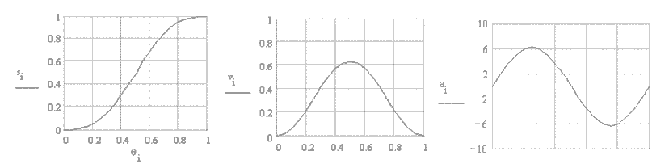

Hareket, hız ve ivme diyagramları

Şu ana kadar açıklanmış olan eğriler arasında sikloid hareket eğrisi en iyi dinamik özellikere sahip kam sistemini verebilecektir. İvme her noktada sınırlı olup başlangıç ivmeside sıfırdır. Bu en az titreşim, gürültü oluşturan bir kam sistemini vereceğinden genellikle tavsiye edilir. Ancak bu özelliklere erişilebilmesi için kamın çok hassas imal edilmesi şarttır.

**5. **   ** *Doğru ve Daire Yayı – Birleşik Eğriler* ***** : ***

Doğrusal hareket eğrisinde, başlangıç ve bitiş noktaları sonsuz ivme olduğundan dolayı uygulamada sorun yaratacaktır. Başlangıç ve bitiş noktalarında sonsuz ivmeyi önlemek için başlangıç ve bitiş bir daire yayı, arada ise bu iki daire yayına teğet bir doğru çizilerek elde edilen yükseliş eğrisinde hareket ve hareketin birinci türevi sürekli olacak, ivme ise her noktada sonlu bir değer alacaktır. Aşağıdaki şekilde gösterildiği gibi, genel olarak daire yayı yarı çapı yükselme mesafesine (H) eşit alınır ise de, farklı bir çapta kullanılabilir.

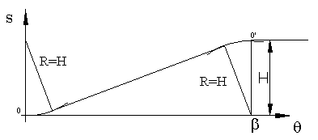

Kalkış sırasında belirli bir aralıkda sabit bir hız elde edilebilmesi için doğrusal hareket eğrileri bir çok uygulama için gereklidir. Hareketin sürekliliğini sağlamak için ise, başlangıç ve bitiş noktalarında daire yayı kullanılabileceği gibi, harmonik haraketin, parabolik hareketin veya sikloid hareketin yarısı bu doğruyu başlangıç ve bitiş noktalarına sıfır eğim ile bağlayabilir.

**Örnek 1:**

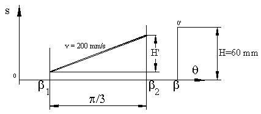

50 devir/dakika açısal hız ile dönen bir kam mekanizmasında, izleyicinin ilk olarak sabit ivme ile 200 mm/s hıza çıkmasını, 60° bu sabit hız ile hareket etmesini ve sonra sabit ivme ile toplam 60 mm yükseliş yaptıktan sonra beklemeye girmesi istenmektedir.

Bu yükseliş eğrisini, hızını ve ivmesini belirleyelim.

Şekilde görüldüğü gibi, yükseliş eğrisi üç kısımdan oluşacaktır. 0 < θ < β 1  aralığında sabit ivme, β 1  < θ < β 2  aralığında sabit hız ve β 2  < θ < β aralığında ise yine sabit ivme ile durmadır. Kamın açısal hızı ω = 50π/30 = 5.238 rad/s olduğuna göre π/3 aralığı, Δt = 0.2 saniyede alınacak 200 mm/s hızla yükseliş H′ = 200×0.2 = 40 mm olacaktır. Diğer iki aralıkta toplam yükselme 20 mm dir. Başlangıç ve bitiş ivmelenmeleri sırasında aynı yükseliş olduğu kabul edilir ise, her iki kısımda 10’ar mm yükseliş alınabilir. Dikkat edilir ise sabit ivme sırasında kamın dönme açısı belirli değildir (mümkün olduğunca artırılması amaçlanmalıdır).

0 < θ < β 1  aralığı sırasında sabit ivme için parabolik hareket olacaktır. İkinci dereceden hareket eğrisi:

s = c 0  + c 1 θ + c 2 θ 2 

şeklinde yazılabilir. Sınır şartlar olarak θ = 0 iken s = 0 ve v = 0, θ = β 1  iken ise s = 10 mm ve v = 200 mm/s olmalıdır. θ = 0 şartları kullanıldığında c 0  = c 1  = 0 elde edilir. θ = β 1  de konum ve hız şartlarından ise:

c 2 β 1  2  = H 1  = 10 mm

2c 2 β 1 ω = 200 mm/s

dir. Bu denklemlerden β 1  = π/6 (30°) ve c 2  = 360/π 2  olarak elde edilir.

β 2  < θ < β aralığında yine sabit ivme olacağından aynı ikinci derece eğri kullanılacak ve sınır şartlar θ = β 2  = π/2 için s = 50 mm, v = 200 mm/s, θ = β için ise s = H = 60 mm ve v = 0 olacaktır. Bu şartlar kullanıldığında Δβ = β − β 2  = π/6, c 0  = H − 100β 2 /Δβ, c 1  = 100β 2 /Δβ ve c 2  = −100β 2 /Δβ olarak bulunur. Bu durumda yükseliş eğrisi denklemleri:

0 < θ < π/6 için

s = 360θ 2 /π 2   ,  v = 720θω/π 2  = 1200θ/π  ve  a = 720ω 2 /π 2  = 2000 mm/s 2 

π/6 < θ < π/2 için

s =200θ  ,  v = 200 mm/s  ve  a = 0

π/2 < θ < 2π/3 için

s = 60 − 100(β − θ) 2 /(ωΔβ) = 60 − 360(β − θ) 2 /π 2   ,  v = 200(β − θ)/Δβ = 1200(β − θ)/π  ve  a = −1200ω/π = −2000 mm/s 2 

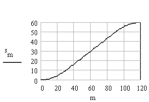

 

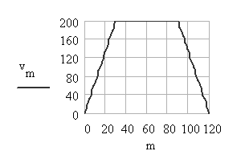

 

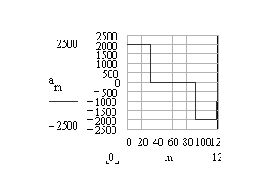

Hareket, hız ve ivme eğrileri

**6. **   ** *Trapezoid İvme Eğrisi* ***** : ***

Açıklanmış olan parabolik veya sabit ivmeli harekette başlangıç ve bitiş noktalarında ivmenin bir basamak şeklinde değişmesi yerine, ivmenin zamana göre türevinin sonsuz olmasını önlemek için diktörtgen şeklinde olan ivme eğrisinin dikey kenarlarını meyillendirerek trapez şeklinde bir ivme diyagramı elde edilebilir. Genellikle ivmenin düzgün değiştiği bu kısım yükselme açısının 1/8 i kadar alınır. Kalan aralıkda sabit ivmeli hareket vardır. Trapezoid ivme eğrisi:

a.     Parabolik eğriye göre titreşim ve gürültüsü daha az, aşınma ve şok etkisi daha uygun kam sistemi ile sonuçlanır.

b.     Üçüncü derece hareket veya sikloidal harekete göre daha küçük kam ebatları ve daha düşük maksimum ivme değerleri elde edilir.

c.     Bağlama açısı aynı taban dairesi için üçüncü derece hareket eğrisine nazaran daha iyidir.

Bu nedenlerden dolayı trapezoid ivme eğrisi (veya bu eğrinin daha iyileştirilmiş şekilleri) bilhassa otomotiv sanayiinde en fazla kullanılan eğridir (İleri tasarım şartlarında bu trapez ivme diyagramında köşelerinde sürekliliğin sağlanması düşünülmelidir).

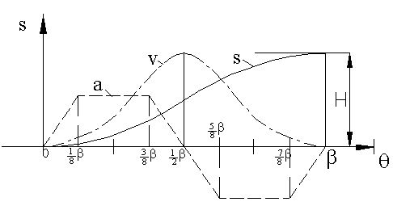

**7.   ** *** Üçüncü Derece Hareket Eğrisi (#1) ****** : ***

İvmenin sabit olmayıp düzgün olarak değişmesi istenilir ise hareket üçüncü dereceden olacaktır. Birinci tip (#1) üçüncü derece hareket eğrisinde ivmenin zamana göre değişimi pozitifdir. Bu nedenle eğri iki üçüncü derece eğrinin birleşiminden elde edilir. Hareketin başlangıç ve bitişinde ivmenin sıfır olması avantajlı isede, orta noktada ivmenin sürekli olmayışı uygulamada sorunlar yaratır (sadme sonsuz olacaktır). Bu nedenle tavsiye edilmemektedir. Analitik olarak hareket, hız ve ivme denklemleri:

0 < θ < β/2 için           β/2 < θ < β için

s = 4Hθ 3 /β 3                 s = H[1 − 4(1 − θ/β) 3 ]

v = 12Hωθ 2 /β 3             v = 12Hω(β − θ) 2 /β 3 

a = 24Hω 2 θ/β 3              a = −24Hω 2 (β − θ)/β 3 

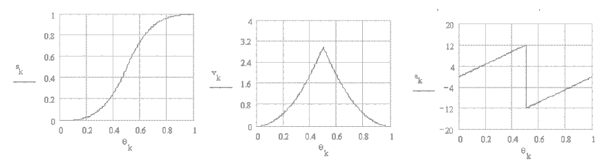

**8.   ** *** Üçüncü Derece Hareket Eğrisi (#2) ****** : ***

İkinci tip üçüncü derece hareket eğrisi ise tek bir eğriden oluşmuştur ve süreklidir. Bu eğriye aynı zamanda 2-3 polinomu da denmektedir. Hareket, hız ve ivme eğrileri Şekilde verilmiştir. Analitik olarak denklemler:

s = Hθ 2 (3β − 2θ)/β 3 

v = 6Hωθ(β − θ)/β 3 

a = 6Hω 2 (β − 2θ)/β 3 

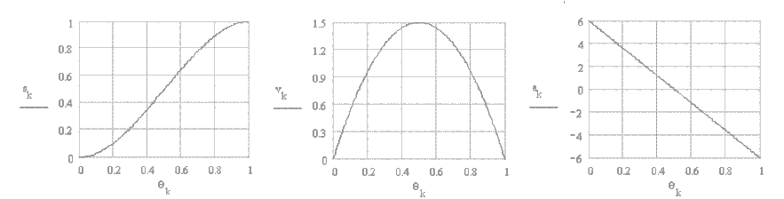

**9.   ** *** Çift Harmonik Hareket ******  Eğrisi ****** : ***

Bu eğri iki harmonik hareketin farkından oluşmaktadır. Şu ana kadar elde edilmiş eğriler simetrik iken, bu eğri simetrik değildir. Bu nedenle Bekleme-Hareket veya Bekleme-Hareket-Doğrusal Hareket gibi durumlarda kullanımı daha uygundur. Hareket, hız ve ivme denklemleri:

 $       s  =   H  2    [   1  −  cos  ⁡   (   πθ  β   )   −   1  4    (   1  −  cos  ⁡   (   2πθ  β   )    )    ]      \displaystyle \text{s}=\frac{\text{H}}{2}\left[ {1-\cos \left( {\frac{{\text{πθ}}}{\text{β}}} \right)-\frac{1}{4}\left( {1-\cos \left( {\frac{{\text{2πθ}}}{\text{β}}} \right)} \right)} \right]    $       s     =                   2               H      ​                  [    1    −    cos      (                β                 πθ       ​                )      −               4              1     ​                  (    1    −    cos      (                β                 2πθ       ​                )      )      ]       

 $       v  =   Hπω   2  β     [   sin  ⁡   (   πθ  β   )   −   1  2   sin  ⁡   (   2πθ  β   )    ]      \displaystyle \text{v}=\frac{{\text{Hπω}}}{{2\text{β}}}\left[ {\sin \left( {\frac{{\text{πθ}}}{\text{β}}} \right)-\frac{1}{2}\sin \left( {\frac{{\text{2πθ}}}{\text{β}}} \right)} \right]    $       v     =                    2   β                  Hπω       ​                  [    sin      (                β                 πθ       ​                )      −               2              1     ​                sin      (                β                 2πθ       ​                )      ]       

 $       a  =    H   π  2    ω  2     2   β  2      [   cos  ⁡   (   πθ  β   )   −  cos  ⁡   (   2πθ  β   )    ]      \displaystyle \text{a}=\frac{{H{{\text{π}}^{2}}{{\text{ω}}^{2}}}}{{2{{\text{β}}^{2}}}}\left[ {\cos \left( {\frac{{\text{πθ}}}{\text{β}}} \right)-\cos \left( {\frac{{\text{2πθ}}}{\text{β}}} \right)} \right]    $       a     =                    2      β             2                         H      π             2               ω             2               ​                  [    cos      (                β                 πθ       ​                )      −    cos      (                β                 2πθ       ​                )      ]       

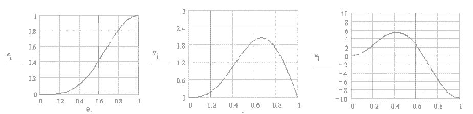

**10.   ** *** Polinom Hareket ******  Eğrileri ****** : ***

Pratikte kullanılan temel hareket eğrileri genel olarak yukarıda açıklanmış olan hareket eğrileridir. Ancak yüksek hızlarda ve özel uygulamalarda değişik hareket eğrileri kullanılabilir. Bu eğrilerde dördüncü türeve kadar süreklilik aranmaktadır. Çok sayıda harmoniklerden oluşan hareket eğrilerinin titreşim açısından uygun olmadığı görülmüştür. Çeşitli çalışmalarda sabit ivme – parabolik hareket eğrisini trapezoid iv-mede olduğu gibi, düzeltme yolları araştırılmıştır (örneğin ilk 1/8 de doğrusal ivme yerine harmonik ivme gibi). Bir başka yaklaşım ise çeşitli derecede bir polinomların hareket eğrisi olarak kullanılmasıdır.

Bir polinomun genel denklemi:

s = c 0  + c 1 θ + c 2 θ 2  + … + c n θ n 

dir. Burada:

s : izleyici hareketi

θ : kam dönme açısı

c i  : sabit değerler (i = 0, …, n)

n : polinom derecesi

Bu polinomun kam açısı β kadar döndüğünde izleyiciyi H kadar yer değiştirmesi istendiği gibi başlangıç ve bitişte bekleme olduğundan bu konumlarda izleyicinin hızı, ivmesi sıfır olması gerekir (bu şekilde, bekleme ile başlayıp biten harekette süreklilik sağlanabilir):

θ = 0 iken          θ = β iken

s = 0                   s = H

v = 0                   v = 0

a = 0                   a = 0

olması gerekir. Bu altı sınır şartın sağlanabilmesi için polinomda altı sabit bulunmalı, yani polinom beşinci dereceden olmalıdır. Bu polinom ve türevleri:

s = c 0  + c 1 θ + c 2 θ 2  + c 3 θ 3  + c 4 θ 4  + c 5 θ 5 

v/ω = c 1  + 2c 2 θ + 3c 3 θ 2  + 4c 4 θ 3  + 5c 5 θ 4 

a/ω = 2c 2  + 6c 3 θ + 12c 4 θ 2  + 20c 5 θ 3 

olacaktır. Yukarıda verilmiş olan sınır şartlar kullanıldığında:

0 = c 2 

H = c 0  + c 1 β + c 2 β 2  + c 3 β 3  + c 4 β 4  + c 5 β 5 

0 = c 1 

0 = c 1  + 2c 2 β + 3c 3 β 2  + 4c 4 β 3  + 5c 5 β 4 

0 = 2c 2 

0 = 2c 2  + 6c 3 β + 12c 4 β 2  + 20c 5 β 3 

c 0  = c 1  = c 2  = 0 değerleri diğer denklemlerde kullanılırak diğer üç denklem bilinmeyen diğer üç katsayı için çözüldüğünde:

 $        c  3   =  10   H   β  3       ,      c  4   =  −  15   H   β  4       ,      c  5   =  6   H   β  5       \displaystyle {{\text{c}}_{3}}=10\frac{\text{H}}{{{{\text{β}}^{3}}}}\text{   ,   }{{\text{c}}_{4}}=-15\frac{\text{H}}{{{{\text{β}}^{4}}}}\text{   ,   }{{\text{c}}_{5}}=6\frac{\text{H}}{{{{\text{β}}^{5}}}}    $          c             3      ​               =        10                  β             3                         H      ​                  ,          c             4      ​               =        −  15                  β             4                         H      ​                  ,          c             5      ​               =        6                  β             5                         H      ​                 

 $       s  =  H    (   θ  β   )   3    [   10  −  15   θ  β   +  6    (   θ  β   )   2    ]      \displaystyle \text{s}=\text{H}{{\left( {\frac{\text{θ}}{\text{β}}} \right)}^{3}}\left[ {10-15\frac{\text{θ}}{\text{β}}+6{{{\left( {\frac{\text{θ}}{\text{β}}} \right)}}^{2}}} \right]    $       s     =         H        (                β                θ      ​                )              3               [    10    −    15              β                θ      ​                +    6        (                β                θ      ​                )               2             ]       

 $       v  =  30  H   ω  β     (   θ  β   )   2    [   1  −  2   θ  β   +    (   θ  β   )   2    ]      \displaystyle \text{v}=30\text{H}\frac{\text{ω}}{\text{β}}{{\left( {\frac{\text{θ}}{\text{β}}} \right)}^{2}}\left[ {1-2\frac{\text{θ}}{\text{β}}+{{{\left( {\frac{\text{θ}}{\text{β}}} \right)}}^{2}}} \right]    $       v     =        30   H               β                ω      ​                   (                β                θ      ​                )              2               [    1    −    2              β                θ      ​                +          (                β                θ      ​                )               2             ]       

 $       a  =  60  H    (   ω  β   )   2    (   θ  β   )    [   1  −  3   θ  β   +  2    (   θ  β   )   2    ]      \displaystyle \text{a}=60\text{H}{{\left( {\frac{\text{ω}}{\text{β}}} \right)}^{2}}\left( {\frac{\text{θ}}{\text{β}}} \right)\left[ {1-3\frac{\text{θ}}{\text{β}}+2{{{\left( {\frac{\text{θ}}{\text{β}}} \right)}}^{2}}} \right]    $       a     =        60   H        (                β                ω      ​                )              2               (                β                θ      ​                )        [    1    −    3              β                θ      ​                +    2        (                β                θ      ​                )               2             ]       

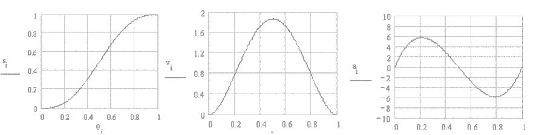

Bu polinom literatürde 3-4-5 polinomu olarak bilinmektedir. Yüksek dereceli polinomların hareket eğrilerinde başlangıç ve bitiş noktalarında gittikçe daha az izleyici hareketi olacaktır. Bu tür eğrilerin kamda gerçekleştirilebilmesi için çok hassas imalat gereklidir. Örneğin başlangıç ve bitiş noktalarında üçüncü türevinde sıfır olması şartı getirilir ise (

 = 0), sınır şartı sekize çıkacak ve yedinci derece bir polinom ile sınır şartlar sağlanacaktır. Ancak iki uç noktada hareketin az olması, ara konumlarda hızın ve ivmenin daha yüksek olmasını gerektirecektir. Bu nedenlerden dolayı, kullanılacak eğriye hem imalat ve hemde uygulamanın gerektirdiği şartlar birlikte göz önüne alınarak karar verilmelidir.

---

<!-- Kısım 6 -->
# 8.4 Kam Boyutu Belirleme

Amacımız elde ettiğimiz hareket eğrisini verecek bir kam profilini elde etmektir. Aynı hareket eğrisini verecek farklı boyutlarda kam imal edilebilir. Kam boyutlarını karşılaştırmak için temel daire çapı esas alınacaktır. Uygulamalarda kam boyutunu mümkün olduğunca küçük almak istenir. Bunun nedeni kam boyutu büyüdükçe:

 

-      Daha fazla alan kapsayacaktır.

-      Dengesiz kütle artacaktır.

-      İzleyici toparlağı bir devirde daha uzun bir yörünge izleyecek, yüzey hızı artacaktır.
 

Ancak Kam boyutu küçüldükçe mekanizmada bazı sakıncalar oluşacaktır. Bunlar:

 

-      Kam profili daha dik eğimli olacak ve bağlama açısı daha kötü değerlerde olacaktır.

-      Kam profilinde eğrilik yarıçapı çok düşük veya eğri olduğu kısımlar olacaktır (ki bu durumda kam çalışamaz).

-      Belirli bir yük altında çalışan kamın kam milinin etki eden momente göre hesaplanan bir çapı vardır. Kamın temel daire çapı mil çapından küçük olamaz (bu husus bilhassa motor kamlarında önemlidir).
 

Uygulamada bağlama açısı kamın minimum gerekli boyutunu belirlemekte kullanılır. Diğer hususlar (örneğin minimum eğrilik yarıçapı, vb), kullanılarak gerektiğinde bulunan bu minimum boyut artırılır.

# Bağlama Açısı

Dördüncü bölümde belirtildiği gibi, bağlama açısı bir mekanizmada kuvvet iletimi özelliklerini belirleyen en basit ve kolay kinematik parametredir. Dördüncü bölümde verilmiş olan tanıma göre:

 $        tan  ⁡  μ  =     I  ˙   zleyici uzvunu hareket ettirmeye çalışan kuvvet bileşkesi     I  ˙   zleyici uzvu yataklarında yatak kuvveti oluşturan kuvvet bileşkesi        \displaystyle {\tan \text{μ}=\frac{\text{İzleyici uzvunu hareket ettirmeye çalışan kuvvet bileşkesi}}{\text{İzleyici uzvu yataklarında yatak kuvveti oluşturan kuvvet bileşkesi}}}   $       tan     μ     =                       I       ˙        zleyici uzvu yataklar  ı  nda yatak kuvveti olu  ş  turan kuvvet bile  ş  kesi                       I       ˙        zleyici uzvunu hareket ettirmeye çal  ış  an kuvvet bile  ş  kesi      ​                  

dir. Bu tanıma göre şekilde toparlaklı öteleyen ve salınan kam mekanizmaları için bağlama açısı gösterilmiştir. Düz yüzeyli izleyiciler için bağlama açısı tanımı kullanılamaz. Ayrıca kuvvet kapalı kamlarda yükselme sırasında izleyici kam tarafından itilecektir, geri dönüş sırasında ise genellikle yay ile oluşturulan dış kuvvet izleyici ile kam arasında temesı sağlayacak, kam tarafından izleyiciye bir kuvvet iletilmeyecektir. Bu nedenle kuvvet kapalı kamlarda yükselme sırasında bağlama açısı önemlidir.

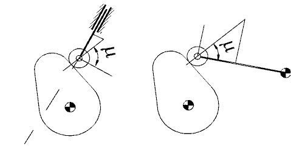

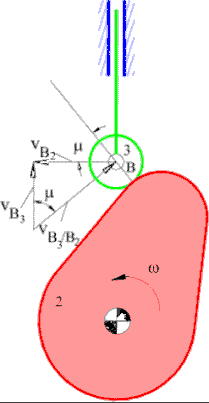

---

<!-- Kısım 7 -->
# 8.5 Kam Profilinin Elde Edilmesi

Temel dairesi yarıçapı ve hareket diyagramı belirlendikten sonra kam profilinin elde edilmesi için önceden toparlaklı santrik izleyicili radyal kamda açıklandığı gibi, kinematik yer değişim yapılarak, kam sabit tutulur. Sabit uzuv kama göre dönecek (kamın sabit uzva göre dönme yönünün ters yönünde) ve bu arada izleyici bağıl konumu hareket eğrisine göre belirlenecektir. İzleyicinin her kam açısına göre aldığı konum bir eğri demetini oluşturacaktır. Bu eğri demetinin her bir eğrisine teğet olarak çizilen eğri kam profilidir. Aşağıdaki şekilde ise düz yüzeyli öteleme yapan izleyicili radyal kam profilinin belirli bir hareket eğrisi için elde edilmesi gösterilmektedir.

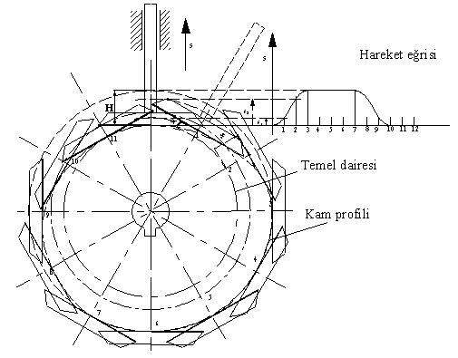

---

<!-- Kısım 8 -->
# Düz yüzeyli öteleme yapan izleyicili radyal kam profilinin elde edilmesi:

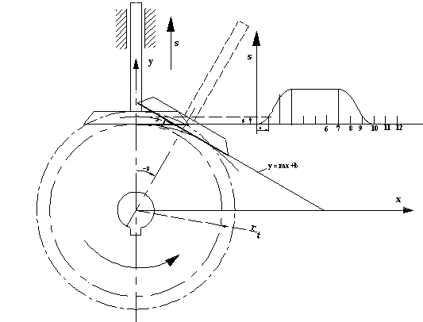

Şimdi zarf teorisini düz yüzeyli öteleme yapan radyal kam için uygulayalım. Hareket eğrisi s(θ) ve ve türevleri kamın tam bir devri için bilinmektedir. Her hangi bir θ açısı ve buna karşı gelen s yükselme uzunluğunda izleyicinin kama göre bağıl konumu yukarıda görülmektedir.

---

<!-- Kısım 9 -->
# Hareket eğrilerinin “Normalizasyonu”

Yukarıda verilen eğrileri birbirleri ile karşılaştırmak için bu eğrilerin “normalize” edilmesi gerekmektedir. Normalizasyon hareket denklemlerinde H, ω ve β değerlerinin

ω = 1 rad/s

H = 1 birim

β = 1 radyan

olarak alınması ile yapılır. Karşılaştırmak için şekilde çeşitli eğrilerin hız, ivme ve ivme değişim diyagramları gösterilmiştir. C v , C a  ve C j , normalize edilmiş hareket eğrilerinin maksimum hız, ivme ve ivme değişim değerleridir. Her hangi H, ω ve β değeri için maximum hız, ivme ve ivme değişim değeri (sadme) bulunmak istendiğinde:

v max  = C v Hω/β

a max  = C a Hω 2 /β 2 

j max  = C j Hω 3 /β 3 

olarak elde edilir. Her hangi bir H yükselme ve b kam dönme hareketi için yazmak istediğimizde, normalize edilmiş eğri denklemini H ile çarpmak ve θ açısı yerine θ/β yerleştirmek yeterlidir. Örneğin normalize edilmiş üçüncü derece hareket eğrisi (#2):

s = 3θ 2  + 2θ 2 

olarak verildiğinden, denklemi H ile çarpar θ açısı yerine θ/β yerleştirir isek:

s = H[3(θ/β) 2  − 2(θ/β) 3 ]

veya

s = H(θ/β) 2 (3 − 2θ/β)

olacaktır. Bu eğrinin maksimum hız ve ivme değerleri: v max  = 1.5Hω/β, a max  = 6H(ω/β) 2  dir.

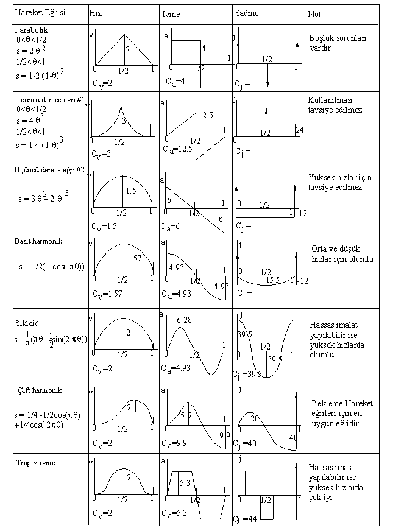

θ = 0 dan başlayan ve θ = β da s = H kadar yükselen bu eğriler, merkez değiştirme ve H yüksekliğinden çıkarma yapılarak geri dönüş eğrisi olarak da kullanılabilir. Bu işlemler şekilde gösterilmektedir. Örneğin eğrinin θ = γ açısında yükselmeye başlaması için eğri denkleminde her q terimi yerine (θ − γ) terimi yerleştirebilir, bu eğriyi geri dönüş eğrisi yapmak için ise, bu yükseliş eğrisi denklemini (s(θ)), H değerinden çıkarmak gereklidir. f(θ) = H − s(θ) denklemi θ = 0 da başlayan geri dönüş denklemidir. f(θ) = H − s(θ − γ) ise θ = γ da başlayan geri dönüş denklemi olur ). Çift harmonik dışında tüm eğriler simetrik olduğundan elde edilen eğriler yine istenilen özelliklere sahip olacaktır.

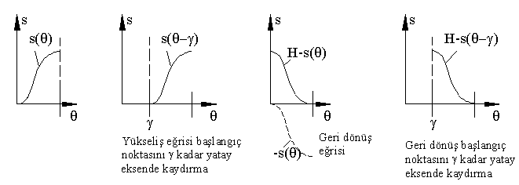

##

---

<!-- Kısım 10 -->
# Toparlaklı, öteleme yapan izleyicili radyal kam profilinin elde edilmesi:

Hareket eğrisi s(θ) ve türevleri kamın tam bir devri için bilinmektedir. Şekilde gösterildiği gibi, izleyici öteleme ekseni kam merkezinden, c kadar kaçıktır (c = 0 oldugunda santrik öteleme yapan izleyici olacaktır).

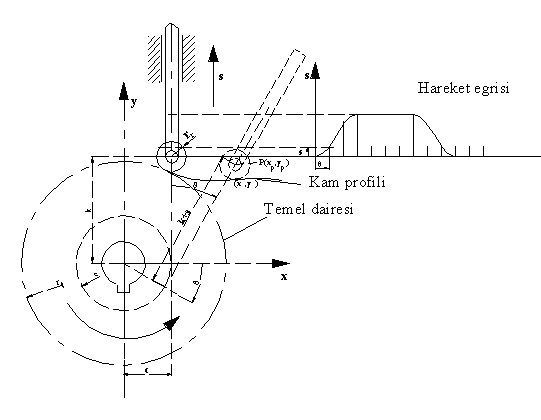

Her hangi bir θ açısı ve buna karşı gelen s yükselme uzunluğunda toparlağın kama göre bağıl konumu yukarıda görülmektedir.

---

<!-- Kısım 11 -->
# Toparlaklı, salınım yapan izleyicili radyal kam profilinin elde edilmesi:

 

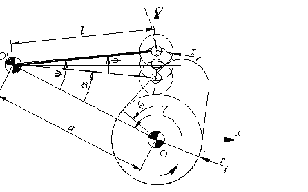

Toparlaklı salynım yapan izleyicili kam mekanizmasının genel şekli yukarıda görülmektedir. İzleyicinin yaptığı toplam salınım açısı ϕ 0  ötelemede H yüksekliğine karşı gelecektir. Toparlak merkezi O′ merkezli daire yayı üzerindedir ve eger *a* ve *l* belirli uzunlukta ise, toparlak merkezinin çizdigi daire yayı bir doğruya çok yakındır. Salınım açısının orta noktasinda izleyici kolu toparlak merkezinden kam merkezine çizilen doğruya dik alinir ise, mekanizma s = *l*ϕ olacak şekilde öteleme yapan izleyici şeklinde yaklaşık olarak düşünülebilir ve öteleme yapan izleyicili kam mekanizması için gösterilmiş olan bağlama açısı hesapları benzer bir şekilde kamın temel daire yarıçapını bulmak için kullanilabilir.

---

<!-- Kısım 12 -->
# Şekil kapalı kam profili:

Bilhassa dokuma ve paketleme makinalarında izleyicinin kuvvet kapalı hareketi, geri dönüşte pozitif bir hareket olmadığından (etki eden kuvvete bağlı olduğundan) istenmez (dinamik etkilerden dolayı iki yüzey temas etmeyerek izleyici kam üzerinde “zıplayabilir”. Bu durumda izleyici hareketi kontrol dışıdır. Bunun yerine toparlaklı izleyiciler için elde edilen içten ve dıştan temas eden kam profili eğrileri birlikte kullanılarak şekil kapalı kam çifti oluşturulabilir. Ancak bu içten ve dıştan temaslı kamların imalatı çok fazla hassasiyet gerektirecektir (boşluk çok az olmalıdır) ve genellikle içten temas eden kam yüzeyinin işlenmesi zordur. Bu nedenle bir çok uygulamada aynı hareket eğrisini veren iki değişik kam eğrisi ve iki değişik izleyici tasarlanır ve iki kam birbirine rijit bağlandığı gibi iki izleyici de birbirine rijit olarak bağlanarak şekil kapalı mekanizma elde edilir.

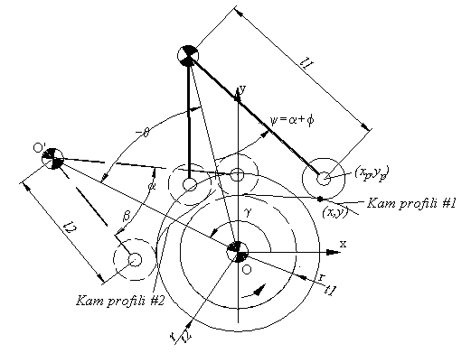

Yukarıda salınım yapan toparlaklı izleyici için iki toparlak ve iki kam profili elde edilmesi gösterilmektedir. Birinci ve ikinci kam profilleri için toparlaklı salınım yapan izleyici için verilen denklemler ile aynı olmalıdır. Verilen denklemler aynen geçerlidir, ancak 2 ve 4 numarali denklemlerde birinci kam profili için (γ + α + ϕ − θ) açı terimi kullanılmalı, ikinci kam profili için ise bu terim yerine (γ − β + ϕ − θ) terimi kullanılmalıdır. İki kam profilinin farklı temel daire yarıçapı vardır (bağlama açısının her iki kam profilinde aynı olması için ikinci kam profili temel daire yarıçapı birinci kam profilinin maksimum çapına eşit olmalıdır). Kol uzunlukları ve toparlak yarıçapları istenir ise farklı alınabilir (eşit alınması da mümkündür).

Örnek 7 de gösterilmiş olan toparlaklı salınım yapan izleyicili radyal kamı şekil kapalı yapmak için ikinci kam profilini de tasarladığımızda (kesik çizgi) asağıda ilk konumda (θ = 0°) ve θ = 120° (SYT) olacak şekilde kamın döndüğü ve izleyicinin ψ = 40° (SYT) salınım yapmış olduğu konumlarda görülmektedir (ikinci kam profili için r t  = 240 mm, kol boyu ve toparlak çapı her iki kam için aynı alınmıştır. MathCad kullanılarak elde edilen profil eğrisi değerleri mekanizmanın AutoCad te çiziminde kullanılmıştır). Dikkat edilir ise, iki eş hareketli kam profili birbirine benzememektedir (genelde benzemez. Eğer hareket diyagramında kalkış, iniş aynı kam dönme açısında aynı eğri kullanılarak yapılır ve üst ve alt konumlarda bekleme süresi aynı olur ise ikinci kam birinci kamın belirli bir derece döndürülmüş şekli olur).

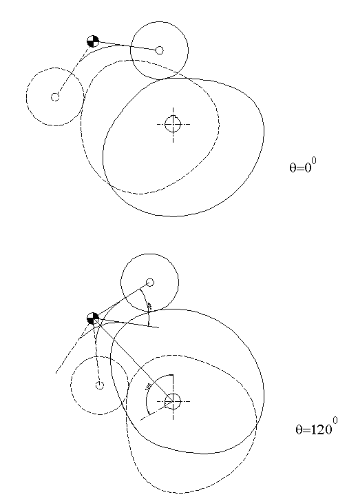

---